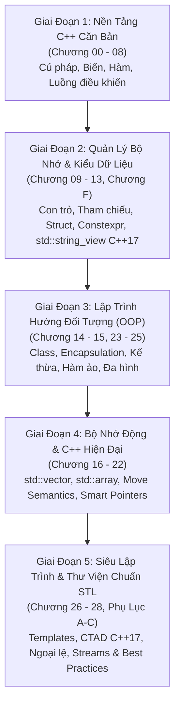

## 🗺️ Lộ Trình Chinh Phục Siêu Giáo Trình (Chuẩn C++17)

---

> [!NOTE] Vì Sao C++17 Là Tiêu Chuẩn Nền Tảng Lý Tưởng?
> C++17 được mệnh danh là "chuẩn mực vàng" trong ngành công nghiệp phần mềm hiện nay:
> - Hầu hết các thư viện lớn, game engine (Unreal Engine 5), và hệ thống sản xuất tại các công ty công nghệ đều hỗ trợ tối đa C++17.
> - C++17 bổ sung các tính năng cực kỳ mạnh mẽ như `std::string_view` (xử lý chuỗi không cần cấp phát heap), `std::optional` (xử lý giá trị rỗng an toàn), Structured Binding (`auto [x, y]`), `if constexpr`, và biến `inline`.
> - Toàn bộ mã nguồn trong giáo trình này đều chạy trơn tru trên mọi trình biên dịch C++17 (GCC 7+, Clang 5+, MSVC 2017+).
