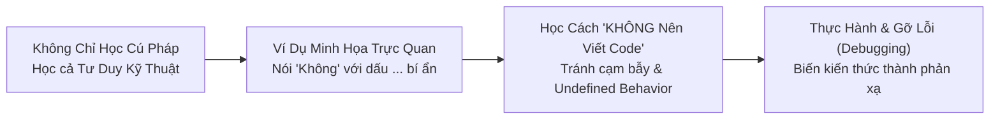

# 0.1 — Giới Thiệu Khóa Học & Phương Pháp Học C++ Đỉnh Cao

---

## 🎯 Mục Tiêu Bài Học
- Hiểu rõ triết lý thiết kế và mục tiêu của toàn bộ bộ giáo trình C++.
- Nắm vững phương pháp học lập trình hiệu quả: "Gõ từng dòng code - Tự tay gỡ lỗi - Thử nghiệm phá vỡ code".
- Định hình lộ trình từ người mới bắt đầu đến làm chủ tư duy phần cứng và C++ hiện đại (Modern C++).

---

## 1. Chào Mừng Bạn Đến Với Siêu Giáo Trình C++!

Chào mừng bạn đến với chuỗi bài giảng C++ toàn diện nhất! Mục tiêu cao nhất của bộ giáo trình này là **biến việc học C++ trở nên trực quan, dễ tiếp cận nhưng đạt độ sâu học thuật chuẩn quốc tế**.

Không giống như nhiều cuốn sách giáo khoa truyền thống hay các trang web khác thường mặc định bạn đã biết lập trình, bộ giáo trình này **không yêu cầu bạn phải có bất kỳ kinh nghiệm lập trình nào trước đó**. Chúng tôi sẽ dẫn dắt bạn qua từng khái niệm từ số 0, đi kèm vô số ví dụ thực tế và giải thích cặn kẽ bản chất ở cấp độ bộ nhớ phần cứng.

Dù bạn học C++ vì đam mê, để phục vụ học tập, thi đấu lập trình hay định hướng trở thành kỹ sư phần mềm chuyên nghiệp trong các ngành đòi hỏi hiệu năng tối thượng (Game Engine, Hệ thống nhúng, Tài chính HFT, AI Infrastructure), bạn đã đặt chân đến đúng nơi!

> **Lời nhận xét từ độc giả quốc tế (Syam - Trinidad):**
> 
> *"Thật kinh ngạc trước cách giải thích các khái niệm C++ chuẩn xác và mạch lạc của trang web này. Tôi từng đọc cuốn 'Programming: Principles and Practice Using C++' của Bjarne Stroustrup (cha đẻ C++) nhưng cảm thấy khá rối rắm... Bộ giáo trình này làm mọi thứ sáng tỏ ngay từ lần đầu tiên. Dường như tác giả biết trước những gì tôi chưa hiểu và những gì tôi sắp phạm sai lầm. Cảm giác như chính phiên bản tương lai của tôi đã quay ngược thời gian để dạy tôi tránh khỏi các cạm bẫy vậy."*

---

## 2. Cấu Trúc Khóa Học

- **Chương Khởi Động (Chương 00)**: Giúp bạn hiểu rõ bối cảnh ra đời của C++, cách máy tính thực thi chương trình, cấu trúc compiler/linker, và cách thiết lập môi trường lập trình tối ưu (VS Code, CLion, Visual Studio, GCC/Clang).
- **Chương Nền Tảng (Chương 01 - 08)**: Cung cấp cái nhìn bao quát về cú pháp, biến, câu lệnh, hàm, kiểu dữ liệu, toán tử và cấu trúc điều khiển để bạn có thể tự tay viết được các chương trình đầu tiên.
- **Các Chương Chuyên Sâu (Chương 09 - 28)**: Đi sâu vào những đặc trưng quyền năng nhất của C++: Quản lý bộ nhớ, Con trỏ & Tham chiếu, Hướng đối tượng (OOP), Hàm ảo & Đa hình, Move Semantics, Smart Pointers, Templates và Thư viện chuẩn STL.

Mỗi chương đều có một chủ đề trọng tâm. Bạn không cần phải vội vã; hãy học theo nhịp độ thoải mái nhất đối với bạn.

---

## 3. Các Mục Tiêu Cốt Lõi Của Giáo Trình

1. **Bao quát cả tư duy lập trình hệ thống lẫn ngôn ngữ C++**: Sách giáo khoa thường chỉ dạy cú pháp mà bỏ qua các chủ đề thực chiến sống còn: phong cách lập trình (code style), cạm bẫy kinh điển (pitfalls), kỹ năng gỡ lỗi (debugging), quy tắc tối ưu hóa và kiểm thử. Học xong giáo trình này, bạn không chỉ biết *cách viết C++*, mà còn biết **cách KHÔNG NÊN viết C++** để tránh các lỗi rò rỉ bộ nhớ hay sập hệ thống (crash).
2. **Cung cấp ví dụ đầy đủ, rõ ràng**: Tuyệt đối tránh hai "căn bệnh" phổ biến của tài liệu lập trình:
   - Dấu ba chấm bí ẩn `...`: Cắt xén mã nguồn khiến người học không biết đặt code vào đâu để chạy.
   - Khái niệm mới chưa giải thích: Đưa một cấu trúc phức tạp vào ví dụ mà không giải thích nó hoạt động ra sao.
3. **Thực hành liên tục với hệ thống Quiz có lời giải chi tiết**: Cuối mỗi bài học đều có bài tập và câu hỏi trắc nghiệm kiểm tra độ hiểu sâu, giúp bạn tự củng cố và lấp đầy lỗ hổng kiến thức ngay lập tức.
4. **Giữ tinh thần hào hứng khi học**: Lập trình phải mang lại niềm vui sáng tạo. Nếu bạn cảm thấy mệt mỏi hoặc bế tắc khi debug, hãy ngủ một giấc thật ngon và quay lại vào sáng hôm sau; bạn sẽ thấy vấn đề được giải quyết nhanh hơn rất nhiều!

---

## 4. Phương Pháp Tối Ưu Hóa Trải Nghiệm Học Tập

::: tip Thực hành tốt nhất (Best Practice)
1. **Tự tay gõ lại code (Type by hand)**: Đừng copy-paste! Việc tự gõ từng ký tự giúp ngón tay và não bộ hình thành phản xạ với cú pháp C++, đồng thời giúp bạn làm quen với các thông báo lỗi của Compiler khi gõ sai.
2. **Chủ động tìm và sửa lỗi (Self-debugging)**: Khi chương trình báo lỗi hoặc chạy sai, hãy đọc kỹ thông báo lỗi và dùng Debugger để truy vết từng bước trước khi đi hỏi người khác. Kỹ năng gỡ lỗi là kỹ năng phân loại lập trình viên giỏi.
3. **Tự tay 'phá vỡ' chương trình (Experiment & Break code)**: Thay đổi số liệu, đổi kiểu biến, nhập chữ khi chương trình yêu cầu nhập số. Xem điều gì sẽ xảy ra! Bạn sẽ học được nhiều nhất khi thấy chương trình bị lỗi và hiểu tại sao nó lại lỗi.
4. **Làm hết các câu hỏi Quiz & Bài tập**: Đừng vội bấm xem lời giải khi chưa thực sự suy nghĩ ít nhất 5-10 phút.
:::

---

## 5. Câu Hỏi Thường Gặp (FAQ)

::: info Hỏi: Tôi có cần đăng ký tài khoản để học không?
**Trả lời**: Hoàn toàn không! Mọi bài học, tài liệu, mã nguồn và hệ thống quiz đều mở công khai 100% để bất kỳ ai cũng có thể học tập thuận tiện nhất.
:::

::: info Hỏi: Tôi nên dùng hệ điều hành nào (Windows, Linux hay macOS)?
**Trả lời**: C++ là ngôn ngữ đa nền tảng (cross-platform). Dù bạn dùng Windows, Ubuntu/Linux hay macOS, bạn đều có thể biên dịch và chạy các chương trình trong giáo trình này mà không gặp trở ngại nào.
:::
