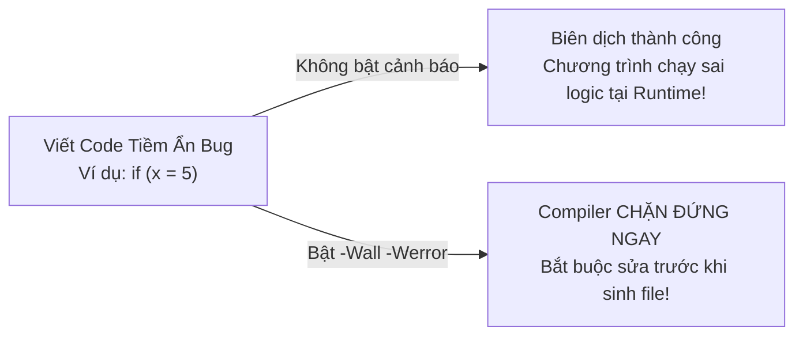

# 0.11 — Thiết Lập Mức Độ Cảnh Báo Và Lỗi (Warnings & Errors)

---

## 🎯 Mục Tiêu Bài Học
- Hiểu sự khác biệt giữa Lỗi (Error) và Cảnh báo (Warning).
- Hiểu vì sao cảnh báo là những "mầm mống lỗi tai hại" trong tương lai.
- Kích hoạt bộ cờ cảnh báo tối thượng chuẩn công nghiệp: `-Wall -Wextra -Wpedantic -Werror`.

---

## 1. Cảnh Báo (Compiler Warning) Là Gì?

- **Lỗi (Error)**: Mã nguồn vi phạm ngữ pháp C++, Compiler **từ chối sinh file chạy**.
- **Cảnh báo (Warning)**: Mã nguồn đúng cú pháp và chương trình vẫn sinh ra file chạy bình thường, nhưng Compiler nhận thấy **đoạn code đó có mùi bất thường hoặc tiềm ẩn nguy cơ lỗi logic cực cao** (ví dụ: gán nhầm trong câu điều kiện `if (x = 5)`, biến khai báo nhưng không dùng, so sánh số có dấu với không dấu).

---

## 2. Quy Tắc Vàng Của Dân Chuyên Nghiệp: Biến Cảnh Báo Thành Lỗi!

Lập trình viên nghiệp dư thường phớt lờ cảnh báo vì thấy chương trình vẫn chạy được. Lập trình viên cấp cao tại các tập đoàn công nghệ lớn coi **Warning chính là Bug**!

Trong các dự án phần mềm chuẩn quân đội hay hệ thống nhúng quan trọng, người ta luôn bật cờ `-Werror`: bất kỳ một cảnh báo nào xuất hiện cũng sẽ lập tức dừng quá trình build lại như một lỗi nghiêm trọng.



---

## 3. Bộ Cờ Cảnh Báo Chuẩn Cho GCC & Clang

Hãy luôn thêm các cờ sau vào lệnh biên dịch hoặc cấu hình CMake của bạn:

```bash
g++ -std=c++20 -Wall -Wextra -Wpedantic -Werror main.cpp -o main
```

- `-Wall`: Bật hầu hết các cảnh báo thông dụng (All common warnings).
- `-Wextra`: Bật thêm các cảnh báo nâng cao và khắt khe hơn.
- `-Wpedantic`: Bắt buộc tuân thủ nghiêm ngặt 100% chuẩn ISO C++.
- `-Werror`: Biến tất cả các cảnh báo thành lỗi, ngăn chặn sinh mã khi code còn "mùi".
