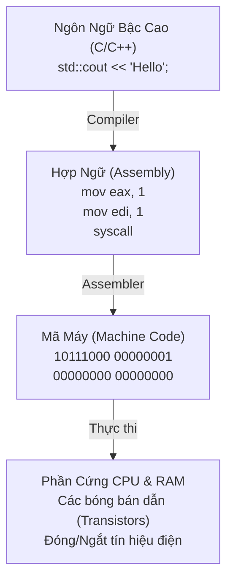

# 0.2 — Chương Trình và Ngôn Ngữ Lập Trình

---

## 🎯 Mục Tiêu Bài Học
- Hiểu cấu trúc máy tính: CPU, RAM và tập chỉ thị phần cứng.
- Phân biệt 3 cấp độ ngôn ngữ: Mã máy (Machine Language), Hợp ngữ (Assembly), Ngôn ngữ bậc cao (High-level Language).
- Hiểu sự khác biệt cơ bản giữa Trình biên dịch (Compiled) và Trình thông dịch (Interpreted).

---

## 1. Bản Chất Của Máy Tính: Phần Cứng Hoạt Động Như Thế Nào?

Máy tính hiện đại có sức mạnh xử lý hàng tỷ phép tính mỗi giây, nhưng bản chất bên trong CPU lại cực kỳ đơn giản: **CPU chỉ là một hệ thống mạch điện tử tuân theo các tín hiệu đóng/ngắt (0 và 1)**.

CPU được thiết kế với một tập hợp các chỉ thị cố định được gọi là **Tập lệnh máy (Instruction Set Architecture - ISA)**, ví dụ như x86_64 của Intel/AMD hoặc ARM64 của Apple Silicon / Qualcomm.



---

## 2. Các Cấp Độ Ngôn Ngữ Lập Trình

### 2.1. Mã Máy (Machine Code / Machine Language)
- Là chuỗi nhị phân gồm các số `0` và `1` mà CPU có thể đọc và thực thi trực tiếp.
- **Ví dụ**: `10110000 01100001` (Chỉ thị nạp số 97 vào thanh ghi AL trên vi xử lý x86).
- **Nhược điểm**: Cực kỳ khó đọc, khó nhớ, lập trình viên gần như không thể duy trì dự án lớn bằng mã máy, và mã máy viết cho CPU Intel không thể chạy trên chip ARM.

### 2.2. Hợp Ngữ (Assembly Language)
- Để con người dễ đọc hơn, các nhà khoa học máy tính đã tạo ra **Hợp ngữ (Assembly)**: thay thế các chuỗi 0 và 1 bằng các từ viết tắt gợi nhớ (mnemonic) như `MOV`, `ADD`, `SUB`, `JMP`.
- **Ví dụ**:
  ```nasm
  mov eax, 5      ; Gán giá trị 5 vào thanh ghi EAX
  add eax, 3      ; Cộng thêm 3 vào EAX (EAX = 8)
  ```
- Một chương trình gọi là **Trình hợp dịch (Assembler)** sẽ dịch mã Assembly thành mã máy.
- **Hạn chế**: Vẫn phụ thuộc chặt chẽ vào kiến trúc phần cứng của từng loại chip và tốn quá nhiều dòng lệnh cho một tác vụ đơn giản.

### 2.3. Ngôn Ngữ Bậc Cao (High-Level Languages: C, C++, Rust, Python)
- Cho phép lập trình viên viết code gần với ngôn ngữ tự nhiên và tư duy toán học của con người (dùng từ khóa như `if`, `while`, `for`, `class`).
- **Độc lập phần cứng**: Cùng một đoạn mã nguồn C++, bạn có thể biên dịch để chạy trên máy tính Windows, máy chủ Linux, điện thoại iPhone hoặc chip vi điều khiển nhúng trong ô tô.

---

## 3. Biên Dịch (Compiled) vs Thông Dịch (Interpreted)

| Tiêu chí | Ngôn Ngữ Biên Dịch (C, C++, Rust) | Ngôn Ngữ Thông Dịch (Python, JavaScript) |
| :--- | :--- | :--- |
| **Cơ chế dịch** | Dịch toàn bộ mã nguồn một lần thành tệp thực thi nhị phân (.exe, ELF binary) trước khi chạy | Đọc và dịch từng dòng lệnh tại thời điểm đang chạy (Runtime) thông qua một máy ảo (Interpreter/VM) |
| **Tốc độ thực thi** | **Cực nhanh (Tối đa công suất CPU)** | Chậm hơn từ 10 đến 50 lần do phụ thuộc thông dịch runtime |
| **Phát hiện lỗi** | Bắt lỗi kiểu dữ liệu và cú pháp ngay khi biên dịch (Compile-time) | Thường chỉ phát hiện lỗi khi luồng chạy chạm tới dòng lệnh đó (Runtime error) |
| **Yêu cầu môi trường** | Chạy trực tiếp trên hệ điều hành, không cần cài thêm trình thông dịch | Phải cài đặt Python runtime hoặc Node.js trên máy đích |

::: tip Vì sao C++ vẫn là vị vua của hiệu năng?
C++ là ngôn ngữ biên dịch trực tiếp xuống mã máy bản địa (native machine code) không qua bất kỳ lớp trung gian (garbage collector hay virtual machine) nào. Điều này cho phép lập trình viên kiểm soát chính xác từng byte RAM và từng chu kỳ xung nhịp CPU!
:::

---

## 4. Câu Hỏi Ôn Tập & Củng Cố

::: details Câu hỏi 1: Tại sao CPU không thể thực thi trực tiếp mã C++ mà bắt buộc phải qua trình biên dịch?
**Trả lời**: Vì phần cứng CPU chỉ là các cổng logic điện tử, chỉ hiểu các tín hiệu điện nhị phân 0 và 1 (Mã máy). Trình biên dịch đóng vai trò là một "thông dịch viên tối cao", chuyển đổi cú pháp trừu tượng bậc cao của C++ thành các chuỗi byte mã máy tương thích chính xác với kiến trúc chip của bạn.
:::

::: details Câu hỏi 2: Ưu điểm lớn nhất của ngôn ngữ bậc cao so với hợp ngữ (Assembly) là gì?
**Trả lời**:
1. Khả năng đọc hiểu và bảo trì vượt trội (Readable & Maintainable).
2. Tính độc lập nền tảng phần cứng (Portability): cùng một mã nguồn C++ có thể biên dịch cho nhiều loại chip CPU khác nhau mà không cần viết lại toàn bộ mã từ đầu.
:::
