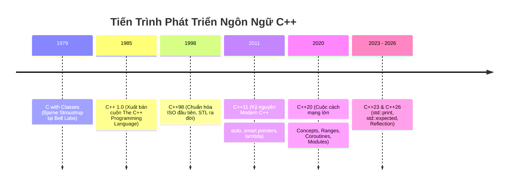

# 0.3 — Giới Thiệu C và C++: Lịch Sử & Sức Mạnh Vượt Thời Gian

---

## 🎯 Mục Tiêu Bài Học
- Hiểu lịch sử hình thành từ ngôn ngữ C của Dennis Ritchie đến C++ của Bjarne Stroustrup.
- Nắm vững triết lý cốt lõi của C++: "Zero-Overhead Principle".
- Hiểu vị thế và ứng dụng thực tế của C++ trong kỷ nguyên công nghệ hiện đại.

---

## 1. Lịch Sử Phát Triển C và C++

### 1.1. Ngôn ngữ C (1972)
- Được phát triển bởi huyền thoại khoa học máy tính **Dennis Ritchie** tại Bell Labs để viết lại hệ điều hành **Unix**.
- C nhanh chóng trở thành ngôn ngữ lập trình hệ thống phổ biến nhất hành tinh nhờ sự gọn nhẹ, linh hoạt và khả năng thao tác trực tiếp với bộ nhớ phần cứng.

### 1.2. Sự ra đời của C++ (1979 - 1985)
- **Bjarne Stroustrup** (nhà khoa học máy tính người Đan Mạch) khi làm luận án tiến sĩ nhận thấy:
  - Ngôn ngữ *Simula* có tính năng Hướng đối tượng (OOP) rất tuyệt vời để mô phỏng hệ thống lớn, nhưng tốc độ chạy quá chậm.
  - Ngôn ngữ *C* chạy cực nhanh nhưng thiếu đi tính năng trừu tượng hóa để quản lý các dự án phức tạp.
- Ông đã kết hợp sức mạnh phần cứng của C với tính năng Lớp (Class) và Hướng đối tượng, đặt tên ban đầu là **"C with Classes"**, sau đó đổi tên thành **C++** vào năm 1983 (toán tử `++` trong C tượng trưng cho việc gia tăng giá trị lên một bậc).

---

## 2. Triết Lý Vàng: "Zero-Overhead Principle"

Bjarne Stroustrup đã đặt ra nguyên tắc vàng bất di bất dịch cho C++:

> 1. **Những gì bạn không dùng, bạn không phải trả giá.** (What you don't use, you don't pay for).
> 2. **Những gì bạn dùng, bạn không thể tự tay viết bằng tay tốt hơn mã do trình biên dịch C++ sinh ra.**

Điều này có nghĩa là mọi tính năng trừu tượng bậc cao trong C++ (như Class, Template, Lambda, Constexpr) đều được tối ưu hóa triệt để tại thời điểm biên dịch, sao cho mã máy sinh ra nhanh ngang bằng, thậm chí vượt trội hơn so với việc một chuyên gia tự viết bằng mã Assembly thô.

---

## 3. C++ Được Ứng Dụng Ở Đâu Trong Thế Giới Thực?

C++ không phải là ngôn ngữ để làm các trang web CRUD thông thường. C++ thống trị tuyệt đối ở bất kỳ nơi nào đòi hỏi **hiệu năng cực hạn (extreme performance), độ trễ cực thấp (low latency) và quản lý tài nguyên nghiêm ngặt**:

1. **Game Engines Đỉnh Cao**: Unreal Engine 5, Unity (C++ Core), CryEngine, toàn bộ các tựa game AAA (GTA, Cyberpunk, Black Myth: Wukong).
2. **Hệ Điều Hành & Trình Duyệt**: Nhân Windows, macOS, Linux, Android/iOS runtime; Google Chrome (V8 engine), Mozilla Firefox.
3. **Tài Chính Định Lượng & Giao Dịch Tần Suất Cao (HFT)**: Các hệ thống giao dịch chứng khoán tại Wall Street (Citadel, Jane Street, Jump Trading) nơi mỗi micro-giây chậm trễ có thể mất hàng triệu USD.
4. **Hạ Tầng Trí Tuệ Nhân Tạo (AI Infrastructure)**: Phần lõi của PyTorch, TensorFlow, CUDA (Nvidia), TensorRT, llama.cpp đều được viết bằng C++ để tối ưu hóa tính toán ma trận trên GPU.
5. **Hàng Không Vũ Trụ & Xe Tự Hành**: Hệ thống điều khiển tên lửa SpaceX Falcon 9, phần mềm tự lái Tesla FSD, robot công nghiệp.

---

## 4. C++ vs C: Mối Quan Hệ Giữa Hai Ngôn Ngữ

::: warning C++ không đơn thuần là "C có thêm Classes"!
Nhiều trường đại học vẫn dạy theo lối mòn: "học C trước rồi học thêm vài tính năng là thành C++". Đây là một sai lầm tai hại dẫn đến việc viết C++ theo phong cách C cổ lỗ sĩ (dùng `malloc`/`free`, mảng thô C-style array, con trỏ thô không an toàn thay vì dùng `std::vector`, `std::unique_ptr`, `std::string`).

C++ là một ngôn ngữ đa mô hình (multi-paradigm) hoàn toàn độc lập với thư viện chuẩn (STL) hùng mạnh và các cơ chế an toàn bộ nhớ hiện đại. Hãy học C++ với tư duy C++ hiện đại ngay từ ngày đầu tiên!
:::
