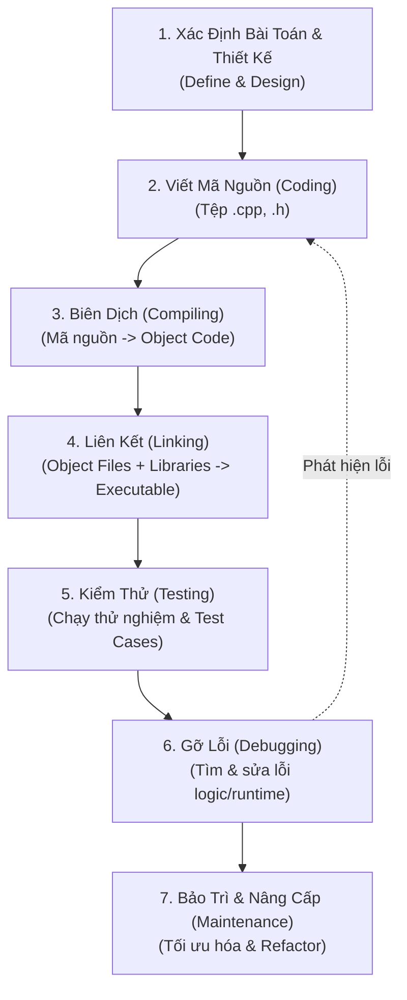

# 0.4 — Quy Trình Phát Triển Phần Mềm Trong C++

---

## 🎯 Mục Tiêu Bài Học
- Hiểu quy trình 7 bước để biến một ý tưởng thành phần mềm C++ chạy thực tế.
- Phân biệt các tệp mã nguồn: `.cpp`, `.h`, `.hpp`.
- Nắm vững tầm quan trọng của việc kiểm thử (Testing) và lập tài liệu (Documentation).

---

## 1. Quy Trình 7 Bước Phát Triển Phần Mềm C++

Phát triển phần mềm không chỉ đơn giản là mở máy tính lên và gõ code. Đây là một quy trình kỹ thuật nghiêm ngặt gồm 7 giai đoạn:

---

## 2. Chi Tiết Từng Bước

### Bước 1: Xác Định Yêu Cầu & Thiết Kế Kiến Trúc
- Trước khi viết một dòng code nào, bạn phải trả lời được câu hỏi:
  - Chương trình này giải quyết vấn đề gì?
  - Dữ liệu đầu vào (Input) là gì? Dữ liệu đầu ra (Output) mong muốn là gì?
  - Cần những thuật toán và cấu trúc dữ liệu nào để đạt hiệu năng tối ưu?

### Bước 2: Viết Mã Nguồn (Source Code)
- Mã nguồn C++ được lưu trong các tệp văn bản thuần (plain text):
  - **Tệp nguồn (Source files)**: thường có phần mở rộng `.cpp` (hoặc `.cc`, `.cxx`).
  - **Tệp tiêu đề (Header files)**: thường có phần mở rộng `.h` hoặc `.hpp`, chứa các khai báo hàm, lớp và hằng số dùng chung giữa nhiều tệp nguồn.

### Bước 3: Biên Dịch (Compiling)
- Trình biên dịch (Compiler) kiểm tra cú pháp, ngữ nghĩa và dịch từng tệp `.cpp` thành một tệp nhị phân trung gian gọi là **Tệp đối tượng (Object File)**, có đuôi `.o` (trên Linux/macOS) hoặc `.obj` (trên Windows).

### Bước 4: Liên Kết (Linking)
- Trình liên kết (Linker) gom các tệp `.o` lại với nhau, liên kết với các thư viện chuẩn (như Thư viện Nhập Xuất `iostream`, Thư viện Toán học `cmath`) để tạo ra một tệp thực thi duy nhất (Executable file, đuôi `.exe` trên Windows hoặc binary không đuôi trên Linux).

### Bước 5 & 6: Kiểm Thử (Testing) và Gỡ Lỗi (Debugging)
- Chương trình biên dịch thành công không có nghĩa là nó chạy đúng!
- Bạn cần chạy thử nghiệm với nhiều bộ dữ liệu khác nhau: dữ liệu hợp lệ, dữ liệu biên (edge cases) và dữ liệu độc hại. Khi phát hiện hành vi sai lệch, bạn sử dụng **Trình gỡ lỗi (Debugger)** để đặt điểm dừng (Breakpoint) và soi từng giá trị biến trong bộ nhớ.

### Bước 7: Bảo Trì & Tái Cấu Trúc (Refactoring)
- Tối ưu hóa hiệu năng, dọn dẹp mã nguồn sạch sẽ (Clean Code) và cập nhật tính năng mới khi yêu cầu thay đổi.
