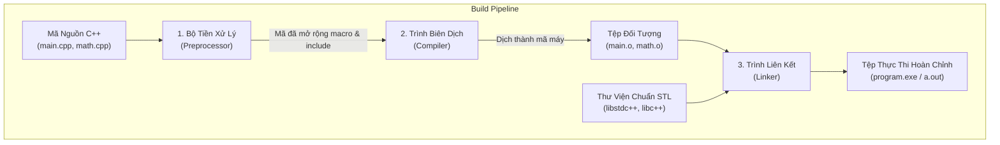

# 0.5 — Trình Biên Dịch (Compiler), Trình Liên Kết (Linker) Và Thư Viện (Libraries)

---

## 🎯 Mục Tiêu Bài Học
- Hiểu chi tiết 3 giai đoạn chuyển hóa mã nguồn: Tiền xử lý (Preprocessor) -> Trình biên dịch (Compiler) -> Trình liên kết (Linker).
- Phân biệt Tệp mã nguồn (`.cpp`), Tệp đối tượng (`.o`/`.obj`), Thư viện tĩnh (`.a`/`.lib`) và Thư viện động (`.so`/`.dll`).
- Nhận biết sự khác biệt giữa Lỗi biên dịch (Compiler Error) và Lỗi liên kết (Linker Error).

---

## 1. Bức Tranh Toàn Cảnh: Từ Code Đến File Thực Thi

Quá trình xây dựng một chương trình C++ (Build Process) bao gồm nhiều công cụ làm việc nối tiếp nhau trong một dây chuyền tự động:

---

## 2. Chi Tiết Từng Công Cụ Trong Dây Chuyền

### 2.1. Bộ Tiền Xử Lý (Preprocessor)
- Chạy đầu tiên trước khi trình biên dịch thực sự bắt tay vào việc.
- Quét qua toàn bộ mã nguồn để xử lý các chỉ thị bắt đầu bằng dấu `#` (như `#include`, `#define`, `#ifdef`):
  - Khi gặp `#include <iostream>`, nó sẽ copy toàn bộ nội dung của tệp `iostream` dán thẳng vào vị trí đó.
  - Xóa bỏ toàn bộ các chú thích (comments) trong code.

### 2.2. Trình Biên Dịch (Compiler)
- Phân tích cú pháp (Syntax Analysis) và ngữ nghĩa (Semantic Analysis) của mã nguồn.
- Nếu có lỗi cú pháp (ví dụ: quên dấu chấm phẩy `;`, sai tên kiểu dữ liệu), nó sẽ dừng lại và báo **Lỗi Biên Dịch (Compiler Error)**.
- Nếu không có lỗi, nó sẽ tối ưu hóa mã và sinh ra mã máy tương ứng cho tệp nguồn đó, lưu vào **Tệp đối tượng (Object file)**. Mỗi tệp `.cpp` sẽ tạo ra một tệp `.o` tương ứng.

### 2.3. Trình Liên Kết (Linker)
- Một dự án thực tế có thể có hàng trăm tệp `.cpp`. Khi hàm `main()` trong `main.cpp` gọi một hàm tính toán nằm trong `math.cpp`, trình biên dịch không thể tự ghép chúng lại với nhau.
- **Linker** chính là "người thợ hàn": nó gom tất cả các tệp `.o` lại, tìm kiếm địa chỉ của các hàm được gọi, kết nối với mã máy của Thư viện chuẩn C++ (Standard Library), và đóng gói thành tệp chạy cuối cùng.

---

## 3. Phân Biệt Lỗi Biên Dịch vs Lỗi Liên Kết

| Loại Lỗi | Khi Nào Xảy Ra? | Dấu Hiệu Nhận Biết | Ví Dụ Điển Hình |
| :--- | :--- | :--- | :--- |
| **Compiler Error** | Khi Compiler đang dịch cú pháp của 1 tệp `.cpp` | Thông báo chỉ rõ số dòng, số cột của tệp bị lỗi | `error: expected ';' before 'return'` |
| **Linker Error** | Sau khi tất cả các tệp `.cpp` đã biên dịch xong, Linker ghép nối mã máy | Thông báo thường chứa từ khóa `undefined reference to ...` hoặc `LNK2019`, không chỉ rõ dòng code | Gọi một hàm mà chỉ mới khai báo prototype nhưng quên chưa viết phần thân hàm |

::: danger Lỗi Linker: Cơn ác mộng của người mới học C++
Nếu bạn thấy trình biên dịch báo lỗi dạng `undefined reference to main` hoặc `unresolved external symbol`, đừng đi tìm lỗi cú pháp trong code! Lỗi này do Linker thông báo rằng nó không thể tìm thấy điểm bắt đầu của chương trình (hàm `main`) hoặc bạn quên chưa liên kết tệp `.cpp` chứa phần định nghĩa hàm vào dự án.
:::
