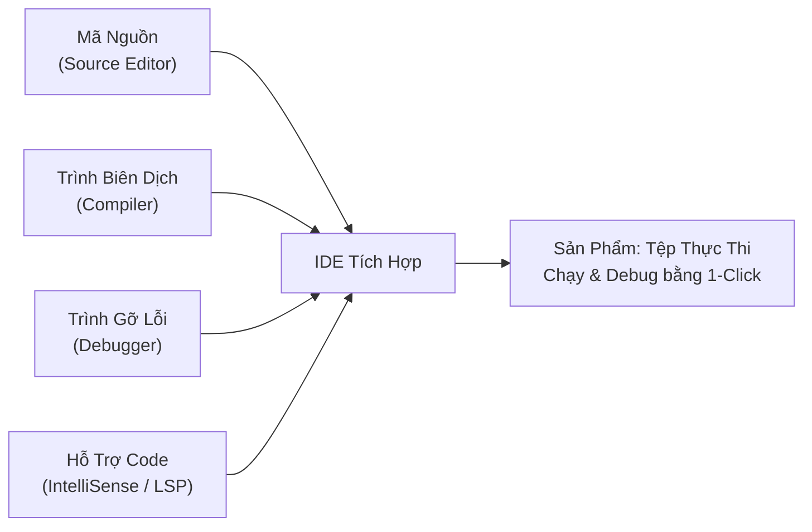

# 0.6 — Cài Đặt Môi Trường Phát Triển Tích Hợp (IDE)

---

## 🎯 Mục Tiêu Bài Học
- Phân biệt giữa Trình soạn thảo văn bản (Editor), Trình biên dịch (Compiler) và Môi trường phát triển tích hợp (IDE).
- Nắm rõ ưu nhược điểm của các IDE phổ biến nhất hiện nay: Visual Studio, CLion, VS Code.
- Cài đặt bộ công cụ biên dịch (Toolchain): GCC / Clang / MSVC.

---

## 1. IDE Là Gì? Vì Sao Bạn Cần Một IDE?

Một môi trường phát triển tích hợp (**Integrated Development Environment - IDE**) là một gói phần mềm "tất cả trong một", kết hợp toàn bộ các công cụ bạn cần để lập trình:



Nếu không dùng IDE, bạn sẽ phải mở tệp văn bản gõ code, mở Terminal gõ lệnh biên dịch thủ công bằng `g++`, sau đó mở một debugger dòng lệnh như `gdb`. Một IDE gom tất cả lại chỉ sau 1 nút bấm (F5 hoặc Run).

---

## 2. Các Lựa Chọn IDE Hàng Đầu

### 2.1. Visual Studio Community (Dành cho Windows - Khuyên Dùng)
- **Ưu điểm**: IDE mạnh mẽ nhất thế giới cho C++ trên Windows. Trình gỡ lỗi (Debugger) trực quan vô đối, bộ phân tích bộ nhớ và hiệu năng đỉnh cao, đi kèm sẵn trình biên dịch MSVC xịn sò của Microsoft.
- **Tải về**: [visualstudio.microsoft.com](https://visualstudio.microsoft.com/) (chọn bản Community - miễn phí).
- **Lưu ý quan trọng khi cài đặt**: Trong quá trình cài, bạn **bắt buộc phải tích chọn gói "Desktop development with C++"**.

### 2.2. Visual Studio Code (Đa nền tảng: Windows, Linux, macOS)
- **Ưu điểm**: Siêu nhẹ, khởi động tức thì, hệ sinh thái Extension khổng lồ, giao diện hiện đại.
- **Các Extension bắt buộc**:
  - `C/C++` (từ Microsoft) hoặc `clangd` (từ LLVM - gợi ý code cực kỳ thông minh).
  - `CMake Tools` (dành cho quản lý dự án C++ chuyên nghiệp).
  - `Code Runner` (để chạy nhanh mã đơn lẻ).

### 2.3. CLion của JetBrains (Chuyên nghiệp / Sinh viên)
- **Ưu điểm**: Khả năng phân tích cú pháp, tái cấu trúc mã (Refactoring) và tích hợp CMake tốt nhất thị trường.
- Miễn phí 100% cho học sinh / sinh viên có email trường học (`.edu`).

---

## 3. Cài Đặt Trình Biên Dịch Dòng Lệnh Trên Linux / macOS

Nếu bạn sử dụng Linux (Ubuntu/Debian) hoặc macOS, bạn có thể cài đặt bộ công cụ chuẩn qua Terminal:

::: code-group
```bash [Ubuntu / Debian]
sudo apt update
sudo apt install build-essential gdb clang cmake -y
# Kiểm tra phiên bản
g++ --version
clang++ --version
```

```bash [macOS]
# Cài đặt Xcode Command Line Tools
xcode-select --install
# Kiểm tra phiên bản
clang++ --version
```
:::
