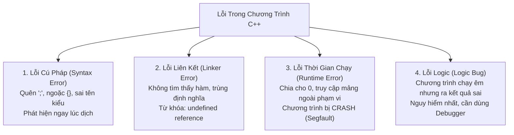

# 0.8 — Các Lỗi C++ Thường Gặp Và Phương Pháp Khắc Phục

---

## 🎯 Mục Tiêu Bài Học
- Phân biệt 4 nhóm lỗi kinh điển: Lỗi cú pháp, Lỗi liên kết, Lỗi thời gian chạy (Runtime crash) và Lỗi logic.
- Nắm vững quy trình đọc thông báo lỗi của Compiler (đọc từ lỗi đầu tiên).
- Rèn luyện tư duy bình tĩnh khi đối mặt với màn hình báo lỗi đỏ rực.

---

## 1. Bản Đồ 4 Nhóm Lỗi Trong C++



---

## 2. Chi Tiết Từng Loại Lỗi & Cách Tự Khắc Phục

### 2.1. Lỗi Cú Pháp (Syntax Error)
- **Nguyên nhân**: Vi phạm ngữ pháp của ngôn ngữ C++ (quên dấu chấm phẩy `;`, mở ngoặc `{` mà quên đóng ngoặc `}`, dùng từ khóa sai quy định).
- **Thông báo mẫu**:
  ```text
  main.cpp:5:35: error: expected ';' before 'return'
  ```
- **Cách xử lý**: Compiler luôn chỉ rõ tên file và dòng bị lỗi (`main.cpp:5`). Hãy nhìn lên dòng đó hoặc dòng ngay phía trên nó để tìm dấu `;` bị thiếu.

### 2.2. Lỗi Liên Kết (Linker Error)
- **Nguyên nhân**: Compiler dịch xong xuôi nhưng Linker không tìm thấy mã máy của hàm được gọi, hoặc có nhiều hơn một hàm cùng tên trong dự án (vi phạm nguyên tắc Một Định Nghĩa - ODR).
- **Thông báo mẫu**:
  ```text
  undefined reference to `main'
  ```
- **Cách xử lý**: Kiểm tra xem bạn đã viết đúng chính tả chữ `main` (viết thường toàn bộ) chưa, hoặc đã thêm file `.cpp` vào danh sách biên dịch chưa.

### 2.3. Lỗi Thời Gian Chạy (Runtime Error / Crash)
- **Nguyên nhân**: Mã nguồn hợp lệ về mặt cú pháp nhưng khi chạy, chương trình yêu cầu CPU thực hiện một thao tác bất khả thi hoặc phi pháp:
  - Chia một số nguyên cho `0`.
  - Truy cập vào vùng nhớ không thuộc quyền sở hữu của chương trình (**Segmentation Fault**).
  - Tràn bộ nhớ ngăn xếp (**Stack Overflow** do đệ quy vô hạn).

### 2.4. Lỗi Logic (Logic Error / Bug)
- **Nguyên nhân**: Chương trình biên dịch hoàn hảo, chạy mượt mà không crash, nhưng **kết quả in ra bị sai** so với yêu cầu bài toán!
- **Ví dụ**: Bạn muốn tính chu vi hình chữ nhật `(dai + rong) * 2` nhưng lại viết nhầm thành `dai + rong * 2`.
- **Cách xử lý**: Đây là loại lỗi khó trị nhất. Bạn phải sử dụng Trình gỡ lỗi (Debugger) để theo dõi giá trị của biến từng bước một.

---

## 3. Nguyên Tắc Vàng Khi Đọc Thông Báo Lỗi

::: tip Hãy luôn sửa lỗi ĐẦU TIÊN được hiển thị!
Khi bạn biên dịch, Compiler có thể phun ra hàng chục, thậm chí hàng trăm dòng thông báo lỗi màu đỏ khiến bạn hoảng loạn.

Đừng lo lắng! Trong 90% trường hợp, chỉ có **một lỗi duy nhất ở dòng đầu tiên**, và các lỗi bên dưới chỉ là hệ quả dây chuyền do Compiler bị mất phương hướng khi phân tích tiếp. Hãy kéo lên trên cùng, đọc và sửa đúng lỗi đầu tiên, sau đó biên dịch lại!
:::
