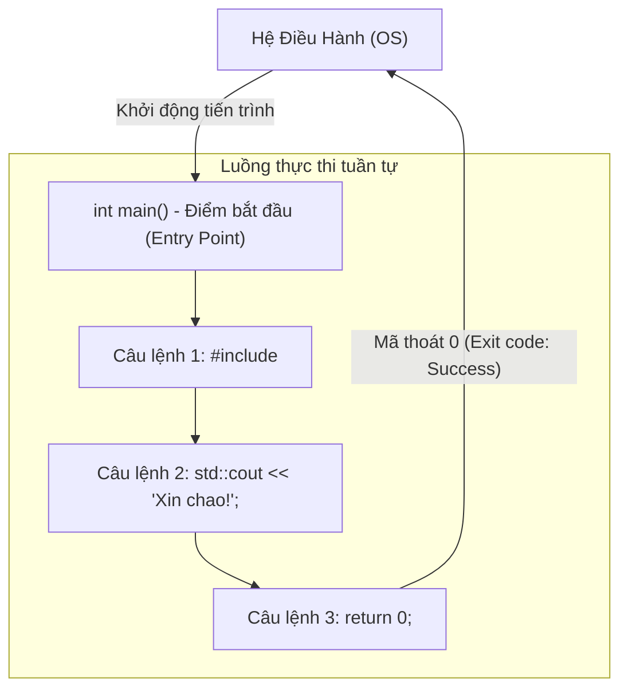

# 1.1 — Câu Lệnh Và Cấu Trúc Cơ Bản Của Chương Trình C++

---

## 🎯 Mục Tiêu Bài Học
- Hiểu rõ bản chất của **câu lệnh (Statement)** và vai trò của nó như đơn vị thực thi nhỏ nhất trong C++.
- Nắm vững cấu trúc giải phẫu của một chương trình C++ hoàn chỉnh và vai trò tối thượng của hàm `main()`.
- Phân biệt sự khác nhau giữa **Lỗi cú pháp (Syntax Error)** và lỗi ngữ nghĩa (Semantic Error).
- Nắm bắt cơ chế trình biên dịch thông báo lỗi và kỹ năng khoanh vùng dòng code bị lỗi.

---

## 1. Câu Lệnh (Statements) — Đơn Vị Chỉ Thị Thực Thi

Một chương trình máy tính về bản chất là một tập hợp tuần tự các chỉ thị điều khiển phần cứng thực hiện một tác vụ cụ thể. Trong ngôn ngữ C++, **câu lệnh (Statement)** là một đơn vị chỉ thị độc lập nhỏ nhất yêu cầu máy tính thực hiện một hành động (action).

Tương tự như ngôn ngữ tự nhiên, chúng ta truyền đạt ý nghĩ thông qua các câu hoàn chỉnh (chứ không phải các từ ngữ hay âm tiết rời rạc). Trong C++, bạn yêu cầu trình biên dịch thực thi công việc thông qua các câu lệnh.

Đa số các câu lệnh trong C++ kết thúc bằng dấu chấm phẩy (`;`). Mỗi khi bạn nhìn thấy dấu chấm phẩy ở cuối dòng, đó gần như chắc chắn là một câu lệnh.

```cpp
int x;         // Câu lệnh khai báo: Yêu cầu cấp phát vùng nhớ cho biến x
x = 5;         // Câu lệnh gán: Ghi giá trị 5 vào ô nhớ của x
std::cout << x;// Câu lệnh xuất: Đẩy giá trị x ra màn hình console
```

### Các Loại Câu Lệnh Trong Chuẩn ISO C++
C++ phân loại câu lệnh thành 7 nhóm chính:
1. **Câu lệnh khai báo / định nghĩa (Declaration / Definition statements)**: Giới thiệu một định danh mới hoặc cấp phát bộ nhớ.
2. **Câu lệnh biểu thức (Expression statements)**: Tính toán một biểu thức và có thể gây ra hiệu ứng phụ (side effect).
3. **Câu lệnh hợp thành (Compound statements / Blocks)**: Gom nhiều câu lệnh vào giữa cặp ngoặc nhọn `{}`.
4. **Câu lệnh lựa chọn (Selection statements)**: Cấu trúc rẽ nhánh điều kiện (`if`, `if-else`, `switch`).
5. **Câu lệnh lặp (Iteration statements)**: Vòng lặp (`for`, `while`, `do-while`, C++11 range-based for).
6. **Câu lệnh nhảy (Jump statements)**: Chuyển hướng luồng thực thi (`break`, `continue`, `return`, `goto`).
7. **Khối bắt ngoại lệ (Try blocks)**: Bắt và xử lý ngoại lệ runtime (`try-catch`).

---

## 2. Hàm (Functions) Và Hàm `main()` — Trái Tim Của Chương Trình

Trong C++, các câu lệnh không tồn tại tự do mà bắt buộc phải được đóng gói bên trong các **Hàm (Functions)**. Một hàm là một tập hợp các câu lệnh được nhóm lại với nhau để thực thi tuần tự từ trên xuống dưới nhằm hoàn thành một nhiệm vụ cụ thể.



::: tip Quy Tắc Bắt Buộc (Standard Rule)
Mọi chương trình C++ độc lập (executable) **bắt buộc phải có đúng một hàm đặc biệt mang tên `main`** (viết thường toàn bộ). 
:::

Khi bạn chạy chương trình, hệ điều hành sẽ tìm đến hàm `main()` đầu tiên và bắt đầu thực thi từ câu lệnh đầu tiên bên trong cặp dấu ngoặc nhọn `{}`. Khi câu lệnh cuối cùng của `main()` hoàn thành, chương trình sẽ kết thúc và giải phóng tài nguyên trả lại cho hệ điều hành.

---

## 3. Mổ Xẻ Chi Tiết Chương Trình "Hello World!"

Hãy cùng phân tích sâu từng dòng code trong chương trình C++ kinh điển:

```cpp
#include <iostream>

int main()
{
    std::cout << "Hello world!";
    return 0;
}
```

```
Dòng 1:  #include <iostream>   --> Chỉ thị tiền xử lý nạp thư viện I/O chuẩn
Dòng 2:                         --> Dòng trắng (Whitespace giúp code dễ đọc)
Dòng 3:  int main()            --> Định nghĩa hàm main (Entry point)
Dòng 4:  {                     --> Bắt đầu phần thân hàm (Function body)
Dòng 5:      std::cout << "...";--> Câu lệnh in chuỗi ra Console
Dòng 6:      return 0;         --> Trả về mã trạng thái thoát cho Hệ điều hành
Dòng 7:  }                     --> Kết thúc phần thân hàm
```

- **Dòng 1: `#include <iostream>`**: Ký tự `#` báo hiệu đây là một **Chỉ thị tiền xử lý (Preprocessor directive)**. Nó yêu cầu bộ tiền xử lý sao chép toàn bộ nội dung tệp tiêu đề `iostream` (Input/Output Stream) vào trước khi biên dịch, cung cấp quyền sử dụng đối tượng `std::cout`.
- **Dòng 3: `int main()`**: Khai báo hàm `main`. Từ khóa `int` (viết tắt của integer) biểu thị hàm này sẽ trả về một số nguyên cho hệ điều hành.
- **Dòng 4 & 7: `{ ... }`**: Định phạm vi thân hàm (Function body).
- **Dòng 5: `std::cout << "Hello world!";`**: 
  - `std::cout` (Character Output) là đối tượng stream tiêu chuẩn đại diện cho màn hình console.
  - Toán tử chèn luồng `<<` (Stream Insertion Operator) đẩy chuỗi ký tự bên phải vào stream bên trái.
- **Dòng 6: `return 0;`**: Trả về số nguyên `0` cho hệ điều hành. Theo quy chuẩn quốc tế của POSIX và Windows, mã thoát `0` đồng nghĩa với: "Chương trình thực thi hoàn hảo, không có lỗi".

---

## 4. Cú Pháp (Syntax) Và Lỗi Cú Pháp (Syntax Errors)

Cú pháp (Syntax) là tập hợp các quy tắc ngữ pháp nghiêm ngặt quy định cách sắp xếp từ khóa, định danh và toán tử để tạo thành một chương trình C++ hợp lệ.

Nếu bạn vi phạm cú pháp — ví dụ như quên dấu chấm phẩy `;` ở cuối câu lệnh:

```cpp
#include <iostream>

int main()
{
    std::cout << "Hello world!" // THIẾU DẤU CHẤM PHẨY Ở ĐÂY
    return 0;
}
```

Khi biên dịch:
- **Trình biên dịch Clang** sẽ báo:
  ```text
  main.cpp:5:32: error: expected ';' after expression
  ```
- **Trình biên dịch GCC** sẽ báo:
  ```text
  main.cpp: In function 'int main()':
  main.cpp:6:5: error: expected ';' before 'return'
  ```
- **Trình biên dịch MSVC (Visual Studio)** sẽ báo:
  ```text
  main.cpp(6): error C2143: syntax error: missing ';' before 'return'
  ```

---

## ⚠️ Hộp Cạm Bẫy Thực Chiến & Undefined Behavior (UB)

::: warning Cạm Bẫy: Trình Biên Dịch Báo Lỗi Sai Dòng!
Hãy chú ý rằng GCC và MSVC báo lỗi ở **dòng 6**, trong khi lỗi thực sự nằm ở **dòng 5**!

**Nguyên nhân kỹ thuật**: Trình biên dịch C++ phân tích mã nguồn theo luồng token (Token stream) và bỏ qua khoảng trắng. Khi đọc xong `"Hello world!"`, trình biên dịch tiếp tục quét tìm dấu `;`. Nó chỉ nhận ra lỗi khi đã chạm tới từ khóa `return` ở dòng tiếp theo.

**Quy tắc khắc phục**: Nếu trình biên dịch chỉ ra một lỗi cú pháp ở một dòng trông hoàn toàn chuẩn xác, hãy luôn kiểm tra dòng ngay phía trên nó!
:::

---

## 🚀 Hộp Cập Nhật C++20 / C++23

::: tip C++23: Xuất Dữ Liệu Hiện Đại Với `std::println`
Từ C++23, bạn không còn phải dùng toán tử `<<` cồng kềnh của `std::cout`. Chuẩn C++23 mang đến thư viện `<print>` với hàm `std::println` cực kỳ tinh gọn, an toàn kiểu (type-safe) và tối ưu hóa vượt trội về kích thước file thực thi (binary size):

```cpp
#include <print> // Thư viện C++23

int main()
{
    std::println("Xin chào, đây là C++23 hiện đại!");
    std::println("Số học viên: {}", 1500);
    return 0;
}
```
:::

---

## 💡 Hộp Thực Hành Tốt Nhất (Best Practice)

::: tip Quy Tắc Vàng
1. **Luôn kết thúc câu lệnh bằng dấu `;`**: Đừng để sót chấm phẩy.
2. **Thụt lề thống nhất (Consistent Indentation)**: Đặt các câu lệnh bên trong thân hàm thụt lề 4 dấu cách (spaces) hoặc 1 tab để code sáng sủa, dễ đọc.
3. **Mỗi dòng một câu lệnh**: Tuyệt đối không viết nhiều câu lệnh trên cùng một dòng (như `x = 5; y = 10; z = 15;`) vì làm giảm nghiêm trọng khả năng gỡ lỗi (debugging) khi đặt breakpoint.
:::

---

## 📝 Hệ Thống Quiz & Bài Tập Tự Luyện

### Câu hỏi 1:
Câu lệnh (Statement) trong C++ là gì?
::: details [Xem lời giải]
Câu lệnh là đơn vị chỉ thị độc lập nhỏ nhất trong chương trình C++, yêu cầu máy tính thực hiện một hành động cụ thể. Hầu hết các câu lệnh trong C++ kết thúc bằng dấu chấm phẩy (`;`).
:::

### Câu hỏi 2:
Hàm (Function) là gì?
::: details [Xem lời giải]
Hàm là một tập hợp các câu lệnh được đặt tên và nhóm lại với nhau, được thực thi tuần tự từ trên xuống dưới để thực hiện một tác vụ cụ thể.
:::

### Câu hỏi 3:
Tên của hàm bắt buộc phải có trong mọi chương trình C++ thực thi độc lập là gì?
::: details [Xem lời giải]
Đó là hàm `main` (viết thường toàn bộ).
:::

### Câu hỏi 4:
Điều gì xảy ra khi một chương trình C++ được hệ điều hành kích hoạt thực thi?
::: details [Xem lời giải]
Hệ điều hành sẽ gọi hàm `main()` và các câu lệnh bên trong `main()` sẽ được thực thi tuần tự từ câu lệnh đầu tiên đến câu lệnh cuối cùng.
:::

### Câu hỏi 5:
Lỗi cú pháp (Syntax error) là gì? Khi nào lỗi cú pháp được phát hiện?
::: details [Xem lời giải]
Lỗi cú pháp xảy ra khi mã nguồn vi phạm các quy tắc ngữ pháp của ngôn ngữ C++ (ví dụ: thiếu dấu `;`, sai cú pháp ngoặc `{}`). Lỗi cú pháp được phát hiện bởi trình biên dịch (Compiler) ngay trong giai đoạn biên dịch (Compile-time), khiến quá trình tạo mã máy bị dừng lại.
:::

### Câu hỏi 6:
Thư viện chuẩn C++ (C++ Standard Library) là gì?
::: details [Xem lời giải]
Thư viện chuẩn C++ là tập hợp các mã nguồn và hàm đã được biên dịch sẵn đi kèm với ngôn ngữ C++ (như thư viện nhập xuất `iostream`, chuỗi ký tự `string`, thuật toán `algorithm`), cung cấp các tính năng thiết yếu giúp lập trình viên không phải viết lại từ đầu.
:::
