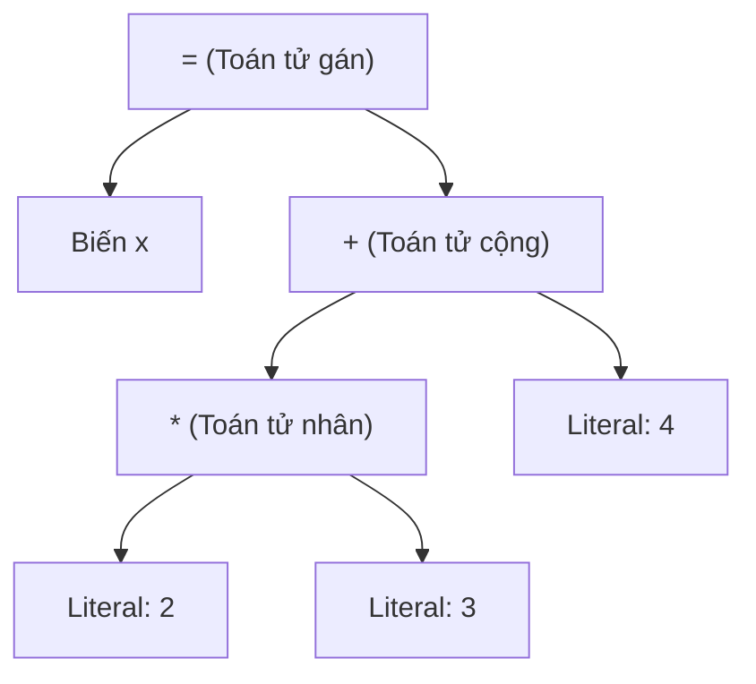

# 1.10 — Giới Thiệu Biểu Thức (Expressions)

---

## 🎯 Mục Tiêu Bài Học
- Hiểu định nghĩa chuẩn ISO C++ của **Biểu thức (Expression)** và quá trình **Định giá (Evaluation)**.
- Phân biệt rõ ràng giữa **Biểu thức (Expression)**, **Câu lệnh (Statement)** và **Câu lệnh biểu thức (Expression Statement)**.
- Nhận biết các biểu thức con (**Subexpressions**), biểu thức toàn vẹn (**Full Expressions**) và cấu trúc cây phân tích cú pháp (AST).
- Nhận diện các câu lệnh biểu thức vô dụng (Useless expression statements) và cách trình biên dịch tối ưu hóa loại bỏ chúng.

---

## 1. Biểu Thức (Expression) Là Gì?

Trong lập trình C++, **Biểu thức (Expression)** là một chuỗi kết hợp giữa các hằng giá trị (literals), biến (variables), toán tử (operators) và lời gọi hàm (function calls) nhằm tính toán để sinh ra một **kết quả đơn nhất (Result / Value)**.

Quá trình thực thi tính toán một biểu thức được gọi là **Định giá (Evaluation)**.

```cpp
2               // Literal tự định giá thành chính nó: 2
"Hello"         // Literal chuỗi tự định giá thành "Hello"
x               // Biến x tự định giá thành giá trị hiện tại lưu trong ô nhớ của x
2 + 3           // Toán tử + định giá 2 và 3 thành giá trị 5
calculate()     // Lời gọi hàm định giá thành giá trị mà hàm đó trả về (return value)
```

::: tip Quy Tắc Vàng Về Biểu Thức
Bất kỳ nơi nào trong C++ yêu cầu một giá trị đơn lẻ (ví dụ: vế phải của phép gán, đối số truyền vào hàm, điều kiện của câu lệnh `if`), bạn đều có thể đặt vào đó một **Biểu thức (Expression)** có khả năng sinh ra giá trị!
:::

---

## 2. Cây Định Giá Biểu Thức (Expression Evaluation Tree)

Hãy quan sát cách trình biên dịch phân tích biểu thức phức hợp: `x = (2 * 3) + 4`:



1. Phép nhân `2 * 3` được định giá trước -&gt; Sinh ra giá trị tạm `6`.
2. Phép cộng `6 + 4` được định giá tiếp -&gt; Sinh ra giá trị tạm `10`.
3. Phép gán đưa giá trị `10` vào biến `x` -&gt; Biểu thức hoàn tất!

---

## 3. Câu Lệnh Biểu Thức (Expression Statements)

Bản thân một biểu thức **không thể đứng độc lập để biên dịch** vì nó không kết thúc bằng dấu chấm phẩy. Để biến một biểu thức thành một câu lệnh hoàn chỉnh, bạn chỉ cần thêm dấu `;` vào cuối.

```cpp
x = 5;          // Biểu thức 'x = 5' biến thành một Câu lệnh biểu thức (Expression Statement)
std::cout << x; // Biểu thức 'std::cout << x' biến thành Câu lệnh biểu thức
```

Khi một câu lệnh biểu thức thực thi, biểu thức bên trong sẽ được định giá. Sau khi kết thúc câu lệnh, **giá trị trả về của biểu thức sẽ bị hủy bỏ (discarded)**, chỉ có các **hiệu ứng phụ (Side Effects)** của nó (như thay đổi biến `x` hoặc in ra màn hình) là còn tồn tại lại trong hệ thống.

---

## ⚠️ Hộp Cạm Bẫy Thực Chiến: Câu Lệnh Biểu Thức Vô Dụng

::: warning Cạm Bẫy: Viết Biểu Thức Không Có Side Effect
Hãy quan sát câu lệnh sau:
```cpp
2 * 3; // Hoàn toàn hợp lệ về mặt cú pháp!
x + 5; // Hoàn toàn hợp lệ về mặt cú pháp!
```
- Phép toán `2 * 3` tính ra `6`, sau đó dấu chấm phẩy `;` xuất hiện và giá trị `6` bị vứt bỏ vào sọt rác!
- Câu lệnh này không làm thay đổi bất kỳ ô nhớ nào, không in gì ra màn hình -&gt; **Hoàn toàn vô dụng (Useless Expression Statement)**.

Khi bạn bật cờ cảnh báo `-Wall`, trình biên dịch GCC và Clang sẽ phát cảnh báo:
`warning: statement has no effect [-Wunused-value]`

Trong chế độ Release (-O2), trình tối ưu hóa của trình biên dịch sẽ **xóa sổ 100% dòng lệnh này khỏi file thực thi**!
:::

---

## 4. Phân Loại Biểu Thức: Subexpression & Full Expression

- **Biểu thức con (Subexpression)**: Là một biểu thức đóng vai trò làm toán hạng cho một toán tử khác.
  - Trong `x = 4 + 5`: Cả `x` và `4 + 5` đều là subexpression của toán tử `=`.
  - Trong `4 + 5`: `4` và `5` là các subexpression của toán tử `+`.
- **Biểu thức toàn vẹn (Full Expression)**: Là một biểu thức độc lập, không phải là biểu thức con của bất kỳ biểu thức nào khác.

---

## 🚀 Hộp Cập Nhật C++20: Biểu Thức Hằng Compile-Time (`constexpr` & `consteval`)

Trong C++ hiện đại, các biểu thức có thể được ép buộc định giá ngay tại thời điểm biên dịch (Compile-time) bằng từ khóa `constexpr` hoặc `consteval` (C++20), giúp CPU khi chạy chương trình không tốn dù chỉ 1 chu kỳ xung nhịp để tính toán:

```cpp
consteval int square(int n) {
    return n * n;
}

int main() {
    // Biểu thức square(10) được tính ngay lúc biên dịch thành hằng số 100!
    constexpr int result { square(10) };
    return 0;
}
```

---

## 💡 Hộp Thực Hành Tốt Nhất (Best Practice)

::: tip Quy Tắc Vàng
1. **Phân biệt rạch ròi giữa Câu lệnh và Biểu thức**:
   - Câu lệnh (Statement) = Hành động (Làm cái gì?).
   - Biểu thức (Expression) = Tính toán (Tạo ra giá trị gì?).
2. **Tránh các biểu thức lồng ghép quá sâu**: Một biểu thức chứa 5-6 phép toán liên tiếp sẽ làm tăng nguy cơ lỗi thứ tự thực thi và gây khó khăn cho việc đặt breakpoint khi gỡ lỗi.
:::

---

## 📝 Hệ Thống Quiz & Bài Tập Tự Luyện

### Câu hỏi 1:
Hãy phân loại từng dòng sau thành: **Câu lệnh không chứa biểu thức**, **Câu lệnh chứa biểu thức**, hoặc **Câu lệnh biểu thức (Expression Statement)**:
- a) `int x;`
- b) `int a { 5 + 2 };`
- c) `x = 10;`
- d) `std::cout << 42;`
::: details [Xem lời giải]
- a) `int x;`: **Câu lệnh không chứa biểu thức** (Chỉ là câu lệnh định nghĩa biến, `x` ở đây là định danh được tạo mới chứ không phải được định giá).
- b) `int a { 5 + 2 };`: **Câu lệnh chứa biểu thức** (`5 + 2` là một biểu thức dùng làm khởi tạo cho câu lệnh định nghĩa biến `a`).
- c) `x = 10;`: **Câu lệnh biểu thức (Expression Statement)** (`x = 10` là một biểu thức gán, thêm dấu `;` biến nó thành câu lệnh).
- d) `std::cout << 42;`: **Câu lệnh biểu thức (Expression Statement)** (Toán tử hai ngôi `<<` kết hợp `std::cout` và `42`, thêm dấu `;` biến nó thành câu lệnh).
:::

### Câu hỏi 2:
Dự đoán kết quả in ra màn hình của chương trình sau mà không cần chạy thử:
```cpp
#include <iostream>

int main()
{
    int a { 5 };
    int b { a * 2 };
    int c { b - 3 };
    std::cout << a << " " << b << " " << c << '\n';
    return 0;
}
```
::: details [Xem lời giải]
Màn hình in ra: `5 10 7`.
**Giải thích**:
- `a` khởi tạo bằng `5`.
- `b` định giá biểu thức `a * 2` -&gt; `5 * 2 = 10`.
- `c` định giá biểu thức `b - 3` -&gt; `10 - 3 = 7`.
:::
