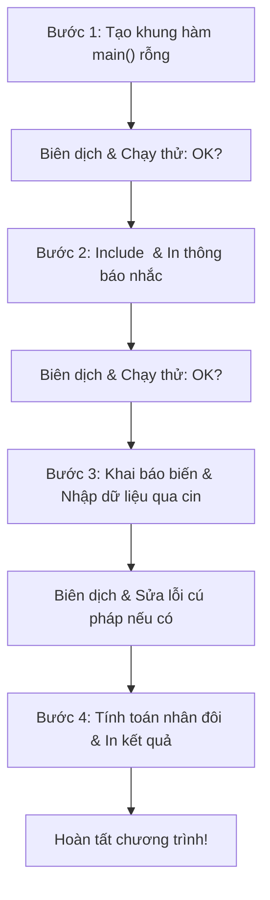

# 1.11 — Tự Tay Phát Triển Chương Trình Đầu Tiên (Developing Your First Program)

---

## 🎯 Mục Tiêu Bài Học
- Làm chủ phương pháp phát triển phần mềm cuốn chiếu từng bước (**Incremental Development Strategy**): "Viết một khối nhỏ -&gt; Biên dịch -&gt; Kiểm thử -&gt; Tinh chỉnh".
- Trải nghiệm thực tế quy trình chẩn đoán và khắc phục lỗi biên dịch (Compiler Error) khi gõ sai cú pháp I/O.
- So sánh sâu sắc 3 giải pháp kiến trúc mã nguồn cho cùng một bài toán (Từ cách tồi đến cách chuẩn mực nhất).
- Rèn luyện tư duy kỹ thuật: *"Làm cho chương trình chạy đúng trước, tối ưu hóa và làm sạch code sau"*.

---

## 1. Bài Toán Thực Chiến: "Nhân Đôi Một Số Nguyên"

Mục tiêu của chúng ta là viết một chương trình tương tác:
1. Yêu cầu người dùng nhập vào một số nguyên từ bàn phím.
2. Đọc giá trị người dùng vừa nhập.
3. In ra màn hình giá trị gấp đôi của số đó.

Ví dụ kịch bản chạy:
```text
Nhap vao mot so nguyen: 4
Gia tri gap doi la: 8
```

---

## 2. Chiến Lược Cuốn Chiếu Từng Bước (Incremental Development)

::: tip Sai Lầm Kinh Điển Của Người Mới Bắt Đầu
Viết liền một mạch 50 dòng code từ đầu đến cuối rồi mới bấm nút Compile, để rồi bị choáng ngợp trước một danh sách đỏ lòm chứa 30 lỗi biên dịch!
:::

**Phương pháp chuẩn kỹ sư**: Hãy chia bài toán thành từng mảnh nhỏ xíu, kiểm tra tính đúng đắn của từng dòng code trước khi bước tiếp!



### Bước 1 & 2: Dựng Khung Xương (Scaffolding)
```cpp
#include <iostream>

int main()
{
    std::cout << "Nhap vao mot so nguyen: ";
    return 0;
}
```
*Biên dịch và chạy thử*: Màn hình hiện thông báo nhắc và kết thúc thành công.

---

### Bước 3: Đọc Dữ Liệu & Bài Học Gỡ Lỗi Compiler
Bây giờ, chúng ta khai báo một biến để lưu số nhập vào. Giả sử người mới học vô tình gõ nhầm:

```cpp
#include <iostream>

int main()
{
    std::cout << "Nhap vao mot so nguyen: ";

    int num {};
    std::cin << num; // CỐ TÌNH GÕ SAI TOÁN TỬ Ở ĐÂY!

    return 0;
}
```

Bấm nút Compile... và BÙM! Trình biên dịch quăng ra một lỗi dài dằng dặc:
- **MSVC**: `error C2678: binary '<<': no operator found which takes a left-hand operand of type 'std::istream'`
- **GCC**: `error: no match for 'operator<<' (operand types are 'std::istream' and 'int')`

#### Cách Một Kỹ Sư Đọc Thông Báo Lỗi:
1. Compiler chỉ ra lỗi nằm ở **dòng chứa `std::cin << num;`**.
2. Nó phàn nàn: *"Không tìm thấy `operator<<` nào chấp nhận vế trái là `std::istream` (chính là kiểu của `std::cin`)"*.
3. Nhận diện nguyên nhân: `std::cin` là luồng nhập, bắt buộc phải dùng **toán tử trích xuất luồng `>>`**, không thể dùng toán tử chèn `<<`!

*Sửa lại dòng đó thành*:
```cpp
std::cin >> num; // Sửa thành toán tử >>
```
Biên dịch lại: Chương trình chạy trơn tru!

---

## 3. Mổ Xẻ 3 Cách Tiếp Cận: Từ Tồi Đến Xuất Sắc

Để nhân đôi số `num`, chúng ta có ít nhất 3 cách viết:

### Cách 1: Giải Pháp Tồi Nhất (The Bad Solution)
```cpp
num = num * 2; // Ghi đè giá trị nhân đôi vào chính biến num
std::cout << "Gia tri gap doi la: " << num << '\n';
```
❌ **Tại sao tồi?**
- Biến `num` ban đầu lưu trữ dữ liệu gốc của người dùng. Sau câu lệnh này, dữ liệu gốc đã bị xóa sổ và ghi đè!
- Nếu chương trình cần mở rộng sau này (ví dụ: in thêm giá trị gấp ba, kiểm tra xem số gốc là chẵn hay lẻ), bạn không còn cách nào lấy lại số gốc được nữa.

---

### Cách 2: Giải Pháp Tạm Chấp Nhận (The Better Solution)
```cpp
int doubled { num * 2 }; // Tạo thêm một biến mới
std::cout << "Gia tri gap doi la: " << doubled << '\n';
```
🟡 **Đánh giá**:
- Giữ nguyên được số gốc `num`.
- *Điểm trừ nhỏ*: Tốn thêm tài nguyên bộ nhớ cho biến `doubled` và làm hàm cồng kềnh hơn, trong khi biến này chỉ được dùng đúng duy nhất một lần rồi biến mất.

---

### Cách 3: Giải Pháp Chuẩn Mực Nhất (The Preferred Solution)
```cpp
// Tính toán trực tiếp ngay trong biểu thức in của std::cout!
std::cout << "Gia tri gap doi la: " << (num * 2) << '\n';
```
✔️ **Tại sao đây là phong cách tối ưu?**
1. Dữ liệu gốc trong `num` được bảo toàn 100%.
2. Không cần cấp phát thêm biến trung gian thừa thãi.
3. Biểu thức `num * 2` được định giá tạm thời ngay tại dòng in, code ngắn gọn và dễ hiểu nhất.

---

## 4. Mã Nguồn Hoàn Chỉnh Chuẩn C++ Hiện Đại

```cpp
#include <iostream>

int main()
{
    std::cout << "Nhap vao mot so nguyen: ";

    int num {}; // Khởi tạo an toàn bằng rỗng {}
    std::cin >> num;

    std::cout << "Gia tri gap doi la: " << (num * 2) << '\n';
    return 0;
}
```

---

## ⚠️ Hộp Cạm Bẫy Thực Chiến & Undefined Behavior (UB)

::: warning Cạm Bẫy: Tràn Số Nguyên Có Dấu (Signed Integer Overflow)
Biến `num` có kiểu `int` (thường là 32-bit có dấu, lưu tối đa `2,147,483,647`).

Nếu người dùng nhập vào số `2,000,000,000`, phép tính `num * 2` sẽ ra `4,000,000,000` — vượt quá giới hạn tối đa của `int`. Trong chuẩn ISO C++, **tràn số nguyên có dấu là Undefined Behavior (UB)**! Trình biên dịch có thể sinh ra kết quả âm kỳ quặc (`-294967296`) hoặc tối ưu hóa sai hoàn toàn logic chương trình.
:::

---

## 🚀 Hộp Cập Nhật C++20 / C++23: Cú Pháp Đẳng Cấp Với `std::println`

Trong C++23, bạn có thể tái cấu trúc toàn bộ luồng in ra bằng một dòng cực kỳ sáng sủa:

```cpp
#include <iostream>
#include <print>

int main()
{
    std::print("Nhap vao mot so nguyen: ");
    
    int num {};
    std::cin >> num;

    std::println("So goc: {}, Gap doi: {}, Gap ba: {}", num, num * 2, num * 3);
    return 0;
}
```

---

## 💡 Hộp Thực Hành Tốt Nhất (Best Practice)

::: tip Quy Tắc Vàng Của Nghề Lập Trình
1. **Quy tắc ba bước**:
   - *Make it work* (Làm cho nó chạy được trước).
   - *Make it right* (Làm cho code sạch đẹp, chuẩn mực, an toàn).
   - *Make it fast* (Tối ưu hóa hiệu năng nếu cần thiết).
2. **Bảo tồn dữ liệu đầu vào**: Không ghi đè lên biến chứa dữ liệu nhập của người dùng trừ khi có lý do thực sự chính đáng.
:::

---

## 📝 Hệ Thống Quiz & Bài Tập Tự Luyện

### Bài tập 1:
Hãy mở rộng chương trình trên để in ra cả giá trị gấp đôi và giá trị gấp ba của số mà người dùng nhập vào.
Mẫu kết quả mong đợi (với số nhập vào là `5`):
```text
Nhap vao mot so nguyen: 5
Gia tri gap doi cua 5 la: 10
Gia tri gap ba cua 5 la: 15
```
::: details [Xem lời giải]
```cpp
#include <iostream>

int main()
{
    std::cout << "Nhap vao mot so nguyen: ";

    int num {};
    std::cin >> num;

    std::cout << "Gia tri gap doi cua " << num << " la: " << (num * 2) << '\n';
    std::cout << "Gia tri gap ba cua " << num << " la: " << (num * 3) << '\n';

    return 0;
}
```
:::
