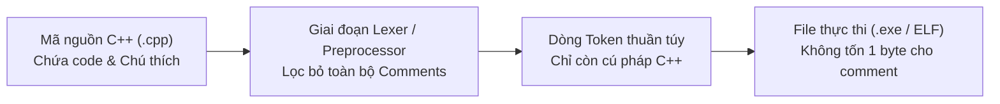
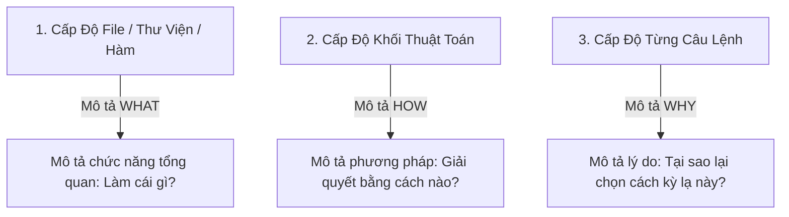

# 1.2 — Chú Thích Trong C++ (Comments)

---

## 🎯 Mục Tiêu Bài Học
- Hiểu rõ vai trò và cách trình biên dịch xử lý các chú thích (**Comments**).
- Làm chủ cú pháp chú thích một dòng (`//`) và chú thích nhiều dòng (`/* ... */`).
- Nắm vững cạm bẫy lồng chú thích nhiều dòng gây lỗi biên dịch.
- Xây dựng tư duy chú thích chuyên nghiệp: Khi nào giải thích **WHAT**, khi nào giải thích **HOW**, và quan trọng nhất là khi nào giải thích **WHY**.
- Thành thạo kỹ thuật "Vô hiệu hóa code" (Commenting out) để phục vụ debug.

---

## 1. Chú Thích Là Gì? Bản Chất Ở Tầng Trình Biên Dịch

**Chú thích (Comment)** là những dòng ghi chú do lập trình viên chèn trực tiếp vào mã nguồn nhằm giải thích ý đồ, logic thuật toán hoặc cách sử dụng chương trình cho con người đọc.

::: tip Cơ Chế Biên Dịch (Compilation Phase)
Trong giai đoạn tiền xử lý (Preprocessing) và phân tích từ vựng (Lexical Analysis), **trình biên dịch sẽ loại bỏ hoàn toàn mọi chú thích** hoặc thay thế chúng bằng một ký tự khoảng trắng đơn lẻ. Mã máy sinh ra (Assembly/Binary) hoàn toàn không chứa chú thích và không làm tốn thêm một byte bộ nhớ RAM nào khi chương trình chạy!
:::



---

## 2. Hai Phong Cách Chú Thích Trong C++

### 2.1. Chú Thích Một Dòng (`//`)
Bắt đầu bằng cặp dấu gạch chéo `//`. Trình biên dịch sẽ bỏ qua tất cả mọi thứ từ vị trí `//` cho đến cuối dòng đó.

```cpp
// Đây là chú thích nguyên một dòng
int health { 100 }; // Chú thích ngắn gọn ở cuối câu lệnh
```

### 2.2. Chú Thích Nhiều Dòng (`/* ... */`)
Bắt đầu bằng `/*` và kết thúc bằng `*/`. Toàn bộ nội dung nằm giữa cặp ký tự này sẽ bị trình biên dịch bỏ qua, bất kể nó kéo dài qua bao nhiêu dòng:

```cpp
/*
 * Hàm tính khoảng cách Euclid giữa hai điểm trong không gian 2D.
 * Đầu vào: x1, y1, x2, y2
 * Đầu ra: Khoảng cách dạng double
 */
```

---

## ⚠️ Hộp Cạm Bẫy Thực Chiến & Undefined Behavior (UB)

::: warning Cạm Bẫy Nghiêm Trọng: Không Thể Lồng Chú Thích Nhiều Dòng!
Chú thích phong cách `/* ... */` **tuyệt đối không thể lồng vào nhau**!

Hãy quan sát đoạn mã sau:
```cpp
/* Đây là chú thích ngoài
    /* Đây là chú thích lồng bên trong */ 
    Dòng này KHÔNG CÒN nằm trong chú thích!
*/
```

**Hậu quả**: Trình biên dịch tìm kiếm dấu kết thúc đầu tiên `*/`. Nó sẽ đóng chú thích ngay tại `/* Đây là chú thích lồng bên trong */`. Đoạn văn bản `Dòng này KHÔNG CÒN nằm trong chú thích! */` sẽ bị compiler coi là mã C++ và lập tức quăng ra hàng loạt lỗi cú pháp (Syntax Errors)!

**Giải pháp**: 
1. Sử dụng `//` cho tất cả các chú thích thông thường trong hàm.
2. Khi cần vô hiệu hóa một khối mã chứa nhiều dòng code, hãy dùng công cụ phím tắt của IDE (`Ctrl + /` trên VS Code) để chèn `//` trên từng dòng, hoặc dùng tiền xử lý `#if 0 ... #endif`.
:::

---

## 3. Triết Lý Chú Thích Chuyên Nghiệp: WHAT - HOW - WHY

Một trong những dấu hiệu nhận biết lập trình viên nghiệp dư là viết những chú thích vô nghĩa, chỉ lặp lại những gì code đã thể hiện rõ ràng.



### Quy Tắc 1: Cấp độ Thư viện / Tệp / Hàm -&gt; Mô tả **WHAT** (Làm cái gì)
Đặt ở đầu tệp hoặc ngay trước định nghĩa hàm:
```cpp
// Hàm xấp xỉ nghiệm của phương trình vi phân bằng phương pháp Runge-Kutta bậc 4.
```

### Quy Tắc 2: Cấp độ Bên trong Hàm -&gt; Mô tả **HOW** (Giải quyết bằng cách nào)
```cpp
// Thuật toán:
// 1. Lọc các phần tử trùng lặp bằng bảng băm (hash set)
// 2. Sắp xếp mảng theo thứ tự giảm dần
// 3. Trả về top k phần tử lớn nhất
```

### Quy Tắc 3: Cấp độ Câu Lệnh -&gt; Mô tả **WHY** (Tại sao) — Quan Trọng Nhất!
Đừng bao giờ giải thích câu lệnh đang làm gì (What) nếu cú pháp đã quá rõ ràng. Hãy giải thích **tại sao bạn phải làm như vậy**!

❌ **Chú thích tồi (Bad Comment):**
```cpp
// Gán sight bằng 0
sight = 0;

// Nhân số lượng với 2
total_cost = quantity * 2 * unit_price;
```

✔️ **Chú thích xuất sắc (Good Comment):**
```cpp
// Nhân vật vừa uống phải Độc dược Mù lòa nên tầm nhìn bị triệt tiêu về 0
sight = 0;

// Nhân đôi số lượng vì mặt hàng này luôn bán theo từng cặp (đôi găng tay)
total_cost = quantity * 2 * unit_price;

// Quyết định dùng std::deque thay vì std::vector vì cần chèn liên tục ở đầu mảng
```

---

## 4. Kỹ Thuật "Vô Hiệu Hóa Code" (Commenting Out)

Khi debug hoặc thử nghiệm một thuật toán mới, thay vì xóa code cũ, bạn có thể tạm thời biến chúng thành chú thích:
- **VS Code**: Bôi đen đoạn code và nhấn `Ctrl + /` (Windows/Linux) hoặc `Cmd + /` (macOS).
- **Visual Studio**: `Ctrl + K, Ctrl + C` để comment, `Ctrl + K, Ctrl + U` để uncomment.

---

## 🚀 Hộp Cập Nhật C++20 / C++23

::: tip C++20 / C++23: Doxygen & Module Documentation
Trong C++ hiện đại, lập trình viên thường kết hợp phong cách chú thích chuẩn hóa theo định dạng **Doxygen** hoặc hỗ trợ tài liệu hóa cho **C++20 Modules**:

```cpp
/**
 * @brief Tính giai thừa tại thời điểm biên dịch (Compile-time Factorial).
 * @param n Số nguyên không âm cần tính.
 * @return Giai thừa của n dưới dạng unsigned long long.
 */
constexpr unsigned long long factorial(unsigned int n) noexcept
{
    return (n <= 1) ? 1 : (n * factorial(n - 1));
}
```
Các công cụ IDE hiện đại sẽ tự động hiển thị popup tài liệu cực đẹp khi bạn hover chuột qua tên hàm!
:::

---

## 💡 Hộp Thực Hành Tốt Nhất (Best Practice)

::: tip Quy Tắc Vàng
1. **Viết code tự tài liệu hóa (Self-documenting code)**: Đặt tên biến và tên hàm rõ ràng đến mức người đọc có thể hiểu ngay mục đích mà không cần đọc comment. Thay vì đặt `int d; // số ngày trong tuần`, hãy đặt `int days_per_week { 7 };`.
2. **Comment dành cho con người chưa biết gì**: Hãy viết chú thích như thể bạn đang giải thích cho một người đồng đội mới vào dự án, hoặc cho chính bạn 6 tháng sau đọc lại!
3. **Cập nhật chú thích khi sửa code**: Một chú thích sai còn nguy hiểm hơn gấp trăm lần việc không có chú thích, vì nó dẫn dắt người đọc đi sai hướng.
:::

---

## 📝 Hệ Thống Quiz & Bài Tập Tự Luyện

### Câu hỏi 1:
Hai loại chú thích trong C++ là gì và cú pháp tương ứng của chúng?
::: details [Xem lời giải]
- Chú thích một dòng: Bắt đầu bằng `//` kéo dài đến cuối dòng.
- Chú thích nhiều dòng: Bắt đầu bằng `/*` và kết thúc bằng `*/`.
:::

### Câu hỏi 2:
Đoạn mã sau có biên dịch thành công không? Tại sao?
```cpp
/*
    int a = 5;
    /* int b = 10; */
    int c = 15;
*/
```
::: details [Xem lời giải]
**Không biên dịch được!** C++ không hỗ trợ lồng chú thích nhiều dòng (`/* ... */`). Trình biên dịch sẽ coi dấu `*/` sau `int b = 10;` là điểm kết thúc của toàn bộ khối chú thích. Phần `int c = 15; */` tiếp theo sẽ bị phân tích như cú pháp C++, dẫn đến lỗi cú pháp nghiêm trọng tại ký tự `*/` mồ côi.
:::

### Câu hỏi 3:
Khi nào bạn nên viết chú thích ở cấp độ từng câu lệnh riêng lẻ?
::: details [Xem lời giải]
Bạn chỉ nên viết chú thích ở cấp độ câu lệnh khi cần giải thích **LÝ DO (WHY)** tại sao bạn lại viết câu lệnh như vậy (ví dụ: giải thích một quyết định thiết kế bất thường, một hằng số đặc biệt từ nghiệp vụ thực tế, hoặc lý do chọn cấu trúc dữ liệu này thay vì cấu trúc dữ liệu khác). Tránh viết chú thích lặp lại nội dung câu lệnh đang làm gì (WHAT).
:::
