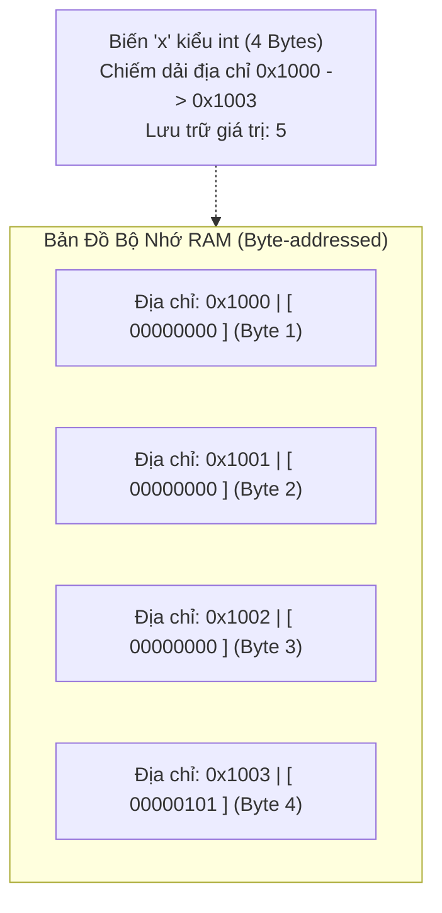

# 1.3 — Giới Thiệu Đối Tượng (Objects) Và Biến (Variables)

---

## 🎯 Mục Tiêu Bài Học
- Phân biệt rõ ràng giữa **Dữ liệu (Data)**, **Giá trị (Value)** và **Hằng giá trị (Literal)**.
- Hiểu kiến trúc bộ nhớ RAM ở cấp độ phần cứng: Ô nhớ, byte, bit và địa chỉ bộ nhớ (Memory Address).
- Nắm vững định nghĩa chuẩn ISO C++ của **Đối tượng (Object)** và **Biến (Variable)**.
- Hiểu vai trò sống còn của **Kiểu dữ liệu (Data Type)** tại thời điểm biên dịch (Compile-time).
- Tránh các sai lầm kinh điển khi định nghĩa nhiều biến trong một câu lệnh.

---

## 1. Dữ Liệu (Data), Giá Trị (Value) Và Hằng Giá Trị (Literal)

Mục đích tối thượng của mọi chương trình máy tính là xử lý dữ liệu để tạo ra kết quả mong muốn.
- **Dữ liệu (Data)**: Bất kỳ thông tin nào có thể lưu trữ, di chuyển hoặc xử lý bởi máy tính.
- **Giá trị (Value)**: Một đơn vị dữ liệu cụ thể (ví dụ: số `5`, số thực `-6.7`, ký tự `'A'`, chuỗi `"Learn C++"`).
- **Hằng giá trị (Literal)**: Giá trị được viết cứng trực tiếp vào mã nguồn chương trình.

```cpp
#include <iostream>

int main()
{
    std::cout << 5;          // In số nguyên literal: 5
    std::cout << 3.14159;    // In số thực literal: 3.14159
    std::cout << 'Z';        // In ký tự literal (dấu nháy đơn ''): Z
    std::cout << "Xin chào"; // In chuỗi ký tự literal (dấu nháy kép ""): Xin chào
    return 0;
}
```

::: info Phân Biệt Nháy Đơn Và Nháy Kép
- **Ký tự đơn (Char literal)**: Bắt buộc đặt trong dấu **nháy đơn** `' '` (ví dụ: `'a'`, `'9'`, `'$'`). Chỉ chứa duy nhất 1 ký tự.
- **Chuỗi văn bản (String literal)**: Bắt buộc đặt trong dấu **nháy kép** `" "` (ví dụ: `"a"`, `"Hello"`). Có thể chứa 0, 1 hoặc nhiều ký tự.
:::

---

## 2. Bản Chất Bộ Nhớ RAM & Địa Chỉ Ô Nhớ

Bộ nhớ truy cập ngẫu nhiên (**RAM - Random Access Memory**) có thể hình dung như một chuỗi dài vô tận các ngăn kéo có đánh số thứ tự liên tiếp. Mỗi ngăn kéo đại diện cho 1 **Byte** (8 bits). 

Mỗi byte trong RAM đều có một **Địa chỉ bộ nhớ (Memory Address)** duy nhất, thường được biểu diễn dưới dạng số thập lục phân (Hexadecimal, ví dụ: `0x7ffee4b2a890`).



Trong các ngôn ngữ cấp thấp hoặc hợp ngữ, lập trình viên phải nhớ từng địa chỉ ô nhớ cụ thể để đọc ghi. C++ giải phóng bạn khỏi gánh nặng đó thông qua khái niệm **Đối tượng** và **Biến**.

---

## 3. Đối Tượng (Object) Và Biến (Variable) Trong ISO C++

Theo chuẩn ISO C++:
- **Đối tượng (Object)**: Là một vùng nhớ lưu trữ (thường trên RAM hoặc thanh ghi CPU) có thể chứa giá trị và sở hữu các thuộc tính (kiểu dữ liệu, vòng đời, kích thước). Đối tượng có thể ẩn danh (anonymous object).
- **Biến (Variable)**: Là **một đối tượng có tên gọi (định danh - identifier)**.

Nhờ có biến, thay vì phải ra lệnh: *"Hãy lấy giá trị tại ô nhớ `0x7ffee4b2a890`"*, bạn chỉ cần viết: *"Hãy lấy giá trị của biến `x`"*. Trình biên dịch sẽ tự động ánh xạ tên biến `x` tới địa chỉ ô nhớ tương ứng!

---

## 4. Định Nghĩa Biến (Variable Definition) & Quá Trình Cấp Phát

Để sử dụng một biến, bạn phải thông báo cho trình biên dịch bằng một câu lệnh định nghĩa:

```cpp
int x; // Định nghĩa một biến tên là x, kiểu int
```

Quá trình này diễn ra qua 2 giai đoạn:
1. **Tại thời điểm biên dịch (Compile-time)**: Trình biên dịch ghi nhận tên biến `x` thuộc kiểu `int` để kiểm tra kiểu và tính toán dung lượng cần cấp phát.
2. **Tại thời điểm chạy (Runtime)**: Khi luồng thực thi đi tới câu lệnh này, một vùng nhớ thực tế sẽ được dành riêng cho biến `x`. Hành động dành riêng vùng nhớ này được gọi là **Cấp phát bộ nhớ (Allocation)** hoặc hiện thực hóa đối tượng (**Instantiation**).

---

## 5. Kiểu Dữ Liệu (Data Types)

Kiểu dữ liệu (Data Type) cho trình biên dịch biết 2 thông tin sống còn:
1. Đối tượng cần bao nhiêu byte bộ nhớ (ví dụ: `int` thường chiếm 4 bytes, `double` chiếm 8 bytes).
2. Chuỗi các bit `0` và `1` trong ô nhớ đó phải được thông dịch như thế nào (số nguyên, số thực, hay ký tự).

```cpp
int age;       // Kiểu số nguyên (integer): lưu các số không có phần thập phân (-5, 0, 42)
double price;  // Kiểu số thực (floating point): lưu số có dấu phẩy động (19.99, -0.05)
```

::: tip Tính Bất Biến Của Kiểu (Type Invariance)
C++ là ngôn ngữ **định kiểu tĩnh (statically typed)**. Kiểu dữ liệu của một biến phải được xác định rõ ràng tại thời điểm biên dịch và **tuyệt đối không thể thay đổi** trong suốt thời gian chương trình chạy.
:::

---

## 6. Khai Báo Nhiều Biến & Những Sai Lầm Thường Gặp

C++ cho phép khai báo nhiều biến cùng kiểu trên một câu lệnh bằng cách phân tách nhau bằng dấu phẩy:

```cpp
int a, b; // Hợp lệ: Định nghĩa 2 biến a và b cùng kiểu int
```

Tuy nhiên, người mới học thường mắc phải 2 sai lầm sau:

❌ **Lỗi 1: Lặp lại kiểu dữ liệu sau dấu phẩy**
```cpp
int a, int b; // LỖI BIÊN DỊCH (Compiler Error)!
```

❌ **Lỗi 2: Khai báo các biến khác kiểu trong cùng một câu lệnh**
```cpp
int a, double b; // LỖI BIÊN DỊCH (Compiler Error)!
```

---

## ⚠️ Hộp Cạm Bẫy Thực Chiến & Undefined Behavior (UB)

::: warning Cạm Bẫy: Nhầm Lẫn Giữa `'a'` và `"a"`
- `'a'` là một **ký tự (char)**, chiếm đúng 1 byte bộ nhớ và lưu mã ASCII của nó (số `97`).
- `"a"` là một **chuỗi ký tự (C-style string literal)**, bao gồm ký tự `'a'` kèm theo ký tự null kết thúc `'\0'` ẩn phía sau, chiếm tới 2 bytes bộ nhớ.

Nếu bạn cố tình gán hoặc truyền chuỗi nháy kép vào một biến kiểu char:
```cpp
char c = "a"; // LỖI BIÊN DỊCH: Không thể chuyển đổi const char[2] sang char!
```
:::

---

## 🚀 Hộp Cập Nhật C++20 / C++23

::: tip C++20: Khái Niệm Type Constraints & Auto
Trong C++20, việc định nghĩa kiểu dữ liệu đã được nâng lên một tầm cao mới với **Concepts** (khái niệm ràng buộc kiểu), cho phép bạn chỉ định biến phải thỏa mãn các đặc tính nhất định:

```cpp
#include <concepts>

// auto kết hợp concept trong C++20
std::integral auto count { 42 }; // Bắt buộc count phải là một kiểu số nguyên!
```
:::

---

## 💡 Hộp Thực Hành Tốt Nhất (Best Practice)

::: tip Quy Tắc Vàng
1. **Mỗi dòng chỉ định nghĩa duy nhất một biến**: Tránh viết `int a, b, c;`. Thay vào đó, hãy viết:
   ```cpp
   int score;   // Điểm số của người chơi
   int lives;   // Số mạng còn lại
   ```
2. **Đặt biến gần nơi sử dụng nhất**: Không nên gom tất cả biến lên đầu hàm theo kiểu ngôn ngữ C cổ điển. Hãy định nghĩa biến ngay trước dòng lệnh đầu tiên cần dùng nó.
:::

---

## 📝 Hệ Thống Quiz & Bài Tập Tự Luyện

### Câu hỏi 1:
Dữ liệu (Data) và Giá trị (Value) khác nhau như thế nào?
::: details [Xem lời giải]
- Dữ liệu là thuật ngữ chung chỉ bất kỳ thông tin nào có thể lưu trữ, di chuyển và tính toán trên máy tính.
- Giá trị là một thể hiện dữ liệu cụ thể (ví dụ: số `42`, ký tự `'x'`).
:::

### Câu hỏi 2:
Trong C++, Đối tượng (Object) và Biến (Variable) khác nhau ở điểm nào?
::: details [Xem lời giải]
- Đối tượng là một vùng nhớ lưu trữ có thể chứa giá trị và có kiểu dữ liệu (có thể là đối tượng ẩn danh).
- Biến là một đối tượng có tên gọi (định danh - identifier) giúp lập trình viên tham chiếu tới vùng nhớ đó một cách thuận tiện.
:::

### Câu hỏi 3:
Tại sao trình biên dịch cần phải biết kiểu dữ liệu của biến ngay tại thời điểm biên dịch (Compile-time)?
::: details [Xem lời giải]
Trình biên dịch cần biết kiểu dữ liệu để:
1. Xác định số byte bộ nhớ chính xác cần cấp phát cho biến trên RAM.
2. Xác định cách diễn giải các bit nhị phân trong ô nhớ thành giá trị có nghĩa (ví dụ: cùng dãy bit nhưng kiểu `int` sẽ hiểu khác với kiểu `float`).
3. Kiểm tra tính hợp lệ của các phép toán trên biến (Type Safety).
:::

### Câu hỏi 4:
Lệnh nào sau đây hợp lệ trong C++?
- A) `int a, int b;`
- B) `int a, double b;`
- C) `int a, b;`
- D) `int a; double b;`
::: details [Xem lời giải]
Cả **C** và **D** đều là cú pháp C++ hợp lệ. Trong đó **C** định nghĩa 2 biến kiểu `int` trên cùng 1 câu lệnh, còn **D** là 2 câu lệnh riêng biệt trên cùng 1 dòng (dù hợp lệ nhưng không khuyến khích viết chung dòng). A và B đều gây lỗi biên dịch.
:::
