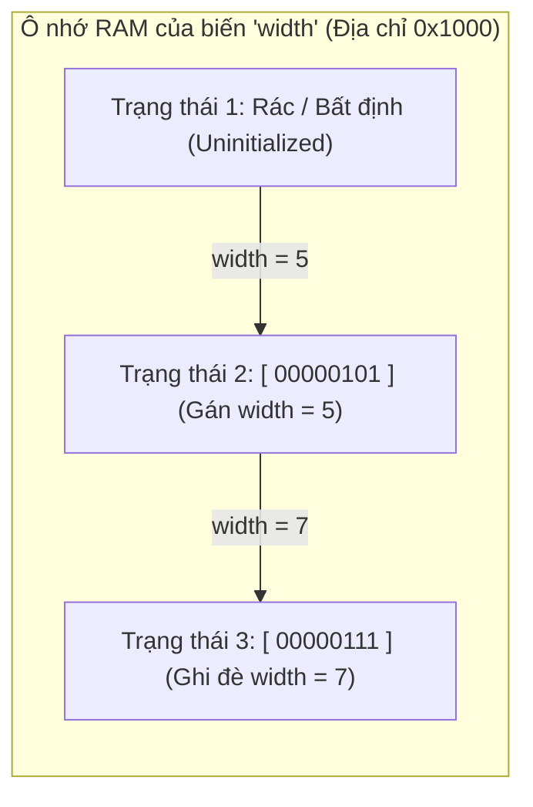

# 1.4 — Khởi Tạo Biến Và Phép Gán (Variable Assignment & Initialization)

---

## 🎯 Mục Tiêu Bài Học
- Phân biệt rạch ròi giữa **Khởi tạo (Initialization)** và **Phép gán (Assignment)** ở cấp độ chu kỳ sống của đối tượng.
- Nắm vững 6 hình thái khởi tạo trong C++: Default, Copy, Direct, List/Uniform, Copy-list, và Value/Zero initialization.
- Hiểu tại sao **Khởi tạo danh sách (Uniform / Brace Initialization - C++11)** là chuẩn mực vàng giúp ngăn chặn lỗi mất mát dữ liệu (Narrowing Conversions).
- Sử dụng thuộc tính `[[maybe_unused]]` (C++17) để dập tắt cảnh báo biến không sử dụng khi biên dịch với cờ khắt khe.

---

## 1. Phép Gán (Assignment)

Sau khi một biến đã được định nghĩa, bạn có thể gán giá trị cho nó bằng toán tử gán `=`. Thao tác này sao chép giá trị từ vế phải vào ô nhớ của biến ở vế trái (được gọi là **copy-assignment**).

```cpp
int width; // Định nghĩa biến width
width = 5; // Phép gán: ghi giá trị 5 vào ô nhớ của width
width = 7; // Ghi đè giá trị 7 vào width, giá trị 5 cũ bị hủy bỏ
```



::: danger Cạm bẫy: Nhầm lẫn giữa `=` và `==`
- Toán tử `=` là **Toán tử gán (Assignment)**: Đặt giá trị cho biến.
- Toán tử `==` là **Toán tử so sánh bằng (Equality comparison)**: Kiểm tra hai vế có bằng nhau hay không.
:::

---

## 2. Khởi Tạo Biến (Initialization)

Nhược điểm của phép gán là bạn phải tốn 2 câu lệnh: một để định nghĩa và một để gán giá trị. Trong khoảng thời gian giữa hai câu lệnh đó, biến có thể mang giá trị rác nguy hiểm.

**Khởi tạo (Initialization)** kết hợp cả hai bước làm một: Cung cấp ngay giá trị ban đầu cho đối tượng ngay tại thời điểm nó được sinh ra trên bộ nhớ.

```cpp
int width { 5 }; // Khởi tạo biến width với giá trị ban đầu là 5
```

---

## 3. Các Hình Thái Khởi Tạo Trong C++

Lịch sử tiến hóa của C++ tạo ra 6 hình thái khởi tạo:

```cpp
int a;         // 1. Default-initialization (Không khởi tạo -> Giá trị rác bất định!)
int b = 5;     // 2. Copy-initialization (Kế thừa từ C, dùng dấu =)
int c( 6 );    // 3. Direct-initialization (Dùng dấu ngoặc đơn () )
int d { 7 };   // 4. Direct-list-initialization (C++11 Uniform/Brace init, dùng dấu ngoặc nhọn {} )
int e = { 8 }; // 5. Copy-list-initialization (Hiếm khi dùng)
int f {};      // 6. Value-initialization / Zero-initialization (Cặp ngoặc nhọn rỗng -> Khởi tạo về 0)
```

### Tại sao nên dùng Khởi Tạo Bằng Ngoặc Nhọn `{}` (Uniform / List Initialization)?
Được giới thiệu từ C++11 bởi Bjarne Stroustrup, cú pháp ngoặc nhọn `{}` giải quyết triệt để sự phân mảnh cú pháp trong C++ cũ và sở hữu ưu điểm vượt trội: **Cấm chuyển đổi thu hẹp dữ liệu (Disallows Narrowing Conversions)**!

Hãy xem sự khác biệt khi cố tình nhét một số thực (`4.5`) vào biến số nguyên (`int`):

```cpp
int w1 = 4.5; // Hợp lệ (nhưng nguy hiểm): Compiler âm thầm cắt bỏ .5, w1 nhận giá trị 4!
int w2(4.5);  // Hợp lệ: Compiler âm thầm cắt bỏ .5, w2 nhận giá trị 4!

int w3 { 4.5 }; // LỖI BIÊN DỊCH (Compile Error): narrowing conversion of '4.5' from 'double' to 'int' is not allowed!
```

Trình biên dịch sẽ **bắt buộc dừng lại và báo lỗi ngay lập tức** nếu bạn dùng `{}` mà giá trị bị mất dữ liệu. Điều này giúp ngăn chặn hàng ngàn bug tiềm ẩn trong các hệ thống thực tế!

---

## 4. Value-Initialization Và Zero-Initialization

Khi bạn đặt một cặp dấu ngoặc nhọn rỗng `{}`, C++ thực hiện **Value-initialization**. Đối với các kiểu dữ liệu nguyên thủy (như `int`, `double`, `bool`), biến sẽ được đảm bảo đưa về giá trị `0`:

```cpp
int x {};    // x được khởi tạo chắc chắn bằng 0
double d {}; // d được khởi tạo chắc chắn bằng 0.0
```

::: tip Quy Tắc Chọn `{ giá_trị }` hay `{}`
- Dùng `{ 5 }` khi bạn có sẵn giá trị cụ thể và sẽ sử dụng giá trị đó ngay.
- Dùng `{}` khi biến chỉ mang giá trị tạm thời và sẽ sớm bị thay thế (ví dụ: biến dùng để nhận dữ liệu nhập từ bàn phím qua `std::cin >> x;`).
:::

---

## ⚠️ Hộp Cạm Bẫy Thực Chiến & Undefined Behavior (UB)

::: warning Cạm Bẫy Tử Thần Khi Khai Báo Nhiều Biến Cùng Dòng
Hãy quan sát dòng code sau:
```cpp
int a, b = 5; // CỰC KỲ NGUY HIỂM!
```
Nhiều người lầm tưởng cả `a` và `b` đều bằng `5`. **Hoàn toàn sai!**
- Biến `b` được khởi tạo bằng `5`.
- Biến `a` **hoàn toàn không được khởi tạo (default-initialization)** và chứa giá trị rác bất định!

Việc đọc biến `a` sau đó sẽ dẫn thẳng tới **Undefined Behavior (UB)**.

Muốn khởi tạo cả hai trên cùng một dòng, bạn phải viết:
```cpp
int a { 5 }, b { 5 }; // Hợp lệ nhưng không khuyến khích phong cách này
```
:::

---

## 🚀 Hộp Cập Nhật C++17 / C++20: Thuộc Tính `[[maybe_unused]]`

Khi bạn biên dịch dự án với cờ khắt khe của compiler (`-Wall -Wextra -Werror`), việc khai báo một biến đã khởi tạo nhưng chưa dùng đến sẽ khiến compiler coi đó là một LỖI và dừng biên dịch:

```cpp
int x { 5 }; // error: unused variable 'x' [-Werror=unused-variable]
```

C++17 cung cấp thuộc tính chuẩn **`[[maybe_unused]]`** để báo cho trình biên dịch: *"Tôi biết biến này có thể chưa được dùng đến, xin đừng phát cảnh báo!"*:

```cpp
[[maybe_unused]] double pi { 3.141592653589793 };
[[maybe_unused]] double gravity { 9.80665 };
```

---

## 💡 Hộp Thực Hành Tốt Nhất (Best Practice)

::: tip Quy Tắc Vàng
1. **Luôn luôn khởi tạo biến ngay khi khai báo**: Không bao giờ để biến ở trạng thái uninitialized.
2. **Ưu tiên sử dụng Direct-list-initialization `{}` hoặc Value-initialization `{}`**:
   ```cpp
   int score { 100 }; // Tốt nhất
   int user_input {}; // Tốt nhất cho biến chuẩn bị nhập
   ```
3. **Mỗi dòng chỉ khai báo và khởi tạo một biến duy nhất**.
:::

---

## 📝 Hệ Thống Quiz & Bài Tập Tự Luyện

### Câu hỏi 1:
Sự khác nhau cơ bản giữa Khởi tạo (Initialization) và Phép gán (Assignment) là gì?
::: details [Xem lời giải]
- **Khởi tạo (Initialization)**: Cung cấp giá trị ban đầu cho biến ngay tại thời điểm biến được cấp phát bộ nhớ.
- **Phép gán (Assignment)**: Thay đổi/ghi đè giá trị của một biến đã tồn tại trước đó trong bộ nhớ.
:::

### Câu hỏi 2:
Hình thái khởi tạo nào được khuyến nghị ưu tiên hàng đầu trong C++ hiện đại? Vì sao?
::: details [Xem lời giải]
Khởi tạo danh sách bằng ngoặc nhọn (**Direct-list-initialization** như `int x{ 5 };` hoặc **Value-initialization** như `int x{};`). Vì nó áp dụng đồng nhất cho mọi kiểu dữ liệu và ngăn chặn triệt để lỗi chuyển đổi thu hẹp làm mất dữ liệu (Narrowing conversions).
:::

### Câu hỏi 3:
Chuyện gì xảy ra trong đoạn mã sau?
```cpp
int x { 7.8 };
```
::: details [Xem lời giải]
Chương trình sẽ bị **Lỗi biên dịch (Compile Error)**! Cú pháp list-initialization nghiêm cấm narrowing conversion từ kiểu số thực `double` sang kiểu số nguyên `int`.
:::

### Câu hỏi 4:
Mục đích của thuộc tính `[[maybe_unused]]` trong C++17 là gì?
::: details [Xem lời giải]
Báo cho trình biên dịch biết rằng biến này có thể cố tình không được sử dụng trong mã nguồn, từ đó triệt tiêu cảnh báo `unused variable` của trình biên dịch (đặc biệt khi bật cờ `-Werror`).
:::
