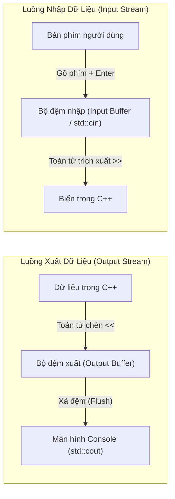

# 1.5 — Nhập Xuất Dữ Liệu Với iostream: cout, cin Và endl

---

## 🎯 Mục Tiêu Bài Học
- Làm chủ thư viện nhập/xuất chuẩn `<iostream>`: Đối tượng xuất `std::cout` và đối tượng nhập `std::cin`.
- Phân biệt toán tử chèn luồng (`<<`) và toán tử trích xuất luồng (`>>`).
- Hiểu rõ bản chất cơ chế đệm (Buffering) và sự khác biệt sống còn về hiệu năng giữa `std::endl` và ký tự xuống dòng `\n`.
- Phân tích cặn kẽ thuật toán trích xuất của `std::cin` và cách xử lý các trường hợp người dùng nhập sai kiểu dữ liệu.

---

## 1. Thư Viện `<iostream>` Và Luồng Dữ Liệu (Streams)

Thư viện `<iostream>` (Input/Output Stream) là một phần cốt lõi của Thư viện chuẩn C++ (C++ Standard Library). Trong C++, nhập/xuất được mô hình hóa dưới dạng một **Dòng chảy dữ liệu (Stream)**:
- Dữ liệu chảy từ chương trình ra ngoài màn hình Console (`std::cout`).
- Dữ liệu chảy từ bàn phím người dùng vào chương trình (`std::cin`).



---

## 2. Xuất Dữ Liệu Với `std::cout` Và Toán Tử Chèn `<<`

Đối tượng `std::cout` (Character Output) cùng với **Toán tử chèn luồng (Stream Insertion Operator `<<`)** dùng để đẩy dữ liệu ra màn hình:

```cpp
#include <iostream>

int main()
{
    std::cout << 42;                 // In số nguyên
    std::cout << "Điểm số: " << 100; // Nối luồng (Chaining) nhiều giá trị liên tiếp
    
    int x { 5 };
    std::cout << "Giá trị của x là: " << x << '\n';
    return 0;
}
```

::: tip Quy Tắc Nhớ Mũi Tên Toán Tử
- `std::cout << x;`: Mũi tên `<<` chỉ về phía `std::cout` -> Đẩy giá trị từ `x` ra màn hình.
- `std::cin >> x;`: Mũi tên `>>` chỉ về phía `x` -> Đẩy giá trị từ bàn phím vào biến `x`.
:::

---

## 3. Xuống Dòng: `std::endl` Đối Đầu Ký Tự `\n`

Nhiều người mới học thường quen tay dùng `std::endl` để xuống dòng:
```cpp
std::cout << "Dòng 1" << std::endl;
```

### Bản Chất Hiệu Năng Ẩn Sau `std::endl`
`std::endl` thực hiện 2 công việc hoàn toàn khác nhau:
1. Gửi ký tự xuống dòng `\n` ra màn hình.
2. **Ép xả toàn bộ bộ đệm xuất (Flush Output Buffer)**.

Hệ thống I/O của hệ điều hành có tốc độ ghi ra phần cứng rất chậm so với RAM. Để tối ưu, C++ gom các yêu cầu xuất vào một bộ đệm (Buffer). Chỉ khi bộ đệm đầy hoặc chương trình kết thúc, dữ liệu mới được đẩy ra một lần.

Nếu bạn lặp lại `std::endl` hàng nghìn lần trong vòng lặp, hệ điều hành sẽ bị ép xả đệm liên tục ra phần cứng, khiến **tốc độ chương trình tụt giảm thê thảm từ 10 đến 100 lần**!

::: tip Quy Tắc Vàng
Luôn ưu tiên sử dụng `'\n'` (ký tự đơn) hoặc `"\n"` (chuỗi) để xuống dòng. Hãy để trình biên dịch và hệ điều hành tự động quyết định thời điểm xả bộ đệm.
```cpp
std::cout << "Xin chào!\n";
std::cout << "Giá trị: " << x << '\n';
```
:::

---

## 4. Nhập Dữ Liệu Với `std::cin` Và Toán Tử Trích Xuất `>>`

`std::cin` (Character Input) đọc dữ liệu từ bộ đệm bàn phím. Khi bạn gọi `std::cin >> x;`, chương trình sẽ dừng lại chờ người dùng gõ phím và nhấn **Enter**.

```cpp
#include <iostream>

int main()
{
    std::cout << "Nhập vào 2 số nguyên cách nhau bởi dấu cách: ";
    int a {};
    int b {};
    std::cin >> a >> b; // Trích xuất lần lượt vào a rồi đến b

    std::cout << "Tổng hai số là: " << (a + b) << '\n';
    return 0;
}
```

### Cơ Chế Hoạt Động Của `operator>>`:
1. **Bỏ qua khoảng trắng đầu dòng (Leading Whitespace)**: Tự động bỏ qua các dấu cách (space), tab, hoặc dấu xuống dòng (`\n`) còn sót lại trước đó.
2. **Đọc ký tự hợp lệ**: Đọc liên tiếp các ký tự thuộc định dạng của biến mục tiêu (ví dụ với `int` là các chữ số `0-9` hoặc dấu `+`, `-`).
3. **Dừng lại khi gặp ký tự không hợp lệ**: Khi gặp ký tự lạ hoặc khoảng trắng, phép trích xuất dừng lại. Ký tự lạ đó vẫn **nằm nguyên trong bộ đệm nhập** để chờ lần trích xuất tiếp theo!

---

## ⚠️ Hộp Cạm Bẫy Thực Chiến & Undefined Behavior (UB)

::: warning Cạm Bẫy Trích Xuất Thất Bại (Extraction Failure)
Chuyện gì xảy ra nếu biến là số nguyên `int x{ 5 };` nhưng người dùng lại nhập chữ cái (ví dụ: `abc`)?
1. Trình trích xuất đọc ký tự đầu tiên `'a'`, nhận thấy không phải số nguyên hợp lệ.
2. **Phép trích xuất thất bại hoàn toàn!**
3. Theo chuẩn C++11 trở đi, biến `x` sẽ tự động bị gán về giá trị `0`.
4. Quan trọng nhất: **`std::cin` rơi vào trạng thái lỗi (Fail State)**. Mọi lệnh `std::cin >> ...` tiếp theo trong chương trình đều bị bỏ qua (không thèm đọc gì nữa) cho đến khi luồng được xóa lỗi qua `std::cin.clear()`!
:::

---

## 🚀 Hộp Cập Nhật C++20 / C++23

::: tip C++23: `std::println` Thay Thế Hoàn Toàn `std::cout`
Với C++23, bạn không còn phải lo lắng về việc nối chuỗi `<<` hay băn khoăn giữa `\n` và `std::endl`:

```cpp
#include <print>

int main()
{
    int age { 20 };
    double gpa { 3.9 };
    
    // Tự động xuống dòng, không flush đệm thừa thãi, cú pháp format siêu đẹp
    std::println("Tuổi: {}, GPA: {:.2f}", age, gpa);
    return 0;
}
```
:::

---

## 💡 Hộp Thực Hành Tốt Nhất (Best Practice)

::: tip Quy Tắc Vàng
1. **Luôn dùng `\n` thay vì `std::endl`** khi xuất văn bản ra console.
2. **Luôn khởi tạo biến về 0 bằng `{}` trước khi dùng `std::cin`**:
   ```cpp
   int input_val {}; // Value-initialization an toàn
   std::cin >> input_val;
   ```
3. **Chú ý dấu nháy**: Sử dụng dấu gạch chéo ngược `\` cho ký tự điều khiển (`'\n'`), không dùng dấu gạch chéo xuôi (`'/n'`).
:::

---

## 📝 Hệ Thống Quiz & Bài Tập Tự Luyện

### Câu hỏi 1:
Cho đoạn mã sau:
```cpp
int x {};
std::cin >> x;
std::cout << "x = " << x << '\n';
```
Hãy cho biết giá trị in ra màn hình của `x` và trạng thái còn lại trong bộ đệm nhập khi người dùng gõ vào từng trường hợp sau:
- a) Người dùng nhập: `123abc` rồi ấn Enter.
- b) Người dùng nhập: `abc123` rồi ấn Enter.
- c) Người dùng nhập: `3.7` rồi ấn Enter.
::: details [Xem lời giải]
- **a) Nhập `123abc`**: `x = 123`. Ký tự `abc\n` vẫn nằm lại trong bộ đệm nhập.
- **b) Nhập `abc123`**: Trích xuất thất bại ngay từ ký tự `'a'`. `x` được gán bằng `0`, `std::cin` rơi vào trạng thái Fail State. Toàn bộ `abc123\n` vẫn nằm lại trong bộ đệm.
- **c) Nhập `3.7`**: `x = 3`. Trình trích xuất dừng lại khi gặp dấu chấm `.`. Phần `.7\n` vẫn nằm lại trong bộ đệm nhập cho lần đọc sau.
:::

### Câu hỏi 2:
Viết chương trình hoàn chỉnh yêu cầu người dùng nhập vào 3 số nguyên cách nhau bởi dấu cách, sau đó in ra trung bình cộng của 3 số đó trên màn hình (dùng dấu `\n` để xuống dòng).
::: details [Xem lời giải]
```cpp
#include <iostream>

int main()
{
    std::cout << "Nhap vao 3 so nguyen: ";
    int a {};
    int b {};
    int c {};
    std::cin >> a >> b >> c;

    // Lưu ý: ép kiểu sang double để tránh phép chia nguyên mất số thập phân
    double average { (a + b + c) / 3.0 };

    std::cout << "Trung binh cong la: " << average << '\n';
    return 0;
}
```
:::
