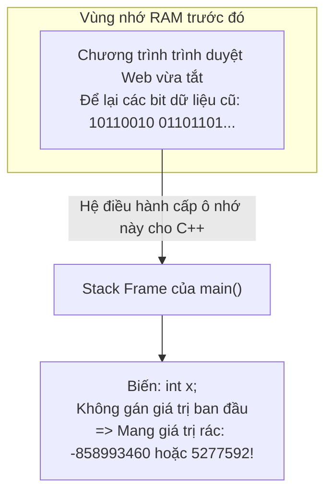

# 1.6 — Biến Chưa Khởi Tạo Và Hành Vi Không Xác Định (Undefined Behavior)

---

## 🎯 Mục Tiêu Bài Học
- Hiểu nguồn gốc vật lý của **Giá trị rác (Garbage Values)** trong bộ nhớ RAM.
- Nắm vững định nghĩa và sự nguy hiểm tột cùng của **Hành vi không xác định (Undefined Behavior - UB)** trong chuẩn ISO C++.
- Phân biệt bộ ba: **Undefined Behavior (UB)**, **Implementation-defined Behavior**, và **Unspecified Behavior**.
- Sử dụng các công cụ phân tích hiện đại (Undefined Behavior Sanitizer - UBSan, Compiler Warnings) để truy tìm và tiêu diệt biến rác.

---

## 1. Biến Chưa Khởi Tạo (Uninitialized Variables) Là Gì?

Không giống như một số ngôn ngữ cấp cao (như Java hay C# tự động gán biến số nguyên về `0`), **C++ kế thừa triết lý hiệu năng tối thượng từ C: "Không trả tiền cho những thứ bạn không dùng" (Zero-overhead principle)**. 

Khi bạn khai báo một biến cục bộ mà không khởi tạo giá trị:
```cpp
int x; // default-initialization cho kiểu nguyên thủy: KHÔNG làm gì cả!
```
Trình biên dịch chỉ đơn thuần cấp phát cho `x` một dải địa chỉ 4 byte trên vùng nhớ Stack. Tại địa chỉ đó, các bóng bán dẫn (transistor) hoặc tụ điện trong chip RAM vẫn đang lưu giữ **các bit 0 và 1 ngẫu nhiên do các chương trình trước đó chạy xong để lại**. Dữ liệu ngẫu nhiên này được gọi là **Giá trị rác (Garbage Value)**.



Nếu bạn cố tình đọc giá trị của `x`:
```cpp
#include <iostream>

int main()
{
    int x; // Biến chưa khởi tạo
    std::cout << x << '\n'; // Đọc giá trị rác => GÂY RA UNDEFINED BEHAVIOR!
    return 0;
}
```

---

## 2. Hành Vi Không Xác Định (Undefined Behavior - UB)

Theo định nghĩa của Chuẩn ISO C++:
&gt; **Undefined Behavior (UB)** là trạng thái mã nguồn thực thi một hành động mà ngôn ngữ C++ không quy định bất kỳ quy tắc hay kết quả nào. 

Nói cách khác, một khi chương trình chạm vào UB, **chuẩn C++ không còn bảo đảm tính đúng đắn cho bất kỳ dòng code nào tiếp theo nữa**. Mọi giả định về logic phần mềm đều sụp đổ!

### 7 Biểu Hiện Chết Người Của UB Trong Thực Tế:
1. **Chạy ra kết quả sai hoàn toàn**: Biến mang một con số kỳ quái.
2. **Crash ngay lập tức**: Bị hệ điều hành "bắn hạ" bằng lỗi *Segmentation Fault* hoặc *Access Violation*.
3. **Chạy đúng trên máy bạn, nhưng crash trên máy sếp hoặc máy khách hàng**: Phụ thuộc ngẫu nhiên vào dữ liệu RAM của từng máy.
4. **Chạy đúng ở chế độ Debug, nhưng crash khi build Release**: Compiler bật tối ưu hóa (-O2/-O3) sẽ giả định UB không bao giờ xảy ra và xóa sổ các đoạn code kiểm tra của bạn!
5. **Chạy bình thường hôm nay, bỗng nhiên lăn ra sập vào ngày mai**: Do vị trí cấp phát RAM bị thay đổi.
6. **Lỗ hổng bảo mật nghiêm trọng**: Rò rỉ khóa bí mật (private keys) hoặc dữ liệu nhạy cảm còn sót lại trong RAM của người dùng trước.
7. **Thời gian chạy bị thay đổi bất thường**.

---

## 3. Phân Biệt: Undefined vs Implementation-defined vs Unspecified

| Khái niệm ISO C++ | Ý nghĩa chuẩn xác | Ví dụ thực tế | Mức độ nguy hiểm |
| :--- | :--- | :--- | :--- |
| **Undefined Behavior (UB)** | Chuẩn không đưa ra bất kỳ quy định nào. Chương trình có thể crash hoặc sinh mã tùy ý. | Đọc biến rác, chia cho 0, truy cập mảng ngoài biên, tràn số nguyên có dấu. | 🔴 **Cực kỳ nguy hiểm** (Phải triệt tiêu 100%) |
| **Implementation-defined** | Chuẩn cho phép compiler tự quyết định, nhưng compiler **bắt buộc phải ghi rõ trong tài liệu kỹ thuật**. | Kích thước `sizeof(int)` là 4 byte hay 2 byte; dịch bit có dấu. | 🟡 **Cần lưu ý khi chuyển nền tảng (Portability)** |
| **Unspecified Behavior** | Chuẩn cho phép compiler tự quyết định hành vi hợp lệ, nhưng **không bắt buộc phải ghi vào tài liệu**. | Thứ tự tính toán các đối số truyền vào hàm: `foo(a(), b())`. | 🟠 **Tiềm ẩn bug bất ngờ nếu dựa vào thứ tự** |

---

## ⚠️ Hộp Cạm Bẫy Thực Chiến & Undefined Behavior (UB)

::: warning Cạm Bẫy Ảo Tưởng: "Tôi Chạy Thấy Vẫn Ra Số 0 Mà, Có Lỗi Đâu?"
Rất nhiều học viên thắc mắc: *"Tại sao em chạy code đọc biến chưa khởi tạo nhưng màn hình vẫn in ra số 0?"*.

**Sự thật phía sau**:
- Trên chế độ **Debug** của một số IDE (như Visual Studio), trình biên dịch cố tình điền các byte đặc biệt vào bộ nhớ (ví dụ `0xCC` tương ứng `-858993460`) để giúp bạn dễ nhận ra lỗi.
- Trên các hệ thống Linux, một tiến trình mới được cấp phát trang nhớ (memory page) vừa tinh khôi từ kernel có thể ngẫu nhiên chứa toàn số `0`.

**Đó là sự may mắn tạm thời, không phải là tính năng của ngôn ngữ!** Một ngày nào đó khi trang nhớ đó chứa dữ liệu rác, hệ thống của bạn sẽ sụp đổ.
:::

---

## 🚀 Hộp Cập Nhật C++20 / C++23: UBSan & Compile-time Detection

::: tip Phát Hiện UB Bằng UBSan và `constexpr`
1. **Undefined Behavior Sanitizer (UBSan)**: Trình biên dịch hiện đại như GCC và Clang tích hợp sẵn cờ `-fsanitize=undefined`. Nếu bạn đọc biến chưa khởi tạo, chương trình sẽ lập tức in cảnh báo đỏ rực ngay tại runtime:
   ```bash
   g++ -fsanitize=undefined main.cpp -o main
   ```
2. **C++20 Constexpr Kiểm Tra UB Ngay Khi Biên Dịch**: Trong C++20, nếu bạn chạy một hàm `constexpr` mà có chứa biến chưa khởi tạo được đọc, trình biên dịch sẽ quăng lỗi compile-time ngay lập tức:
   ```cpp
   constexpr int compute() {
       int uninit;
       return uninit; // LỖI COMPILE-TIME trong C++20: đọc giá trị không xác định!
   }
   ```
:::

---

## 💡 Hộp Thực Hành Tốt Nhất (Best Practice)

::: tip Quy Tắc Bất Di Bất Dịch
1. **Không bao giờ để biến ở trạng thái uninitialized**: Luôn khởi tạo ngay khi khai báo:
   ```cpp
   int score {}; // Luôn an toàn với value-initialization
   ```
2. **Bật toàn bộ cờ cảnh báo của Compiler**:
   ```bash
   -Wall -Wextra -Wpedantic -Werror
   ```
   Cờ này sẽ biến mọi cảnh báo dùng biến chưa khởi tạo thành lỗi và chặn đứng quá trình biên dịch!
:::

---

## 📝 Hệ Thống Quiz & Bài Tập Tự Luyện

### Câu hỏi 1:
Thế nào là một biến chưa khởi tạo (Uninitialized variable)? Tại sao việc sử dụng nó lại dẫn đến Undefined Behavior?
::: details [Xem lời giải]
Biến chưa khởi tạo là biến đã được cấp phát bộ nhớ nhưng chưa được gán bất kỳ giá trị hợp lệ nào (thông qua initialization hoặc assignment). Vì chưa được gán, ô nhớ của biến chứa các bit rác ngẫu nhiên. Chuẩn ISO C++ không định nghĩa kết quả khi một chương trình đọc các bit dữ liệu bất định này, do đó hành động này được coi là Undefined Behavior.
:::

### Câu hỏi 2:
Đoạn code sau đây có đảm bảo luôn in ra giá trị giống nhau trên mọi máy tính và mọi trình biên dịch không? Tại sao?
```cpp
#include <iostream>

int main()
{
    int total;
    total = total + 5;
    std::cout << total << '\n';
    return 0;
}
```
::: details [Xem lời giải]
**Hoàn toàn không!** Biến `total` chưa được khởi tạo nhưng lại được lấy ra để thực hiện phép cộng `total + 5`. Đây là Undefined Behavior nghiêm trọng. Giá trị của `total` là hoàn toàn bất định (rác), có thể thay đổi giữa các lần chạy, giữa các hệ điều hành và giữa các trình biên dịch khác nhau.
:::

### Câu hỏi 3:
Sự khác biệt cơ bản giữa **Implementation-defined behavior** và **Undefined behavior** là gì?
::: details [Xem lời giải]
- **Implementation-defined behavior**: Hành vi hợp lệ và có thể dự đoán được trên một trình biên dịch cụ thể, và trình biên dịch đó bắt buộc phải công bố cách xử lý trong tài liệu chính thức (ví dụ: `sizeof(int)`).
- **Undefined behavior**: Hành vi hoàn toàn không được chuẩn quy định. Trình biên dịch không có nghĩa vụ phải xử lý nhất quán hay cảnh báo, chương trình có thể chạy sai logic, sinh rác, hoặc sập hệ thống bất cứ lúc nào.
:::
