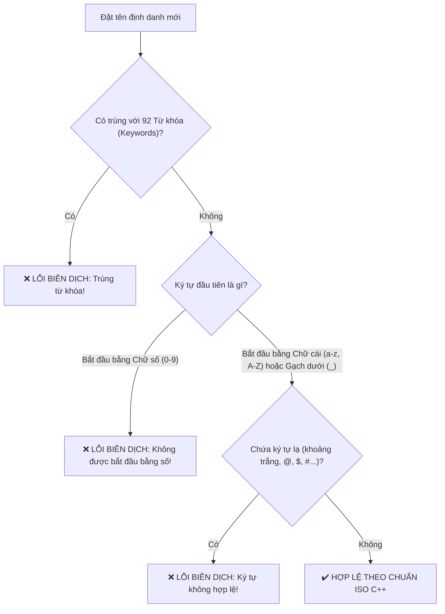

# 1.7 — Từ Khóa Và Quy Tắc Đặt Tên Định Danh (Keywords & Identifiers)

---

## 🎯 Mục Tiêu Bài Học
- Nắm vững danh sách 92 **Từ khóa (Keywords)** của chuẩn C++23 và các từ khóa ngữ cảnh (**Contextual Keywords**).
- Làm chủ 4 quy tắc bắt buộc của trình biên dịch khi đặt tên **Định danh (Identifiers)**.
- Phân biệt các vùng định danh cấm kỵ (Reserved Identifiers) dành riêng cho trình biên dịch và hệ điều hành.
- Áp dụng các quy chuẩn đặt tên chuẩn công nghiệp: `snake_case`, `camelCase`, `PascalCase` và nguyên lý độ dài định danh tỷ lệ với phạm vi sống.

---

## 1. Từ Khóa (Keywords) Trong C++

Tính đến chuẩn **C++23**, C++ bảo lưu một tập hợp gồm **92 từ khóa**. Mỗi từ khóa mang một ý nghĩa ngữ nghĩa đặc biệt và không thể bị định nghĩa lại hoặc sử dụng làm tên biến, tên hàm.

```
auto        break       case        catch       char        class       const       constexpr
consteval   constinit   continue    decltype    default     delete      do          double
else        enum        explicit    export      extern      false       float       for
friend      goto        if          inline      int         long        mutable     namespace
new         noexcept    nullptr     operator    private     protected   public      register
return      short       signed      sizeof      static      static_cast struct      switch
template    this        throw       true        try         typedef     typename    union
unsigned    using       virtual     void        volatile    while       ...
```

### Từ Khóa Ngữ Cảnh (Contextual Keywords)
C++ còn định nghĩa một số định danh có ý nghĩa đặc biệt trong ngữ cảnh cụ thể nhưng vẫn có thể dùng làm tên biến (dù không khuyến khích):
- `override` (C++11) & `final` (C++11): Quản lý tính đa hình và kế thừa trong OOP.
- `import` (C++20) & `module` (C++20): Quản lý hệ thống C++20 Modules.

---

## 2. Quy Tắc Bắt Buộc Khi Đặt Tên Định Danh (Identifiers)

Định danh (Identifier) là tên gọi mà bạn gán cho biến, hàm, kiểu dữ liệu, hoặc nhãn (label). C++ đưa ra 4 quy tắc cú pháp bất di bất dịch:



1. **Không được trùng từ khóa**: `int return;` hoặc `double double;` sẽ báo lỗi ngay lập tức.
2. **Chỉ được chứa chữ cái (a-z, A-Z), chữ số (0-9) và dấu gạch dưới (`_`)**: Không được chứa khoảng trắng, dấu gạch ngang (`-`), hay ký tự đặc biệt (`@`, `$`, `%`, v.v.).
3. **Bắt buộc phải bắt đầu bằng chữ cái hoặc dấu gạch dưới**: Tuyệt đối không bắt đầu bằng chữ số (`int 2x;` là sai).
4. **Phân biệt chữ hoa chữ thường (Case-Sensitive)**: `my_variable`, `My_Variable` và `MY_VARIABLE` là 3 biến hoàn toàn độc lập và trỏ tới 3 ô nhớ khác nhau.

---

## ⚠️ Hộp Cạm Bẫy Thực Chiến: Vùng Định Danh Dành Riêng (Reserved Identifiers)

::: warning Cạm Bẫy: Đừng Tự Tiện Đặt Tên Bắt Đầu Bằng Dấu Gạch Dưới!
Chuẩn ISO C++ dành riêng các mẫu tên sau cho trình biên dịch (Compiler) và Thư viện chuẩn (Standard Library):
1. **Bắt đầu bằng hai dấu gạch dưới liên tiếp (`__`)**: Ví dụ `__temp`, `__init__`.
2. **Bắt đầu bằng một dấu gạch dưới theo sau ngay bởi một chữ cái viết hoa (`_Capital`)**: Ví dụ `_Count`, `_Value`.
3. **Bắt đầu bằng một dấu gạch dưới trong phạm vi toàn cục (Global Scope)**: Ví dụ `int _global_var;`.

Nếu bạn vi phạm, code của bạn có thể bị xung đột với các macro nội bộ của compiler (như `__LINE__`, `__FILE__`), gây ra lỗi biên dịch kỳ dị hoặc **Undefined Behavior** khi nâng cấp phiên bản compiler!
:::

---

## 3. Phong Cách Đặt Tên Chuẩn Công Nghiệp (Best Practices)

Một lập trình viên chuyên nghiệp luôn tuân thủ các quy ước sau:

### Quy Ước 1: Kiểu Viết (Casing Conventions)
- **Tên biến và Tên hàm**: Luôn bắt đầu bằng chữ thường.
  - **`snake_case`**: Các từ cách nhau bởi dấu gạch dưới (`total_score`, `calculate_grade()`). Đây là phong cách chính thức của Thư viện chuẩn C++ (STL).
  - **`camelCase`**: Viết hoa chữ cái đầu của các từ tiếp theo (`totalScore`, `calculateGrade()`).
- **Tên Kiểu dữ liệu tự định nghĩa (Class, Struct, Enum, Concept)**: Viết hoa chữ cái đầu mỗi từ (**`PascalCase`**): `StudentRecord`, `Vector3D`.
- **Hằng số biên dịch / Macros**: Viết hoa toàn bộ (`MAX_BUFFER_SIZE`).

### Quy Ước 2: Nguyên Lý "Độ Dài Tỷ Lệ Với Phạm Vi"
- **Biến có phạm vi cực ngắn (vài dòng trong vòng lặp)**: Có thể dùng tên ngắn gọn: `i`, `j`, `k`, `x`, `y`.
- **Biến có phạm vi rộng (biến toàn cục, biến thành viên lớp, tham số hàm)**: Bắt buộc phải đặt tên đầy đủ, rõ ràng và có ý nghĩa nghiệp vụ:
  - ❌ Xấu: `int d;` (Ngày? Khoảng cách? Dữ liệu?)
  - ✔️ Tốt: `int days_elapsed;` hoặc `int distance_in_meters;`

::: info Tư Duy Kỹ Thuật: "Code Được Đọc Nhiều Gấp 10 Lần So Với Được Viết"
Đừng tiếc vài giây gõ phím để viết tên biến ngắn gọn ngớ ngẩn (như `cstcnt` thay vì `customer_count`). Trình biên dịch hiện đại và tính năng Auto-complete của IDE sẽ giúp bạn gõ phím cực nhanh!
:::

---

## 🚀 Hộp Cập Nhật C++20: Từ Khóa Mới
C++20 bổ sung nhiều từ khóa mang tính cách mạng cho hệ thống lập trình mẫu và bất đồng bộ:
- `concept` & `requires`: Ràng buộc kiểu dữ liệu cho template.
- `consteval`: Ép buộc tính toán 100% tại compile-time.
- `constinit`: Đảm bảo biến được khởi tạo tại compile-time nhưng vẫn có thể thay đổi lúc runtime.
- `co_await`, `co_return`, `co_yield`: Hỗ trợ lập trình Coroutine bất đồng bộ.

---

## 💡 Hộp Thực Hành Tốt Nhất (Best Practice)

::: tip Quy Tắc Vàng
1. **Bắt đầu tên biến bằng chữ thường**: Dùng `snake_case` hoặc `camelCase` một cách nhất quán trong toàn bộ dự án.
2. **Tránh viết tắt tùy tiện**: Trừ các từ viết tắt phổ biến toàn cầu (`min`, `max`, `id`, `url`, `sql`, `temp`).
3. **Thêm đơn vị đo lường vào tên biến** nếu biến thể hiện đại lượng vật lý: `timeout_seconds`, `delay_ms`, `speed_kmh`.
:::

---

## 📝 Hệ Thống Quiz & Bài Tập Tự Luyện

### Câu hỏi 1:
Hãy phân loại các định danh sau thành: **Hợp lệ chuẩn mực (Conventional)**, **Hợp lệ nhưng vi phạm quy ước (Unconventional)**, hoặc **Bất hợp pháp gây lỗi biên dịch (Invalid)**:
1. `int total_sum {};`
2. `int _apple {};`
3. `int 2fast2furious {};`
4. `int my score {};`
5. `int bool {};`
6. `int NumberOfStudents {};`
7. `int MAXIMUM {};`
::: details [Xem lời giải]
1. `int total_sum {};`: **Hợp lệ chuẩn mực (Conventional)** - snake_case bắt đầu bằng chữ thường.
2. `int _apple {};`: **Hợp lệ nhưng vi phạm quy ước (Unconventional)** - không nên bắt đầu bằng dấu gạch dưới vì dễ đụng độ định danh hệ thống.
3. `int 2fast2furious {};`: **Bất hợp pháp (Invalid)** - không được bắt đầu bằng chữ số.
4. `int my score {};`: **Bất hợp pháp (Invalid)** - chứa khoảng trắng.
5. `int bool {};`: **Bất hợp pháp (Invalid)** - `bool` là từ khóa của C++.
6. `int NumberOfStudents {};`: **Hợp lệ nhưng vi phạm quy ước (Unconventional)** - biến thông thường không nên bắt đầu bằng chữ in hoa (chữ hoa dành cho kiểu dữ liệu/Class).
7. `int MAXIMUM {};`: **Hợp lệ nhưng vi phạm quy ước (Unconventional)** - viết hoa toàn bộ thường chỉ dành cho hằng số macro/preprocessor, dùng cho biến thông thường gây nhầm lẫn.
:::
