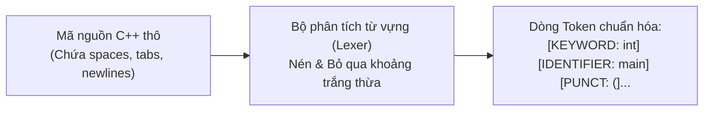

# 1.8 — Khoảng Trắng Và Định Dạng Mã Nguồn (Whitespace & Formatting)

---

## 🎯 Mục Tiêu Bài Học
- Hiểu cách bộ phân tích từ vựng (Lexer) của trình biên dịch C++ xử lý **Khoảng trắng (Whitespace)**.
- Nhận biết các trường hợp khoảng trắng là bắt buộc theo cú pháp và khi nào nó hoàn toàn vô hình với compiler.
- Phân biệt các phong cách đặt dấu ngoặc nhọn kinh điển (**Allman style** vs **K&R / OTBS style**).
- Nắm vững các tiêu chuẩn định dạng mã nguồn chuyên nghiệp: Giới hạn độ dài dòng (80/100 ký tự), ngắt toán tử đầu dòng, và căn lề dọc.
- Làm quen với công cụ định dạng tự động tiêu chuẩn công nghiệp: `clang-format`.

---

## 1. Khoảng Trắng (Whitespace) Trong C++ Là Gì?

**Khoảng trắng (Whitespace)** là thuật ngữ bao gồm 3 ký tự điều khiển định dạng:
1. Dấu cách (Space - mã ASCII `32`)
2. Dấu tab (Tab - mã ASCII `9`)
3. Dấu xuống dòng (Newline - `\n`, mã ASCII `10`)

C++ được xếp vào nhóm ngôn ngữ **Độc lập với khoảng trắng (Whitespace-independent language)** (trái ngược hoàn toàn với Python - nơi thụt dòng quyết định khối lệnh).

```cpp
// Hai đoạn mã sau hoàn toàn tương đương đối với Trình biên dịch:
int main() { std::cout << "Hi"; return 0; }

int main()
{
    std::cout << "Hi";
    return 0;
}
```



---

## 2. Khi Nào Khoảng Trắng Là Bắt Buộc?

Dù trình biên dịch bỏ qua khoảng trắng thừa, có 3 trường hợp khoảng trắng là **bắt buộc**:

1. **Phân tách hai từ khóa hoặc định danh đứng liền kề**:
   ```cpp
   int x; // Bắt buộc có khoảng trắng giữa int và x
   intx;  // LỖI: Compiler coi đây là một định danh tên là intx!
   ```
2. **Ngắt chỉ thị tiền xử lý (Preprocessor Directives)**: Mỗi chỉ thị như `#include` phải nằm trên một dòng riêng biệt.
3. **Kết thúc chú thích một dòng (`//`)**: Dấu xuống dòng là dấu hiệu kết thúc duy nhất của `//`.

### Khoảng Trắng Bên Trong Chuỗi Ký Tự
Khoảng trắng nằm giữa cặp dấu nháy kép `""` được giữ nguyên vẹn 100%:
```cpp
std::cout << "A    B"; // In ra chính xác 4 khoảng trắng giữa A và B
```

::: tip Tính Năng Ghép Chuỗi Tự Động (String Concatenation)
Hai chuỗi nháy kép đặt cạnh nhau và chỉ phân tách bởi khoảng trắng hoặc dấu xuống dòng sẽ tự động được trình biên dịch hợp nhất thành một chuỗi duy nhất:
```cpp
std::cout << "Xin chào, "
             "đây là một câu văn rất dài "
             "được chia thành nhiều dòng!\n";
```
:::

---

## 3. Phong Cách Định Dạng Mã Nguồn Chuẩn Quốc Tế

### 3.1. Phong Cách Ngoặc Nhọn: Allman vs K&R
- **Allman Style (Khuyên dùng cho người mới học)**: Ngoặc mở `{` nằm riêng trên một dòng, căn thẳng hàng với ngoặc đóng `}`.
  ```cpp
  int main()
  {
      return 0;
  }
  ```
  *Ưu điểm*: Các khối lệnh cực kỳ rõ ràng, dễ phát hiện thiếu ngoặc.
- **K&R / OTBS Style (One True Brace Style)**: Ngoặc mở `{` nằm cùng dòng với khai báo hàm/câu lệnh.
  ```cpp
  int main() {
      return 0;
  }
  ```
  *Ưu điểm*: Tiết kiệm diện tích màn hình hiển thị.

### 3.2. Giới Hạn Độ Dài Dòng (Line Length: 80 - 100 Ký Tự)
Chuẩn công nghiệp (Google C++ Style Guide) khuyến nghị mỗi dòng không vượt quá **80 đến 100 ký tự**. Điều này giúp lập trình viên có thể mở song song 2 hoặc 3 cửa sổ code trên cùng một màn hình để so sánh (Code Review).

### 3.3. Quy Tắc Ngắt Biểu Thức Dài
Khi một câu lệnh quá dài phải ngắt xuống dòng, **hãy luôn đặt toán tử ở đầu dòng tiếp theo**:

```cpp
// XẤU: Toán tử nằm cuối dòng khó nhận biết dòng tiếp theo là phần tiếp nối
std::cout << "Gia tri: " <<
    x + y +
    z;

// TỐT: Toán tử nằm ở đầu dòng tiếp theo, thẳng hàng
std::cout << "Gia tri: "
    << x + y
    + z;
```

---

## ⚠️ Hộp Cạm Bẫy Thực Chiến & Undefined Behavior (UB)

::: warning Cạm Bẫy: Xuống Dòng Bên Trong Chuỗi Nháy Kép Cũ
Tuyệt đối không được gõ phím Enter trực tiếp bên trong chuỗi nháy kép thông thường:
```cpp
// LỖI BIÊN DỊCH: missing terminating " character
std::cout << "Dong 1
Dong 2";
```
Nếu muốn xuống dòng trong chuỗi thông thường, bạn phải dùng `\n` hoặc dùng **Raw String Literal** của C++11 (`R"(...)"`).
:::

---

## 🚀 Hộp Cập Nhật C++20 / C++23: Tự Động Hóa Với Clang-Format

Trong các tập đoàn công nghệ lớn, lập trình viên không tự căn khoảng trắng bằng tay mà sử dụng tệp cấu hình **`.clang-format`**:

```yaml
BasedOnStyle: Google
IndentWidth: 4
ColumnLimit: 100
BreakBeforeBraces: Allman
```
Chỉ cần bấm tổ hợp phím `Shift + Alt + F` trong VS Code, toàn bộ mã nguồn của bạn sẽ tự động được định dạng hoàn hảo chuẩn quốc tế trong 0.1 giây!

---

## 💡 Hộp Thực Hành Tốt Nhất (Best Practice)

::: tip Quy Tắc Vàng
1. **Thụt lề thống nhất 4 spaces** cho mỗi khối mã bên trong `{}`.
2. **Căn lề dọc cho các biến hoặc comment liền kề** để tăng tốc độ quét mắt của con người:
   ```cpp
   int player_health  { 100 };
   int player_mana    { 50 };
   int player_stamina { 75 };
   ```
3. **Thêm dòng trắng giữa các đoạn logic khác nhau** để chia nhỏ hàm thành các "đoạn văn" dễ thở.
:::

---

## 📝 Hệ Thống Quiz & Bài Tập Tự Luyện

### Câu hỏi 1:
Đoạn mã sau có biên dịch được không? Kết quả in ra màn hình là gì?
```cpp
#include <iostream>
int main(){std::cout<<"A" "B"
"C";return 0;}
```
::: details [Xem lời giải]
**Biên dịch hoàn toàn bình thường!** C++ là ngôn ngữ độc lập với khoảng trắng, không phân biệt code viết trên 1 dòng hay nhiều dòng. Ba chuỗi ký tự `"A"`, `"B"`, và `"C"` được phân tách nhau bởi khoảng trắng và dấu xuống dòng sẽ tự động được nối thành `"ABC"`. Màn hình sẽ in ra: `ABC`.
:::

### Câu hỏi 2:
Tại sao khi ngắt một biểu thức toán học hoặc luồng `std::cout` dài qua nhiều dòng, ta nên đặt toán tử (`+`, `-`, `<<`) ở đầu dòng mới thay vì ở cuối dòng cũ?
::: details [Xem lời giải]
Đặt toán tử ở đầu dòng mới giúp:
1. Người đọc ngay lập tức nhận diện dòng này là phần kéo dài tiếp tục của câu lệnh phía trước.
2. Dễ dàng căn lề dọc các toán tử thẳng hàng nhau từ trên xuống dưới, giúp cấu trúc tính toán trở nên rõ ràng và giảm thiểu nhầm lẫn khi review code.
:::
