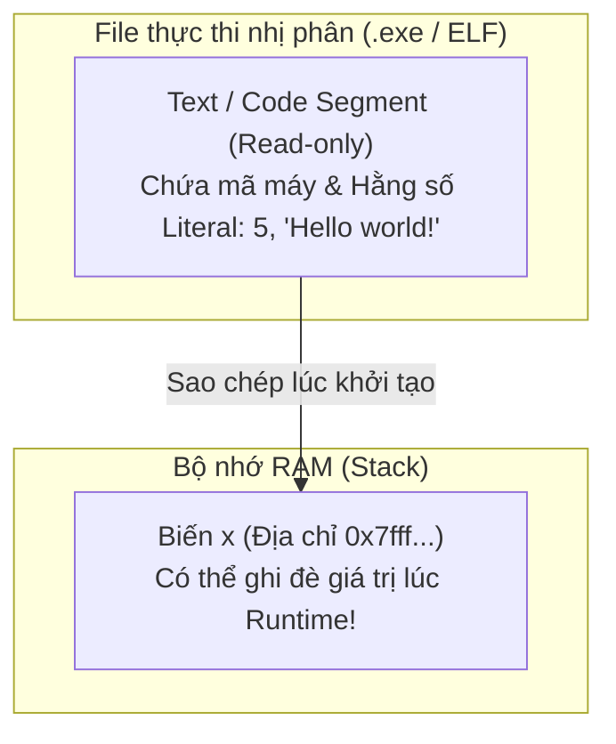
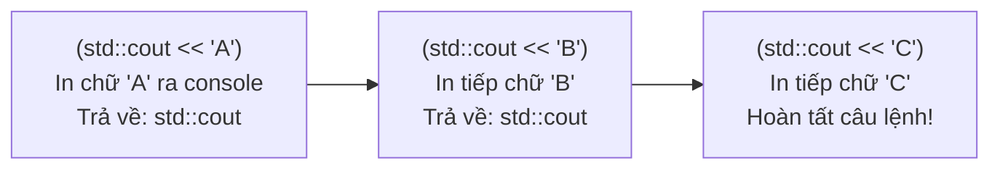

# 1.9 — Hằng Giá Trị (Literals) Và Toán Tử (Operators)

---

## 🎯 Mục Tiêu Bài Học
- Hiểu rõ bản chất phần cứng của **Hằng giá trị (Literal Constants)**: Lưu tại phân vùng mã máy (Text/Code Segment) ở chế độ chỉ đọc (Read-only).
- Nắm vững khái niệm **Toán tử (Operator)**, **Toán hạng (Operand)** và số ngôi của toán tử (**Arity**: Unary, Binary, Ternary).
- Phân biệt sự khác nhau giữa **Giá trị trả về (Return Value)** và **Hiệu ứng phụ (Side Effect)** theo chuẩn ISO C++.
- Giải mã cơ chế xâu chuỗi toán tử (Operator Chaining) trong `std::cout << a << b` và `x = y = 5`.

---

## 1. Hằng Giá Trị (Literals) Là Gì?

Hãy so sánh hai dòng code sau:
```cpp
std::cout << 5; // 5 là một literal
int x { 5 };     // x là một biến, được khởi tạo bởi literal 5
```

- **Hằng giá trị (Literal / Literal Constant)**: Là giá trị cố định được viết cứng trực tiếp vào mã nguồn. Nó có kiểu dữ liệu nhưng **không thể bị sửa đổi** sau khi biên dịch.
- **Bản chất phần cứng**: Khi biên dịch, các literal được nhúng thẳng vào file nhị phân thực thi (trong phân vùng **Text / Code Segment** ở chế độ chỉ đọc). Ngược lại, biến `x` đại diện cho một ô nhớ trên vùng **Stack (RAM)** có thể đọc và ghi giá trị mới tùy ý lúc runtime.



---

## 2. Toán Tử (Operators) Và Số Ngôi (Arity)

Trong toán học và C++, một **phép toán (Operation)** là quá trình tiếp nhận các giá trị đầu vào (gọi là **Toán hạng - Operands**) để tính toán sinh ra một giá trị mới (gọi là **Giá trị trả về - Return Value**). Biểu tượng đại diện cho phép toán được gọi là **Toán tử (Operator)**.

Số lượng toán hạng mà một toán tử yêu cầu được gọi là **Số ngôi (Arity)** của toán tử đó:

| Số ngôi (Arity) | Số toán hạng | Ví dụ trong C++ | Giải thích cơ chế |
| :--- | :--- | :--- | :--- |
| **Đơn ngôi (Unary)** | 1 | `-x`, `+y`, `!flag`, `sizeof(int)` | Đảo dấu số học, phủ định logic |
| **Hai ngôi (Binary)** | 2 | `a + b`, `x * y`, `std::cout << z` | Vế trái (Left operand) và vế phải (Right operand) |
| **Ba ngôi (Ternary)** | 3 | `condition ? val1 : val2` | Toán tử điều kiện duy nhất trong C++ |
| **Không ngôi (Nullary)**| 0 | `throw;` | Ném lại ngoại lệ hiện tại |

::: info Đa Ngữ Cảnh Của Ký Tự Toán Tử
Một ký tự có thể mang nhiều ý nghĩa tùy thuộc vào số ngôi của nó. Ví dụ ký hiệu `-`:
- Dạng đơn ngôi: `-5` (Toán tử đổi dấu số dương thành âm).
- Dạng hai ngôi: `8 - 3` (Toán tử trừ trong toán học).
:::

---

## 3. Giá Trị Trả Về (Return Value) Và Hiệu Ứng Phụ (Side Effect)

Trong ngôn ngữ giao tiếp hằng ngày, "tác dụng phụ" thường mang nghĩa tiêu cực (như uống thuốc bị đau bụng). Nhưng trong chuẩn ISO C++, khái niệm **Hiệu ứng phụ (Side Effect)** mang ý nghĩa hoàn toàn trung lập:

> **Hiệu ứng phụ (Side Effect)**: Là bất kỳ thay đổi nào có thể quan sát được đối với trạng thái của hệ thống sau khi toán tử thực thi, nằm ngoài việc sinh ra giá trị trả về.

Ví dụ:
- Phép toán `2 + 3`: Trả về giá trị `5`. Không làm thay đổi bất kỳ ô nhớ nào -> **Không có Side Effect**.
- Phép toán `x = 5`: Trả về giá trị tham chiếu tới `x`, đồng thời **ghi đè giá trị 5 vào ô nhớ của biến `x`** -> Thay đổi ô nhớ này chính là **Side Effect**!
- Lệnh `std::cout << 5`: Trả về đối tượng `std::cout`, đồng thời **đẩy ký tự `'5'` ra màn hình Console** -> Ghi ra màn hình chính là **Side Effect**!

---

## 4. Giải Mã Bí Ẩn Xâu Chuỗi Toán Tử (Chaining)

Tại sao bạn có thể viết:
```cpp
std::cout << "A" << "B" << "C";
```
và
```cpp
x = y = 5;
```

Bản chất là vì toán tử gán `=` và toán tử chèn `<<` đều **trả về chính toán hạng vế trái của chúng**:



1. `(std::cout << "A")` thực hiện in chữ `"A"` và trả về chính đối tượng `std::cout`.
2. Biểu thức trở thành `(std::cout) << "B" << "C";`.
3. Quá trình lặp lại tuần tự từ trái sang phải, tạo thành chuỗi in liên tục!

---

## ⚠️ Hộp Cạm Bẫy Thực Chiến & Undefined Behavior (UB)

::: warning Cạm Bẫy: Trộn Lẫn Side Effect Trong Cùng Một Biểu Thức!
Đừng bao giờ cố gắng đọc và sửa đổi cùng một biến nhiều lần trong cùng một câu lệnh phức tạp:
```cpp
int x { 5 };
int y = x + ++x; // NGUY HIỂM TỘT CÙNG: Trước C++17 là Undefined Behavior!
```
Thứ tự thực hiện các side effect giữa các toán hạng không có sự ngăn cách bởi chuỗi tuần tự (Sequence Point) sẽ khiến giá trị của `y` hoàn toàn bất định giữa các trình biên dịch khác nhau!
:::

---

## 🚀 Hộp Cập Nhật C++20: Toán Tử Ba Chiều `<=>` (Spaceship Operator)

C++20 mang đến toán tử phi thuyền **`<=>`** (Three-way comparison operator), cho phép so sánh toàn diện hai đối tượng chỉ bằng một phép toán duy nhất:

```cpp
#include <compare>
#include <iostream>

int main()
{
    int a { 10 };
    int b { 20 };
    auto result { a <=> b };

    if (result < 0)
        std::cout << "a nho hon b\n";
    else if (result > 0)
        std::cout << "a lon hon b\n";
    else
        std::cout << "a bang b\n";
    return 0;
}
```

---

## 💡 Hộp Thực Hành Tốt Nhất (Best Practice)

::: tip Quy Tắc Vàng
1. **Dùng dấu ngoặc đơn `()` để tường minh hóa độ ưu tiên**: Thay vì bắt người đọc phải tự nhớ bảng độ ưu tiên 17 cấp của C++, hãy viết `(2 + 3) * 4` thay vì `2 + 3 * 4`.
2. **Không lạm dụng Side Effect trong các biểu thức tính toán**: Tách các phép gán hoặc thay đổi biến thành các dòng lệnh độc lập.
:::

---

## 📝 Hệ Thống Quiz & Bài Tập Tự Luyện

### Câu hỏi 1:
Hãy cho biết giá trị in ra của các biểu thức sau:
- a) `std::cout << 1 + 2 * 3 << '\n';`
- b) `std::cout << (1 + 2) * 3 << '\n';`
- c) `std::cout << 10 - 4 - 2 << '\n';`
::: details [Xem lời giải]
- a) **7** (Phép nhân `*` có độ ưu tiên cao hơn phép cộng `+`, do đó `2 * 3 = 6`, sau đó `1 + 6 = 7`).
- b) **9** (Ngoặc đơn `()` có độ ưu tiên cao nhất, tính `1 + 2 = 3`, sau đó `3 * 3 = 9`).
- c) **4** (Toán tử trừ có tính kết hợp từ trái qua phải: `(10 - 4) - 2 = 6 - 2 = 4`).
:::

### Câu hỏi 2:
Đoạn mã sau in ra giá trị gì? Giải thích cơ chế:
```cpp
int a { 2 };
int b {};
b = a = 10;
std::cout << a << " " << b << '\n';
```
::: details [Xem lời giải]
In ra: `10 10`.
**Giải thích**: Toán tử gán `=` có tính kết hợp từ phải qua trái (Right-to-left associativity). Biểu thức được định giá là `b = (a = 10)`. Đầu tiên `a = 10` gán 10 vào `a` và trả về `a` (giá trị 10). Sau đó giá trị 10 này tiếp tục được gán vào `b`. Cả `a` và `b` đều mang giá trị 10.
:::
