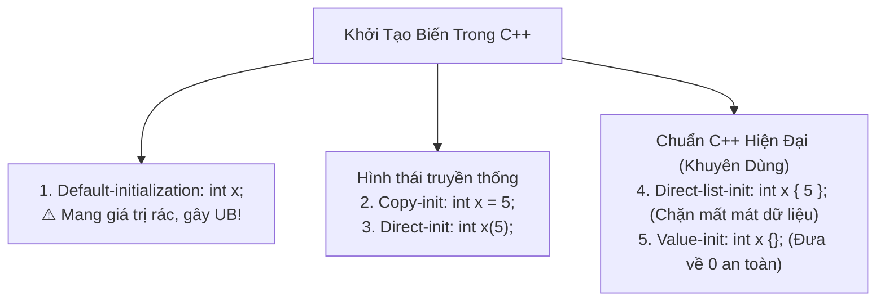
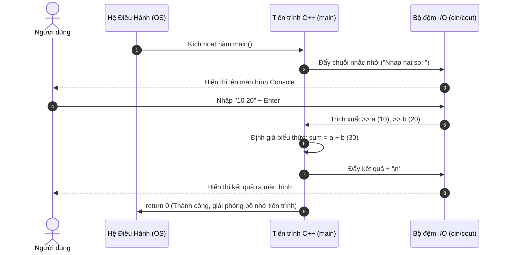

# 1.X — Tổng Kết Chương 1 & Bài Tập Đánh Giá Năng Lực

---

## 🎯 Mục Tiêu Bài Học
- Ôn tập toàn diện toàn bộ 11 bài học nền tảng của **Chương 01: C++ Căn Bản**.
- Hệ thống hóa các khái niệm then chốt: Vòng đời biến, 6 hình thái khởi tạo, cơ chế đệm I/O, Undefined Behavior và biểu thức.
- Vượt qua hệ thống câu hỏi kiểm tra năng lực và tự tay viết các chương trình C++ hoàn chỉnh không có lỗi.

---

## 1. Bảng Tra Cứu Khái Niệm Cốt Lõi Chương 1

| Khái niệm (Concept) | Định nghĩa chuẩn ISO C++ | Ví dụ minh họa |
| :--- | :--- | :--- |
| **Statement (Câu lệnh)** | Đơn vị chỉ thị thực thi độc lập kết thúc bằng dấu `;`. | `int x { 5 };` |
| **Function (Hàm)** | Tập hợp các câu lệnh được nhóm lại để thực thi tuần tự. | `int main() { ... }` |
| **Object (Đối tượng)** | Vùng nhớ lưu trữ (RAM/Register) có kiểu dữ liệu và chứa giá trị. | Vùng nhớ 4 bytes trên Stack |
| **Variable (Biến)** | Đối tượng có tên gọi (Identifier). | `int score;` |
| **Initialization (Khởi tạo)** | Cung cấp giá trị ban đầu cho đối tượng ngay khi cấp phát bộ nhớ. | `int x { 10 };` |
| **Assignment (Phép gán)** | Ghi đè giá trị mới vào ô nhớ của biến đã tồn tại từ trước. | `x = 20;` |
| **Undefined Behavior (UB)** | Trạng thái mã nguồn thực thi ngoài quy định của chuẩn ISO C++. | Đọc biến rác, chia cho 0 |
| **Literal (Hằng giá trị)** | Giá trị cố định nhúng trực tiếp vào file nhị phân (Read-only). | `42`, `"Hello"`, `'C'` |
| **Expression (Biểu thức)** | Sự kết hợp toán tử, biến, literal để tính ra một giá trị đơn nhất. | `(a + b) * 2` |

---

## 2. Bảng So Sánh 6 Hình Thái Khởi Tạo Biến



| Cú pháp khởi tạo | Tên gọi chuẩn | Đặc tính kỹ thuật | Khuyến nghị |
| :--- | :--- | :--- | :--- |
| `int x;` | Default-initialization | Chứa giá trị rác bất định | ❌ **Tránh tuyệt đối** |
| `int x = 5;` | Copy-initialization | Kế thừa từ C, tự động ép kiểu | 🟡 Cho phép |
| `int x( 5 );` | Direct-initialization | Dùng ngoặc tròn, dễ nhầm lời gọi hàm | 🟡 Cho phép |
| `int x { 5 };` | Direct-list-initialization | **Cấm narrowing conversion (Cấm mất dữ liệu)** | 🟢 **Ưu tiên số 1** |
| `int x = { 5 };` | Copy-list-initialization | Kết hợp cả hai | ⚪ Ít dùng |
| `int x {};` | Value-initialization | **Khởi tạo chắc chắn về số 0** | 🟢 **Ưu tiên cho biến chuẩn bị nhập** |

---

## 3. Kiến Trúc Hoạt Động Của Một Chương Trình C++ Chuẩn Mực



---

## ⚠️ Hộp Cạm Bẫy Thực Chiến & Undefined Behavior (UB)

::: warning Top 5 Cạm Bẫy Nguy Hiểm Nhất Chương 1
1. **Đọc biến chưa khởi tạo**: Luôn mang giá trị rác ngẫu nhiên.
2. **Nhầm lẫn giữa `=` và `==`**: `=` là phép gán, `==` là so sánh bằng.
3. **Lạm dụng `std::endl`**: Ép xả đệm liên tục làm sụt giảm nghiêm trọng hiệu năng I/O.
4. **Khai báo `int a, b = 5;`**: Biến `a` hoàn toàn chưa được khởi tạo!
5. **Lồng chú thích `/* /* */ */`**: Gây lỗi biên dịch cú pháp nghiêm trọng.
:::

---

## 🚀 Hộp Cập Nhật C++20 / C++23

::: tip C++ Hiện Đại Nâng Cấp Chương 1
1. **`std::println` trong `<print>` (C++23)**: Thay thế hoàn toàn `std::cout << ... << '\n'`.
2. **Khởi tạo danh sách `{}` (Uniform Initialization - C++11)**: Bảo vệ kiểu dữ liệu khỏi narrowing conversions.
3. **Thuộc tính `[[maybe_unused]]` (C++17)**: Khử cảnh báo biến rác khi bật cờ `-Werror`.
:::

---

## 💡 Hộp Thực Hành Tốt Nhất (Best Practice)

::: tip 5 Quy Tắc Vàng Cốt Lõi
1. **Luôn khởi tạo biến ngay khi khai báo**, ưu tiên dùng ngoặc nhọn `{}`.
2. **Mỗi dòng chỉ khai báo một biến duy nhất**.
3. **Dùng `\n` thay vì `std::endl`** khi in xuống dòng.
4. **Phát triển mã nguồn theo chiến lược cuốn chiếu**: Viết từng hàm nhỏ, biên dịch và chạy thử ngay lập tức.
5. **Bật toàn bộ cờ cảnh báo của compiler (`-Wall -Wextra -Wpedantic -Werror`)**.
:::

---

## 📝 Hệ Thống Quiz & Bài Tập Đánh Giá Năng Lực

### Câu hỏi 1:
Sự khác nhau cơ bản giữa Khởi tạo (Initialization) và Phép gán (Assignment) là gì? Trong suốt vòng đời của một biến, mỗi thao tác có thể được thực hiện bao nhiêu lần?
::: details [Xem lời giải]
- **Khởi tạo (Initialization)**: Cung cấp giá trị ban đầu cho biến ngay tại thời điểm biến được cấp phát trên bộ nhớ. Vì một biến chỉ được sinh ra đúng một lần, nó **chỉ có thể được khởi tạo duy nhất 1 lần**.
- **Phép gán (Assignment)**: Thay đổi giá trị của biến sau khi biến đã được tạo ra. Một biến có thể được gán giá trị **vô số lần** trong suốt vòng đời của nó.
:::

### Câu hỏi 2:
Undefined Behavior (UB) xảy ra khi nào và hậu quả tiềm tàng của nó đối với phần mềm thương mại là gì?
::: details [Xem lời giải]
UB xảy ra khi chương trình thực thi một thao tác mà chuẩn ISO C++ không quy định kết quả (như đọc biến chưa khởi tạo, chia cho 0, truy cập mảng ngoài giới hạn). Hậu quả có thể là phần mềm sập bất ngờ (crash), sinh ra dữ liệu sai lệch âm thầm, tạo lỗ hổng bảo mật rò rỉ dữ liệu, hoặc chạy đúng trên máy lập trình viên nhưng lỗi trên máy khách hàng.
:::

### Bài tập Lập trình: Máy Tính Cơ Bản 2 Số
Viết một chương trình hoàn chỉnh thực hiện các yêu cầu sau:
1. Nhắc người dùng nhập vào một số nguyên thứ nhất.
2. Nhắc người dùng nhập vào một số nguyên thứ hai.
3. In ra màn hình phép cộng (`+`) và phép trừ (`-`) giữa hai số đó theo đúng định dạng mẫu.

Mẫu chạy chương trình (với dữ liệu nhập là `8` và `3`):
```text
Nhap so nguyen thu nhat: 8
Nhap so nguyen thu hai: 3
8 + 3 = 11
8 - 3 = 5
```
::: details [Xem lời giải]
```cpp
#include <iostream>

int main()
{
    std::cout << "Nhap so nguyen thu nhat: ";
    int x {};
    std::cin >> x;

    std::cout << "Nhap so nguyen thu hai: ";
    int y {};
    std::cin >> y;

    std::cout << x << " + " << y << " = " << (x + y) << '\n';
    std::cout << x << " - " << y << " = " << (x - y) << '\n';

    return 0;
}
```
:::
