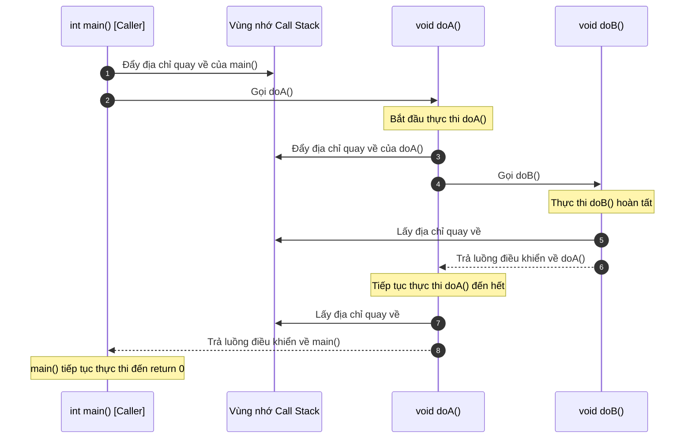

# 2.1 — Giới Thiệu Về Hàm (Introduction to Functions)

---

## 🎯 Mục Tiêu Bài Học
- Hiểu rõ bản chất của **Hàm (Function)** như một khối mã tái sử dụng độc lập (Modularization).
- Nắm vững cơ chế **Hàm gọi (Caller)** và **Hàm được gọi (Callee)** ở cấp độ thanh ghi CPU và con trỏ lệnh.
- Giải mã hoạt động của **Ngăn xếp lời gọi hàm (Call Stack)** khi các hàm gọi lồng nhau.
- Nắm vững quy tắc cấm lồng hàm (**Nested Functions are Illegal**) trong chuẩn ISO C++.

---

## 1. Hàm (Function) Là Gì? Tại Sao Cần Dùng Hàm?

Trong chương 1, bạn đã biết mọi chương trình C++ bắt đầu từ hàm `main()`. Nhưng khi chương trình mở rộng lên hàng nghìn dòng, nếu nhét toàn bộ mã nguồn vào `main()`, mã nguồn sẽ trở thành một "mớ bòng bong" spaghetti không thể bảo trì, gỡ lỗi hay kiểm thử!

> **Hàm (Function)** là một tập hợp các câu lệnh được đặt tên, được thiết kế để hoàn thành một nhiệm vụ chuyên biệt và có thể được tái sử dụng nhiều lần tại bất kỳ vị trí nào trong chương trình.

### Phân Loại Hàm Trong C++
1. **Hàm thư viện chuẩn (Standard Library Functions)**: Các hàm có sẵn do ngôn ngữ cung cấp (như `std::cin`, `std::cout`, `std::sqrt`).
2. **Hàm do người dùng tự định nghĩa (User-defined Functions)**: Các hàm do chính bạn thiết kế để giải quyết bài toán nghiệp vụ riêng.

---

## 2. Giải Phẫu Cấu Trúc Của Một Hàm

Một hàm C++ cơ bản gồm hai phần tách biệt:

```cpp
returnType functionName() // 1. Tiêu đề hàm (Function Header)
{
    // 2. Thân hàm (Function Body) chứa các câu lệnh
}
```

```cpp
#include <iostream>

// Định nghĩa hàm doPrint (Callee)
void doPrint()
{
    std::cout << "Dang thuc thi ben trong doPrint()\n";
}

// Ham main (Caller)
int main()
{
    std::cout << "Bat dau ham main()\n";
    doPrint(); // Lời gọi hàm (Function Call)
    std::cout << "Ket thuc ham main()\n";
    return 0;
}
```

Màn hình console sẽ xuất hiện:
```text
Bat dau ham main()
Dang thuc thi ben trong doPrint()
Ket thuc ham main()
```

---

## 3. Bản Chất Phần Cứng: Ngăn Xếp Lời Gọi Hàm (Call Stack)

Khi gặp câu lệnh gọi hàm `doPrint()`, CPU không thể chạy lung tung. Nó thực hiện các bước sau:
1. **Lưu địa chỉ trở về (Return Address)**: CPU ghi nhớ dòng lệnh tiếp theo của `main()` vào vùng nhớ Stack.
2. **Chuyển con trỏ lệnh (Instruction Pointer)**: Nhảy tới dòng lệnh đầu tiên trong thân hàm `doPrint()`.
3. **Thực thi Callee**: Chạy tuần tự các câu lệnh trong `doPrint()`.
4. **Quay trở về (Return)**: Khi chạm dấu ngoặc đóng `}` của `doPrint()`, CPU lấy lại địa chỉ trở về từ Stack và tiếp tục thực thi câu lệnh tiếp theo trong `main()`.



---

## ⚠️ Hộp Cạm Bẫy Thực Chiến & Undefined Behavior (UB)

::: warning Cạm Bẫy 1: Quên Cặp Dấu Ngoặc Đơn `()` Khi Gọi Hàm
Một lỗi kinh điển của người mới học là viết:
```cpp
doPrint; // Quên cặp dấu ngoặc đơn ()!
```
- Trong C++, `doPrint` (không có ngoặc) là **tên của con trỏ hàm** (Function Pointer). Câu lệnh này trở thành một câu lệnh biểu thức vô dụng (compiler có thể bỏ qua hoặc cảnh báo). Hàm `doPrint()` **hoàn toàn không được kích hoạt**!
- Bắt buộc phải viết `doPrint();` để thực hiện lời gọi hàm.
:::

::: warning Cạm Bẫy 2: Cấm Lồng Hàm (Nested Functions Are Illegal)
Trong C++, bạn **tuyệt đối không được định nghĩa một hàm bên trong phần thân của một hàm khác**:

```cpp
int main()
{
    void foo() // LỖI BIÊN DỊCH: C++ không hỗ trợ nested functions!
    {
        std::cout << "foo!\n";
    }

    foo();
    return 0;
}
```
Mọi hàm trong C++ đều phải được định nghĩa ở cấp độ không gian tên (Namespace/Global Scope) ngang hàng nhau.
:::

---

## 🚀 Hộp Cập Nhật C++20 / C++23: Biểu Thức Lambda Thay Thế Hàm Lồng

Nếu bạn thực sự muốn tạo ra một "hàm cục bộ" ngay bên trong một hàm khác, chuẩn C++ hiện đại cung cấp **Biểu thức Lambda (Lambda Expressions)**:

```cpp
#include <iostream>

int main()
{
    // Định nghĩa một hàm ẩn danh (lambda) ngay trong main
    auto print_msg = []() {
        std::cout << "Day la lambda function cuc bo hop le trong Modern C++!\n";
    };

    print_msg(); // Gọi lambda như một hàm thông thường
    return 0;
}
```

---

## 💡 Hộp Thực Hành Tốt Nhất (Best Practice)

::: tip Quy Tắc Vàng Khi Thiết Kế Hàm
1. **Nguyên lý Đơn Trách Nhiệm (Single Responsibility Principle)**: Mỗi hàm chỉ nên làm một việc và làm thật tốt việc đó.
2. **Tên hàm phải là một Động từ**: Tên hàm thể hiện hành động, ví dụ: `calculateTax()`, `printInvoice()`, `getUserInput()`.
3. **Độ dài hàm lý tưởng**: Không nên vượt quá một màn hình hiển thị (khoảng 20 - 40 dòng code). Nếu hàm quá dài, hãy tách nó thành các hàm con nhỏ hơn.
:::

---

## 📝 Hệ Thống Quiz & Bài Tập Tự Luyện

### Câu hỏi 1:
Phần mã nằm giữa cặp dấu ngoặc nhọn `{}` của một hàm được gọi là gì?
::: details [Xem lời giải]
Phần thân hàm (**Function Body**).
:::

### Câu hỏi 2:
Dự đoán kết quả in ra màn hình của chương trình sau:
```cpp
#include <iostream>

void doB()
{
    std::cout << "B\n";
}

void doA()
{
    std::cout << "A1\n";
    doB();
    std::cout << "A2\n";
}

int main()
{
    std::cout << "Main1\n";
    doA();
    doB();
    std::cout << "Main2\n";
    return 0;
}
```
::: details [Xem lời giải]
```text
Main1
A1
B
A2
B
Main2
```
**Giải thích**: 
1. `main()` in `Main1`, gọi `doA()`.
2. `doA()` in `A1`, gọi `doB()`.
3. `doB()` in `B`, quay lại `doA()`.
4. `doA()` in `A2`, quay lại `main()`.
5. `main()` gọi trực tiếp `doB()`, in tiếp `B`.
6. `main()` in `Main2` và kết thúc.
:::
