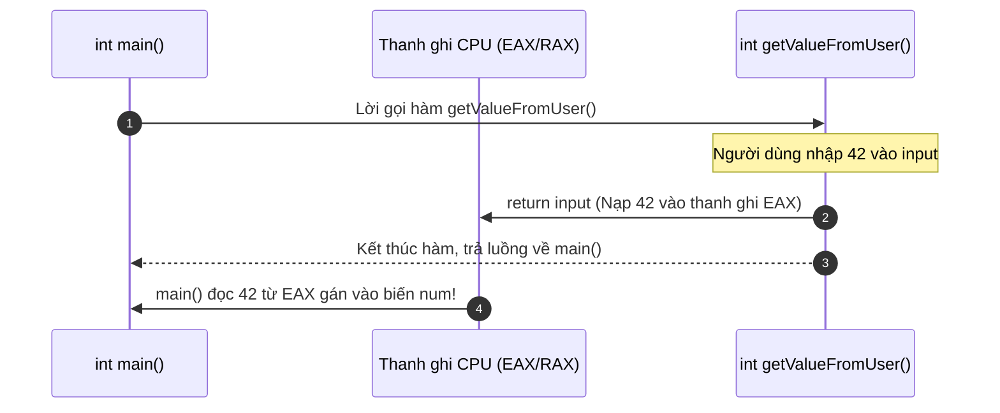

# 2.2 — Giá Trị Trả Về Của Hàm (Function Return Values)

---

## 🎯 Mục Tiêu Bài Học
- Hiểu rõ cơ chế **Truyền kết quả theo giá trị (Return by Value)** từ Callee về Caller thông qua thanh ghi CPU.
- Nắm vững vai trò của câu lệnh `return` và cách sử dụng giá trị trả về để khởi tạo biến.
- Mổ xẻ cơ chế mã trạng thái thoát (**Exit Status Codes**: `0`, `EXIT_SUCCESS`, `EXIT_FAILURE`) của hàm `main()`.
- Cảnh giác cao độ với cạm bẫy **Undefined Behavior (UB)** khi một hàm có kiểu trả về khác void nhưng quên viết câu lệnh `return`.
- Làm chủ thuộc tính hiện đại `[[nodiscard]]` (C++17) và triết lý lập trình **DRY (Don't Repeat Yourself)**.

---

## 1. Vấn Đề: Làm Sao Để Lấy Dữ Liệu Từ Trong Hàm Ra Ngoài?

Hãy quan sát nỗ lực viết một hàm nhập số sau đây:

```cpp
#include <iostream>

void getValueFromUser()
{
    std::cout << "Nhap mot so nguyen: ";
    int input {};
    std::cin >> input;
} // Biến input bị hủy bỏ tại đây!

int main()
{
    getValueFromUser();
    int num {}; // Làm sao để lấy số người dùng vừa nhập gán vào num?
    std::cout << "So vua nhap la: " << num << '\n'; // Luôn in ra 0!
    return 0;
}
```

Khi hàm `getValueFromUser()` kết thúc, biến cục bộ `input` sẽ lập tức bị hủy khỏi bộ nhớ. Hàm `main()` hoàn toàn không nhận được dữ liệu gì!

Để chuyển giao dữ liệu từ Callee về Caller, chúng ta cần cơ chế **Giá trị trả về (Return Values)**.

---

## 2. Cơ Chế Trả Về Theo Giá Trị (Return By Value)

Để một hàm có thể gửi dữ liệu ngược về Caller, bạn cần 2 yếu tố:
1. **Kiểu trả về (Return Type)**: Xác định kiểu dữ liệu của kết quả ở đầu hàm (ví dụ: `int`, `double`).
2. **Câu lệnh `return` (Return Statement)**: Đánh dấu điểm kết thúc của hàm và cung cấp biểu thức mang giá trị trả về.

```cpp
#include <iostream>

// int là kiểu trả về: Hàm này cam kết sẽ gửi về 1 số nguyên
int getValueFromUser()
{
    std::cout << "Nhap mot so nguyen: ";
    int input {};
    std::cin >> input;

    return input; // Sao chép giá trị của input gửi về cho Caller
}

int main()
{
    // Khởi tạo biến num bằng chính giá trị trả về của hàm!
    int num { getValueFromUser() };

    std::cout << "So ban vua nhap gap doi la: " << (num * 2) << '\n';
    return 0;
}
```

### Bản Chất Thanh Ghi CPU (EAX / RAX Register)
Trong kiến trúc x86-64, các giá trị số nguyên hoặc con trỏ khi trả về từ hàm thường được lưu tạm thời vào thanh ghi CPU **`EAX`** (32-bit) hoặc **`RAX`** (64-bit). Hàm gọi chỉ việc đọc dữ liệu trực tiếp từ thanh ghi này!



---

## 3. Mổ Xẻ Sâu Về Hàm `main()` & Mã Trạng Thái Thoát

Hàm `main()` là hàm đặc biệt nhất trong toàn bộ hệ thống C++:
1. **Bắt buộc phải trả về kiểu `int`**: Chuẩn ISO C++ nghiêm cấm viết `void main()`.
2. **Nghiêm cấm gọi tường minh**: Bạn không được phép gọi `main();` trong code của mình.
3. **Mã thoát (Exit Status Code)**:
   - Giá trị `0` hoặc macro `EXIT_SUCCESS` (trong `<cstdlib>`): Báo cho hệ điều hành biết tiến trình chạy hoàn hảo không có lỗi.
   - Giá trị khác 0 hoặc `EXIT_FAILURE`: Báo cho hệ điều hành biết tiến trình gặp sự cố bất thường.

::: tip Ngoại Lệ Duy Nhất Của Hàm `main()`
Theo chuẩn ISO C++, nếu bạn không viết câu lệnh `return` ở cuối hàm `main()`, trình biên dịch sẽ **tự động chèn ngầm định `return 0;`** giúp bạn. Tuy nhiên, việc chủ động viết rõ `return 0;` luôn là chuẩn mực tốt nhất để thể hiện rõ ý đồ kỹ thuật.
:::

---

## ⚠️ Hộp Cạm Bẫy Thực Chiến & Undefined Behavior (UB)

::: warning Cạm Bẫy Chết Người: Quên Return Trong Hàm Value-Returning
Ngoại trừ hàm `main()`, đối với **bất kỳ hàm nào có kiểu trả về khác `void`**:
```cpp
int getNumber()
{
    std::cout << "Hello\n";
    // QUÊN CÂU LỆNH RETURN Ở ĐÂY!
}

int main()
{
    int x { getNumber() }; // UNDEFINED BEHAVIOR!
    return 0;
}
```
Nếu luồng thực thi đi tới dấu ngoặc đóng `}` mà không gặp câu lệnh `return`:
- Đây là **Undefined Behavior (UB)** nghiêm trọng theo chuẩn ISO C++!
- Caller sẽ đọc một giá trị rác ngẫu nhiên đang tồn tại trong thanh ghi CPU `EAX`.
- Nếu bật tối ưu hóa (-O3), trình biên dịch có thể xóa sổ toàn bộ các nhánh rẽ dẫn tới hàm này!
:::

---

## 🚀 Hộp Cập Nhật C++17: Thuộc Tính `[[nodiscard]]`

Đôi khi bạn viết một hàm trả về một mã lỗi quan trọng hoặc một kết quả tính toán tốn kém, nhưng người gọi hàm lại vô tình bỏ quên (không hứng lấy giá trị):

```cpp
int calculateTax();

int main() {
    calculateTax(); // Quên không gán vào biến -> Kết quả tính toán bị vứt bỏ!
}
```

C++17 giới thiệu thuộc tính **`[[nodiscard]]`** để ép trình biên dịch phát cảnh báo nếu Caller dám "ngó lơ" giá trị trả về:

```cpp
[[nodiscard]] int calculateTax()
{
    return 500;
}

int main()
{
    calculateTax(); // CẢNH BÁO COMPILE: ignoring return value of function declared with 'nodiscard' attribute!
    
    int tax { calculateTax() }; // Hợp lệ, không có cảnh báo
    return 0;
}
```

---

## 💡 Hộp Thực Hành Tốt Nhất: Triết Lý DRY (Don't Repeat Yourself)

::: tip Quy Tắc Vàng
- **DRY (Don't Repeat Yourself)**: Tuyệt đối không lặp lại cùng một đoạn code tại nhiều nơi. Nếu bạn cần nhập 3 số, đừng copy-paste lệnh `cin` 3 lần, hãy gọi hàm `getValueFromUser()` 3 lần!
- **WET (Write Everything Twice)**: Là phản mẫu (Anti-pattern) cần tránh. Khi phát hiện lỗi sai trong code WET, bạn sẽ phải sửa ở 10 chỗ khác nhau và rất dễ bỏ sót.
:::

---

## 📝 Hệ Thống Quiz & Bài Tập Tự Luyện

### Câu hỏi 1:
Đoạn mã sau có biên dịch được không? Kết quả in ra là gì?
```cpp
#include <iostream>

int getNumber()
{
    return 5;
    return 10;
}

int main()
{
    std::cout << getNumber() << '\n';
    return 0;
}
```
::: details [Xem lời giải]
**Biên dịch bình thường và in ra số 5**.
Khi thực thi, ngay khi chạm câu lệnh `return 5;`, hàm `getNumber()` sẽ lập tức kết thúc và trao quyền điều khiển cùng giá trị 5 về cho Caller. Dòng `return 10;` nằm ở vùng mã không bao giờ chạm tới (**Unreachable Code**).
:::

### Câu hỏi 2:
Chương trình sau có hợp lệ không? Tại sao?
```cpp
#include <iostream>

int returnA()
{
    return 10;

    int returnB()
    {
        return 20;
    }
}

int main()
{
    std::cout << returnA() << '\n';
    return 0;
}
```
::: details [Xem lời giải]
**Không hợp lệ (Lỗi biên dịch)!** C++ không hỗ trợ định nghĩa hàm lồng nhau (Nested functions). Hàm `returnB()` nằm bên trong thân hàm `returnA()` sẽ bị compiler từ chối ngay lập tức.
:::

### Bài tập:
Viết một chương trình hoàn chỉnh sử dụng một hàm tự định nghĩa mang tên `doubleNumber(int)` nhận vào một số và trả về số gấp đôi. Trong `main()`, gọi hàm này để in ra giá trị gấp đôi của số `7`.
::: details [Xem lời giải]
```cpp
#include <iostream>

int doubleNumber(int x)
{
    return x * 2;
}

int main()
{
    std::cout << "Gia tri gap doi cua 7 la: " << doubleNumber(7) << '\n';
    return 0;
}
```
:::
