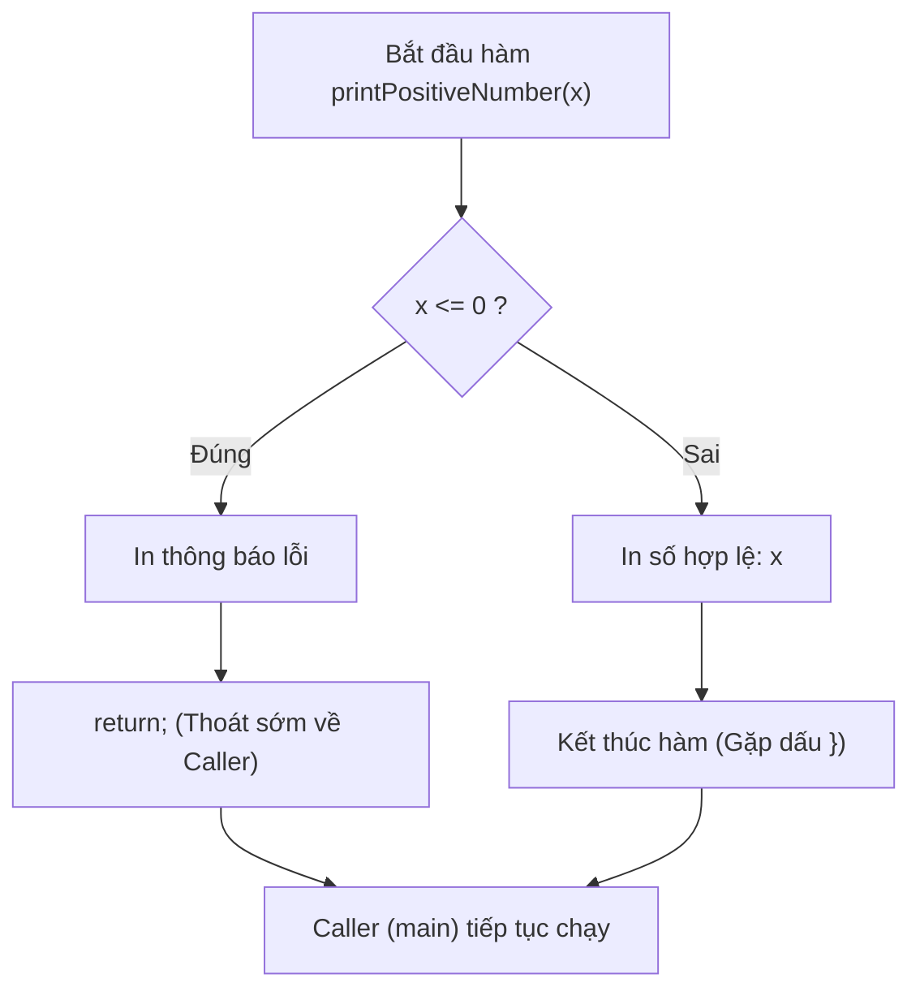

# 2.3 — Hàm Không Trả Về Giá Trị (Void Functions)

---

## 🎯 Mục Tiêu Bài Học
- Hiểu rõ bản chất và mục đích thiết kế của **Hàm không trả về giá trị (Void Functions / Non-value returning functions)**.
- Làm chủ kỹ thuật thoát sớm khỏi hàm bằng câu lệnh `return;` rỗng (**Early Return / Guard Clauses**).
- Nhận biết các lỗi biên dịch điển hình khi cố tình sử dụng kết quả của hàm `void` trong các biểu thức đòi hỏi giá trị.
- Phân biệt cơ chế dọn dẹp Stack giữa hàm trả về giá trị và hàm `void`.

---

## 1. Hàm `void` Là Gì?

Không phải hàm nào cũng sinh ra để tính toán số liệu. Có những hàm được tạo ra chỉ để thực hiện một **Hiệu ứng phụ (Side Effect)**, ví dụ: in một thông báo ra màn hình, phát một âm thanh trong game, hoặc thiết lập kết nối mạng.

Khi một hàm không cần gửi bất kỳ dữ liệu nào về cho Caller, ta đặt kiểu trả về của nó là **`void`**:

```cpp
#include <iostream>

// Hàm void: Không trả về bất kỳ giá trị nào cho Caller
void printGreeting()
{
    std::cout << "Xin chao mung ban den voi the gioi Modern C++!\n";
    // Không cần câu lệnh return ở đây
}

int main()
{
    printGreeting(); // Hợp lệ: Gọi hàm để thực hiện hành vi
    return 0;
}
```

---

## 2. Câu Lệnh `return;` Rỗng Và Kỹ Thuật Thoát Sớm (Early Return)

Đối với hàm `void`, khi luồng thực thi đi tới dấu ngoặc nhọn đóng `}`, quyền điều khiển sẽ **tự động quay trở về Caller**. Do đó, việc viết `return;` ở dòng cuối cùng của hàm `void` là hoàn toàn dư thừa:

```cpp
void badStyle()
{
    std::cout << "Hello\n";
    return; // DƯ THỪA: Không nên viết dòng này ở cuối hàm!
}
```

Tuy nhiên, câu lệnh `return;` (không kèm theo giá trị) lại cực kỳ hữu ích khi bạn muốn **thoát sớm khỏi hàm (Early Return)** nếu phát hiện điều kiện bất thường:

```cpp
void printPositiveNumber(int x)
{
    if (x <= 0)
    {
        std::cout << "Loi: So truyen vao phai la so duong!\n";
        return; // Thoát ngay lập tức về Caller, bỏ qua các dòng lệnh bên dưới!
    }

    std::cout << "So hop le: " << x << '\n';
}
```



---

## ⚠️ Hộp Cạm Bẫy Thực Chiến: Sử Dụng Hàm Void Sai Ngữ Cảnh

::: warning Cạm Bẫy 1: Cố Tình In Giá Trị Của Hàm Void Ra `std::cout`
Hãy quan sát dòng code sau:
```cpp
void doSomething() { std::cout << "Action\n"; }

int main()
{
    std::cout << doSomething(); // LỖI BIÊN DỊCH NGHIÊM TRỌNG!
    return 0;
}
```
**Nguyên nhân kỹ thuật**: Toán tử `<<` yêu cầu vế bên phải phải là một biểu thức sinh ra một giá trị cụ thể. Trong khi đó, `doSomething()` trả về kiểu `void` (nghĩa là "hư vô / không có kiểu"). Compiler sẽ báo lỗi:
`error: invalid use of void expression`!
:::

::: warning Cạm Bẫy 2: Cố Tình Trả Về Giá Trị Trong Hàm Void
```cpp
void calculate()
{
    return 5; // LỖI BIÊN DỊCH: return-statement with a value, in function returning 'void'
}
```
:::

---

## 🚀 Hộp Cập Nhật C++23: `std::unreachable()`

Trong C++23, thư viện `<utility>` bổ sung hàm tiện ích chuẩn **`std::unreachable()`**. Hàm này báo hiệu cho trình biên dịch biết một nhánh rẽ trong hàm không bao giờ có thể chạm tới, cho phép optimizer loại bỏ hoàn toàn mã thừa:

```cpp
#include <utility>

void processState(int state)
{
    if (state == 1) { /* Xử lý 1 */ return; }
    if (state == 2) { /* Xử lý 2 */ return; }
    
    // Nếu đảm bảo state chỉ có thể là 1 hoặc 2:
    std::unreachable(); // C++23 Optimization Hint
}
```

---

## 💡 Hộp Thực Hành Tốt Nhất (Best Practice)

::: tip Quy Tắc Vàng
1. **Tuyệt đối không đặt `return;` ở cuối hàm `void`**: Hãy để hàm kết thúc tự nhiên tại dấu ngoặc nhọn đóng `}`.
2. **Sử dụng Early Return (Guard Clauses) để làm phẳng mã nguồn**: Kiểm tra các trường hợp lỗi hoặc dữ liệu không hợp lệ ở ngay đầu hàm và dùng `return;` để thoát ra ngay, tránh việc phải lồng nhiều tầng `if-else` phức tạp.
:::

---

## 📝 Hệ Thống Quiz & Bài Tập Tự Luyện

### Câu hỏi 1:
Đoạn mã sau có biên dịch thành công không? Nếu không, hãy chỉ ra lỗi:
```cpp
#include <iostream>

void printMessage()
{
    std::cout << "Xin chao!\n";
}

int main()
{
    int result = printMessage();
    return 0;
}
```
::: details [Xem lời giải]
**Không biên dịch được!**
Hàm `printMessage()` có kiểu trả về là `void`, nghĩa là nó không sinh ra bất kỳ giá trị nào. Dòng lệnh `int result = printMessage();` cố tình lấy giá trị từ hàm void để gán vào một biến kiểu số nguyên `int`, dẫn đến lỗi biên dịch: `error: cannot convert 'void' to 'int' in initialization`.
:::

### Câu hỏi 2:
Khi nào bạn nên sử dụng câu lệnh `return;` bên trong một hàm void?
::: details [Xem lời giải]
Bạn chỉ nên dùng `return;` trong hàm void khi muốn **thoát sớm (Early Return)** khỏi hàm trước khi đi tới dòng lệnh cuối cùng (ví dụ: khi kiểm tra thấy tham số truyền vào không hợp lệ hoặc tác vụ cần làm đã hoàn thành sớm).
:::
