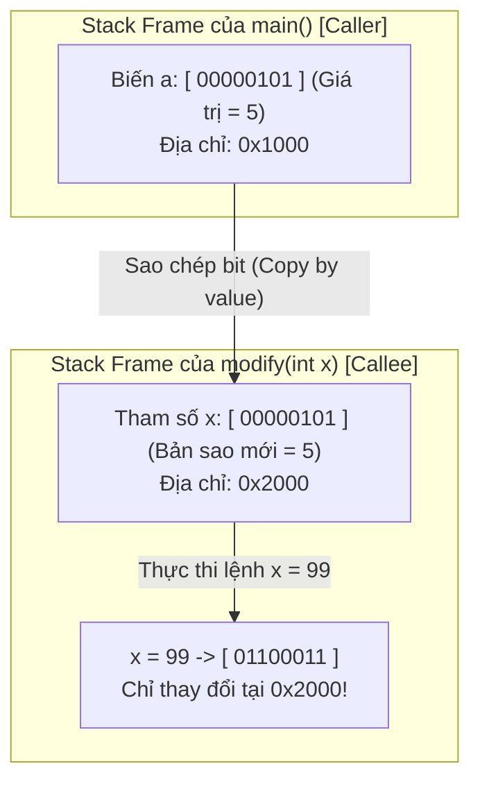

# 2.4 — Tham Số Và Đối Số Của Hàm (Parameters & Arguments)

---

## 🎯 Mục Tiêu Bài Học
- Phân biệt chính xác tuyệt đối giữa **Tham số (Parameter)** và **Đối số (Argument)** theo chuẩn ISO C++.
- Hiểu sâu sắc cơ chế **Truyền theo giá trị (Pass by Value)** ở cấp độ bộ nhớ Stack Frame: Quá trình sao chép bit độc lập.
- Nắm vững cách lồng ghép các lời gọi hàm làm đối số cho hàm khác.
- Xử lý tham số không sử dụng (**Unnamed Parameters**) để bảo toàn tính tương thích ngược của API mà không bị compiler phát cảnh báo.

---

## 1. Phân Biệt: Tham Số (Parameter) vs Đối Số (Argument)

Hai thuật ngữ này thường bị người học dùng lẫn lộn, nhưng trong kỹ thuật phần mềm chuẩn chỉ, chúng mang hai ý nghĩa hoàn toàn khác biệt:

- **Tham số (Parameter / Formal Parameter)**: Là một biến được khai báo bên trong cặp dấu ngoặc đơn `()` ở tiêu đề hàm. Nó đóng vai trò như một "chỗ giữ chỗ" (placeholder) chờ nhận dữ liệu.
- **Đối số (Argument / Actual Argument)**: Là giá trị hoặc biểu thức thực tế được truyền vào hàm từ phía **Caller** tại thời điểm thực hiện lời gọi hàm.

```cpp
// x và y ở đây là các THAM SỐ (Parameters)
int add(int x, int y)
{
    return x + y;
}

int main()
{
    // 5 và 10 ở đây là các ĐỐI SỐ (Arguments)
    int sum { add(5, 10) };
    return 0;
}
```

---

## 2. Cơ Chế Truyền Theo Giá Trị (Pass By Value)

Mặc định trong C++, khi bạn truyền một đối số vào hàm, C++ thực hiện cơ chế **Truyền theo giá trị (Pass by Value)**:
1. Một vùng nhớ hoàn toàn mới được cấp phát trên Stack Frame của Callee dành cho tham số.
2. Giá trị của đối số được **sao chép nguyên vẹn (Copy-initialization)** vào ô nhớ của tham số.
3. Mọi thao tác tính toán hoặc thay đổi giá trị của tham số bên trong Callee **hoàn toàn không làm ảnh hưởng gì tới biến gốc của Caller**!



```cpp
#include <iostream>

void modify(int x)
{
    x = 99; // Chỉ làm thay đổi bản sao x trên stack của modify()
}

int main()
{
    int a { 5 };
    modify(a);
    std::cout << "Gia tri a sau khi goi ham: " << a << '\n'; // Van in ra 5!
    return 0;
}
```

---

## 3. Lồng Ghép Các Biểu Thức Làm Đối Số

Một đối số không bắt buộc phải là một hằng số đơn thuần, nó có thể là **bất kỳ biểu thức hợp lệ nào**, bao gồm cả kết quả trả về của một hàm khác:

```cpp
#include <iostream>

int add(int x, int y) { return x + y; }
int multiply(int x, int y) { return x * y; }

int main()
{
    // add(1, 2) tính ra 3 -> Sau đó multiply(3, 4) tính ra 12!
    std::cout << multiply(add(1, 2), 4) << '\n'; // In ra 12
    return 0;
}
```

---

## 4. Tham Số Không Tên (Unnamed Parameters)

Trong quá trình bảo trì phần mềm thực tế, đôi khi một tham số hàm không còn cần dùng đến nữa, nhưng bạn không thể xóa nó khỏi tiêu đề hàm vì sẽ làm vỡ hàng trăm lời gọi hàm cũ trong dự án:

```cpp
void process(int count) // Compiler warning: unused parameter 'count'
{
    // Không dùng đến count nữa
}
```

Để triệt tiêu cảnh báo mà vẫn giữ nguyên chữ ký hàm, C++ cho phép bạn **bỏ hẳn tên tham số** (chỉ giữ lại kiểu dữ liệu) hoặc bọc tên tham số trong chú thích:

```cpp
void process(int /*count*/) // Chuẩn mực: Không còn cảnh báo unused parameter!
{
}
```

---

## ⚠️ Hộp Cạm Bẫy Thực Chiến: Thứ Tự Tính Đối Số (Order of Evaluation)

::: warning Cạm Bẫy: Unspecified Behavior Khi Tính Toán Đối Số
Giả sử bạn gọi một hàm có 2 đối số:
```cpp
doSomething(funcA(), funcB());
```
Chuẩn ISO C++ **không quy định `funcA()` hay `funcB()` được chạy trước**! Đây là **Unspecified Behavior**:
- Compiler A (như GCC) có thể chạy `funcB()` trước rồi mới đến `funcA()`.
- Compiler B (như Clang) có thể chạy `funcA()` trước rồi mới đến `funcB()`.

Nếu `funcA()` và `funcB()` có hiệu ứng phụ làm thay đổi cùng một trạng thái toàn cục, chương trình của bạn sẽ sinh ra kết quả khác nhau trên mỗi trình biên dịch!
:::

---

## 🚀 Hộp Cập Nhật C++20: Abbreviated Function Templates

Từ C++20, bạn có thể dùng từ khóa `auto` ngay trong danh sách tham số của hàm thông thường. Trình biên dịch sẽ tự động biến hàm đó thành một Template:

```cpp
#include <iostream>

// C++20: Tự động suy luận kiểu cho tham số a và b
auto addModern(auto a, auto b)
{
    return a + b;
}

int main()
{
    std::cout << addModern(5, 10) << '\n';     // Gọi với số nguyên (int, int)
    std::cout << addModern(2.5, 4.1) << '\n';   // Gọi với số thực (double, double)
    return 0;
}
```

---

## 💡 Hộp Thực Hành Tốt Nhất (Best Practice)

::: tip Quy Tắc Vàng
1. **Khớp chính xác số lượng và kiểu đối số**: Tránh dựa vào cơ chế ngầm định ép kiểu của compiler khi truyền đối số.
2. **Không phụ thuộc vào thứ tự tính toán đối số**: Đảm bảo các đối số truyền vào hàm là các biểu thức độc lập thuần túy, không chứa side effect chéo nhau.
:::

---

## 📝 Hệ Thống Quiz & Bài Tập Tự Luyện

### Câu hỏi 1:
Đoạn mã sau bị lỗi gì?
```cpp
#include <iostream>

int multiply(int x, int y)
{
    int product { x * y };
}

int main()
{
    std::cout << multiply(4) << '\n';
    return 0;
}
```
::: details [Xem lời giải]
Chương trình có **2 lỗi nghiêm trọng**:
1. **Thiếu đối số**: Hàm `multiply` yêu cầu 2 tham số (`x` và `y`), nhưng trong `main()` chỉ truyền đúng 1 đối số (`4`). Compiler sẽ báo lỗi `too few arguments to function`.
2. **Thiếu câu lệnh return**: Hàm `multiply` có kiểu trả về là `int` nhưng không hề có câu lệnh `return product;` ở cuối.
:::

### Câu hỏi 2:
Viết một hàm tên là `printDouble(int n)` nhận vào một số nguyên và in ra màn hình thông báo theo định dạng: `n gap doi la: (n * 2)`. Viết hàm `main()` để yêu cầu người dùng nhập một số từ bàn phím và gọi hàm `printDouble` đó.
::: details [Xem lời giải]
```cpp
#include <iostream>

void printDouble(int n)
{
    std::cout << n << " gap doi la: " << (n * 2) << '\n';
}

int main()
{
    std::cout << "Nhap mot so nguyen: ";
    int x {};
    std::cin >> x;

    printDouble(x);
    return 0;
}
```
:::
