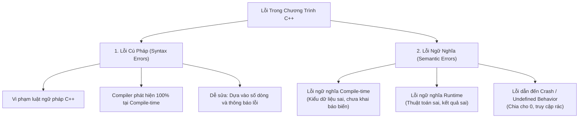

# 3.1 — Lỗi Cú Pháp (Syntax Errors) và Lỗi Ngữ Nghĩa (Semantic Errors)

---

## 🎯 Mục Tiêu Bài Học
- Phân biệt rạch ròi giữa hai nhóm lỗi căn bản trong lập trình C++: **Lỗi cú pháp (Syntax error)** và **Lỗi ngữ nghĩa (Semantic error / Logic error)**.
- Hiểu cơ chế phát hiện lỗi của trình biên dịch: lỗi bắt được tại compile-time và lỗi tiềm ẩn chỉ bộc lộ ở runtime.
- Nhận diện các lỗi ngữ nghĩa nguy hiểm dẫn tới **Hành vi không xác định (Undefined Behavior - UB)** hoặc sự cố sập chương trình (crash).
- Tiếp cận tư duy phòng ngừa lỗi và cách compiler hiện đại hỗ trợ cảnh báo sớm.

---

## 1. Bản Chất Của Lỗi Trong Phần Mềm

Lập trình viên dù xuất sắc đến đâu cũng không thể tránh khỏi việc tạo ra lỗi (bugs). Viết code thì dễ, nhưng tìm ra nguyên nhân và sửa triệt để lỗi mới là công việc thử thách và chiếm nhiều thời gian nhất. 

Trong C++, ngôn ngữ vừa trừu tượng bậc cao vừa can thiệp sâu vào phần cứng, các lỗi phát sinh thường rơi vào hai phạm trù lớn:
1. **Lỗi cú pháp (Syntax errors)**: Vi phạm ngữ pháp của ngôn ngữ.
2. **Lỗi ngữ nghĩa (Semantic errors)**: Vi phạm ý nghĩa luận lý của chương trình.



---

## 2. Lỗi Cú Pháp (Syntax Errors)

Một **lỗi cú pháp** xảy ra khi bạn viết một câu lệnh không hợp lệ theo quy tắc ngữ pháp của C++. Tương tự như việc viết sai ngữ pháp tiếng Việt hay tiếng Anh, trình biên dịch sẽ không thể phân tích cú pháp (parse) được mã nguồn của bạn.

Các lỗi cú pháp kinh điển bao gồm:
- Thiếu dấu chấm phẩy `;` ở cuối câu lệnh.
- Thiếu hoặc không đóng cặp ngoặc tròn `()`, ngoặc nhọn `{}` hay ngoặc vuông `[]`.
- Đặt tên định danh (tên biến, tên hàm) không hợp lệ (ví dụ: bắt đầu bằng chữ số).
- Sử dụng các toán tử không tồn tại trong C++.

Hãy xét ví dụ sau:

```cpp
#include <iostream>

int main( // LỖI CÚ PHÁP: Thiếu dấu đóng ngoặc tròn ')'
{
    int 1x; // LỖI CÚ PHÁP: Tên biến không được bắt đầu bằng chữ số

    std::cout << "Xin chao!"; << x +++ << '\n'; 
    // LỖI CÚ PHÁP: Dấu chấm phẩy thừa ở giữa câu lệnh, toán tử '+++' không tồn tại

    return 0 // LỖI CÚ PHÁP: Thiếu dấu chấm phẩy ';' ở cuối câu lệnh
}
```

::: tip Compiler là người bạn đồng hành nghiêm khắc
Mọi lỗi cú pháp đều được trình biên dịch phát hiện ngay tại giai đoạn biên dịch (**compile-time**). Trình biên dịch sẽ từ chối sinh mã máy và xuất ra các thông báo lỗi (Error Diagnostic) chỉ rõ tên tệp, số dòng và mô tả lỗi. Nhiệm vụ của bạn chỉ đơn giản là đọc thông báo lỗi, sửa lại cú pháp cho đúng và biên dịch lại.
:::

---

## 3. Lỗi Ngữ Nghĩa (Semantic Errors)

Một **lỗi ngữ nghĩa** xảy ra khi câu lệnh của bạn hoàn toàn đúng về mặt cú pháp ngữ pháp C++, nhưng ngữ nghĩa thực thi lại sai: vi phạm các quy tắc ràng buộc logic của ngôn ngữ, hoặc thực hiện một hành động khác hoàn toàn so với chủ ý của người lập trình.

Lỗi ngữ nghĩa được chia thành hai nhóm chính:

### 3.1. Lỗi ngữ nghĩa phát hiện tại Compile-time
Một số lỗi ngữ nghĩa vẫn bị trình biên dịch chặn lại vì vi phạm hệ thống kiểu (type system) hoặc cấu trúc của C++:

```cpp
int main()
{
    5 = x;          // LỖI: Cú pháp gán hợp lệ nhưng '5' là rvalue (không thể gán giá trị cho một hằng số)
                    // Đồng thời biến 'x' chưa từng được khai báo!

    return "hello"; // LỖI: Hàm main() khai báo trả về int, nhưng lại trả về một chuỗi ký tự (const char*)
}
```

### 3.2. Lỗi ngữ nghĩa chỉ phát tác tại Runtime (Runtime Semantic Errors)
Đây là loại lỗi nguy hiểm nhất trong kỹ nghệ phần mềm. Trình biên dịch tin tưởng hoàn toàn vào lập trình viên và sinh ra mã máy chạy trơn tru, nhưng khi chạy thực tế, chương trình sẽ:
- Cho ra kết quả sai lệch.
- Đột ngột bị hệ điều hành tiêu diệt (Crash / Core dump / Segmentation Fault).
- Rơi vào trạng thái nguy hiểm tột cùng: **Undefined Behavior (UB)**.

#### Ví dụ 1: Chia cho số 0
```cpp
#include <iostream>

int main()
{
    int a { 10 };
    int b { 0 };

    // Phép chia cho 0 trong toán học không xác định, trong C++ gây Crash hoặc UB
    std::cout << a << " / " << b << " = " << (a / b) << '\n';

    return 0;
}
```

#### Ví dụ 2: Sử dụng biến rác chưa khởi tạo (UB)
```cpp
#include <iostream>

int main()
{
    int x; // Quên khởi tạo giá trị ban đầu (Uninitialized variable)
    
    // Đọc giá trị rác từ ô nhớ -> Hành vi không xác định!
    std::cout << "Gia tri cua x: " << x << '\n'; 

    return 0;
}
```

#### Ví dụ 3: Lỗi giải thuật logic
```cpp
#include <iostream>

// Hàm có tên là 'add' (cộng) nhưng lại viết nhầm toán tử trừ '-'
int add(int x, int y)
{
    return x - y; // Lỗi ngữ nghĩa do người viết nhầm lẫn
}

int main()
{
    std::cout << "5 + 3 = " << add(5, 3) << '\n'; // In ra 2 thay vì 8!
    return 0;
}
```

#### Ví dụ 4: Lệnh không bao giờ được thực thi (Dead code)
```cpp
#include <iostream>

int main()
{
    return 0; // Hàm main kết thúc tại đây!

    std::cout << "Dong nay se khong bao gio duoc chay!\n"; // Unreachable code
}
```

---

## 4. ⚠️ Hộp Cạm Bẫy Thực Chiến & Undefined Behavior

::: danger Cạm bẫy: Sự nguy hiểm khôn lường của Undefined Behavior (UB)
Khi một lỗi ngữ nghĩa dẫn tới **Hành vi không xác định (Undefined Behavior)**, chuẩn ISO C++ hoàn toàn không đảm bảo bất kỳ điều gì về những gì chương trình sẽ làm:
- Nó có thể in ra kết quả ngẫu nhiên.
- Nó có thể chạy bình thường trong 99 lần thử nghiệm nhưng sập vào lần thứ 100 trên máy khách hàng.
- Trình tối ưu hóa của compiler (Optimizer) có thể tự ý xóa bỏ hoàn toàn đoạn code xung quanh vì compiler giả định UB không bao giờ xảy ra!

**Ví dụ kinh điển**: Tràn số nguyên có dấu (Signed Integer Overflow) hay đọc biến chưa khởi tạo là các lỗi ngữ nghĩa runtime phổ biến nhất tạo ra UB.
:::

---

## 5. 🚀 Hộp Cập Nhật C++20 / C++23: Bắt Lỗi Sớm Với `static_assert` và `std::unreachable()`

Trong C++ hiện đại, các tiêu chuẩn ngôn ngữ ngày càng cung cấp nhiều công cụ giúp chuyển đổi **lỗi ngữ nghĩa runtime** thành **lỗi compile-time**:

1. **`static_assert` (C++11/C++17)**: Cho phép kiểm tra điều kiện logic ngay khi biên dịch:
```cpp
// Đảm bảo kiểu int trên kiến trúc đích phải tối thiểu 4 byte
static_assert(sizeof(int) >= 4, "Loi he thong: Kieu int phai co toi thieu 4 bytes!");
```

2. **`std::unreachable()` (C++23 trong `<utility>`)**: Báo hiệu cho trình biên dịch và lập trình viên biết một nhánh code về mặt logic không bao giờ được chạm tới:
```cpp
#include <utility>

int getDirectionCode(char dir)
{
    switch (dir)
    {
        case 'N': return 1;
        case 'S': return 2;
        case 'E': return 3;
        case 'W': return 4;
        default:
            std::unreachable(); // Báo hiệu nhánh này không thể xảy ra nếu đầu vào hợp lệ
    }
}
```

---

## 6. 💡 Hộp Thực Hành Tốt Nhất (Best Practice)

::: tip Quy tắc sống còn của lập trình viên chuyên nghiệp
1. **Bật toàn bộ cờ cảnh báo của Compiler**: Hãy luôn sử dụng cờ `-Wall -Wextra -Wpedantic` (trên GCC/Clang) hoặc `/W4` (trên MSVC). Rất nhiều lỗi ngữ nghĩa tiềm ẩn (như biến chưa sử dụng, biến chưa khởi tạo, phép gán nhầm trong câu lệnh điều kiện) sẽ được Compiler cảnh báo ngay lập tức!
2. **Coi Warning như Error**: Bật cờ `-Werror` (hoặc `/WX`). Trình biên dịch sẽ dừng lại và ép bạn phải giải quyết triệt để từng cảnh báo trước khi cho phép chạy chương trình.
3. **Luôn khởi tạo biến ngay khi khai báo**: Khởi tạo đồng nhất bằng cặp ngoặc nhọn `{}` (Uniform initialization) như `int x { 0 };` để loại trừ hoàn toàn lỗi sử dụng giá trị rác.
:::

---

## 7. 📝 Hệ Thống Quiz & Bài Tập Tự Luyện

::: details Câu hỏi 1: Lỗi cú pháp và lỗi ngữ nghĩa khác nhau căn bản ở điểm nào?
**Lời giải chi tiết**:
- **Lỗi cú pháp (Syntax error)**: Vi phạm các quy tắc cấu trúc ngữ pháp của ngôn ngữ C++ (như thiếu dấu chấm phẩy, sai ngoặc). Luôn luôn được trình biên dịch phát hiện và báo lỗi ngay tại giai đoạn compile-time. Chương trình không thể tạo ra tệp thực thi.
- **Lỗi ngữ nghĩa (Semantic error)**: Đúng ngữ pháp C++ nhưng sai về ý nghĩa hoặc logic thực thi (như nhầm phép tính, chia cho 0, dùng biến chưa gán giá trị). Chương trình vẫn có thể biên dịch thành công nhưng khi chạy sẽ cho kết quả sai hoặc bị sập hệ thống (crash).
:::

::: details Câu hỏi 2: Đoạn mã sau đây chứa những lỗi gì và thuộc nhóm lỗi nào?
```cpp
#include <iostream>

int multiply(int a, int b)
{
    return a + b;
}

int main()
{
    int x;
    std::cout << multiply(x, 2) << '\n'
    return 0;
}
```
**Lời giải chi tiết**:
1. **Lỗi cú pháp (Syntax error)**: Thiếu dấu chấm phẩy `;` ở cuối dòng `std::cout << multiply(x, 2) << '\n'`. Trình biên dịch sẽ báo lỗi tại dòng này hoặc dòng kế tiếp.
2. **Lỗi ngữ nghĩa Compile-time / Logic**: Trong hàm `multiply`, lập trình viên muốn nhân hai số nhưng lại dùng toán tử cộng `+`.
3. **Lỗi ngữ nghĩa Runtime (Undefined Behavior)**: Biến `x` trong hàm `main` được khai báo nhưng chưa được khởi tạo giá trị. Khi truyền `x` vào hàm `multiply`, chương trình sẽ đọc giá trị rác từ ô nhớ, dẫn đến kết quả không xác định.
:::
