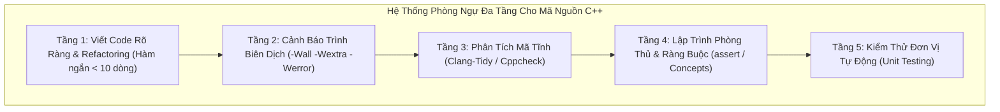

# 3.10 — Phòng Ngừa Lỗi: Bắt Bug Trước Khi Trở Thành Thảm Họa (Finding Issues Before They Become Problems)

---

## 🎯 Mục Tiêu Bài Học
- Chuyển đổi từ tư duy "chữa cháy thụ động" sang **"phòng ngừa chủ động"**: phát hiện lỗi ngay từ khi vừa gõ phím thay vì chờ tới khi sập hệ thống.
- Làm chủ kỹ thuật **Tái cấu trúc mã nguồn (Code Refactoring)** và nguyên tắc tách hàm nhỏ đạt chuẩn sạch.
- Áp dụng nguyên lý **Lập trình phòng thủ (Defensive Programming)** và kiểm tra ràng buộc bằng tiền điều kiện (`assert` / `static_assert`).
- Tận dụng sức mạnh của các công cụ **Phân tích mã nguồn tĩnh (Static Analysis)**: Clang-Tidy, Cppcheck, MSVC Code Analysis.

---

## 1. Triết Lý Phòng Ngừa: "Chữa Bệnh Sớm Hơn Chữa Bệnh Nặng"

Một con bug nằm càng lâu trong mã nguồn thì chi phí để tìm và sửa nó càng tăng theo cấp số nhân. Một lỗi logic nhỏ nếu bị bỏ quên qua nhiều tuần, khi các tính năng khác tiếp tục được xây dựng chồng chéo lên nó, sẽ biến thành một "cơn ác mộng gỡ lỗi" ngốn hàng ngày trời của lập trình viên.

&gt; *"Mọi người đều biết rằng gỡ lỗi khó gấp đôi so với viết code ngay từ đầu. Vì vậy, nếu bạn cố tỏ ra thông minh hết mức có thể khi viết code, thì làm sao bạn đủ thông minh để gỡ lỗi nó được nữa?"*
&gt; 
&gt; — **Brian Kernighan**, Đồng tác giả ngôn ngữ C và cuốn sách *The Elements of Programming Style*.



---

## 2. Tái Cấu Trúc Mã Nguồn (Refactoring)

Khi một chương trình mở rộng, các hàm của bạn thường có xu hướng phình to ra. Một hàm dài hàng trăm dòng lệnh là nơi trú ngụ lý tưởng của mọi loại bug: rất khó kiểm soát luồng rẽ nhánh, biến số bị dùng chồng chéo, và người đọc rất nhanh bị quá tải nhận thức.

**Tái cấu trúc (Refactoring)** là quá trình thay đổi cấu trúc bên trong của mã nguồn để làm code sạch hơn, dễ hiểu hơn và dễ bảo trì hơn mà **hoàn toàn không làm thay đổi hành vi bên ngoài** của chương trình.

### Tiêu chuẩn một hàm tốt:
- **Độ dài lý tưởng**: Dưới 10 dòng code. Một hàm hiển thị trọn vẹn trên một màn hình mà không cần cuộn chuột (scroll) là tiêu chuẩn tối thiểu.
- **Đơn nhiệm (Single Responsibility Principle)**: Mỗi hàm chỉ làm **duy nhất một việc** và làm việc đó thật xuất sắc.

::: tip Nguyên tắc vàng khi chỉnh sửa code
Khi làm việc với mã nguồn, hãy luôn tách biệt rạch ròi giữa hai hành động:
1. **Thay đổi hành vi (Behavioral change)**: Thêm tính năng mới hoặc sửa bug.
2. **Thay đổi cấu trúc (Structural change / Refactoring)**: Tách hàm, đổi tên biến cho rõ nghĩa.

**Tuyệt đối không làm cả hai việc cùng một lúc!** Hãy refactor trước, chạy test xác nhận code vẫn chạy đúng, rồi mới tiến hành thêm tính năng mới.
:::

---

## 3. Lập Trình Phòng Thủ (Defensive Programming)

Lập trình phòng thủ là kỹ thuật viết mã với giả định rằng: **Mọi tình huống xấu nhất đều có thể xảy ra**. Người dùng có thể nhập chữ cái vào ô số nguyên, dữ liệu đọc từ mạng có thể bị mất mát, hoặc một lập trình viên khác trong nhóm có thể truyền con trỏ `nullptr` vào hàm của bạn.

### Ví dụ kiểm tra ràng buộc (Constraints):
```cpp
#include <iostream>
#include <cassert> // Thu vien cung cap macro assert

// Ham tinh giai thua: chi chap nhan so nguyen khong am (n >= 0)
long long factorial(int n)
{
    // Kiem tra rang buoc tien dieu kien: neu n < 0, chuong trinh dung lap tuc o Debug mode
    assert(n >= 0 && "Loi nghiem trong: Tham so factorial() khong duoc phep mang gia tri am!");

    long long result{ 1 };
    for (int i{ 1 }; i <= n; ++i)
    {
        result *= i;
    }
    return result;
}

int main()
{
    std::cout << "5! = " << factorial(5) << '\n';
    // std::cout << "(-3)! = " << factorial(-3) << '\n'; // Kich hoat assert ngay!
    return 0;
}
```

---

## 4. Tự Động Hóa Kiểm Thử Đơn Vị (Unit Testing)

Thay vì mỗi lần sửa code lại phải chạy chương trình rồi dùng tay gõ `4` và `3` vào màn hình Console để kiểm tra, chúng ta tự động hóa quá trình này bằng các **Hàm kiểm thử đơn vị (Unit Tests)**:

```cpp
#include <iostream>

int add(int x, int y)
{
    return x + y;
}

// Ham tu kiem tra add() voi hang loat ca bien
bool runUnitTests()
{
    if (add(1, 1) != 2) return false;
    if (add(-5, 5) != 0) return false;
    if (add(-3, -7) != -10) return false;
    if (add(0, 0) != 0) return false;
    
    return true; // Tat ca ca kiem thu deu vuot qua thanh cong!
}

int main()
{
    if (runUnitTests())
    {
        std::cout << "[PASS] Toan bo bai kiem thu don vi deu thanh cong!\n";
    }
    else
    {
        std::cerr << "[FAIL] Phat hien hoi quy: Ham add() da bi hong logic!\n";
    }

    return 0;
}
```

Trong thực tế doanh nghiệp, các bộ thư viện chuyên nghiệp như **Google Test (GTest)** hoặc **Catch2** sẽ quản lý hàng ngàn ca kiểm thử tự động trong quy trình CI/CD.

---

## 5. Công Cụ Phân Tích Mã Nguồn Tĩnh (Static Analysis Tools)

**Phân tích tĩnh (Static Analysis)** là kỹ thuật phân tích tệp mã nguồn để tìm kiếm lỗi tiềm ẩn, vi phạm chuẩn an toàn và lỗ hổng bảo mật mà **không cần phải biên dịch hay chạy chương trình**.

Các công cụ phân tích tĩnh xuất sắc nhất hiện nay:
1. **`clang-tidy`**: Trợ thủ số 1 của hệ sinh thái LLVM/Clang. Tự động kiểm tra hàng trăm quy tắc của bộ chuẩn C++ Core Guidelines, phát hiện rò rỉ bộ nhớ, biến chưa khởi tạo, và thậm chí tự động sửa code cho bạn!
2. **`cppcheck`**: Công cụ mã nguồn mở cực kỳ mạnh mẽ, tập trung săn tìm các lỗi Undefined Behavior và con trỏ lạc lối.
3. **Bộ phân tích tĩnh tích hợp trong IDE**:
   - Visual Studio: Phím tắt `Alt + F11` (*Build &gt; Run Code Analysis on Solution*).
   - CLion / VS Code: Tích hợp trực tiếp Clang-Tidy hiển thị gạch chân màu vàng ngay khi bạn vừa gõ xong dòng code lỗi!

---

## 6. 🚀 Nâng Tầm C++20 / C++23: `[[nodiscard]]` và Ràng Buộc Kiểu Dữ Liệu

1. **Thuộc tính `[[nodiscard]]` (C++17/C++20)**: Ép người gọi hàm bắt buộc phải hứng giá trị trả về. Nếu bỏ qua kết quả trả về, compiler sẽ báo lỗi cảnh báo ngay lập tức:
   ```cpp
   [[nodiscard]] bool allocateBuffer(int size)
   {
       // Tra ve true neu thanh cong, false neu that bai
       return size > 0;
   }

   int main()
   {
       allocateBuffer(100); // Compiler WARNING: Bo quen ma loi tra ve!
       return 0;
   }
   ```
2. **C++20 Concepts**: Thay vì đợi lỗi phát sinh ở runtime, C++20 cho phép đặt ràng buộc trực tiếp lên kiểu dữ liệu template ngay tại thời điểm biên dịch, triệt tiêu hoàn toàn lỗi sai kiểu!

---

## 7. 💡 Hộp Thực Hành Tốt Nhất (Best Practice)

::: tip 5 Điều răn để không bao giờ phải thức đêm gỡ lỗi
1. **Viết code từng phần nhỏ rồi test ngay**: Đừng bao giờ viết một mạch 500 dòng code rồi mới bấm nút Compile lần đầu tiên. Hãy viết 10-20 dòng, biên dịch và chạy thử ngay!
2. **Ưu tiên thư viện chuẩn STL hơn là tự viết lại bánh xe**: Các hàm trong `<algorithm>`, `<string>`, `<vector>` đã được hàng ngàn chuyên gia hàng đầu thế giới tối ưu hóa và kiểm thử suốt 30 năm qua. Code bạn tự viết khó có thể ít lỗi hơn thư viện chuẩn!
3. **Ưu tiên code dễ đọc hơn code "ngắn một cách bí hiểm"**: Đừng cố viết tắt gom 5 phép toán vào 1 dòng code để chứng tỏ trình độ. Code dễ đọc và trong sáng mới là code của kỹ sư thượng thừa.
4. **Bật toàn bộ cảnh báo Compiler**: Đặt `-Wall -Wextra -Wpedantic` làm chuẩn bắt buộc cho mọi dự án.
5. **Cài đặt Clang-Tidy**: Chạy phân tích tĩnh định kỳ trước mỗi lần bàn giao mã nguồn.
:::

---

## 8. 📝 Hệ Thống Quiz & Bài Tập Tự Luyện

::: details Câu hỏi 1: Tái cấu trúc mã nguồn (Refactoring) khác gì so với việc sửa lỗi (Bug fixing) hoặc phát triển tính năng mới?
**Lời giải chi tiết**:
- **Tái cấu trúc (Refactoring)**: Là quá trình cải tiến cấu trúc, tổ chức bên trong của mã nguồn (ví dụ: tách hàm dài thành các hàm nhỏ, đổi tên biến cho rõ nghĩa, loại bỏ code trùng lặp) nhằm tăng tính trong sáng và khả năng bảo trì, **nhưng tuyệt đối không làm thay đổi bất kỳ hành vi bên ngoài nào** của chương trình.
- **Sửa lỗi / Tính năng mới**: Là hành động thay đổi hành vi bên ngoài của chương trình (biến kết quả từ sai thành đúng, hoặc bổ sung thêm khả năng xử lý mới).
:::

::: details Câu hỏi 2: Công cụ phân tích tĩnh (Static Analysis) hoạt động như thế nào và tại sao nó lại bổ trợ hoàn hảo cho trình biên dịch (Compiler)?
**Lời giải chi tiết**:
Công cụ phân tích tĩnh phân tích mã nguồn dạng văn bản và cây cú pháp trừu tượng (Abstract Syntax Tree - AST) dựa trên hàng trăm bộ quy tắc kinh nghiệm và kịch bản lỗi phổ biến mà không cần chạy chương trình. Trong khi trình biên dịch chỉ tập trung kiểm tra tính hợp lệ về mặt ngữ pháp để sinh mã máy, công cụ phân tích tĩnh đi sâu vào việc phát hiện các đoạn mã "có mùi" (code smells), vi phạm thực hành chuẩn mực, tiềm ẩn rò rỉ bộ nhớ hoặc khả năng xảy ra Undefined Behavior trong những trường hợp biên hiếm gặp mà trình biên dịch thường bỏ qua.
:::
