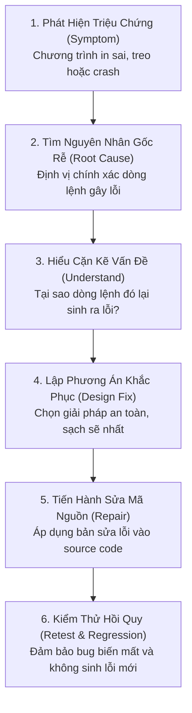

# 3.2 — Quy Trình Gỡ Lỗi (The Debugging Process)

---

## 🎯 Mục Tiêu Bài Học
- Nắm vững chu trình 6 bước chuẩn mực trong kỹ nghệ gỡ lỗi phần mềm từ phát hiện triệu chứng đến khắc phục triệt để nguyên nhân gốc rễ.
- Phân biệt rạch ròi giữa **Triệu chứng (Symptom)** bên ngoài và **Nguyên nhân gốc rễ (Root Cause)** bên trong mã nguồn.
- Học tư duy cô lập vấn đề bằng phương pháp tạo mẫu thử nghiệm tối thiểu (Minimal Reproducible Example - MRE).
- Hiểu tầm quan trọng của kiểm thử hồi quy (Regression Testing) để đảm bảo việc sửa một lỗi cũ không làm phát sinh thêm ba lỗi mới.

---

## 1. Bản Chất Của Lỗi: Điều Bạn Tưởng Đúng Nhưng Không Hề Đúng

Mọi lỗi phần mềm (bug) đều bắt nguồn từ một tiên đề giản đơn: **Bạn nghĩ một đoạn mã đang hoạt động theo cách A, nhưng trong thực tế nó lại hoạt động theo cách B**.

Khi chương trình biên dịch thành công mà khi chạy lại cho kết quả sai lệch hoặc bị sập, bạn đang đối mặt với lỗi ngữ nghĩa. Nhưng làm sao để tìm ra nó giữa hàng trăm, hàng ngàn dòng code? Việc lao vào sửa code ngẫu nhiên theo kiểu "thử vận may" chỉ khiến mã nguồn thêm hỗn loạn. Bạn cần một **quy trình gỡ lỗi khoa học và có hệ thống**.



---

## 2. Chu Trình 6 Bước Gỡ Lỗi Chuẩn Mực

Một quy trình gỡ lỗi chuyên nghiệp gồm 6 bước tuần tự:

### Bước 1: Tìm nguyên nhân gốc rễ (Find the root cause)
Xác định chính xác dòng lệnh, biểu thức hoặc trạng thái bộ nhớ bắt đầu bị sai lệch so với kỳ vọng.

### Bước 2: Hiểu cặn kẽ tại sao lỗi xảy ra (Understand the problem)
Không được vội vàng sửa code khi chưa thực sự hiểu tại sao dòng lệnh đó lại thất bại. Sửa code trong trạng thái mơ hồ là con đường ngắn nhất dẫn đến thảm họa!

### Bước 3: Lập phương án khắc phục (Determine a fix)
Xem xét các giải pháp:
- Sửa toán tử hoặc logic của biểu thức?
- Cấu trúc lại luồng rẽ nhánh điều kiện?
- Thay đổi cấu trúc dữ liệu hoặc thuật toán?

### Bước 4: Tiến hành sửa lỗi (Repair the issue)
Chỉnh sửa mã nguồn và biên dịch lại.

### Bước 5: Kiểm thử lại để xác nhận lỗi đã biến mất (Retest)
Chạy lại đúng trường hợp thử nghiệm (test case) đã gây ra lỗi trước đó để đảm bảo kết quả hiện tại hoàn toàn chính xác.

### Bước 6: Kiểm thử hồi quy (Regression testing)
Chạy toàn bộ các kịch bản kiểm thử khác của chương trình để đảm bảo việc sửa đổi mã nguồn không vô tình làm hỏng các tính năng đang chạy ổn định khác.

---

## 3. Câu Chuyện Thực Tế: Chiếc Tủ Lạnh Hỏng Đá

Để hiểu sâu sắc sự khác biệt giữa **Triệu chứng (Symptom)** và **Nguyên nhân gốc rễ (Root Cause)**, hãy liên hệ với một tình huống đời thực:

Một buổi tối, bạn muốn lấy một cốc đá từ khay lấy đá tự động ở cánh tủ lạnh. Bạn áp cốc vào cần gạt, máy kêu rè rè nhưng **không có viên đá nào rơi ra**. 

- **Triệu chứng**: Không có đá rơi vào cốc.
- **Điều tra ban đầu**: Bạn mở ngăn đông tủ lạnh, khay chứa đá hoàn toàn trống rỗng. Khay trống rỗng có phải nguyên nhân gốc rễ không? **Không! Đó chỉ là một triệu chứng sâu hơn**.
- **Tìm nguyên nhân gốc rễ**: Tại sao khay đá trống? Bạn kiểm tra:
  - Tủ lạnh vẫn lạnh sâu (-18°C)? Có.
  - Đường ống cấp nước có bị tắc không? Không, nước vẫn chảy tốt.
  - Bộ phận làm đá tự động (ice maker) có nhận được điện và quay cơ học không? Động cơ làm đá đã bị kẹt bánh răng!
  - **=&gt; Đây chính là nguyên nhân gốc rễ (Root Cause)!**
- **Hiểu vấn đề & Lập phương án**: Bánh răng nhựa bị nứt khiến mô-tơ không thể đổ đá ra khay. Bạn có các lựa chọn: gỡ bánh răng ra dán keo (tạm bợ), thay cụm làm đá mới, hoặc mua tủ lạnh mới. Bạn quyết định mua cụm làm đá mới.
- **Sửa chữa & Kiểm thử**: Lắp cụm mới, bật điện tủ lạnh. Sáng hôm sau mở ra, đá đã đầy ắp khay và các ngăn khác của tủ lạnh vẫn đông đá hoàn hảo (không phát sinh lỗi mới).

---

## 4. Áp Dụng Lên Mã Nguồn C++

Hãy áp dụng chu trình trên vào đoạn mã sau:

```cpp
#include <iostream>

int add(int x, int y) // Hàm được thiết kế để tính tổng hai số
{
    return x - y; // Nhưng lại dùng toán tử trừ!
}

int main()
{
    std::cout << "5 + 3 = " << add(5, 3) << '\n'; // In ra màn hình: 5 + 3 = 2
    return 0;
}
```

1. **Phát hiện triệu chứng**: Màn hình in ra `5 + 3 = 2`. Kết quả kỳ vọng là `8`.
2. **Tìm nguyên nhân gốc rễ**: Trong `main()`, hai đối số `5` và `3` là các giá trị hằng số (literals) hoàn toàn chính xác. Vậy lỗi chắc chắn nằm bên trong hàm `add(5, 3)`. Truy vết vào thân hàm `add`, câu lệnh duy nhất là `return x - y;`. Đây chính là dòng lệnh thủ phạm!
3. **Hiểu vấn đề**: Lập trình viên đã gõ nhầm toán tử trừ `-` thay vì toán tử cộng `+`.
4. **Lập phương án & Sửa lỗi**: Thay `operator-` thành `operator+`:
   ```cpp
   int add(int x, int y)
   {
       return x + y; // Đã khắc phục
   }
   ```
5. **Kiểm thử lại**: Chạy lại chương trình, màn hình in ra: `5 + 3 = 8`. Lỗi đã được giải quyết triệt để!

---

## 5. ⚠️ Hộp Cạm Bẫy Thực Chiến: "Chữa Triệu Chứng" và Lỗi Hồi Quy (Regression)

::: danger Cạm bẫy: "Vá víu triệu chứng" thay vì giải quyết nguyên nhân gốc rễ
Một sai lầm chí mạng của người mới học là sửa code để "lách" cho đúng với một trường hợp cụ thể thay vì giải quyết bản chất logic.

Xét ví dụ: Khi thấy `add(5, 3)` in ra `2`, thay vì sửa dấu `+`, lập trình viên lại sửa:
```cpp
int add(int x, int y)
{
    return (x - y) + 6; // "Vá tạm" để 5 - 3 + 6 = 8!
}
```
Cách sửa này khiến `add(5, 3)` ra `8`, nhưng khi gọi `add(10, 2)` nó sẽ ra `(10 - 2) + 6 = 14` (sai bét!). Đây gọi là **Lỗi hồi quy (Regression Bug)** — việc sửa một lỗi đã phá hỏng toàn bộ các trường hợp đúng khác.
:::

---

## 6. 🚀 Hộp Cập Nhật C++20 / C++23: Hỗ Trợ Kiểm Thử & Chẩn Đoán Lỗi

1. **Kiểm tra tính đúng đắn tại compile-time với `constexpr`**:
   Nếu một hàm được khai báo là `constexpr`, bạn có thể dùng `static_assert` để kiểm thử logic hàm ngay khi biên dịch:
   ```cpp
   constexpr int add(int x, int y)
   {
       return x + y;
   }

   // Tự động kiểm thử ngay khi biên dịch! Nếu add() tính sai, compiler báo lỗi ngay lập tức
   static_assert(add(5, 3) == 8, "Ham add() tinh sai!");
   static_assert(add(-2, 2) == 0, "Ham add() tinh sai voi so am!");
   ```
2. **Ghi log hiện đại với `<print>` (C++23)**:
   Thay vì dùng `std::cout` cồng kềnh, C++23 cung cấp `std::println` nhanh và không làm ảnh hưởng đến cấu hình định dạng của luồng:
   ```cpp
   #include <print>
   // std::println("add({}, {}) = {}", 5, 3, add(5, 3));
   ```

---

## 7. 💡 Hộp Thực Hành Tốt Nhất (Best Practice)

::: tip Quy tắc vàng khi gỡ lỗi
1. **Tạo ca kiểm thử tái hiện lỗi ổn định (Reproducible test case)**: Một lỗi không thể tái hiện là một lỗi gần như không thể sửa. Hãy xác định chính xác dãy dữ liệu đầu vào nào dẫn tới lỗi.
2. **Xây dựng MRE (Minimal Reproducible Example)**: Hãy cắt bỏ tối đa các đoạn code râu ria không liên quan đến khi chỉ còn lại vài dòng code ngắn nhất mà vẫn gây ra lỗi.
3. **Viết kiểm thử tự động (Unit Test)**: Mỗi khi tìm ra một bug, hãy viết ngay một bài test cho bug đó. Việc này đảm bảo bug vĩnh viễn không bao giờ có cơ hội quay trở lại trong tương lai!
:::

---

## 8. 📝 Hệ Thống Quiz & Bài Tập Tự Luyện

::: details Câu hỏi 1: Lỗi hồi quy (Regression Bug) là gì? Tại sao bước Kiểm thử hồi quy (Bước 6) lại tối quan trọng?
**Lời giải chi tiết**:
- **Lỗi hồi quy (Regression Bug)** là loại lỗi mới xuất hiện ở một tính năng vốn dĩ đang hoạt động bình thường, nguyên nhân bắt nguồn từ việc lập trình viên chỉnh sửa mã nguồn để thêm tính năng mới hoặc sửa một lỗi khác.
- **Bước 6 tối quan trọng** vì mã nguồn phần mềm có tính liên kết chặt chẽ. Một thay đổi nhỏ ở hàm dùng chung có thể làm thay đổi kết quả đầu ra của hàng chục hàm khác đang phụ thuộc vào nó. Nếu không kiểm thử hồi quy toàn diện, hệ thống sẽ rơi vào vòng lặp "sửa 1 lỗi sinh ra 3 lỗi mới".
:::

::: details Câu hỏi 2: Một người bạn gửi cho bạn đoạn code sau và nhờ debug vì chương trình tính chu vi hình chữ nhật ra kết quả sai:
```cpp
#include <iostream>

int calculatePerimeter(int length, int width)
{
    return length * width; 
}

int main()
{
    std::cout << "Chu vi HCN 4x5 la: " << calculatePerimeter(4, 5) << '\n';
    return 0;
}
```
Hãy nêu rõ Triệu chứng, Nguyên nhân gốc rễ và Cách khắc phục chuẩn xác.
**Lời giải chi tiết**:
- **Triệu chứng (Symptom)**: Chương trình in ra `Chu vi HCN 4x5 la: 20` trong khi chu vi đúng phải là `2 * (4 + 5) = 18`.
- **Nguyên nhân gốc rễ (Root Cause)**: Hàm `calculatePerimeter` bị nhầm lẫn công thức toán học giữa **Diện tích** (`dài * rộng`) và **Chu vi** (`2 * (dài + rộng)`).
- **Cách khắc phục**: Sửa lại thân hàm `calculatePerimeter`:
  ```cpp
  int calculatePerimeter(int length, int width)
  {
      return 2 * (length + width);
  }
  ```
:::
