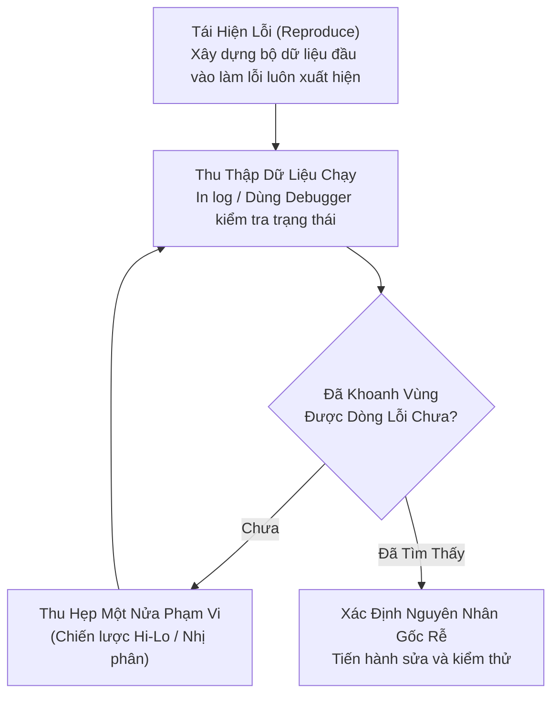

# 3.3 — Chiến Lược Gỡ Lỗi: Cô Lập & Thu Hẹp Phạm Vi (A Strategy for Debugging)

---

## 🎯 Mục Tiêu Bài Học
- Hiểu được ưu điểm và giới hạn chết người của phương pháp "đọc code bằng mắt" (Code Inspection).
- Nắm vững nguyên lý sống còn: **Tái hiện lỗi (Bug Reproducibility)** và cách viết kịch bản tái hiện lỗi (Reproduction Steps).
- Làm chủ chiến lược tư duy "Trò chơi đoán số Hi-Lo" (Binary Search Debugging) để nhanh chóng thu hẹp không gian tìm kiếm từ hàng ngàn dòng code xuống còn 1 dòng duy nhất.
- Tiếp cận khái niệm **Heisenbug** và các lỗi phụ thuộc môi trường chạy.

---

## 1. Tìm Lỗi Bằng Cách "Đọc Code Bằng Mắt" (Code Inspection)

Khi một chương trình chạy sai, phản xạ đầu tiên của nhiều người là mở tệp mã nguồn và đọc từng dòng code. Trong các chương trình nhỏ có cấu trúc phân tách rõ ràng, cách này đôi khi phát huy tác dụng:

```cpp
int main()
{
    getNames();   // Bước 1: Yêu cầu người dùng nhập danh sách tên
    sortNames();  // Bước 2: Sắp xếp theo thứ tự bảng chữ cái A-Z
    printNames(); // Bước 3: In danh sách tên đã sắp xếp

    return 0;
}
```

Nếu chương trình in ra danh sách tên theo thứ tự ngược lại (Z-A), bạn có thể đoán ngay vấn đề nằm ở hàm `sortNames()`. Việc khoanh vùng vào một hàm cụ thể giúp bạn dễ dàng đọc và phát hiện sai sót logic.

### Giới hạn chết người của việc đọc code bằng mắt:
1. **Quy mô mã nguồn khổng lồ**: Các dự án thực tế có hàng chục nghìn đến hàng triệu dòng code. Không ai có đủ thời gian và sự kiên nhẫn để đọc từng dòng.
2. **Hội chứng "Thiên kiến giả định" (Bad Assumptions)**: Lỗi thường sinh ra do chính giả định sai lầm của người viết. Khi bạn đọc lại code của chính mình, não bộ của bạn có xu hướng tái lặp lại đúng giả định sai lầm đó, biến lỗi thành "vô hình" trước mắt bạn!
3. **Triệu chứng không để lại manh mối**: Nếu một chương trình phân tích tài chính chạy xong mà không đưa ra bất kỳ kết quả nào ra màn hình, bạn sẽ hoàn toàn không biết phải bắt đầu đọc từ đâu.

---

## 2. Tìm Lỗi Khi Chạy Chương Trình (Dynamic Debugging)

Khi việc đọc code bằng mắt bất lực, con đường duy nhất là **quan sát hành vi thực tế của chương trình khi đang chạy**. Chiến lược này gồm 3 bước:
1. Xác định cách thức **tái hiện lỗi** một cách ổn định (100% lặp lại được).
2. Chạy chương trình và thu thập dữ liệu chẩn đoán để thu hẹp phạm vi nghi vấn.
3. Lặp lại bước 2 cho đến khi định vị được chính xác dòng lệnh gây ra sai lệch.



---

## 3. Tái Hiện Lỗi Ổn Định: Điều Kiện Tiên Quyết

::: danger Nguyên lý bất biến
**Bạn không thể sửa một lỗi mà bạn không thể nhìn thấy nó xảy ra.**
:::

Một lỗi xuất hiện ngẫu nhiên (chạy 10 lần chỉ bị lỗi 1 lần) sẽ tiêu tốn thời gian chẩn đoán gấp hàng chục lần so với lỗi xuất hiện 100% số lần chạy.
Để biến một lỗi chập chờn thành lỗi ổn định, bạn cần thiết lập **Kịch bản tái hiện (Reproduction Steps)**:
- Hệ điều hành và phiên bản compiler đang sử dụng là gì?
- Thứ tự các nút bấm hoặc thao tác nhập liệu chính xác là gì?
- Dữ liệu đầu vào cụ thể (tệp tin, chuỗi ký tự, con số) gây ra sự cố?

---

## 4. Chiến Thuật "Đoán Số Hi-Lo" (Homing In on Issues)

Hãy nhớ lại trò chơi đoán số tuổi thơ: Tôi nghĩ trong đầu một số nguyên từ 1 đến 10. Bạn đoán:
- Bạn đoán: `5` -> Tôi bảo: **"Quá thấp" (Too low)**. (Bạn loại bỏ ngay nửa dải số từ 1 đến 5).
- Bạn đoán: `8` -> Tôi bảo: **"Quá cao" (Too high)**. (Bạn loại bỏ 8, 9, 10).
- Bạn đoán: `6` -> Tôi bảo: **"Quá thấp" (Too low)**.
- Bạn đoán: `7` -> Tôi bảo: **"Chính xác!"**.

Trong lập trình, ta áp dụng chính xác tư duy **tìm kiếm nhị phân (Binary Search)** này để khoanh vùng lỗi giữa điểm bắt đầu chạy và điểm xuất hiện triệu chứng sai:


1. **Tín hiệu "Too Low" (Quá Thấp)**: Nếu tại một dòng lệnh ở giữa chương trình, bạn kiểm tra và chứng minh được rằng **mọi biến số vẫn mang giá trị hoàn toàn đúng** và chưa có gì bất thường, điều đó tương đương với việc lỗi **nằm ở nửa sau** của chương trình. Bạn loại bỏ hoàn toàn nửa đầu!
2. **Tín hiệu "Too High" (Quá Cao)**: Nếu tại một điểm kiểm tra, giá trị biến `x` đã bị biến dạng thành số rác hoặc sai lệch, bạn biết chắc chắn lỗi **đã xảy ra ở đoạn mã phía trước** điểm đó. Bạn loại bỏ hoàn toàn nửa sau!
3. Bằng cách liên tục đặt các trạm kiểm soát ở điểm giữa của vùng mã nghi vấn, bạn chia đôi không gian tìm kiếm sau mỗi lần thử. Một chương trình dài 1.000 dòng chỉ mất tối đa **khoảng 10 lần kiểm tra** ($2^{10} = 1024$) là tìm ra chính xác dòng code thủ phạm!

---

## 5. ⚠️ Hộp Cạm Bẫy Thực Chiến: Heisenbug & Trạng Thái Ẩn

::: danger Cạm bẫy: "Heisenbug" — Lỗi biến mất khi bạn cố gắng quan sát nó!
Trong vật lý lượng tử có nguyên lý bất định Heisenberg: việc quan sát hạt làm thay đổi trạng thái của hạt. Trong lập trình, **Heisenbug** là những con bug kỳ quái:
- Khi chạy bình thường thì chương trình crash.
- Nhưng khi bạn chèn thêm lệnh in `std::cout` hoặc bật Debugger lên thì chương trình lại **chạy trơn tru không hề có lỗi**!

**Nguyên nhân gốc rễ**: 
1. Việc chèn thêm `std::cout` làm thay đổi cách Compiler sắp xếp các biến trên Stack, vô tình che lấp vùng nhớ bị tràn.
2. Đọc biến chưa khởi tạo: Ở chế độ Debug, IDE thường tự động điền các byte số `0` vào ô nhớ, khiến biến chưa khởi tạo ngẫu nhiên mang giá trị hợp lệ. Đến khi sang chế độ Release trên máy khách hàng, ô nhớ chứa rác và lập tức crash!
:::

---

## 6. 🚀 Hộp Cập Nhật C++20 / C++23: Định Vị Lỗi Với `std::source_location`

Trước C++20, lập trình viên phải dựa vào các macro tiền xử lý cũ kỹ của C (`__FILE__`, `__LINE__`). Kể từ C++20, thư viện chuẩn cung cấp `std::source_location` giúp xác định ngữ cảnh dòng code mà không cần dùng macro:

```cpp
#include <iostream>
#include <source_location>

void logCheckpoint(const std::string& message, 
                   const std::source_location& location = std::source_location::current())
{
    std::cout << "[LOG] " << message 
              << " | Tep: " << location.file_name()
              << " | Dong: " << location.line()
              << " | Ham: " << location.function_name() << '\n';
}

int main()
{
    logCheckpoint("Bat dau chuong trinh");
    // Thuc hien tinh toan...
    logCheckpoint("Kiem tra sau khi tinh toan");
    return 0;
}
```

---

## 7. 💡 Hộp Thực Hành Tốt Nhất (Best Practice)

::: tip Chiến thuật gỡ lỗi đỉnh cao
1. **Không đoán mò vô căn cứ**: Hãy dựa vào dữ liệu thực tế (giá trị biến số, luồng thực thi). Hãy để dữ liệu chỉ đường cho bạn.
2. **Chia để trị (Divide and Conquer)**: Áp dụng tư duy nhị phân để loại bỏ từng khối mã lớn thay vì sa đà đọc từng câu lệnh riêng lẻ.
3. **Cẩn trọng với những điều bạn "chắc chắn đúng"**: Nơi chứa bug thường chính là nơi bạn nghĩ rằng "đoạn này đơn giản thế làm sao mà sai được".
:::

---

## 8. 📝 Hệ Thống Quiz & Bài Tập Tự Luyện

::: details Câu hỏi 1: Tại sao việc dựa hoàn toàn vào "Đọc code bằng mắt" (Code Inspection) lại rất dễ bỏ sót các lỗi ngữ nghĩa do giả định sai (Bad Assumptions)?
**Lời giải chi tiết**:
Khi một lỗi xuất phát từ việc lập trình viên hiểu sai bản chất bài toán hoặc hiểu sai cơ chế ngôn ngữ (ví dụ: ngỡ rằng phép gán `=` là phép so sánh `==`, hoặc tưởng rằng một hàm trả về độ dài tính cả ký tự null `\0`), thì khi đọc lại code bằng mắt, não bộ sẽ dùng chính lăng kính giả định sai đó để đánh giá. Vì vậy, người viết sẽ luôn thấy đoạn code đó "hợp lý" và không thể phát hiện ra sai sót. Chỉ có việc chạy code thực tế và kiểm tra dữ liệu thật mới phá vỡ được giả định sai lầm.
:::

::: details Câu hỏi 2: Một chương trình gồm 800 dòng lệnh. Nếu bạn áp dụng chiến lược tìm kiếm nhị phân (Hi-Lo Debugging), bạn cần tối đa khoảng bao nhiêu lần kiểm tra để xác định chính xác dòng lệnh gây lỗi?
**Lời giải chi tiết**:
Áp dụng công thức tìm kiếm nhị phân: $\log_2(800) \approx 9.64$.
Như vậy, bạn chỉ cần tối đa **10 lần kiểm tra** để cô lập được dòng lệnh lỗi trong số 800 dòng mã nguồn!
:::
