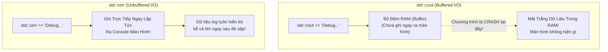

# 3.4 — Các Chiến Thuật Gỡ Lỗi Thủ Công Căn Bản (Basic Debugging Tactics)

---

## 🎯 Mục Tiêu Bài Học
- Nắm vững 3 chiến thuật gỡ lỗi thủ công kinh điển: **Vô hiệu hóa mã nguồn (Commenting out code)**, **Xác thực luồng thực thi (Code flow validation)** và **In giá trị biến số (Printing values)**.
- Hiểu bản chất cơ chế bộ đệm: Tại sao bắt buộc phải dùng **`std::cerr`** thay vì `std::cout` khi in thông tin chẩn đoán lỗi.
- Nhận diện cạm bẫy tai hại: Gọi hàm mà quên cặp ngoặc tròn `()` dẫn đến hiện tượng suy biến thành con trỏ hàm.
- Đánh giá mặt hạn chế của phương pháp "print debugging" và lý do các kỹ sư phần mềm phải chuyển sang sử dụng công cụ gỡ lỗi tích hợp (Integrated Debugger).

---

## 1. Chiến Thuật 1: Vô Hiệu Hóa Từng Phần Mã Nguồn (Commenting Out Code)

Khi chương trình chạy sai, cách đơn giản nhất để thu hẹp vùng nghi vấn là tạm thời biến một đoạn mã thành chú thích (comment out) và quan sát xem lỗi còn xuất hiện hay không:

```cpp
int main()
{
    getNames();       // Nhập danh sách tên
//  doMaintenance();  // Tạm thời comment hàm này lại để kiểm tra!
    sortNames();      // Sắp xếp
    printNames();     // In kết quả

    return 0;
}
```

Có 3 kịch bản xảy ra khi bạn comment hàm `doMaintenance()`:
1. **Lỗi biến mất**: Chúc mừng bạn, chính `doMaintenance()` là thủ phạm làm sai lệch dữ liệu! Hãy tập trung toàn bộ sự chú ý vào hàm này.
2. **Lỗi vẫn y nguyên**: Nhiều khả năng `doMaintenance()` vô can. Bạn có thể tạm thời loại trừ hàm này khỏi danh sách tình nghi để tập trung vào các hàm còn lại.
3. **Chương trình phát sinh lỗi mới hoặc crash**: Hàm này đang thực hiện một tác vụ khởi tạo mà các dòng code phía sau bắt buộc phải có. Hãy bỏ comment và thử phương án khác.

::: danger Cạm bẫy: Quên mở lại comment trước khi đưa code vào sản phẩm
Sau khi comment và uncomment hàng chục dòng code để tìm bug, bạn rất dễ bỏ quên một vài hàm quan trọng. Việc này sẽ vô tình sửa được 1 bug nhưng làm hỏng toàn bộ logic hệ thống!
**Giải pháp**: Hãy luôn sử dụng công cụ quản lý phiên bản (Git) và chạy lệnh `git diff` để rà soát lại từng ký tự thay đổi trước khi đóng gói hoặc commit.
:::

---

## 2. Chiến Thuật 2: Xác Thực Luồng Thực Thi (Code Flow Validation)

Một lỗi rất phổ biến trong các chương trình phức tạp là một hàm bị gọi quá nhiều lần, quá ít lần, hoặc **hoàn toàn không được gọi**.

Để kiểm tra xem hàm có thực sự được CPU nhảy tới thực thi hay không, ta đặt các câu lệnh in dấu vết (trace statements) ở ngay đầu hàm:

```cpp
#include <iostream>

int getValue()
{
std::cerr << "-> Da vao ham getValue()\n";
    return 4;
}

int main()
{
std::cerr << "-> Da vao ham main()\n";
    std::cout << getValue << '\n'; // Chu y dong nay!

    return 0;
}
```

Khi chạy chương trình trên, kết quả hiển thị trên màn hình:
```text
-> Da vao ham main()
1
```
(hoặc trên một số trình biên dịch nó in ra một địa chỉ bộ nhớ như `00101424`).

### Phát hiện lỗi:
Dòng chữ `-> Da vao ham getValue()` **hoàn toàn không xuất hiện**! Điều này chứng minh hàm `getValue()` chưa từng được chạy.
Nhìn kỹ vào dòng gọi hàm:
```cpp
std::cout << getValue << '\n';
```
Chúng ta đã **quên cặp dấu ngoặc tròn `()`**! Viết `getValue` mà không có `()` trong C++ không phải là một lời gọi hàm, mà là lấy địa chỉ của hàm (Function Pointer). Trình biên dịch ép kiểu địa chỉ đó thành `bool` (in ra `1`) hoặc in trực tiếp địa chỉ hex!

Sửa lại thành:
```cpp
std::cout << getValue() << '\n'; // Da them () de goi ham
```
Kết quả in ra chuẩn xác:
```text
-> Da vao ham main()
-> Da vao ham getValue()
4
```

---

## 3. Bản Chất Phần Cứng: Tại Sao Phải Dùng `std::cerr` Thay Vì `std::cout`?



::: danger Điểm mấu chốt: Sự nguy hiểm của bộ đệm (I/O Buffering)
- **`std::cout` có bộ đệm (Buffered)**: Khi bạn gửi dữ liệu vào `std::cout`, C++ không ghi ngay ra màn hình mà gom dữ liệu lại trong một vùng đệm RAM để tối ưu hiệu năng ghi. Nếu chương trình của bạn bị crash (ví dụ: chia cho 0, truy cập con trỏ rác) ngay sau câu lệnh in, **dữ liệu trong bộ đệm sẽ bị biến mất vĩnh viễn trước khi kịp xuất hiện trên màn hình**! Bạn sẽ tưởng nhầm rằng chương trình bị crash ở một dòng code phía trước câu lệnh in đó.
- **`std::cerr` không có bộ đệm (Unbuffered)**: Mọi ký tự đẩy vào `std::cerr` đều được ép ghi ngay lập tức ra màn hình. Khi chương trình sập, dòng log cuối cùng xuất hiện trên `std::cerr` chắc chắn là điểm mốc đáng tin cậy nhất!
:::

---

## 4. Chiến Thuật 3: In Giá Trị Biến Số (Printing Values)

Một chương trình tính toán sai thường do một biến nào đó đang mang giá trị sai lệch. Việc in giá trị biến số ở từng chặng giúp ta kiểm soát trạng thái nội tại của chương trình:

```cpp
#include <iostream>

int add(int x, int y)
{
    return x + y;
}

int getUserInput()
{
    std::cout << "Nhap mot so: ";
    int x{};
    std::cin >> x;
    return --x; // Chu y toan tu --
}

int main()
{
    int x{ getUserInput() };
    int y{ getUserInput() };

    int z{ add(x, y) };
    std::cout << "Ket qua: " << z << '\n';

    return 0;
}
```

Nếu người dùng nhập `4` và `3`, kết quả mong đợi là `7`, nhưng màn hình lại in ra `Ket qua: 5`!

### Đặt câu lệnh chẩn đoán (Instrumenting):
```cpp
int main()
{
std::cerr << "[DEBUG] Bat dau main()\n";
    int x{ getUserInput() };
std::cerr << "[DEBUG] main::x = " << x << '\n';

    int y{ getUserInput() };
std::cerr << "[DEBUG] main::y = " << y << '\n';

    int z{ add(x, y) };
std::cerr << "[DEBUG] main::z = " << z << '\n';

    std::cout << "Ket qua: " << z << '\n';
    return 0;
}
```

Màn hình hiển thị:
```text
[DEBUG] Bat dau main()
Nhap mot so: 4
[DEBUG] main::x = 3
Nhap mot so: 3
[DEBUG] main::y = 2
[DEBUG] main::z = 5
Ket qua: 5
```

**Nhận định ngay lập tức**: 
Người dùng nhập `4` nhưng `main::x` lại nhận giá trị `3`! Lỗi xảy ra ngay tại quá trình lấy dữ liệu từ hàm `getUserInput()`. Kiểm tra hàm này, ta thấy dòng lệnh `return --x;` đã tự ý giảm giá trị nhập vào đi `1` đơn vị trước khi trả về. Xóa bỏ dấu `--`, chương trình hoạt động hoàn hảo!

---

## 5. Vì Sao "Print Debugging" Không Phải Là Giải Pháp Bền Vững?

Dù in log bằng `std::cerr` rất trực quan, các chuyên gia phần mềm không khuyến khích lạm dụng nó vì 4 lý do:
1. **Làm bẩn mã nguồn (Code Pollution)**: Hàng chục dòng log chen chúc khiến code chính bị lu mờ, khó đọc và khó bảo trì.
2. **Làm nhiễu cửa sổ dòng lệnh**: Output chẩn đoán lẫn lộn với output nghiệp vụ của chương trình.
3. **Rủi ro sửa nhầm khi dọn dẹp**: Khi hoàn tất gỡ lỗi, bạn phải xóa toàn bộ các dòng `std::cerr`. Thao tác xóa thủ công này rất dễ vô tình xóa nhầm cả dòng code xử lý thật!
4. **Không tái sử dụng được**: Lần sau phát sinh lỗi ở hàm đó, bạn lại phải tự tay gõ lại từng dòng log từ đầu.

Để khắc phục toàn bộ các nhược điểm này, C++ IDE cung cấp một vũ khí tối thượng: **Integrated Debugger (Trình gỡ lỗi tích hợp)** mà chúng ta sẽ làm chủ ở các bài tiếp theo!

---

## 6. 🚀 Hộp Cập Nhật C++20 / C++23: Ghi Log Hiện Đại Với `<print>`

Trong C++23, bạn có thể xuất thẳng thông báo debug ra luồng lỗi chuẩn `stderr` một cách thanh lịch và hiệu năng cao mà không lo vấn đề format của `std::cerr`:

```cpp
#include <print>

int main()
{
    int x{ 42 };
    // In trực tiếp ra luồng stderr trong C++23:
    std::println(stderr, "[DEBUG] Gia tri cua x la: {}", x);
    return 0;
}
```

---

## 7. 💡 Hộp Thực Hành Tốt Nhất (Best Practice)

::: tip Mẹo quản lý code debug tạm thời
1. **Không thụt đầu dòng (Zero Indentation)**: Khi viết các dòng debug tạm thời bằng `std::cerr`, hãy viết sát lề mép trái (cột 0). Khi nhìn lướt qua tệp code, các dòng debug sẽ lồi hẳn ra ngoài cấu trúc thụt lề, giúp bạn phát hiện và xóa sạch chúng trong tích tắc trước khi bàn giao!
2. **Tắt Auto-Format tạm thời**: Nếu dùng công cụ tự động căn lề như Clang-Format, hãy bọc câu lệnh bằng:
   ```cpp
   // clang-format off
   std::cerr << "Debug log...\n";
   // clang-format on
   ```
:::

---

## 8. 📝 Hệ Thống Quiz & Bài Tập Tự Luyện

::: details Câu hỏi 1: Tại sao việc sử dụng `std::cout` để in thông điệp gỡ lỗi trước một điểm nghi vấn bị crash có thể đánh lừa lập trình viên?
**Lời giải chi tiết**:
Vì `std::cout` sử dụng cơ chế đệm dữ liệu (Buffering) để tăng hiệu năng xuất. Khi chương trình thực thi lệnh `std::cout`, chuỗi ký tự thường được giữ lại trong bộ nhớ đệm RAM mà chưa lập tức xuất ra màn hình Console. Nếu chương trình bị crash ngay ở dòng tiếp theo, hệ điều hành sẽ giải phóng tiến trình và toàn bộ dữ liệu trong bộ đệm RAM chưa kịp xả sẽ biến mất. Lập trình viên không thấy dòng log xuất hiện trên màn hình sẽ lầm tưởng rằng chương trình bị sập ở một dòng nào đó trước câu lệnh in, dẫn đến chẩn đoán sai lệch hoàn toàn vị trí lỗi. Ngược lại, `std::cerr` là unbuffered, đảm bảo dữ liệu hiển thị ra màn hình ngay lập tức.
:::

::: details Câu hỏi 2: Đoạn mã sau đây in ra kết quả gì và tại sao?
```cpp
#include <iostream>

int calculate()
{
    return 100;
}

int main()
{
    std::cout << calculate << '\n';
    return 0;
}
```
**Lời giải chi tiết**:
Đoạn mã trên thiếu cặp dấu ngoặc tròn `()` sau tên hàm `calculate`. Thay vì gọi hàm để lấy giá trị `100`, biểu thức `calculate` trả về địa chỉ của hàm (Function Pointer). Tùy thuộc vào trình biên dịch:
- Trình biên dịch có thể ép kiểu ngầm định con trỏ hàm thành kiểu `bool` (do con trỏ khác null) và in ra giá trị số nguyên `1`.
- Một số trình biên dịch (như MSVC) hoặc cờ biên dịch có thể in ra trực tiếp địa chỉ vùng nhớ hex của hàm (ví dụ: `004015A0`).
Để gọi hàm đúng, bắt buộc phải viết `calculate()`.
:::
