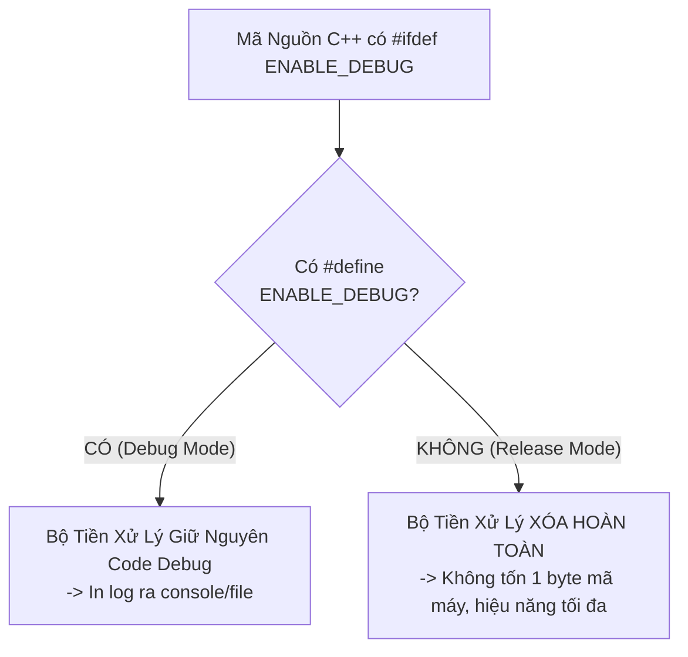

# 3.5 — Các Chiến Thuật Gỡ Lỗi Nâng Cao: Biên Dịch Có Điều Kiện & Ghi Log (More Debugging Tactics)

---

## 🎯 Mục Tiêu Bài Học
- Khắc phục nhược điểm của việc thêm/xóa lệnh debug thủ công bằng kỹ thuật **Biên dịch có điều kiện (Conditional Compilation)** qua Preprocessor.
- Hiểu bản chất luồng ghi log trong C++: `std::clog` và sự cần thiết của các thư viện ghi log chuyên dụng (Logging Frameworks).
- Nắm vững cấu trúc phân cấp cấp độ log (Log Levels): `TRACE`, `DEBUG`, `INFO`, `WARN`, `ERROR`, `FATAL`.
- Tránh cạm bẫy "mì ống macro" (`#ifdef` spaghetti) và tối ưu hóa hiệu năng khi ghi log trong môi trường thực chiến.

---

## 1. Kiểm Soát Mã Gỡ Lỗi Bằng Bộ Tiền Xử Lý (Preprocessor Directives)

Ở bài học trước, chúng ta thấy việc gõ các lệnh debug rồi lại xóa đi vừa tốn công vừa tiềm ẩn rủi ro xóa nhầm code. Một giải pháp kinh điển là **đóng/mở chế độ gỡ lỗi thông qua chỉ thị tiền xử lý**:

```cpp
#include <iostream>

// Bỏ comment dòng này để bật chế độ debug, comment lại để tắt
#define ENABLE_DEBUG 

int getUserInput()
{
#ifdef ENABLE_DEBUG
std::cerr << "[DEBUG] Da goi ham getUserInput()\n";
#endif

    std::cout << "Nhap mot so: ";
    int x{};
    std::cin >> x;
    return x;
}

int main()
{
#ifdef ENABLE_DEBUG
std::cerr << "[DEBUG] Da vao ham main()\n";
#endif

    int x{ getUserInput() };
    std::cout << "Ban da nhap: " << x << '\n';

    return 0;
}
```

### Cơ chế hoạt động:
- Khi dòng `#define ENABLE_DEBUG` tồn tại, bộ tiền xử lý sẽ giữ lại các khối lệnh nằm giữa `#ifdef ENABLE_DEBUG` và `#endif`.
- Khi bạn biến dòng đó thành chú thích `//#define ENABLE_DEBUG`, bộ tiền xử lý sẽ **cắt bỏ hoàn toàn** các đoạn mã debug trước khi chuyển qua cho Compiler. Trong tệp thực thi cuối cùng (Production binary), hoàn toàn không còn một vết tích nào của code debug, giúp tối ưu tối đa tốc độ thực thi!



::: danger Cạm bẫy: Vấn nạn "Mì ống tiền xử lý" (#ifdef Spaghetti)
Việc rải rác quá nhiều `#ifdef` và `#endif` khắp mọi ngóc ngách của mã nguồn sẽ biến tệp tin thành một đống hỗn độn cực kỳ khó đọc. Ngoài ra, chỉ cần gõ sai một chữ cái (ví dụ `#ifdef ENABEL_DEBUG`), trình biên dịch sẽ âm thầm bỏ qua đoạn code đó mà không phát bất kỳ cảnh báo nào!
:::

---

## 2. Ghi Log Chuyên Nghiệp: Tách Biệt Chẩn Đoán Khỏi Luồng Xuất

Một giải pháp thanh lịch và chuẩn công nghiệp hơn là **Ghi log (Logging)**.
**Nhật ký thực thi (Log file)** là một bản ghi tuần tự các sự kiện xảy ra trong suốt vòng đời của chương trình, thường kèm theo mốc thời gian (timestamp), tên tiến trình/luồng và mức độ nghiêm trọng.

### Vì sao nên ghi log ra tệp thay vì in ra màn hình?
1. **Không làm phiền người dùng**: Màn hình Console chỉ hiển thị giao diện và dữ liệu kết quả nghiệp vụ; mọi chi tiết kỹ thuật được âm thầm ghi vào tệp `app.log`.
2. **Khả năng chẩn đoán từ xa (Post-mortem Analysis)**: Khi phần mềm của bạn gặp sự cố trên máy của khách hàng cách xa hàng nghìn cây số, bạn chỉ cần yêu cầu họ gửi tệp `app.log` về để phân tích nguyên nhân mà không cần phải ngồi trực tiếp trước máy họ!

---

## 3. Hệ Thống Phân Cấp Mức Độ Ghi Log (Log Levels)

Mọi thư viện log chuẩn mực (như `plog`, `spdlog`, `quill`) đều phân cấp thông tin thành các cấp độ từ chi tiết đến khẩn cấp:

| Cấp độ (Level) | Mục đích sử dụng | Môi trường kích hoạt |
| :--- | :--- | :--- |
| **TRACE** | Ghi lại từng bước nhảy vào/ra hàm, từng giá trị biến số vòng lặp | Chỉ dùng trong nội bộ Dev khi gỡ lỗi sâu |
| **DEBUG** | Các mốc logic quan trọng trong thuật toán | Môi trường thử nghiệm / Debug build |
| **INFO** | Các sự kiện bình thường của hệ thống (Khởi động, kết nối DB thành công) | Môi trường thực tế (Production) |
| **WARN** | Các tình huống bất thường nhưng hệ thống vẫn tự xử lý được (Thử lại kết nối) | Môi trường thực tế (Production) |
| **ERROR** | Lỗi khiến một thao tác nghiệp vụ thất bại (Không ghi được tệp, API trả về 500) | Môi trường thực tế (Production) |
| **FATAL** | Sự cố nghiêm trọng khiến chương trình buộc phải dừng khẩn cấp (Hết RAM, hỏng dữ liệu) | Bắt buộc ghi nhận và gửi cảnh báo ngay |

---

## 4. Minh Họa Sử Dụng Thư Viện Log Gọn Nhẹ (`plog`)

Ví dụ sử dụng thư viện header-only `plog`:

```cpp
#include <iostream>
#include <plog/Log.h> 
#include <plog/Initializers/RollingFileInitializer.h>

int getUserInput()
{
    PLOGD << "getUserInput() duoc goi"; // Log o cap do DEBUG

    std::cout << "Nhap mot so nguyen: ";
    int x{};
    std::cin >> x;
    return x;
}

int main()
{
    // Khoi tao log ghi ra tep Logfile.txt, chi ghi cac thong diep tu DEBUG tro len
    plog::init(plog::debug, "Logfile.txt");

    PLOGI << "=== CHUONG TRINH BAT DAU ==="; // Log o cap do INFO

    int x{ getUserInput() };
    std::cout << "Gia tri da nhap: " << x << '\n';

    PLOGI << "=== CHUONG TRINH KET THUC BINH THUONG ===";
    return 0;
}
```

Nội dung tệp `Logfile.txt` sinh ra tự động:
```text
2026-11-13 14:40:01.120 DEBUG [12450] [getUserInput@8] getUserInput() duoc goi
2026-11-13 14:40:00.980 INFO  [12450] [main@19] === CHUONG TRINH BAT DAU ===
2026-11-13 14:40:05.340 INFO  [12450] [main@24] === CHUONG TRINH KET THUC BINH THUONG ===
```

Khi phát hành sản phẩm (Release), ta chỉ cần đổi `plog::init(plog::warning, "Logfile.txt")` hoặc `plog::none`, toàn bộ các dòng `PLOGD` sẽ bị bỏ qua mà không cần xóa bất kỳ dòng code nào!

---

## 5. ⚠️ Hộp Cạm Bẫy Thực Chiến: Đòn Giáng Hiệu Năng Của Thao Tác Ghi Đĩa

::: danger Cạm bẫy hiệu năng: Disk I/O Bottleneck
Thao tác ghi ra ổ cứng (Disk I/O) chậm hơn thao tác xử lý trong RAM từ 10.000 đến 100.000 lần!
Nếu bạn đặt một dòng log ghi file bên trong một vòng lặp chạy 1.000.000 lần, chương trình của bạn sẽ bị "đóng băng" từ vài mili-giây kéo dài thành hàng chục phút!
**Giải pháp**:
- Không bao giờ đặt log mức độ TRACE/DEBUG bên trong các vòng lặp tính toán khổng lồ.
- Với các hệ thống hiệu năng cao (Game Engine, High-Frequency Trading), sử dụng cơ chế **Ghi log bất đồng bộ (Asynchronous Logging)** như thư viện `spdlog` hoặc `quill`: dữ liệu log được đẩy vào hàng đợi RAM không khóa (lock-free queue) và một luồng ngầm (worker thread) riêng biệt sẽ từ từ ghi xuống đĩa.
:::

---

## 6. 🚀 Hộp Cập Nhật C++20 / C++23: Hiện Đại Hóa Với `<source_location>` và `<print>`

C++ hiện đại giúp việc xây dựng hệ thống log tùy biến trở nên dễ dàng mà không phụ thuộc vào thư viện ngoài cồng kềnh:

```cpp
#include <iostream>
#include <source_location>
#include <string_view>
#include <chrono>

void fastLog(std::string_view msg, 
             const std::source_location& loc = std::source_location::current())
{
    // Tu dong lay ten ham, ten tep va so dong tai vi tri goi ham ma khong can MACRO!
    std::clog << "[" << loc.file_name() << ":" << loc.line() << " in " 
              << loc.function_name() << "] " << msg << '\n';
}

int main()
{
    fastLog("Khoi tao tai nguyen thanh cong");
    return 0;
}
```

---

## 7. 💡 Hộp Thực Hành Tốt Nhất (Best Practice)

::: tip Quy tắc chuẩn kỹ nghệ khi quản lý log
1. **Tuyệt đối không hardcode mật khẩu hay dữ liệu cá nhân vào log (PII / Secrets)**: Đừng bao giờ ghi mật khẩu người dùng, mã PIN thẻ tín dụng, hoặc khóa bí mật (API Key) vào tệp log! Đây là lỗ hổng an ninh kinh điển bị các tin tặc khai thác.
2. **Khai thác `std::clog` có chủ đích**: Dùng `std::clog` cho các thông điệp ghi log mặc định của thư viện chuẩn trước khi chuyển sang framework chuyên nghiệp.
3. **Cấu hình Log Rotation**: Một ứng dụng chạy liên tục nhiều tháng có thể sinh ra tệp log nặng hàng trăm Gigabytes làm tràn ổ cứng máy chủ. Hãy luôn cấu hình cơ chế xoay vòng tệp log (Rolling file - tự động nén hoặc cắt sang tệp mới khi dung lượng vượt quá 10MB).
:::

---

## 8. 📝 Hệ Thống Quiz & Bài Tập Tự Luyện

::: details Câu hỏi 1: Sự khác biệt bản chất giữa `std::cout`, `std::cerr` và `std::clog` trong thư viện chuẩn C++ là gì?
**Lời giải chi tiết**:
- **`std::cout`**: Đại diện cho luồng xuất chuẩn (Standard Output - `stdout`). Có bộ đệm (Buffered). Dùng để xuất dữ liệu kết quả bình thường của chương trình tới người dùng.
- **`std::cerr`**: Đại diện cho luồng lỗi chuẩn (Standard Error - `stderr`). **Không có bộ đệm (Unbuffered)**. Dùng để xuất thông báo lỗi khẩn cấp, đảm bảo hiển thị ngay lập tức kể cả khi hệ thống crash.
- **`std::clog`**: Đại diện cho luồng ghi nhật ký chuẩn. Mặc định cũng trỏ tới `stderr` nhưng **có bộ đệm (Buffered)**. Được thiết kế chuyên biệt cho việc ghi nhận các sự kiện log định kỳ với chi phí hiệu năng thấp hơn `std::cerr`.
:::

::: details Câu hỏi 2: Tại sao việc sử dụng chỉ thị tiền xử lý `#ifdef` để bật/tắt code debug lại không làm giảm tốc độ thực thi của chương trình ở chế độ Release?
**Lời giải chi tiết**:
Bởi vì bộ tiền xử lý (C++ Preprocessor) hoạt động ở giai đoạn đầu tiên của quá trình biên dịch (trước khi compiler phân tích cú pháp và sinh mã máy). Khi một điều kiện `#ifdef` đánh giá là `false`, toàn bộ khối mã nguồn nằm bên trong sẽ bị bộ tiền xử lý loại bỏ hoàn toàn khỏi tệp mã nguồn trung gian. Compiler thậm chí không nhìn thấy sự tồn tại của những dòng code đó, do đó mã máy sinh ra hoàn toàn sạch sẽ, không tốn bất kỳ chu kỳ xung nhịp CPU hay byte bộ nhớ nào.
:::
