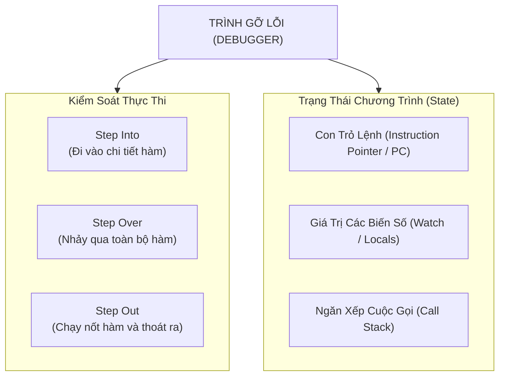
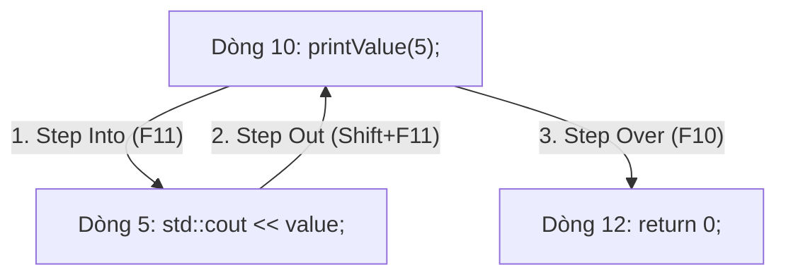

# 3.6 — Sử Dụng Trình Gỡ Lỗi Tích Hợp: Các Thao Tác Từng Bước (Stepping)

---

## 🎯 Mục Tiêu Bài Học
- Hiểu rõ khái niệm **Trạng thái chương trình (Program State)**: Điểm thực thi (Instruction Pointer), biến số trong bộ nhớ và ngăn xếp cuộc gọi.
- Làm chủ 3 thao tác điều khiển thực thi cốt lõi của Trình gỡ lỗi (Debugger): **Step Into**, **Step Over** và **Step Out**.
- Nắm vững bảng phím tắt chuẩn trên các IDE thịnh hành nhất: Visual Studio, VS Code, CLion và Code::Blocks.
- Nhận thức nguyên nhân vì sao bắt buộc phải biên dịch ở cấu hình **Debug** (`-g -O0`) thay vì Release khi gỡ lỗi.

---

## 1. Trình Gỡ Lỗi (Debugger) Là Gì?

Trong các bài học trước, khi muốn theo dõi chương trình, chúng ta phải tự tay sửa code để in thông tin ra màn hình. Nhưng điều gì sẽ xảy ra nếu có một công cụ cho phép bạn **tạm dừng thời gian thực thi của chương trình**, quan sát từng ô nhớ RAM, và yêu cầu CPU chạy từng câu lệnh một theo ý muốn của bạn?

Công cụ kỳ diệu đó chính là **Trình gỡ lỗi (Debugger)**.

Một Debugger mang lại hai sức mạnh tối thượng:
1. **Kiểm soát tuyệt đối luồng thực thi**: Chạy từng dòng, nhảy qua hàm, hoặc chạy tới một điểm chỉ định.
2. **Soi chiếu trạng thái chương trình (Program State)**: Đọc và chỉnh sửa trực tiếp giá trị của mọi biến số trong RAM ngay khi chương trình đang tạm dừng mà không cần sửa một dòng code nào!



::: danger Bắt buộc: Hãy luôn chuyển sang cấu hình Debug Build
Trước khi bắt đầu gỡ lỗi, hãy đảm bảo dự án của bạn đang được biên dịch ở cấu hình **Debug** (thêm cờ `-g -O0` trên GCC/Clang). 
Nếu bạn để cấu hình **Release** (`-O2` hoặc `-O3`), trình tối ưu hóa (Optimizer) của compiler sẽ tự động gộp lệnh, xóa bỏ biến tạm, hoặc nhúng thân hàm (Inlining), khiến con trỏ dòng lệnh của Debugger nhảy loạn xạ không theo thứ tự mã nguồn!
:::

---

## 2. Các Thao Tác Chạy Từng Bước (Stepping)

**Stepping** là tập hợp các thao tác cho phép lập trình viên "dắt tay" CPU đi qua từng câu lệnh C++.

Hãy xét chương trình mẫu sau:

```cpp
#include <iostream>

void printValue(int value)
{
    std::cout << value << '\n'; // Dòng 5
}

int main()
{
    printValue(5);             // Dòng 10

    return 0;                  // Dòng 12
}
```



### 2.1. Step Into (Đi Vào Trong Hàm)
- **Ý nghĩa**: Thực thi câu lệnh tiếp theo. Nếu câu lệnh đó chứa một **lời gọi hàm**, Debugger sẽ lập tức **nhảy vào bên trong thân hàm đó** và tạm dừng ở dòng lệnh đầu tiên của hàm.
- **Khi nào dùng?**: Dùng khi bạn nghi ngờ chính hàm đó đang bị lỗi logic và muốn kiểm tra từng câu lệnh bên trong nó.

### 2.2. Step Over (Nhảy Qua Hàm)
- **Ý nghĩa**: Thực thi câu lệnh tiếp theo. Nếu câu lệnh đó chứa một lời gọi hàm, Debugger sẽ **chạy toàn bộ hàm đó với tốc độ tối đa** mà không dừng lại, và chỉ trả lại quyền kiểm soát cho bạn ở dòng lệnh kế tiếp ngay sau lời gọi hàm.
- **Khi nào dùng?**: Dùng khi bạn chắc chắn hàm đó đã chạy đúng (ví dụ: các hàm thư viện chuẩn, các hàm tiện ích đã kiểm thử kỹ), bạn không muốn tốn thời gian bước vào xem chi tiết bên trong.

### 2.3. Step Out (Thoát Ra Khỏi Hàm Hiện Tại)
- **Ý nghĩa**: Chạy nốt toàn bộ các câu lệnh còn lại của hàm đang thực thi cho đến khi hàm trả về (`return`), và tạm dừng ngay tại dòng lệnh gọi hàm ở hàm cha.
- **Khi nào dùng?**: Rất hữu ích khi bạn lỡ tay bấm *Step Into* vào một hàm mà bạn không muốn debug (hoặc vô tình nhảy vào mã nguồn phức tạp của thư viện chuẩn STL như `std::cout` hay `std::vector`), bạn bấm *Step Out* để thoát ra ngay lập tức!

---

## 3. Bảng Tra Cứu Phím Tắt Stepping Trên Các IDE Phổ Biến

| Thao tác Debug | Visual Studio (Windows) | VS Code (Windows/Linux) | CLion (JetBrains) | Code::Blocks |
| :--- | :--- | :--- | :--- | :--- |
| **Bắt đầu Debug** | `F5` | `F5` | `Shift + F9` | `F8` |
| **Step Into** | `F11` | `F11` | `F7` | `Shift + F7` |
| **Step Over** | `F10` | `F10` | `F8` | `F7` |
| **Step Out** | `Shift + F11` | `Shift + F11` | `Shift + F8` | `Ctrl + F7` |
| **Dừng Debug** | `Shift + F5` | `Shift + F5` | `Ctrl + F2` | `Ctrl + F8` |

---

## 4. ⚠️ Hộp Cạm Bẫy Thực Chiến: Vô Tình Lạc Vào Mã Thư Viện Chuẩn

::: danger Cạm bẫy: Lạc vào "ma trận" mã nguồn STL
Khi con trỏ vàng đang dừng ở dòng lệnh:
```cpp
std::cout << value << '\n';
```
Nếu bạn nhấn **Step Into (`F11`)**, trình gỡ lỗi sẽ coi `<<` là một hàm toán tử `operator<<` của thư viện chuẩn và mở tệp tiêu đề `ostream` của compiler ra! Bạn sẽ thấy hàng trăm dòng code template phức tạp hiện ra trước mắt.
**Cách xử lý**:
1. Đừng hoảng sợ! Hãy bình tĩnh nhấn tổ hợp phím **Step Out (`Shift + F11`)** một hoặc hai lần. Debugger sẽ thực thi xong toán tử xuất và đưa bạn quay trở lại mã nguồn của chính bạn.
2. Quy tắc: Với các dòng lệnh gọi hàm thư viện chuẩn hoặc hàm in ấn, hãy luôn dùng **Step Over (`F10`)**!
:::

---

## 5. 🚀 C++ Nâng Cao: Tính Năng "Step Back" (Reverse Debugging)

Trong các debugger thông thường, thời gian chỉ trôi theo một chiều về phía trước. Nếu bạn lỡ tay bấm quá đà (Overstep) qua dòng lệnh gây crash, bạn buộc phải dừng lại và chạy lại từ đầu.

Tuy nhiên, các công cụ phân tích hiện đại đã hỗ trợ kỹ thuật **Reverse Debugging (Gỡ lỗi đảo ngược thời gian)**:
- **`rr` (Record and Replay framework trên Linux)**: Ghi lại toàn bộ luồng thực thi của CPU ở cấp độ từng lệnh assembly, cho phép bạn dùng lệnh `reverse-step` hay `reverse-continue` để "tua ngược" thời gian!
- **Visual Studio Enterprise Time-Travel Debugging (TTD)**: Cho phép ghi lại vết thực thi của tiến trình và lùi ngược về quá khứ để xem chính xác thời điểm một vùng nhớ bị ghi đè.

---

## 6. 💡 Hộp Thực Hành Tốt Nhất (Best Practice)

::: tip Chiến thuật thao tác gỡ lỗi hiệu quả
1. **Ưu tiên Step Over làm mặc định**: Hãy luôn dùng `Step Over (F10)` để lướt qua luồng chính của hàm `main`. Chỉ chuyển sang `Step Into (F11)` khi gặp hàm mà bạn đang trực tiếp nghi ngờ có lỗi.
2. **Quan sát mũi tên vàng**: Mũi tên chỉ thị dòng lệnh sắp được thực thi, **chưa phải là dòng lệnh đã thực thi xong**. Trạng thái biến số sẽ chỉ thay đổi sau khi mũi tên vàng bước qua dòng lệnh đó.
3. **Kích hoạt tự động xả đệm khi debug**: Thêm `std::cout << std::unitbuf;` ở đầu `main()` khi debug để đảm bảo output xuất hiện đồng bộ tức thì trên cửa sổ Console.
:::

---

## 7. 📝 Hệ Thống Quiz & Bài Tập Tự Luyện

::: details Câu hỏi 1: Giả sử bạn đang dừng ở dòng lệnh `int result = calculateInterest(balance, rate);`. Nếu bạn muốn xem bên trong hàm `calculateInterest` tính toán những gì, bạn phải dùng lệnh stepping nào? Nếu bạn chỉ muốn nhận kết quả mà không cần vào trong, bạn dùng lệnh nào?
**Lời giải chi tiết**:
- Để xem chi tiết các bước tính toán bên trong hàm `calculateInterest`: Sử dụng **Step Into** (phím `F11` trên Visual Studio / VS Code).
- Để nhận kết quả và đi thẳng tới dòng tiếp theo mà không vào trong hàm: Sử dụng **Step Over** (phím `F10` trên Visual Studio / VS Code).
:::

::: details Câu hỏi 2: Khi con trỏ lệnh màu vàng đang trỏ vào dòng `5`: `int x { 10 };`, giá trị hiện tại của biến `x` trong bộ nhớ RAM đã là `10` hay chưa?
**Lời giải chi tiết**:
**Chưa!** Mũi tên chỉ thị của Debugger luôn trỏ vào câu lệnh **sắp được thực thi tiếp theo**. Tại thời điểm này, câu lệnh khai báo và khởi tạo `int x { 10 };` chưa hề chạy. Biến `x` lúc này hoặc chưa tồn tại trong phạm vi, hoặc đang chứa giá trị rác ngẫu nhiên của ô nhớ. Giá trị `10` sẽ chỉ được ghi vào biến `x` sau khi bạn thực hiện một bước stepping qua khỏi dòng `5`.
:::
