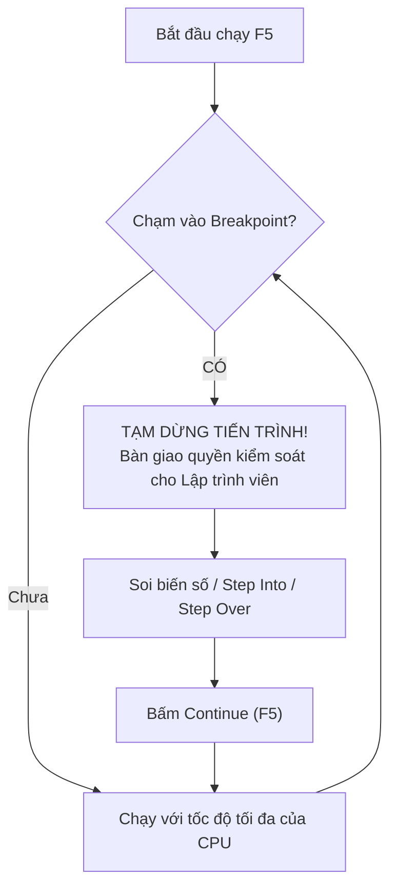

# 3.7 — Điểm Ngắt (Breakpoints) và Điều Hướng Thực Thi Nâng Cao

---

## 🎯 Mục Tiêu Bài Học
- Làm chủ **Điểm ngắt (Breakpoints)**: Cơ chế tạm dừng chương trình tại dòng lệnh mong muốn mà không cần bấm stepping qua hàng trăm câu lệnh râu ria.
- Phân biệt rõ rệt giữa **Run to Cursor**, **Continue (F5)** và **Start Debugging**.
- Khám phá tính năng quyền lực nhưng nguy hiểm: **Set Next Statement** (Can thiệp con trỏ lệnh để nhảy cóc hoặc chạy lại dòng code).
- Hiểu bản chất phần cứng: CPU xử lý Breakpoint thông qua ngắt phần mềm (Software Interrupt `INT 3` trên x86/x64) như thế nào.

---

## 1. Vấn Đề Của Việc Bấm "Stepping" Quá Nhiều

Trong bài học trước, bạn đã học cách dùng `Step Into` và `Step Over`. Nhưng hãy tưởng tượng chương trình của bạn phải chạy qua 5.000 dòng code khởi tạo tài nguyên trước khi đến được hàm xử lý đồ họa bị lỗi. Việc ngồi nhấn phím `F10` hàng nghìn lần là bất khả thi!

Để gỡ lỗi hiệu quả trên các dự án lớn, chúng ta cần các kỹ thuật **điều hướng nhanh** đến chính xác vị trí muốn khảo sát.

---

## 2. Kỹ Thuật 1: Chạy Đến Vị Trí Con Trỏ (Run to Cursor)

Lệnh **Run to Cursor** cho phép bạn đặt con trỏ chuột tại một dòng code bất kỳ trong file và yêu cầu Debugger: *"Hãy chạy hết tốc lực từ điểm hiện tại cho đến khi chạm vào dòng con trỏ này thì dừng lại!"*.

- **Cách sử dụng**: Nhấp chuột phải vào dòng lệnh mong muốn -> Chọn **Run to Cursor** (Phím tắt: `Ctrl + F10` trên Visual Studio).
- **Đặc điểm**: Lệnh này chỉ có hiệu lực một lần duy nhất. Nếu dòng code đó nằm trong một vòng lặp chạy 100 lần, Debugger chỉ dừng ở lần chạm đầu tiên, sau đó nếu bạn bấm Continue, chương trình sẽ chạy thẳng về đích.

---

## 3. Kỹ Thuật 2: Điểm Ngắt (Breakpoints) — Vũ Khí Tối Thượng

Một **Điểm ngắt (Breakpoint)** là một cột mốc đặc biệt được đánh dấu trên một dòng mã nguồn, ra lệnh cho Debugger phải lập tức dừng chương trình mỗi khi luồng thực thi chạm tới dòng đó.



### Cách đặt Breakpoint:
- Nhấp chuột trái vào dải lề màu xám (bên trái số dòng) trên IDE.
- Hoặc đặt con trỏ tại dòng đó và nhấn phím **`F9`**.
- Một **chấm tròn màu đỏ** xuất hiện báo hiệu Breakpoint đã được thiết lập.

### So sánh Breakpoint và Run to Cursor:
| Đặc tính | Run to Cursor | Điểm ngắt (Breakpoint) |
| :--- | :--- | :--- |
| **Tính bền vững** | Biến mất ngay sau lần dừng đầu tiên | Tồn tại vĩnh viễn cho đến khi bạn chủ động xóa |
| **Trong vòng lặp** | Chỉ dừng 1 lần | Dừng lại ở **mọi lần lặp** khi CPU chạm vào dòng đó |
| **Độ tiện dụng** | Phù hợp khi muốn nhảy nhanh đột xuất | Phù hợp cho các điểm kiểm tra cốt lõi của thuật toán |

---

## 4. Dưới Lăng Kính Phần Cứng: Breakpoint Hoạt Động Ra Sao?

::: tip Bí mật kiến trúc máy tính: Mã máy `0xCC` (INT 3)
Bạn có bao giờ thắc mắc làm thế nào mà Debugger có thể bắt CPU dừng lại đúng dòng code mong muốn mà không làm chậm máy tính?
Trên kiến trúc vi xử lý x86/x64, khi bạn đặt một Breakpoint:
1. Debugger sẽ âm thầm ghi nhớ byte mã máy gốc tại địa chỉ bộ nhớ đó.
2. Nó tạm thời **ghi đè byte đầu tiên của câu lệnh bằng opcode `0xCC`** (Lệnh ngắt `INT 3`).
3. Khi CPU thực thi tới đây và đọc phải `0xCC`, nó sẽ kích hoạt một ngắt ngoại lệ (Trap Interrupt) trả quyền điều khiển về cho Hệ điều hành và Debugger.
4. Debugger khôi phục lại byte mã máy gốc, cập nhật giao diện IDE hiển thị mũi tên vàng và chờ lệnh của bạn!
:::

---

## 5. Can Thiệp Con Trỏ Lệnh: "Set Next Statement"

Tính năng **Set Next Statement** (Nhảy con trỏ lệnh) cho phép lập trình viên kéo mũi tên vàng sang một dòng code khác:
- **Nhảy tiến (Jump forwards)**: Bỏ qua một đoạn code không muốn chạy.
- **Nhảy lùi (Jump backwards)**: Ép CPU chạy lại một câu lệnh vừa mới thực thi xong để quan sát lại.

```cpp
#include <iostream>

void printValue(int value)
{
    std::cout << value << '\n';
}

int main()
{
    printValue(5); // Dòng 10
    printValue(6); // Dòng 11: Nếu dùng "Set Next Statement" nhảy qua dòng này...
    printValue(7); // Dòng 12: Chương trình sẽ chỉ in 5 và 7!

    return 0;
}
```

---

## 6. ⚠️ Hộp Cạm Bẫy Thực Chiến & Undefined Behavior

::: danger Cạm bẫy cực kỳ nguy hiểm: "Set Next Statement" KHÔNG Hoàn Tác Biến Số!
Rất nhiều người nhầm lẫn rằng "Set Next Statement" lùi lại phía sau sẽ tua ngược thời gian như nút *Undo*. **Hoàn toàn sai!**
- Lệnh này **chỉ thay đổi thanh ghi con trỏ lệnh (Instruction Pointer - RIP/EIP)** của CPU.
- Nó **KHÔNG hề khôi phục lại giá trị của các biến số** đã bị thay đổi trong RAM!

Ví dụ: Nếu bạn có `x = x + 10;`, khi `x` từ `5` tăng lên `15`, nếu bạn nhảy lùi lại dòng đó và chạy lại, `x` sẽ tiếp tục cộng thêm `10` và trở thành `25`!
Ngoài ra, **tuyệt đối không bao giờ dùng "Set Next Statement" để nhảy từ hàm này sang một hàm khác**. Làm như vậy sẽ phá vỡ cấu trúc ngăn xếp (Stack Corruption), làm hỏng địa chỉ trả về (Return Address) và dẫn tới **Crash ngay lập tức (Segmentation Fault)**!
:::

---

## 7. 🚀 C++ Hiện Đại: Điểm Ngắt Có Điều Kiện (Conditional Breakpoint)

Trong các ứng dụng thực tế, một vòng lặp có thể lặp 100.000 lần và bug chỉ xuất hiện ở lần lặp thứ 99.999 khi chỉ số `i == 99999` hoặc khi biến `ptr == nullptr`. Nếu bạn đặt Breakpoint thông thường, bạn sẽ phải nhấn Continue... 99.999 lần!

Giải pháp hiện đại là **Conditional Breakpoint (Điểm ngắt có điều kiện)**:
1. Nhấp chuột phải vào chấm tròn đỏ của Breakpoint -> Chọn **Conditions...**.
2. Nhập biểu thức điều kiện C++: `i == 99999` hoặc `user.age < 0`.
3. Debugger sẽ cho chương trình chạy hết tốc lực và **chỉ dừng lại duy nhất khi điều kiện đó thỏa mãn (true)**!

---

## 8. 💡 Hộp Thực Hành Tốt Nhất (Best Practice)

::: tip Quy tắc dùng Breakpoint của chuyên gia
1. **Dọn dẹp Breakpoint sau khi sửa xong**: Luôn dùng tính năng *Disable All Breakpoints* hoặc *Delete All Breakpoints* (`Ctrl + Shift + F9`) khi hoàn thành một phiên gỡ lỗi để tránh việc lần chạy sau chương trình liên tục bị dừng bất ngờ.
2. **Khai thác Hit Count**: Nếu bạn muốn dừng ở lần thứ 50 một hàm được gọi, bạn có thể thiết lập điều kiện Hit Count `= 50` trong thuộc tính Breakpoint.
3. **Data Breakpoint (Hardware Watchpoint)**: Khi một biến số bị đổi giá trị một cách bí ẩn mà không rõ dòng code nào làm việc đó, hãy dùng *New Data Breakpoint* theo dõi địa chỉ ô nhớ của biến. CPU sẽ tự động dừng ngay khi có bất kỳ lệnh nào ghi đè vào ô nhớ đó!
:::

---

## 9. 📝 Hệ Thống Quiz & Bài Tập Tự Luyện

::: details Câu hỏi 1: Điểm khác biệt mấu chốt giữa thao tác "Step Back (Reverse Debugging)" và thao tác "Set Next Statement nhảy lùi" là gì?
**Lời giải chi tiết**:
- **Step Back (Reverse Debugging)**: Là cơ chế "quay ngược thời gian" thực sự. Nó hoàn tác toàn bộ trạng thái của chương trình: giá trị các biến số được khôi phục về trạng thái trước đó, bộ nhớ RAM và thanh ghi CPU được trả lại chính xác thời điểm trong quá khứ.
- **Set Next Statement nhảy lùi**: Chỉ đơn thuần di chuyển con trỏ lệnh của CPU về dòng code phía trước. Toàn bộ các biến số trong RAM vẫn giữ nguyên giá trị đã bị biến đổi. Nếu chạy tiếp, các phép toán tích lũy có thể làm sai lệch dữ liệu nặng nề hơn.
:::

::: details Câu hỏi 2: Bạn có một vòng lặp `for (int count = 0; count < 1000; ++count)`. Bạn biết chắc lỗi chỉ xuất hiện khi `count == 555`. Bạn nên thiết lập công cụ gì trong Debugger để tiết kiệm thời gian nhất?
**Lời giải chi tiết**:
Bạn nên thiết lập một **Điểm ngắt có điều kiện (Conditional Breakpoint)** tại dòng code bên trong thân vòng lặp:
- Đặt Breakpoint tại dòng cần kiểm tra (`F9`).
- Nhấp chuột phải vào chấm đỏ, chọn **Conditions**.
- Điền điều kiện: `count == 555`.
Chương trình sẽ chạy trơn tru 554 lần lặp đầu tiên với tốc độ tối đa của CPU và chỉ tự động tạm dừng chính xác ở lần lặp thứ 555 để bạn kiểm tra.
:::
