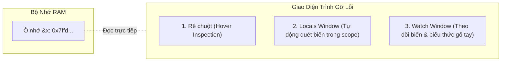

# 3.8 — Theo Dõi Biến Số và Biểu Thức Trong Trình Gỡ Lỗi (Watching Variables)

---

## 🎯 Mục Tiêu Bài Học
- Nắm vững 4 kỹ thuật theo dõi biến số trong khi gỡ lỗi: **Rê chuột (Hover)**, **QuickWatch**, **Cửa sổ Watch (Watch Window)** và **Cửa sổ biến cục bộ (Locals/Autos Window)**.
- Học cách đánh giá các biểu thức C++ động (Dynamic Expression Evaluation) ngay trong cửa sổ Watch.
- Hiểu cách thức hoạt động của **Data Breakpoints (Điểm ngắt dữ liệu)**: Dừng chương trình ngay thời điểm một ô nhớ RAM bị ghi đè.
- Nhận diện cạm bẫy chí mạng: **Hiệu ứng phụ (Side Effects)** khi gọi hàm hoặc dùng toán tử tăng/giảm trong cửa sổ Watch.

---

## 1. Giám Sát Trạng Thái Bộ Nhớ Của Chương Trình

Điều khiển luồng chạy từng bước (Stepping) chỉ là một nửa sức mạnh của Debugger. Nửa sức mạnh còn lại — đóng vai trò quyết định trong việc bắt các lỗi logic — chính là khả năng **nhìn thấu giá trị của từng biến số trong bộ nhớ RAM** tại bất kỳ thời điểm nào mà không cần sửa code để in ra màn hình!

Xét chương trình đơn giản sau:

```cpp
#include <iostream>

int main()
{
    int x{ 1 };
    std::cout << x << ' ';

    x = x + 2; // Dòng 8
    std::cout << x << ' ';

    x = x + 3; // Dòng 11
    std::cout << x << ' ';

    return 0;
}
```

Chương trình in ra dãy số `1 3 6`. Hãy xem Debugger giúp ta quan sát sự biến đổi của `x` qua từng dòng code như thế nào.



---

## 2. Các Kỹ Thuật Theo Dõi Biến Số

### 2.1. Rê chuột lên biến (Mouse Hover)
Khi chương trình đang tạm dừng tại một dòng lệnh:
- Hãy di chuyển con trỏ chuột lên trên tên biến (ví dụ `x`).
- Một hộp thoại nhỏ (DataTip) sẽ xuất hiện hiển thị kiểu dữ liệu và giá trị hiện tại của biến đó trong RAM.
- Bạn có thể rê chuột lên biến `x` ở bất kỳ dòng nào trong hàm hiện tại, không nhất thiết phải là dòng đang đứng.

### 2.2. Cửa sổ Biến Cục Bộ (Locals Window) & Tự Động (Autos Window)
- **Locals Window**: IDE tự động liệt kê toàn bộ các biến cục bộ và tham số của hàm đang được thực thi. Bạn không cần làm gì cả; cứ mỗi bước Step, IDE sẽ tự động làm mới giá trị của mọi biến trong phạm vi hàm hiện tại.
- **Autos Window**: IDE tự động đoán những biến số xuất hiện ở dòng lệnh vừa chạy và dòng lệnh sắp chạy để hiển thị nhằm tránh làm rối mắt.

### 2.3. Cửa sổ Theo Dõi Tùy Biến (Watch Window)
Nếu hàm của bạn có hàng chục biến nhưng bạn chỉ quan tâm duy nhất đến biến `x`, hoặc bạn muốn theo dõi một biến xuyên suốt qua nhiều hàm khác nhau:
1. Mở cửa sổ **Watch** (Trên Visual Studio: `Debug > Windows > Watch > Watch 1`; trên VS Code: mục `Watch` ở thanh Debug bên trái).
2. Nhập tên biến `x` vào cột Name.
3. Khi bạn thực hiện Stepping (`F10`), giá trị của `x` trong Watch sẽ liên tục được cập nhật. Nếu giá trị vừa thay đổi ở bước vừa rồi, IDE sẽ **tô đỏ giá trị mới** để bạn dễ dàng nhận biết!

---

## 3. Đánh Giá Biểu Thức Động (Evaluating Expressions)

Cửa sổ Watch không chỉ hiển thị tên biến đơn thuần; nó thực chất là một **trình thông dịch biểu thức C++ thu nhỏ**! Bạn có thể gõ vào Watch bất kỳ biểu thức hợp lệ nào:

- Gõ: `x + 10` -> Watch sẽ tính và hiển thị: `13` (khi `x == 3`).
- Gõ: `x == 6` -> Watch sẽ hiển thị: `true` hoặc `false`.
- Gõ: `sizeof(x)` -> Watch hiển thị kích thước byte: `4`.

---

## 4. ⚠️ Hộp Cạm Bẫy Thực Chiến: Hiệu Ứng Phụ (Side Effects) Trong Cửa Sổ Watch!

::: danger Cạm bẫy chí mạng: Thay đổi dữ liệu ngầm mà không hề hay biết
Khi bạn nhập một biểu thức vào cửa sổ Watch hoặc QuickWatch, Debugger sẽ thực sự **thực thi biểu thức đó trên bộ nhớ của tiến trình**.

Nếu bạn vô tình nhập một biểu thức có **hiệu ứng phụ (Side Effect)**, ví dụ:
- Gõ vào Watch: `x++` hoặc `x = 50`
- Hoặc gọi một hàm làm thay đổi trạng thái hệ thống: `popNextTask()`

Mỗi lần Debugger làm mới màn hình hoặc mỗi bước bạn bấm Stepping, **biểu thức đó lại được tính lại một lần nữa**, khiến biến `x` tự động tăng liên tục hoặc dữ liệu bị sửa đổi ngoài tầm kiểm soát của chương trình!
Điều này sẽ tạo ra những lỗi "ma ám" cực kỳ quái gở khiến bạn mất hàng giờ không hiểu tại sao giá trị của biến lại thay đổi dù mã nguồn không hề có lệnh nào như vậy!

**Quy tắc vàng**: Chỉ đưa vào cửa sổ Watch các biểu thức **chỉ đọc (Pure / Read-only expressions)**!
:::

---

## 5. Điểm Ngắt Dữ Liệu (Data Breakpoints / Hardware Watchpoints)

Một kịch bản gỡ lỗi kinh hoàng: Bạn có một biến toàn cục hoặc một biến trong đối tượng, ban đầu mang giá trị `0`. Sau khi chạy một hồi, biến đó bị đổi thành `-999`, nhưng bạn không hề biết trong số 500 hàm của dự án, **hàm nào đã lén lút ghi đè vào biến đó**!

Giải pháp tối thượng của Debugger là **Data Breakpoint**:
1. Trong cửa sổ Watch, nhấp chuột phải vào biến -> Chọn **Break When Value Changes** (hoặc tạo *New Data Breakpoint* theo địa chỉ ô nhớ).
2. Nhấn `Continue (F5)`.
3. Chương trình chạy với tốc độ phần cứng bình thường. Ngay khi có bất kỳ dòng lệnh nào trong toàn bộ chương trình ghi dữ liệu mới vào ô nhớ đó, **CPU sẽ lập tức phát ngắt phần cứng và Debugger tạm dừng ngay tại dòng lệnh thủ phạm**!

---

## 6. 🚀 Góc C++ Hiện Đại: Pretty Printers & Natvis

Khi bạn làm việc với các kiểu dữ liệu hiện đại như `std::string`, `std::string_view` (C++17) hay `std::span` (C++20), cấu trúc nội tại của chúng là con trỏ và độ dài. 
Trước đây, debugger sẽ hiển thị chúng dưới dạng các con trỏ trần trụi và byte nhớ hex rất khó nhìn.

Trong các IDE hiện đại (Visual Studio, CLion, VS Code C++ Extension), công cụ **Natvis (Native Visualizers)** và **GDB Pretty Printers** tự động phân tích cấu trúc C++ hiện đại và hiển thị chuỗi ký tự hoặc mảng dữ liệu một cách rõ ràng, trực quan như chuỗi văn bản thông thường, giúp lập trình viên không còn phải "dò mìn" từng byte nhớ thô.

---

## 7. 💡 Hộp Thực Hành Tốt Nhất (Best Practice)

::: tip Quy tắc sử dụng Watch Window chuyên nghiệp
1. **Kiểm tra vòng đời biến (Scope)**: Khi một biến nằm ngoài phạm vi hiện tại (ví dụ: biến cục bộ của hàm khác), Watch window sẽ hiển thị `x: <not available>` hoặc bị mờ đi. Đừng vội tưởng chương trình bị lỗi, đó chỉ là biến chưa bước vào vòng đời hoạt động.
2. **Tận dụng hiển thị hệ Hex**: Khi làm việc với cờ nhị phân, bitmask hoặc địa chỉ con trỏ, bạn có thể nhấp chuột phải vào cửa sổ Watch và chọn **Hexadecimal Display** để xem dữ liệu ở dạng cơ số 16 (`0x...`).
3. **Dọn sạch Watch sau mỗi phiên**: Xóa bớt các biến không còn dùng trong Watch để tránh làm chậm tốc độ làm mới giao diện khi step qua từng dòng.
:::

---

## 8. 📝 Hệ Thống Quiz & Bài Tập Tự Luyện

::: details Câu hỏi 1: Giả sử bạn đang gỡ lỗi và muốn biết ngay lập tức giá trị của tất cả các biến cục bộ trong hàm hiện tại mà không muốn mất công gõ từng tên biến vào Watch Window. Bạn nên sử dụng cửa sổ nào?
**Lời giải chi tiết**:
Bạn nên mở cửa sổ **Locals Window** (trong Visual Studio: `Debug > Windows > Locals`; trong VS Code: mục `VARIABLES > Locals`). Cửa sổ này tự động thu thập và hiển thị toàn bộ các biến cục bộ cũng như tham số hình thức đang có hiệu lực trong phạm vi (scope) của hàm hiện tại, tự động cập nhật giá trị sau mỗi bước stepping.
:::

::: details Câu hỏi 2: Tại sao việc nhập biểu thức `getUserInput()` vào cửa sổ Watch lại là một ý tưởng tồi nếu hàm đó yêu cầu người dùng nhập từ bàn phím hoặc thay đổi một biến toàn cục?
**Lời giải chi tiết**:
Bởi vì cửa sổ Watch đánh giá (evaluate) lại các biểu thức sau mỗi thao tác stepping hoặc mỗi khi IDE cần vẽ lại giao diện. Nếu biểu thức là một hàm có tác dụng phụ (side effects) như đọc dữ liệu luồng nhập hoặc thay đổi trạng thái, hàm sẽ bị gọi liên tục ngoài ý muốn, làm gián đoạn luồng thực thi thông thường của chương trình và gây sai lệch hoàn toàn dữ liệu thử nghiệm.
:::
