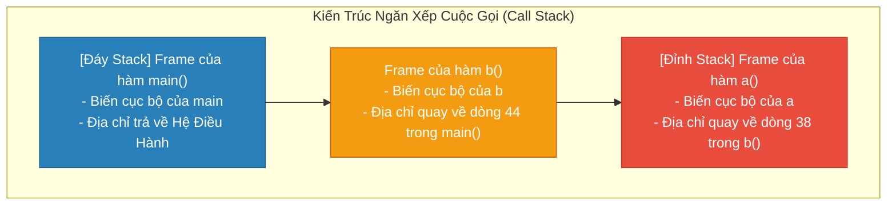

# 3.9 — Ngăn Xếp Cuộc Gọi (The Call Stack) và Dấu Vết Thực Thi

---

## 🎯 Mục Tiêu Bài Học
- Hiểu sâu sắc bản chất kiến trúc của **Ngăn xếp cuộc gọi (Call Stack)** và **Khung ngăn xếp (Stack Frame)** trong bộ nhớ phần cứng.
- Nắm rõ cơ chế CPU lưu trữ **Địa chỉ trả về (Return Address)** và biến cục bộ khi gọi hàm.
- Làm chủ cửa sổ **Call Stack Window** trong IDE để truy vết chuỗi hàm dẫn tới lỗi crash hoặc logic sai.
- Khám phá tính năng đột phá của C++23: Thư viện **`<stacktrace>`** cho phép in vết ngăn xếp ngay tại runtime mà không cần bật Debugger!

---

## 1. CPU Ghi Nhớ Lối Về Như Thế Nào?

Khi hàm `main()` gọi hàm `b()`, và hàm `b()` lại tiếp tục gọi hàm `a()`, làm thế nào CPU biết sau khi hàm `a()` chạy xong thì phải quay trở lại dòng nào của `b()`, và sau khi `b()` kết thúc thì phải quay về dòng nào của `main()`?

Câu trả lời nằm ở cấu trúc dữ liệu kinh điển nhất của khoa học máy tính: **Ngăn xếp cuộc gọi (Call Stack)**, hoạt động theo nguyên lý **LIFO (Last In, First Out - Vào sau ra trước)**.



### Mỗi Khung Ngăn Xếp (Stack Frame) chứa những gì?
Mỗi khi một hàm được kích hoạt, CPU sẽ dành riêng một vùng nhớ trên đỉnh Stack gọi là **Stack Frame** (hay Activation Record), bao gồm:
1. **Tham số hàm (Arguments)** truyền vào.
2. **Các biến cục bộ (Local variables)** được khai báo trong hàm.
3. **Địa chỉ trả về (Return Address)**: Địa chỉ của dòng lệnh tiếp theo trong hàm gọi mà CPU cần quay lại thực thi sau khi hàm hiện tại kết thúc.

Khi hàm thực thi lệnh `return`, toàn bộ Stack Frame của nó bị thu hồi (Pop khỏi Stack), và CPU nhảy ngay về địa chỉ trả về được ghi nhớ.

---

## 2. Truy Vết Bằng Cửa Sổ Call Stack Trong IDE

Hãy xét chương trình mẫu sau:

```cpp
#include <iostream>

void a()
{
    std::cout << "a() duoc goi\n"; // Dòng 5
}

void b()
{
    std::cout << "b() duoc goi\n"; // Dòng 10
    a();                           // Dòng 11
}

int main()
{
    a();                           // Dòng 16
    b();                           // Dòng 17

    return 0;
}
```

### Thực hành mở cửa sổ Call Stack:
1. Đặt Breakpoint tại **Dòng 5** (bên trong hàm `a()`).
2. Nhấn `F5` để bắt đầu gỡ lỗi.
3. Lần đầu tiên Breakpoint bị kích hoạt: Hàm `a()` được gọi trực tiếp từ dòng 16 của `main()`.
   Cửa sổ **Call Stack** hiển thị:
   ```text
   > a() line 5
     main() line 16
   ```
4. Nhấn `Continue (F5)`: Chương trình chạy tiếp, in xong, sau đó vào `b()`, và `b()` lại gọi `a()` ở dòng 11. Breakpoint dòng 5 bị kích hoạt lần thứ hai!
   Cửa sổ **Call Stack** cập nhật:
   ```text
   > a() line 5
     b() line 11
     main() line 17
   ```

### Sức mạnh chuyển đổi ngữ cảnh (Context Switching):
Trong cửa sổ Call Stack, bạn có thể **nhấp đúp chuột vào hàm `b()` hoặc `main()`**. 
Ngay lập tức, IDE sẽ chuyển màn hình mã nguồn về hàm đó, và cửa sổ **Locals / Watch** sẽ tự động hiển thị giá trị các biến số của hàm đó tại thời điểm nó gọi hàm tiếp theo! Điều này cho phép bạn "du hành" ngược lên các tầng gọi phía trên để kiểm tra dữ liệu đầu vào.

---

## 3. ⚠️ Hộp Cạm Bẫy Thực Chiến: Tràn Ngăn Xếp (Stack Overflow)

::: danger Cạm bẫy phần cứng: Stack Overflow
Vùng nhớ Stack của mỗi tiến trình có dung lượng rất giới hạn (mặc định khoảng **1 MB trên Windows** và **8 MB trên Linux**).
Nếu bạn có một hàm đệ quy không có điểm dừng (Infinite Recursion):
```cpp
void crashForever()
{
    crashForever(); // Gọi chính nó vô tận
}
```
Mỗi lời gọi hàm lại đẩy thêm một Stack Frame mới vào bộ nhớ mà không bao giờ giải phóng. Sau hàng ngàn cuộc gọi, Stack Frame chạm đáy giới hạn bộ nhớ, kích hoạt ngoại lệ phần cứng **Stack Overflow (Lỗi tràn ngăn xếp)** và tiến trình bị hệ điều hành "tiêu diệt" lập tức!
Cửa sổ Call Stack khi đó sẽ hiển thị hàng ngàn dòng gọi lặp đi lặp lại cùng một hàm.
:::

---

## 4. 🚀 Đột Phá C++23: Bắt Trọn Dấu Vết Với Thư Viện `<stacktrace>`

Trước C++23, để in được Call Stack khi chương trình gặp sự cố mà không dùng Debugger, lập trình viên phải phụ thuộc vào các API phức tạp của hệ điều hành (như `backtrace()` trên Linux hay `StackWalk64` trên Windows).

C++23 chính thức đưa vào thư viện chuẩn **`<stacktrace>`**, cho phép chụp lại toàn bộ ngăn xếp cuộc gọi tại bất kỳ thời điểm nào một cách chuẩn hóa và an toàn:

```cpp
#include <iostream>
#include <stacktrace> // Yêu cầu trình biên dịch hỗ trợ C++23

void badFunction()
{
    // Chụp lại toàn bộ Call Stack tại thời điểm hiện tại
    auto trace = std::stacktrace::current();
    
    std::cout << "--- VET NGAN XEP HIEN TAI (CALL STACK) ---\n";
    std::cout << trace << '\n';
}

void processOrder()
{
    badFunction();
}

int main()
{
    processOrder();
    return 0;
}
```

Kết quả xuất ra màn hình Console hiển thị đầy đủ tên hàm, tệp tin và số dòng của từng tầng gọi!

---

## 5. 💡 Hộp Thực Hành Tốt Nhất (Best Practice)

::: tip Chiến thuật phân tích Call Stack khi ứng dụng bị Crash
1. **Khi chương trình bị Crash đột ngột**: Đừng vội đóng thông báo lỗi! Debugger sẽ tự động tạm dừng ngay tại dòng lệnh gây ra sập (ví dụ: giải phóng con trỏ rác). Hãy nhìn ngay vào cửa sổ **Call Stack**.
2. **Lần ngược từ trên xuống dưới**: Dòng trên cùng thường là hàm nội bộ của thư viện C/C++ hoặc hệ điều hành (nơi phát hiện ra lỗi bất hợp pháp). Hãy nhấp đúp dần xuống dòng đầu tiên thuộc **mã nguồn của chính bạn**; đó chính là nơi khởi nguồn lỗi!
3. **Phân tích tham số của các tầng gọi trước**: Kiểm tra xem hàm cha đã vô tình truyền đối số sai (như con trỏ null hoặc giá trị âm bất hợp lệ) xuống cho hàm con hay không.
:::

---

## 6. 📝 Hệ Thống Quiz & Bài Tập Tự Luyện

::: details Câu hỏi 1: Giả sử hàm `main()` gọi hàm `calculateTax()`, sau đó `calculateTax()` gọi `lookupTaxRate()`. Hàm nào hiện đang nằm ở đỉnh (top) của Call Stack và hàm nào nằm ở đáy (bottom)?
**Lời giải chi tiết**:
- **Đỉnh của Call Stack (Top)**: Là hàm `lookupTaxRate()`. Vì đây là hàm được gọi sau cùng và hiện đang trực tiếp thực thi.
- **Đáy của Call Stack (Bottom)**: Là hàm `main()`. Vì `main()` là điểm vào (entry point) khởi đầu của chương trình và là hàm gọi đầu tiên trong chuỗi.
:::

::: details Câu hỏi 2: Một Stack Frame thông thường chứa những thành phần cơ bản nào trong bộ nhớ?
**Lời giải chi tiết**:
Một Stack Frame bao gồm:
1. Các đối số (arguments) truyền vào hàm.
2. Địa chỉ trả về (Return Address) để CPU biết quay lại dòng lệnh nào trong hàm cha sau khi hàm hiện tại kết thúc.
3. Con trỏ khung ngăn xếp cũ (Frame Pointer / EBP / RBP) để khôi phục trạng thái ngăn xếp của hàm gọi.
4. Vùng lưu trữ cho toàn bộ các biến cục bộ (Local variables) được cấp phát bên trong hàm.
:::
