# 3.x — Tổng Kết Chương 03 & Hệ Thống Bài Tập Gỡ Lỗi Thực Chiến

---

## 🎯 Mục Tiêu Tổng Kết
- Hệ thống hóa toàn bộ kiến thức kỹ nghệ gỡ lỗi: từ phân biệt bản chất lỗi, quy trình điều tra 6 bước, đến làm chủ hoàn toàn Debugger tích hợp.
- Nằm lòng các thao tác điều hướng và kiểm soát bộ nhớ: Stepping (Step Into/Over/Out), Điểm ngắt (Breakpoints), Cửa sổ Watch và Ngăn xếp cuộc gọi (Call Stack).
- Rèn luyện phản xạ phát hiện các cạm bẫy kinh điển: biến chưa khởi tạo, phép chia cho 0, bỏ quên giá trị trả về và nhầm lẫn kiểu dữ liệu ký tự.
- Thực chiến giải quyết 4 bài tập gỡ lỗi kinh điển có phân tích mổ xẻ chi tiết từng dòng code.

---

## 1. Sơ Đồ Tư Duy Tổng Quan Chương 03

```mermaid
flowchart TD
    Ch03["CHƯƠNG 03: GỠ LỖI CHƯƠNG TRÌNH (DEBUGGING)"] --> Errors["1. Nhận Diện Lỗi"]
    Ch03 --> Strategy["2. Chiến Lược Điều Tra"]
    Ch03 --> Tools["3. Công Cụ Debugger"]
    Ch03 --> Prevention["4. Phòng Ngừa Chủ Động"]

    Errors --> E1["Lỗi Cú Pháp (Syntax): Bắt tại Compile-time"]
    Errors --> E2["Lỗi Ngữ Nghĩa (Semantic): Sai logic hoặc dẫn đến UB/Crash"]

    Strategy --> S1["Tái hiện lỗi ổn định (Reproduction Steps)"]
    Strategy --> S2["Thu hẹp nhị phân (Chiến lược Hi-Lo)"]
    Strategy --> S3["In vết bằng std::cerr (Unbuffered)"]

    Tools --> T1["Stepping: Step Into (F11), Step Over (F10), Step Out (Shift+F11)"]
    Tools --> T2["Breakpoints (F9): INT 3 dừng CPU tức thì"]
    Tools --> T3["Watch & Locals: Soi ô nhớ RAM & Biểu thức"]
    Tools --> T4["Call Stack: Chuỗi Stack Frame và LIFO"]

    Prevention --> P1["Refactoring: Tách hàm < 10 dòng"]
    Prevention --> P2["Lập trình phòng thủ: assert / static_assert"]
    Prevention --> P3["Phân tích mã tĩnh: Clang-Tidy / Cppcheck"]
```



---

## 2. Bảng Tóm Lược Thuật Ngữ & Khái Niệm Cốt Lõi

| Khái niệm | Ý nghĩa chuyên môn chuẩn ISO C++ | Lưu ý quan trọng |
| :--- | :--- | :--- |
| **Syntax Error** | Lỗi ngữ pháp ngôn ngữ C++ | Luôn bị Compiler phát hiện tại compile-time, ngăn sinh mã máy. |
| **Semantic Error** | Lỗi ý nghĩa/logic của câu lệnh | Có thể biên dịch thành công nhưng chạy sai kết quả hoặc gây Crash/UB. |
| **Undefined Behavior (UB)** | Hành vi không được chuẩn ISO định nghĩa | Trạng thái nguy hiểm nhất: chương trình có thể sập hoặc chạy ngẫu nhiên. |
| **Debugging** | Quy trình phát hiện, cô lập và khắc phục lỗi | 6 bước: Triệu chứng -> Nguyên nhân gốc -> Hiểu -> Lên phương án -> Sửa -> Retest. |
| **Heisenbug** | Bug biến mất khi cố gắng chèn log quan sát | Thường do biến chưa khởi tạo hoặc lỗi tràn bộ đệm RAM. |
| **Step Into** | Đi vào bên trong hàm sắp gọi | Dùng khi muốn mổ xẻ chi tiết hàm nghi vấn lỗi. |
| **Step Over** | Chạy trọn vẹn cả hàm, dừng ở dòng tiếp sau | Dùng cho các hàm đã kiểm thử kỹ hoặc hàm thư viện chuẩn. |
| **Step Out** | Chạy nốt hàm hiện tại và thoát ra hàm gọi | Cứu nguy khi lỡ tay Step Into nhầm vào mã thư viện STL. |
| **Breakpoint** | Điểm dừng được ghim cố định trên dòng code | Dùng ngắt mềm phần cứng `0xCC` để dừng CPU với chi phí 0%. |
| **Watch Window** | Cửa sổ giám sát biến số và biểu thức | **Cấm** nhập biểu thức có hiệu ứng phụ (`x++`, gọi hàm sửa đổi). |
| **Call Stack** | Ngăn xếp lưu chuỗi các hàm đang hoạt động | Cấu trúc LIFO, lưu Stack Frame, biến cục bộ và Return Address. |

---

## 3. ⚠️ Tổng Kết Hộp Cạm Bẫy Thực Chiến & Undefined Behavior

::: danger 4 Cạm bẫy sống còn rút ra từ Chương 03
1. **Lạm dụng `std::cout` để debug crash**: `std::cout` có bộ đệm (Buffered); khi chương trình crash đột ngột, dữ liệu log còn kẹt trong RAM và biến mất vĩnh viễn, đánh lừa vị trí xảy ra lỗi. Hãy luôn dùng **`std::cerr`** (Unbuffered).
2. **Nhầm lẫn tên hàm với lời gọi hàm**: Viết `func` thay vì `func()` sẽ không kích hoạt hàm mà làm suy biến thành con trỏ hàm, ép kiểu ngầm định thành `true` hoặc địa chỉ hex!
3. **Hiệu ứng phụ trong cửa sổ Watch**: Nhập các biểu thức như `x++` hoặc gọi hàm làm thay đổi dữ liệu vào Watch Window sẽ khiến dữ liệu bị biến đổi ngầm mỗi lần giao diện IDE làm mới.
4. **Nhảy xuyên hàm bằng Set Next Statement**: Kéo con trỏ vàng từ hàm này sang hàm khác sẽ phá vỡ Call Stack và làm hỏng địa chỉ trả về, dẫn tới sập chương trình ngay lập tức.
:::

---

## 4. 🚀 Cập Nhật C++20 / C++23: Công Nghệ Gỡ Lỗi Tương Lai

1. **`std::source_location` (C++20)**: Thay thế hoàn toàn các macro tiền xử lý cũ kỹ `__FILE__`, `__LINE__` để thu thập vị trí dòng lỗi chuẩn mực.
2. **`std::stacktrace` (C++23)**: Tự động chụp lại và in toàn bộ Call Stack ngay tại thời điểm xảy ra sự cố mà không cần cài đặt thêm bất kỳ công cụ ngoài nào.
3. **AddressSanitizer (ASan) & UBSan**: Bật cờ `-fsanitize=address,undefined` trên GCC/Clang giúp phát hiện tràn bộ đệm và truy cập con trỏ lạc ngay trong tích tắc.

---

## 5. 📝 Hệ Thống Bài Tập Gỡ Lỗi Thực Chiến (Quiz Time)

### Bài Tập 1: Sửa Chương Trình Tính Tổng Bị Mất Dữ Liệu
Chương trình sau đây được thiết kế để nhập hai số nguyên từ bàn phím và tính tổng, nhưng khi chạy lại ra kết quả sai lệch:

```cpp
#include <iostream>

int readNumber(int x)
{
    std::cout << "Vui long nhap mot so: ";
    std::cin >> x;
    return x;
}

void writeAnswer(int x)
{
    std::cout << "Tong hai so la: " << x << '\n';
}

int main()
{
    int x {};
    readNumber(x);
    x = x + readNumber(x);
    writeAnswer(x);

    return 0;
}
```

::: details [Xem lời giải chi tiết Bài tập 1]
**1. Phân tích triệu chứng bằng Debugger**:
- Đặt Breakpoint tại hàm `main()`, theo dõi biến `x` trong Watch Window.
- Khi dòng lệnh `readNumber(x);` đầu tiên chạy xong, người dùng nhập `5`, nhưng biến `main::x` vẫn giữ nguyên giá trị `0`! 
- Giá trị trả về từ hàm `readNumber(x)` đã bị vứt bỏ vì không có phép gán nào hứng lấy nó.
- Đồng thời, hàm `readNumber(int x)` nhận tham số `x` theo hình thức **truyền theo giá trị (Pass by Value)**. Biến `x` trong hàm chỉ là một bản sao cục bộ, việc nhập vào nó hoàn toàn không làm thay đổi biến `x` ở hàm `main()`.

**2. Mã nguồn chuẩn mực sau khi sửa lỗi**:
Hàm `readNumber` không cần tham số đầu vào mà chỉ cần khai báo biến cục bộ và trả về giá trị:

```cpp
#include <iostream>

int readNumber()
{
    std::cout << "Vui long nhap mot so: ";
    int input {};
    std::cin >> input;
    return input;
}

void writeAnswer(int sum)
{
    std::cout << "Tong hai so la: " << sum << '\n';
}

int main()
{
    int x { readNumber() };
    int y { readNumber() };
    writeAnswer(x + y);

    return 0;
}
```
:::

---

### Bài Tập 2: Truy Tìm Lỗi Chia Cho 0 Bí Ẩn
Chương trình sau đây có nhiệm vụ chia hai số nguyên. Khi người dùng nhập `8` và `4`, chương trình bất ngờ bị sập (Crash / Segmentation Fault):

```cpp
#include <iostream>

int readNumber()
{
    std::cout << "Vui long nhap mot so: ";
    int x {};
    std::cin >> x;
    return x;
}

void writeAnswer(int x)
{
    std::cout << "Thuong so la: " << x << '\n';
}

int main()
{
    int x {};
    int y {};
    x = readNumber();
    x = readNumber(); // Chu y dong nay!
    writeAnswer(x / y);

    return 0;
}
```

::: details [Xem lời giải chi tiết Bài tập 2]
**1. Phân tích triệu chứng bằng Debugger**:
- Dùng Step Over (`F10`) từng bước và mở cửa sổ **Locals Window**:
  - Dòng `x = readNumber();` đầu tiên: người dùng nhập `8`, biến `x` nhận `8`.
  - Dòng tiếp theo: lập trình viên gõ nhầm thành `x = readNumber();` thay vì `y = readNumber();`! Người dùng nhập `4`, biến `x` bị ghi đè thành `4`.
  - Lúc này biến `y` vẫn giữ nguyên giá trị khởi tạo ban đầu là `0`!
- Khi CPU chạm tới biểu thức `x / y` (tức là `4 / 0`), phép chia cho số 0 kích hoạt ngoại lệ phần cứng số học (Division by Zero Fault), khiến chương trình crash lập tức.

**2. Mã nguồn chuẩn sau khi sửa lỗi**:
```cpp
#include <iostream>

int readNumber()
{
    std::cout << "Vui long nhap mot so: ";
    int x {};
    std::cin >> x;
    return x;
}

void writeAnswer(int x)
{
    std::cout << "Thuong so la: " << x << '\n';
}

int main()
{
    int x { readNumber() };
    int y { readNumber() };

    // Lập trình phòng thủ: Kiểm tra mẫu số khác 0 trước khi chia!
    if (y != 0)
    {
        writeAnswer(x / y);
    }
    else
    {
        std::cerr << "Loi: Khong the chia cho so 0!\n";
    }

    return 0;
}
```
*(Lưu ý: Phép chia số nguyên trong C++ sẽ tự động cắt bỏ phần thập phân, ví dụ `7 / 2 = 3`).*
:::

---

### Bài Tập 3: Dựng Lại Cấu Trúc Call Stack Bằng Mắt
Xét đoạn mã nguồn gồm 4 hàm sau:

```cpp
#include <iostream>

void d()
{ 
    // [DIEM DUNG TAI DAY]
}

void c()
{
}

void b()
{
    c();
    d();
}

void a()
{
    b();
}

int main()
{
    a();
    return 0;
}
```

Khi con trỏ lệnh đang dừng ở bên trong hàm `d()`, hãy liệt kê thứ tự các hàm xuất hiện trong cửa sổ **Call Stack** từ Đỉnh (Top) xuống Đáy (Bottom).

::: details [Xem lời giải chi tiết Bài tập 3]
Thứ tự các Stack Frame trong Call Stack từ Đỉnh xuống Đáy là:
1. **`d()`** *(Đỉnh stack - hàm đang chạy hiện tại)*
2. **`b()`** *(hàm gọi trực tiếp d())*
3. **`a()`** *(hàm gọi trực tiếp b())*
4. **`main()`** *(Đáy stack - khởi đầu của tiến trình)*

*Giải thích*: Lưu ý rằng hàm `c()` không xuất hiện trong Call Stack tại thời điểm này. Mặc dù `b()` có gọi `c()`, nhưng hàm `c()` đã thực thi xong và trả về trước khi `b()` tiến hành gọi `d()`. Do đó Stack Frame của `c()` đã bị hủy (pop) khỏi ngăn xếp trước khi `d()` được đẩy (push) vào.
:::

---

### Bài Tập 4 (Nâng Cao): Lỗi Ép Kiểu Ngầm Định Với Kiểu Ký Tự `char`
Một lập trình viên viết chương trình cộng hai số như sau. Khi nhập `8` và `4`, chương trình lại in ra kết quả quái lạ: `Tong hai so la: 108`!

```cpp
#include <iostream>

int readNumber()
{
    std::cout << "Vui long nhap mot so: ";
    char x {}; // CHU Y KIEU DU LIEU O DAY!
    std::cin >> x;
    
    return x;
}

void writeAnswer(int x)
{
    std::cout << "Tong hai so la: " << x << '\n';
}

int main()
{
    int x { readNumber() };
    int y { readNumber() };
    writeAnswer(x + y);

    return 0;
}
```

Hãy dùng Debugger soi biến số để giải thích tại sao `8 + 4` lại ra `108` và đưa ra cách sửa chữa.

::: details [Xem lời giải chi tiết Bài tập 4]
**1. Soi bộ nhớ bằng Debugger**:
- Trong hàm `readNumber()`, biến `x` được khai báo kiểu **`char`** (kiểu ký tự văn bản) thay vì `int`.
- Khi người dùng gõ phím `8`, toán tử `std::cin >> x` không đọc giá trị số học `8`, mà đọc **ký tự `'8'`**!
- Trong bảng mã ký tự ASCII chuẩn:
  - Ký tự `'8'` có mã nhị phân tương ứng với giá trị số nguyên là **`56`**.
  - Tương tự, khi người dùng gõ `4`, biến nhận ký tự `'4'` có mã ASCII là **`52`**.
- Khi lệnh `return x;` thực thi, ký tự được chuyển đổi ngầm định (Integral Promotion) thành số nguyên `int`.
- Tại hàm `main()`, biến `x = 56` và `y = 52`.
- Kết quả phép tính: `56 + 52 = 108`!

**2. Khắc phục**:
Thay đổi kiểu dữ liệu của biến `x` trong hàm `readNumber()` từ `char` sang `int`:
```cpp
int readNumber()
{
    std::cout << "Vui long nhap mot so: ";
    int x {}; // Sua thanh int de nhan gia tri so hoc chinh xac
    std::cin >> x;
    return x;
}
```
:::
