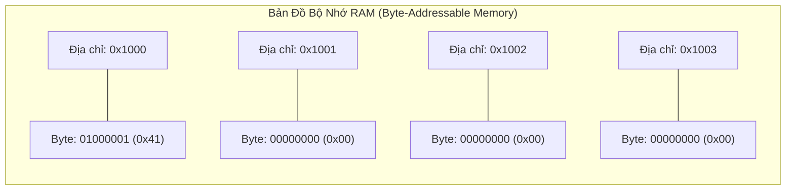
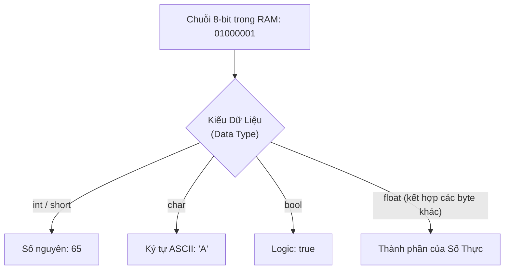

# 4.1 — Tổng Quan Về Các Kiểu Dữ Liệu Cơ Bản (Fundamental Data Types)

---

## 🎯 Mục Tiêu Bài Học
- Hiểu sâu sắc bản chất phần cứng: **Bit**, **Byte** và cơ chế đánh địa chỉ bộ nhớ (Byte-addressable memory architecture).
- Nắm vững vai trò tối thượng của **Kiểu dữ liệu (Data Type)**: Cách compiler và CPU giải mã chuỗi bit nhị phân thành thông tin có ý nghĩa.
- Phân loại toàn bộ các **Kiểu dữ liệu cơ bản (Fundamental / Primitive Types)** theo chuẩn ISO C++: Số thực dấu phẩy động (Floating point), Số nguyên (Integer & Integral), Ký tự (Char), Logic (Bool), Con trỏ null (`nullptr_t`) và Kiểu rỗng (`void`).
- Phân biệt rõ rệt giữa thuật ngữ "Integer types" và "Integral types".

---

## 1. Bit, Byte và Cơ Chế Định Địa Chỉ Bộ Nhớ

Trong máy tính kỹ thuật số, bộ nhớ RAM được cấu tạo từ hàng tỷ bóng bán dẫn (transistor) hoặc tụ điện siêu nhỏ. Đơn vị đo lường thông tin nhỏ nhất là một **bit (viết tắt của Binary Digit - chữ số nhị phân)**. Một bit chỉ có thể nhận một trong hai trạng thái: **`0`** (tắt / điện áp thấp) hoặc **`1`** (bật / điện áp cao).

Tuy nhiên, phần cứng CPU hiện đại không thể truy xuất bộ nhớ tới từng bit riêng lẻ. Số lượng địa chỉ là có hạn, và nhu cầu đọc ghi từng bit đơn lẻ là cực kỳ hiếm. Thay vào đó, bộ nhớ máy tính được tổ chức thành các đơn vị tuần tự gọi là **Byte**.

- **Chuẩn ISO C++ quy định**: $1 \text{ Byte} = 8 \text{ bits}$ tuần tự (được gọi chính xác là một *Octet*).
- Mỗi byte trong bộ nhớ RAM sở hữu một **Địa chỉ bộ nhớ duy nhất (Memory Address)**, thường được biểu diễn dưới dạng số thập lục phân (Hexadecimal, ví dụ `0x7ffd5a0`).



::: tip Điểm mấu chốt: C++ thao tác theo từng khối Byte
Trong C++, đơn vị bộ nhớ nhỏ nhất có thể gán địa chỉ trực tiếp và có kích thước tối thiểu `sizeof == 1` là **1 Byte**. Bạn không thể có một biến riêng lẻ có kích thước 1 bit hoặc trỏ trực tiếp một con trỏ tới 1 bit!
:::

---

## 2. Kiểu Dữ Liệu (Data Type) Là Gì?

Bản thân bộ nhớ RAM chỉ là một chuỗi vô tận các số `0` và `1` vô tri. Nếu bạn nhìn vào 1 byte chứa chuỗi bit:
```text
0100 0001 (Hệ Hex: 0x41)
```
Chuỗi bit này có ý nghĩa gì?
- Nếu diễn giải theo **Số nguyên (Integer)**: Nó đại diện cho số học **`65`**.
- Nếu diễn giải theo **Ký tự (Character ASCII)**: Nó đại diện cho chữ cái **`'A'`**.
- Nếu diễn giải theo **Logic (Boolean)**: Bất kỳ giá trị khác 0 nào đều đại diện cho **`true`**.

**Kiểu dữ liệu (Data Type)** chính là bản "hướng dẫn sử dụng" mà lập trình viên cung cấp cho Trình biên dịch để trả lời hai câu hỏi sống còn:
1. Đối tượng này chiếm dụng **bao nhiêu byte** trong bộ nhớ RAM?
2. Chuỗi bit nhị phân trong các byte đó được **mã hóa và giải mã theo quy tắc nào**?



---

## 3. Phân Loại Các Kiểu Dữ Liệu Cơ Bản Trong ISO C++

Chuẩn ISO C++ phân chia các kiểu cơ bản (Fundamental Types) thành các nhóm chính sau:

| Nhóm (Category) | Từ khóa kiểu (Keywords) | Ý nghĩa nghiệp vụ | Ví dụ minh họa |
| :--- | :--- | :--- | :--- |
| **Số thực (Floating Point)** | `float`, `double`, `long double` | Số có phần thập phân | `3.14159f`, `2.71828` |
| **Số nguyên (Integer)** | `short`, `int`, `long`, `long long` | Số nguyên có dấu / không dấu | `-42`, `1000000LL` |
| **Ký tự (Character)** | `char`, `wchar_t`, `char8_t`, `char16_t`, `char32_t` | Ký tự văn bản (ASCII, Unicode) | `'c'`, `u8'x'`, `U'A'` |
| **Logic (Boolean)** | `bool` | Đúng hoặc Sai | `true`, `false` |
| **Con trỏ null** | `std::nullptr_t` (C++11) | Giá trị con trỏ rỗng an toàn | `nullptr` |
| **Kiểu rỗng (Void)** | `void` | Không có kiểu / Không có giá trị | `void printLog()` |

---

## 4. Phân Biệt "Integer Types" và "Integral Types"

Trong văn bản chuẩn ISO C++, hai thuật ngữ này thường khiến người học nhầm lẫn:

1. **Standard Integer Types (Các kiểu số nguyên chuẩn)**: Bao gồm `short`, `int`, `long`, `long long` (và các biến thể `signed`/`unsigned` của chúng). Chúng đại diện cho các số học thuần túy và khi in ra màn hình bằng `std::cout` sẽ hiển thị ở dạng con số.
2. **Integral Types (Các kiểu nguyên vẹn)**: Khái niệm rộng hơn, bao gồm toàn bộ **Standard Integer Types** CỘNG VỚI kiểu **`bool`** và tất cả các kiểu ký tự (**`char`**, `wchar_t`, v.v.). 
   - Điểm chung: Tất cả các kiểu này bên dưới phần cứng đều được lưu trữ và tính toán bởi các phép toán số nguyên của CPU!

---

## 5. ⚠️ Hộp Cạm Bẫy Thực Chiến: Đọc Dữ Liệu Sai Kiểu (Type Punning UB)

::: danger Cạm bẫy: Cố tình ép kiểu bộ nhớ thô (Type Punning)
Nhiều lập trình viên xuất thân từ C thường dùng con trỏ để đọc 4 byte của biến `float` dưới dạng một biến `int`:
```cpp
float f { 3.14f };
int i = *(int*)&f; // VI PHẠM STRICT ALIASING RULE -> Undefined Behavior!
```
Hành động này vi phạm nghiêm trọng quy tắc **Strict Aliasing** trong chuẩn C++, dẫn tới việc Compiler sinh ra mã máy sai lệch hoàn toàn khi bật tối ưu hóa `-O2` hoặc `-O3`!
**Giải pháp C++20**: Sử dụng hàm `std::bit_cast` trong `<bit>` để sao chép bit an toàn tuyệt đối.
:::

---

## 6. 🚀 Hộp Cập Nhật C++20 / C++23: `char8_t` Cho Chuẩn UTF-8

Trong các phiên bản C++ cũ, kiểu `char` truyền thống vừa dùng để biểu diễn ký tự ASCII 1 byte, vừa dùng làm byte nhớ thô, vừa dùng chứa chuỗi UTF-8 đa byte. Sự nhập nhằng này dẫn tới vô số lỗi giải mã văn bản.

- **C++20** chính thức giới thiệu kiểu dữ liệu cơ bản mới: **`char8_t`**.
- `char8_t` được thiết kế chuyên biệt và độc quyền để lưu trữ các đơn vị mã (Code units) của bộ mã **UTF-8**, phân tách rạch ròi khỏi `char` thông thường:
  ```cpp
  char8_t utf8Char { u8'A' }; // Chuẩn UTF-8 trong C++20
  ```

---

## 7. 💡 Hộp Thực Hành Tốt Nhất (Best Practice)

::: tip Quy tắc chọn kiểu dữ liệu
1. **Mặc định chọn `int` cho số nguyên thông thường**: Trừ khi bạn có lý do đặc biệt cần tiết kiệm bộ nhớ hoặc số vượt quá 2 tỷ, `int` luôn là kiểu số nguyên được CPU tối ưu hóa tốc độ tính toán tốt nhất.
2. **Mặc định chọn `double` cho số thực**: Không dùng `float` cho các tính toán đòi hỏi độ chính xác cao vì `float` có độ chính xác rất hạn chế (chỉ 6-7 chữ số). `double` là chuẩn mặc định của số thực trong C++.
3. **Hiểu ý nghĩa hậu tố `_t`**: Các kiểu dữ liệu kết thúc bằng đuôi `_t` (như `size_t`, `nullptr_t`, `int32_t`) là quy ước chuẩn hóa chỉ thị "đây là một Type được định nghĩa".
:::

---

## 8. 📝 Hệ Thống Quiz & Bài Tập Tự Luyện

::: details Câu hỏi 1: Tại sao phần cứng máy tính không đánh địa chỉ bộ nhớ cho từng bit riêng lẻ mà lại đánh địa chỉ theo từng Byte?
**Lời giải chi tiết**:
1. **Tiết kiệm độ dài địa chỉ**: Nếu mỗi bit có một địa chỉ riêng, số lượng địa chỉ cần quản lý sẽ tăng lên 8 lần, đòi hỏi các thanh ghi địa chỉ và bus địa chỉ của CPU phải lớn hơn rất nhiều (tốn transistor và băng thông phần cứng).
2. **Hiệu suất xử lý thực tế**: Trong thực tế, các lệnh máy tính luôn thao tác với các nhóm dữ liệu (ký tự 8-bit, số nguyên 32-bit hoặc 64-bit). Việc nạp và lưu trữ từng byte hoặc từng khối 4-8 bytes một lần phù hợp hoàn hảo với kiến trúc phần cứng vi xử lý hiện đại.
:::

::: details Câu hỏi 2: Kiểu `bool` và kiểu `char` có được xem là "Kiểu số nguyên (Integer type)" hay không? Hãy giải thích dựa trên chuẩn ISO C++.
**Lời giải chi tiết**:
Theo chuẩn ISO C++:
- `bool` và `char` thuộc nhóm **Integral Types** (các kiểu nguyên vẹn). Dưới góc độ biểu diễn phần cứng, chúng được lưu trữ như các giá trị số nguyên trong RAM (ví dụ: `bool` lưu 0 hoặc 1; `char` lưu mã số ASCII từ 0 đến 127).
- Tuy nhiên, theo nghĩa hẹp thông thường của thuật ngữ **Standard Integer Types**, chúng không thuộc nhóm này vì hành vi xuất dữ liệu của chúng khác biệt: `bool` xuất ra `0/1` (hoặc `false/true` nếu bật `boolalpha`), còn `char` xuất ra hình dạng ký tự văn bản thay vì in ra con số đại diện của nó.
:::
