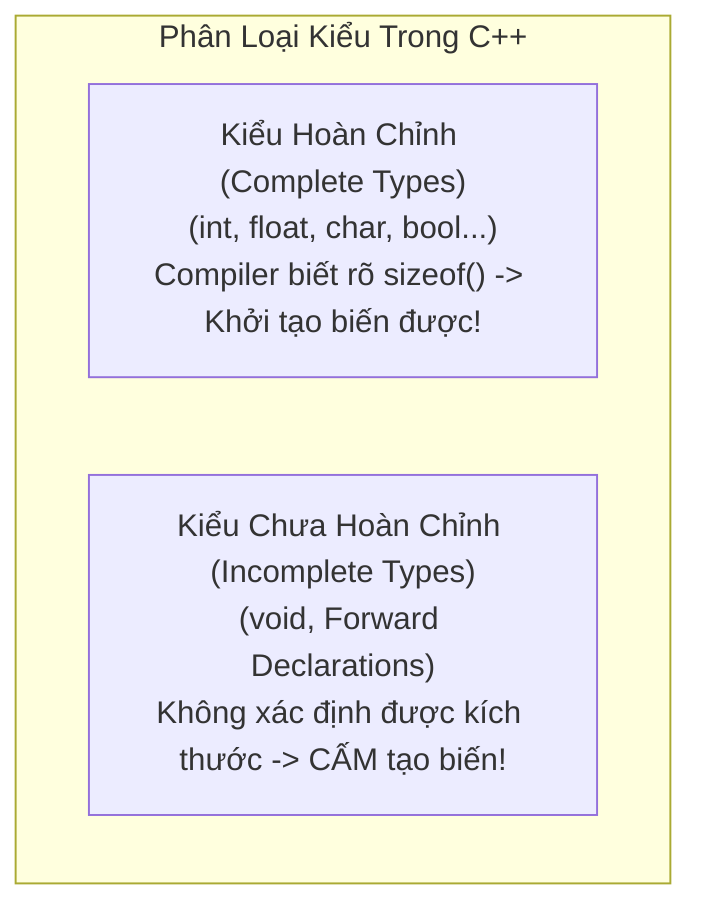

# 4.2 — Kiểu Rỗng (Void) và Khái Niệm Kiểu Chưa Hoàn Chỉnh (Incomplete Types)

---

## 🎯 Mục Tiêu Bài Học
- Hiểu bản chất thực sự của từ khóa **`void`**: Đại diện cho "không có kiểu" (no type) hoặc "không có giá trị".
- Nắm vững khái niệm nền tảng trong hệ thống kiểu C++: **Kiểu chưa hoàn chỉnh (Incomplete Type)** và lý do tại sao không thể khởi tạo biến kiểu `void`.
- Phân biệt cách khai báo hàm không tham số: Phong cách C cũ (`void`) vs Chuẩn mực C++ hiện đại (Cặp ngoặc rỗng `()`).
- Khám phá các ứng dụng nâng cao của `void`: Con trỏ `void*` và kỹ thuật ép kiểu `static_cast<void>` để triệt tiêu cảnh báo trình biên dịch.

---

## 1. Bản Chất Của `void`: Kiểu Chưa Hoàn Chỉnh (Incomplete Type)

Trong C++, **`void`** có nghĩa là "trống rỗng" hoặc "không tồn tại kiểu".

`void` là ví dụ đầu tiên bạn tiếp cận về một **Kiểu chưa hoàn chỉnh (Incomplete Type)**.
- **Kiểu hoàn chỉnh (Complete Type)**: Là kiểu mà Compiler biết chính xác kích thước bao nhiêu byte trong bộ nhớ (ví dụ `int` là 4 bytes, `double` là 8 bytes). Do đó, bạn có thể định nghĩa biến và cấp phát ô nhớ cho nó.
- **Kiểu chưa hoàn chỉnh (Incomplete Type)**: Là kiểu mà Compiler chỉ biết về sự tồn tại của tên kiểu, nhưng **không có đủ thông tin để xác định kích thước bộ nhớ** cần cấp phát.

Vì `void` đại diện cho sự không tồn tại của kiểu, nó **cố ý không bao giờ được hoàn thiện**.



Do đó, hành động cố tình tạo một biến kiểu `void` sẽ bị Compiler chặn đứng ngay lập tức:

```cpp
int main()
{
    void x; // LỖI BIÊN DỊCH: Không thể định nghĩa biến thuộc kiểu chưa hoàn chỉnh 'void'!
    return 0;
}
```

---

## 2. Ngữ Cảnh Sử Dụng 1: Hàm Không Trả Về Giá Trị

Ứng dụng phổ biến nhất của `void` là đặt ở vị trí kiểu trả về của một hàm, báo hiệu cho trình biên dịch biết: **Hàm này chỉ thực hiện hành động (Side Effect) chứ không trả lại bất kỳ dữ liệu nào cho nơi gọi**.

```cpp
#include <iostream>

void printGreeting() // void o day co nghia: Khong co gia tri tra ve
{
    std::cout << "Xin chao ban!\n";
    // Khong can cau lenh return o cuoi ham
}

void tryReturn()
{
    std::cout << "Thu tra ve gia tri...\n";
    // return 5; // LỖI BIÊN DỊCH: Hàm void không được phép trả về một giá trị!
    return;      // HOP LE: return dung mot minh de thoat khoi ham som
}
```

---

## 3. Ngữ Cảnh Sử Dụng 2: Danh Sách Tham Số Rỗng (C vs C++)

Trong ngôn ngữ lập trình C cổ điển, nếu bạn viết một hàm với cặp ngoặc tròn rỗng `int getValue()`, C coi đó là một hàm nhận **số lượng tham số bất kỳ không xác định**! Để bắt buộc hàm không được nhận tham số nào, lập trình viên C phải viết rõ ràng từ khóa `void` vào trong ngoặc:

```cpp
// Phong cách ngôn ngữ C cũ:
int getValue(void) // void ở đây có nghĩa: Hàm không nhận bất kỳ tham số nào
{
    return 42;
}
```

### Quy chuẩn C++ Hiện Đại:
Trong C++, cặp ngoặc tròn rỗng `()` **mặc định đồng nghĩa với việc không nhận tham số nào**. Việc viết `(void)` trong C++ chỉ được giữ lại vì tính tương thích ngược với C (Backwards Compatibility) và bị coi là rườm rà, lỗi thời.

::: tip Thực hành tốt nhất (Best Practice)
Trong C++, hãy luôn sử dụng cặp dấu ngoặc tròn rỗng **`()`** cho các hàm không nhận tham số. Tuyệt đối không viết `(void)`.
```cpp
int getValue(); // CHUẨN C++: Ngắn gọn, sạch sẽ, chuẩn mực!
```
:::

---

## 4. Các Ngữ Cảnh Nâng Cao Của `void`

### 4.1. Con trỏ phi kiểu: `void*` (Void Pointer)
Một con trỏ kiểu `void*` có thể lưu giữ địa chỉ bộ nhớ của **bất kỳ đối tượng nào** (dù là `int`, `double` hay chuỗi ký tự) mà không quan tâm đến kiểu thực tế của nó. Đây là nền tảng của lập trình cấp thấp và lập trình tổng quát kiểu C trước khi có C++ Templates. Chúng ta sẽ đào sâu chi tiết về `void*` trong chương về Con trỏ.

### 4.2. Triệt tiêu cảnh báo biến không sử dụng: `static_cast<void>(x)`
Khi bạn nhận một tham số trong hàm nhưng tạm thời chưa dùng đến (hoặc một hàm trả về mã lỗi nhưng bạn chủ ý muốn bỏ qua), Compiler thường đưa ra cảnh báo *Unused variable*. Bạn có thể dùng `static_cast<void>` để báo cho trình biên dịch biết đây là chủ đích của bạn:

```cpp
void onEventTriggered(int eventCode)
{
    // Triệt tiêu cảnh báo: "unused parameter 'eventCode'"
    static_cast<void>(eventCode); 
}
```

---

## 5. ⚠️ Hộp Cạm Bẫy Thực Chiến: Phép Toán `sizeof(void)`

::: danger Cạm bẫy: Hành vi không chuẩn (GNU Extension vs ISO C++)
Theo đúng văn bản chuẩn ISO C++, việc áp dụng toán tử `sizeof(void)` là **hoàn toàn bất hợp pháp** và trình biên dịch chuẩn phải báo lỗi biên dịch, bởi vì kiểu chưa hoàn chỉnh không có kích thước!
Tuy nhiên, trình biên dịch **GCC / Clang** có một tiện ích mở rộng (GNU Extension) tự ý coi `sizeof(void) == 1`. 
**Hậu quả**: Nếu bạn viết code dựa trên giả định `sizeof(void) == 1`, mã nguồn của bạn sẽ lập tức bị lỗi khi chuyển sang biên dịch trên **Microsoft Visual Studio (MSVC)** hoặc các trình biên dịch nhúng tuân thủ nghiêm ngặt chuẩn ISO!
:::

---

## 6. 🚀 Hộp Cập Nhật C++20 / C++23: `[[maybe_unused]]` và `std::is_void_v`

1. **Thuộc tính chuẩn hóa `[[maybe_unused]]` (C++17/C++20)**: Thay thế hoàn toàn mẹo `static_cast<void>`:
   ```cpp
   void handleCallback([[maybe_unused]] int statusCode)
   {
       // Compiler không phát sinh bất kỳ cảnh báo nào dù statusCode không được dùng!
   }
   ```
2. **Kiểm tra kiểu tại Compile-time với Type Traits**:
   ```cpp
   #include <type_traits>

   template <typename T>
   void processType()
   {
       if constexpr (std::is_void_v<T>)
       {
           // Xu ly rieng neu T la void
       }
   }
   ```

---

## 7. 💡 Hộp Thực Hành Tốt Nhất (Best Practice)

::: tip Lời khuyên thiết kế hàm
- Nếu một hàm chỉ thực hiện nhiệm vụ in ấn, ghi tệp, hoặc thay đổi trạng thái đối tượng mà không sinh ra dữ liệu mới, hãy để kiểu trả về là `void`.
- Dùng câu lệnh `return;` không kèm giá trị để thoát sớm khỏi hàm `void` (Early exit / Guard clauses) khi phát hiện dữ liệu đầu vào không hợp lệ.
:::

---

## 8. 📝 Hệ Thống Quiz & Bài Tập Tự Luyện

::: details Câu hỏi 1: Tại sao câu lệnh sau đây gây lỗi biên dịch?
```cpp
void myVar{};
```
**Lời giải chi tiết**:
`void` là một kiểu dữ liệu chưa hoàn chỉnh (Incomplete Type) đại diện cho sự không có kiểu. Trình biên dịch không thể biết được cần phải cấp phát bao nhiêu byte bộ nhớ RAM cho một đối tượng thuộc kiểu `void`. Do đó, theo chuẩn ISO C++, không một biến số nào được phép khai báo với kiểu `void`.
:::

::: details Câu hỏi 2: Sự khác biệt giữa `return;` và `return 0;` là gì? Chúng được sử dụng trong những hàm có kiểu trả về như thế nào?
**Lời giải chi tiết**:
- **`return;`**: Không kèm theo bất kỳ biểu thức giá trị nào. Được sử dụng độc quyền trong các hàm có kiểu trả về là **`void`** để chấm dứt thực thi hàm sớm và trao lại quyền điều khiển cho hàm gọi.
- **`return 0;`**: Trả về một giá trị số nguyên cụ thể (`0`). Bắt buộc phải sử dụng trong các hàm có kiểu trả về tương thích với số nguyên (ví dụ hàm `int main()`). Nếu đặt `return 0;` trong một hàm `void`, trình biên dịch sẽ báo lỗi cú pháp.
:::
