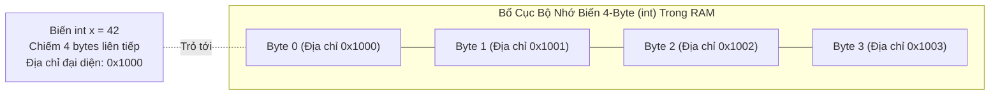
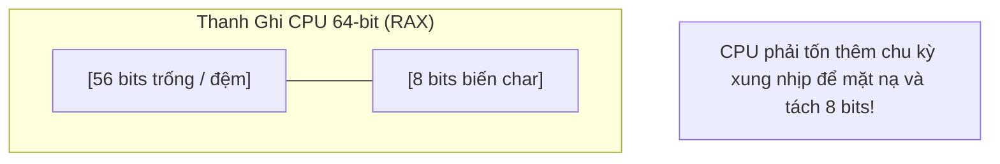

# 4.3 — Kích Thước Đối Tượng & Toán Tử `sizeof` (Object Sizes and sizeof)

---

## 🎯 Mục Tiêu Bài Học
- Hiểu quy luật toán học cốt lõi: Với $n$ bit, một đối tượng có thể lưu trữ tối đa $2^n$ giá trị phân biệt.
- Nắm vững bảng quy chuẩn kích thước tối thiểu của các kiểu dữ liệu theo chuẩn ISO C++ và sự khác biệt giữa các mô hình dữ liệu hệ điều hành (**LP64** trên Linux vs **LLP64** trên Windows).
- Làm chủ toán tử **`sizeof`**: Toán tử tính toán kích thước tại compile-time trả về kiểu `size_t`.
- Hiểu lý do kiến trúc phần cứng: Tại sao biến nhỏ hơn (như `short`, `char`) chưa chắc đã chạy nhanh hơn biến lớn hơn (`int`, `int64_t`) do cơ chế căn chỉnh byte (Byte Alignment) và kích thước thanh ghi CPU.

---

## 1. Mối Quan Hệ Giữa Số Bit Và Khả Năng Lưu Trữ

Mỗi ô nhớ (biến số) trong chương trình của bạn thực chất chiếm giữ một hoặc nhiều byte liên tiếp nhau trong RAM. Kích thước byte của biến quyết định trực tiếp **phạm vi giá trị** mà biến đó có thể biểu diễn:

- **1 bit**: Lưu được $2^1 = 2$ giá trị (`0` hoặc `1`).
- **2 bits**: Lưu được $2^2 = 4$ giá trị (`00`, `01`, `10`, `11`).
- **8 bits (1 Byte)**: Lưu được $2^8 = 256$ giá trị duy nhất (từ $0$ đến $255$ hoặc $-128$ đến $127$).
- **16 bits (2 Bytes)**: Lưu được $2^{16} = 65.536$ giá trị.
- **32 bits (4 Bytes)**: Lưu được $2^{32} \approx 4,29 \text{ tỷ}$ giá trị (từ $-2.147.483.648$ đến $2.147.483.647$).
- **64 bits (8 Bytes)**: Lưu được $2^{64} \approx 18,4 \text{ tỷ tỷ}$ giá trị (con số khổng lồ đủ để đếm số hạt cát trên Trái Đất!).



---

## 2. Kích Thước Các Kiểu Theo Chuẩn ISO C++

Một sự thật gây sốc cho nhiều người mới học: **Chuẩn ISO C++ KHÔNG quy định kích thước cố định bằng số byte cụ thể cho phần lớn các kiểu cơ bản!** 
Thay vào đó, chuẩn chỉ đưa ra **Ràng buộc kích thước tối thiểu (Minimum Size Guarantees)**:

| Kiểu dữ liệu (Type) | Kích thước tối thiểu (ISO C++) | Kích thước thực tế trên Windows (x64) | Kích thước thực tế trên Linux / macOS (x64) |
| :--- | :--- | :--- | :--- |
| `bool` | 1 byte | 1 byte | 1 byte |
| `char` / `char8_t` | **Chính xác 1 byte** | 1 byte | 1 byte |
| `short` | Tối thiểu 16 bits (2 bytes) | 2 bytes | 2 bytes |
| `int` | Tối thiểu 16 bits (2 bytes) | **4 bytes** | **4 bytes** |
| `long` | Tối thiểu 32 bits (4 bytes) | **4 bytes (LLP64)** | **8 bytes (LP64)** ⚠️ |
| `long long` | Tối thiểu 64 bits (8 bytes) | 8 bytes | 8 bytes |
| `float` | Tối thiểu 32 bits (4 bytes) | 4 bytes | 4 bytes |
| `double` | Tối thiểu 64 bits (8 bytes) | 8 bytes | 8 bytes |
| `long double` | Tối thiểu 80/128 bits | 8 bytes | 16 bytes |

::: danger Cạm bẫy đa nền tảng: Sự khác biệt chết người của kiểu `long`
Nhìn vào bảng trên, bạn sẽ thấy kiểu `long`:
- Trên hệ điều hành **Windows 64-bit (Mô hình LLP64)**: `sizeof(long) == 4 bytes`.
- Trên hệ điều hành **Linux / macOS 64-bit (Mô hình LP64)**: `sizeof(long) == 8 bytes`!

Nếu bạn viết code lưu trữ số lớn hơn 2 tỷ vào kiểu `long`, chương trình của bạn sẽ chạy trơn tru trên Ubuntu Linux nhưng lập tức bị **tràn số âm (Overflow)** khi đem sang máy Windows của khách hàng!
Đây là lý do C++ hiện đại khuyến cáo sử dụng các kiểu có độ rộng cố định (`int32_t`, `int64_t`) trong bài 4.6.
:::

---

## 3. Toán Tử `sizeof`: Cân Đo Trọng Lượng Dữ Liệu

Để đo lường chính xác xem một kiểu dữ liệu hoặc một biến số chiếm bao nhiêu byte trên chiếc máy tính hiện tại, C++ cung cấp toán tử một ngôi **`sizeof`**.

```cpp
#include <iostream>
#include <iomanip>

int main()
{
    std::cout << std::left;
    std::cout << std::setw(15) << "sizeof(bool):"        << sizeof(bool)        << " byte\n";
    std::cout << std::setw(15) << "sizeof(char):"        << sizeof(char)        << " byte\n";
    std::cout << std::setw(15) << "sizeof(short):"       << sizeof(short)       << " bytes\n";
    std::cout << std::setw(15) << "sizeof(int):"         << sizeof(int)         << " bytes\n";
    std::cout << std::setw(15) << "sizeof(long):"        << sizeof(long)        << " bytes\n";
    std::cout << std::setw(15) << "sizeof(long long):"   << sizeof(long long)   << " bytes\n";
    std::cout << std::setw(15) << "sizeof(float):"       << sizeof(float)       << " bytes\n";
    std::cout << std::setw(15) << "sizeof(double):"      << sizeof(double)      << " bytes\n";

    int x { 100 };
    std::cout << "Kich thuoc bien x: " << sizeof(x) << " bytes\n"; // Co the truyen truc tiep ten bien

    return 0;
}
```

---

## 4. ⚠️ Hộp Cạm Bẫy Thực Chiến: Biểu Thức Bên Trong `sizeof` KHÔNG HỀ Chạy!

::: danger Cạm bẫy kinh điển: Đoán kết quả của `sizeof(x++)`
Toán tử `sizeof` là một toán tử được tính toán hoàn toàn ngay tại thời điểm biên dịch (**Compile-time operator**). Compiler chỉ nhìn vào **kiểu dữ liệu** của biểu thức bên trong để trả về kích thước, chứ **không hề sinh ra mã máy để thực thi biểu thức đó**!

Hãy xét đoạn code sau:
```cpp
int x { 5 };
std::cout << sizeof(x++) << '\n'; // In ra: 4 (kich thuoc cua kieu int)
std::cout << "Gia tri cua x: " << x << '\n'; // IN RA: 5! KHÔNG PHẢI 6!
```
Vì phép toán `x++` không bao giờ được thực thi tại runtime, giá trị của `x` vẫn giữ nguyên là `5`! Đặt biểu thức có hiệu ứng phụ bên trong `sizeof` là một sai lầm logic nghiêm trọng.
:::

---

## 5. Bản Chất Phần Cứng: Nhỏ Hơn Chưa Chắc Đã Chạy Nhanh Hơn!

Một ngộ nhận cực kỳ phổ biến của người mới bắt đầu: *"Kiểu `short` (2 byte) hoặc `char` (1 byte) tốn ít RAM hơn kiểu `int` (4 byte), vậy nên dùng `short` chương trình sẽ chạy nhanh hơn!"*.

**Thực tế hoàn toàn ngược lại**:
1. **Thanh ghi CPU (CPU Registers)**: Bộ vi xử lý hiện đại x86-64 hoặc ARM64 được thiết kế để xử lý dữ liệu theo từng từ máy (Machine Word) kích thước 32-bit hoặc 64-bit.
2. **Căn chỉnh địa chỉ (Memory Alignment)**: Khi CPU đọc một biến 2-byte hoặc 1-byte, nó thường phải thực hiện thêm các thao tác phụ: dịch bit (shift) và mặt nạ bit (mask) để bóc tách dữ liệu ra khỏi thanh ghi 64-bit.
3. Do đó, trên các máy tính hiện đại, kiểu **`int` (32-bit)** thường có tốc độ xử lý số học **nhanh hơn đáng kể** so với `short` hoặc `char`!



---

## 6. 🚀 Hộp Cập Nhật C++20 / C++23: Định Dạng Hiện Đại Với `<print>`

Trong C++23, việc in kích thước đối tượng trở nên ngắn gọn và đẹp đẽ hơn bao giờ hết:

```cpp
#include <print>

int main()
{
    std::println("int: {} bytes, double: {} bytes", sizeof(int), sizeof(double));
    return 0;
}
```

---

## 7. 💡 Hộp Thực Hành Tốt Nhất (Best Practice)

::: tip Lời khuyên tối ưu hóa bộ nhớ
1. **Không tối ưu hóa sớm (Premature Optimization)**: Đừng cố nhét các biến số vào kiểu `char` hoặc `short` để tiết kiệm vài byte RAM trừ khi bạn đang tạo một mảng gồm hàng triệu phần tử. Sự đánh đổi này vừa làm code khó đọc vừa làm chậm tốc độ tính toán của CPU.
2. **Kiểm tra giả định bằng `static_assert`**: Nếu thuật toán của bạn bắt buộc kiểu `int` phải có tối thiểu 4 bytes, hãy đặt ngay câu lệnh:
   ```cpp
   static_assert(sizeof(int) >= 4, "Loi: Kien truc nay co sizeof(int) < 4 bytes!");
   ```
:::

---

## 8. 📝 Hệ Thống Quiz & Bài Tập Tự Luyện

::: details Câu hỏi 1: Toán tử `sizeof` trả về kết quả theo đơn vị gì? Kiểu dữ liệu của giá trị trả về đó là gì?
**Lời giải chi tiết**:
- Toán tử `sizeof` luôn trả về kích thước theo đơn vị **Byte** (với quy chuẩn 1 byte = `sizeof(char) == 1`).
- Kiểu dữ liệu của giá trị trả về bởi `sizeof` là kiểu số nguyên không dấu chuẩn **`std::size_t`** (được định nghĩa trong header `<cstddef>`).
:::

::: details Câu hỏi 2: Đoạn mã sau đây in ra kết quả gì và tại sao?
```cpp
#include <iostream>

int main()
{
    int a { 10 };
    std::cout << sizeof(a = 20) << '\n';
    std::cout << a << '\n';

    return 0;
}
```
**Lời giải chi tiết**:
- Dòng `sizeof(a = 20)` in ra: **`4`** (trên hầu hết kiến trúc 32-bit/64-bit hiện đại, tương ứng với `sizeof(int)`).
- Dòng `std::cout << a;` in ra: **`10`** (không phải `20`).
- **Giải thích**: Toán tử `sizeof` là một toán tử compile-time. Biểu thức gán `a = 20` bên trong dấu ngoặc không hề được CPU thực thi tại runtime; compiler chỉ kiểm tra kiểu dữ liệu của biểu thức gán đó (là tham chiếu lvalue tới `int`, có kích thước bằng kiểu `int`) và thế trực tiếp con số `4` vào mã máy trước khi chạy.
:::
