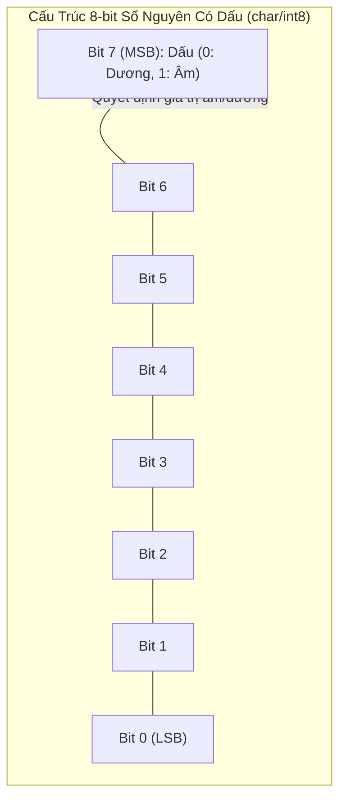

# 4.4 — Số Nguyên Có Dấu (Signed Integers) & Cạm Bẫy Tràn Số (Integer Overflow)

---

## 🎯 Mục Tiêu Bài Học
- Hiểu rõ cơ chế biểu diễn số nguyên có dấu theo chuẩn **Mã bù 2 (Two's Complement)** mà chuẩn **ISO C++20** chính thức bắt buộc toàn cầu.
- Nắm vững công thức dải giá trị của số nguyên $n$-bit: từ $-(2^{n-1})$ đến $2^{n-1}-1$.
- Mổ xẻ cạm bẫy chí mạng: **Tràn số nguyên có dấu (Signed Integer Overflow)** là **Hành vi không xác định (Undefined Behavior)** và cách compiler tối ưu hóa có thể xóa sổ code kiểm tra của bạn.
- Hiểu hành vi cắt cụt về phía số 0 (Truncation toward zero) của phép chia số nguyên (Integer Division).

---

## 1. Các Kiểu Số Nguyên Có Dấu Trong C++

Số nguyên là kiểu dữ liệu cơ bản đại diện cho các số nguyên dương, số nguyên âm và số `0`. C++ cung cấp 4 kiểu số nguyên có dấu chính:

```cpp
short s;      // Thường là 16-bit (2 bytes)
int i;        // Thường là 32-bit (4 bytes) - Lựa chọn mặc định tốt nhất
long l;       // 32-bit trên Windows, 64-bit trên Linux/macOS
long long ll; // Tối thiểu 64-bit (8 bytes)
```

::: tip Thực hành tốt nhất (Best Practice)
Theo mặc định, các kiểu số nguyên trong C++ luôn **có dấu (signed)**. Do đó, từ khóa `signed` (như `signed int`) là hoàn toàn dư thừa. Hãy dùng tên ngắn gọn: `short`, `int`, `long`, `long long`.
:::

---

## 2. Bản Chất Phần Cứng: Biểu Diễn Mã Bù 2 (Two's Complement)

Làm thế nào để các cổng logic của CPU (vốn chỉ biết cộng các bit 0 và 1) có thể thực hiện được phép trừ và lưu số âm?

Câu trả lời là **Mã bù 2 (Two's Complement)**. Kể từ **C++20**, chuẩn ISO C++ chính thức quy định mọi trình biên dịch C++ trên toàn thế giới bắt buộc phải sử dụng mã bù 2 để biểu diễn số nguyên có dấu.

Trong mã bù 2 của một biến $n$-bit:
- **Bit trọng số cao nhất (MSB - Most Significant Bit)** đóng vai trò là **Bit dấu (Sign bit)**:
  - Nếu MSB là `0`: Đây là số dương hoặc số 0.
  - Nếu MSB là `1`: Đây là số âm.
- Để đổi dấu một số nhị phân: **Đảo toàn bộ các bit ($0 \leftrightarrow 1$) rồi cộng thêm $1$**.



### Bảng Dải Giá Trị Chuẩn:
Với $n$ bit, dải giá trị an toàn là: $[-(2^{n-1}), 2^{n-1} - 1]$

| Kiểu dữ liệu | Số bit (tiêu biểu) | Giá trị nhỏ nhất (Minimum) | Giá trị lớn nhất (Maximum) |
| :--- | :--- | :--- | :--- |
| **8-bit signed** | 8 bits | $-128$ | $+127$ |
| **16-bit signed** (`short`) | 16 bits | $-32.768$ | $+32.767$ |
| **32-bit signed** (`int`) | 32 bits | **$-2.147.483.648$** | **$+2.147.483.647$** |
| **64-bit signed** (`long long`)| 64 bits | $-9.223.372.036.854.775.808$ | $+9.223.372.036.854.775.807$ |

*(Lưu ý: Phía số âm luôn nhiều hơn phía số dương 1 giá trị vì phía dương phải chia sẻ vị trí cho số `0`)*.

---

## 3. ⚠️ Hộp Cạm Bẫy Thực Chiến: Tràn Số Có Dấu (Signed Overflow = UB)

Điều gì xảy ra nếu bạn cố tình cộng thêm `1` vào giá trị cực đại của một biến `int` 32-bit?

```cpp
#include <iostream>

int main()
{
    // Dấu nháy đơn ' là dấu phân cách chữ số (Digit Separator) từ C++14 giúp dễ đọc
    int x { 2'147'483'647 }; // Giá trị cực đại của kiểu signed int 32-bit
    std::cout << "x ban dau: " << x << '\n';

    x = x + 1; // NGUY HIỂM: TRÀN SỐ CÓ DẤU (SIGNED OVERFLOW)!

    std::cout << "x sau khi cong 1: " << x << '\n';
    return 0;
}
```

::: danger Cạm bẫy chí mạng: Sự tàn khốc của Undefined Behavior (UB)
Trên chiếc máy tính cá nhân của bạn, đoạn code trên có thể in ra `-2147483648` (do bit dấu bị lật từ 0 sang 1 theo cơ chế xoay vòng bù 2 của phần cứng). Nhiều lập trình viên lầm tưởng đây là quy chuẩn!

**KHÔNG HỀ!** Theo văn bản chuẩn ISO C++:
&gt; *"Nếu một phép toán số nguyên có dấu vượt ra ngoài dải giá trị có thể biểu diễn, hành vi của chương trình là **HOÀN TOÀN KHÔNG XÁC ĐỊNH (Undefined Behavior)**."*

**Hậu quả thực tế khi biên dịch Release (`-O2` hoặc `-O3`)**:
Trình tối ưu hóa của Compiler (như GCC hay Clang) mặc định giả định rằng **UB không bao giờ xảy ra trong code của bạn**. 
Nếu bạn viết câu lệnh kiểm tra:
```cpp
if (x + 1 > x) { /* Lam gi do */ }
```
Compiler sẽ tự động suy luận: "Vì toán học thì $x + 1$ luôn lớn hơn $x$, và signed overflow là UB nên không cần xét trường hợp tràn số âm", và Compiler sẽ **XÓA BỎ HOÀN TOÀN câu lệnh `if`** khỏi mã máy! Toàn bộ cơ chế kiểm tra lỗi bảo mật của bạn sẽ biến mất không dấu vết!
:::

---

## 4. Phép Chia Số Nguyên: Cắt Cụt Về Phía Số 0 (Truncation)

Khi thực hiện phép chia giữa hai số nguyên trong C++, kết quả trả về **luôn luôn là một số nguyên**. Toàn bộ phần thập phân sẽ bị **cắt cụt (truncated)**, không phải làm tròn!

```cpp
#include <iostream>

int main()
{
    std::cout << " 8 / 5 = "  << (8 / 5)   << '\n'; // In ra: 1 (phần 0.6 bị vứt bỏ)
    std::cout << "-8 / 5 = "  << (-8 / 5)  << '\n'; // In ra: -1 (phần -0.6 bị vứt bỏ)
    std::cout << "19 / 10 = " << (19 / 10) << '\n'; // In ra: 1 (KHÔNG làm tròn lên 2!)

    return 0;
}
```

Nếu muốn nhận kết quả dạng số thực thập phân (`1.6`), bắt buộc ít nhất một trong hai toán hạng phải là số thực:
```cpp
std::cout << 8.0 / 5 << '\n'; // In ra: 1.6
```

---

## 5. 🚀 Hộp Cập Nhật C++20 / C++23: Truy Vấn Giới Hạn Chuẩn Với `<limits>`

Thay vì ghi nhớ các con số hàng tỷ dễ gõ nhầm, hãy dùng `std::numeric_limits` trong thư viện chuẩn `<limits>`:

```cpp
#include <iostream>
#include <limits>

int main()
{
    std::cout << "int Min: " << std::numeric_limits<int>::min() << '\n';
    std::cout << "int Max: " << std::numeric_limits<int>::max() << '\n';
    std::cout << "long long Max: " << std::numeric_limits<long long>::max() << '\n';

    return 0;
}
```

Trong **C++20**, thư viện `<numeric>` còn bổ sung hàm toán học `std::midpoint(a, b)` giúp tính trung bình cộng giữa hai số nguyên lớn mà **tuyệt đối không bao giờ bị tràn số**!

---

## 6. 💡 Hộp Thực Hành Tốt Nhất (Best Practice)

::: tip Quy tắc sinh tồn với số nguyên
1. **Luôn mặc định chọn `int`**: Trừ khi cần lưu số lớn hơn 2 tỷ (dùng `long long`) hoặc cần tối ưu mảng bộ nhớ cực lớn.
2. **Sử dụng dấu phân cách số `'` (từ C++14)**: Viết `int money { 1'000'000 };` thay vì `1000000` để tránh hoa mắt đếm số 0.
3. **Bật cờ phát hiện tràn số khi gỡ lỗi**: Thêm cờ `-fsanitize=undefined` khi biên dịch trên GCC/Clang. Nếu có phép toán nào bị signed overflow, chương trình sẽ lập tức dừng lại và chỉ rõ tên file, số dòng!
:::

---

## 7. 📝 Hệ Thống Quiz & Bài Tập Tự Luyện

::: details Câu hỏi 1: Một kiểu số nguyên có dấu 6-bit có thể biểu diễn dải giá trị từ bao nhiêu đến bao nhiêu?
**Lời giải chi tiết**:
- Với $n = 6$ bit:
  - Tổng số giá trị phân biệt là $2^6 = 64$.
  - 1 bit được dành cho bit dấu (MSB), còn lại 5 bit cho độ lớn.
  - Phía âm: từ $-(2^{6-1}) = -2^5 = -32$.
  - Phía dương: từ $0$ đến $2^{6-1} - 1 = 2^5 - 1 = 31$.
- Vậy dải giá trị là từ **$-32$ đến $+31$**.
:::

::: details Câu hỏi 2: Đoạn mã sau đây in ra kết quả gì?
```cpp
#include <iostream>

int main()
{
    int a { 14 };
    int b { 4 };
    std::cout << (a / b) << '\n';
    std::cout << (-a / b) << '\n';
    return 0;
}
```
**Lời giải chi tiết**:
- `14 / 4 = 3.5`: Vì cả `a` và `b` đều là số nguyên, phép chia số nguyên sẽ cắt cụt phần thập phân `.5`, in ra **`3`**.
- `-14 / 4 = -3.5`: Cắt cụt phần thập phân về phía số 0, in ra **`-3`**.
:::
