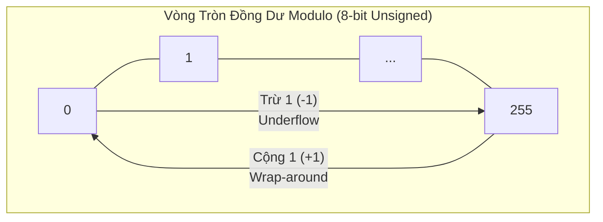

# 4.5 — Số Nguyên Không Dấu (Unsigned Integers) & Lý Do Nên Tránh Dùng

---

## 🎯 Mục Tiêu Bài Học
- Hiểu cơ chế hoạt động của **Số nguyên không dấu (Unsigned Integers)**: Dải giá trị từ $0$ đến $2^n - 1$ và toán học xoay vòng đồng dư (Modulo Wrap-around).
- Thấu hiểu nghịch lý nổi tiếng: Tại sao cha đẻ C++ Bjarne Stroustrup và chuẩn kỹ thuật của Google (Google C++ Style Guide) đều khuyên **tránh dùng unsigned cho các đại lượng đếm và số học thông thường**.
- Nhận diện 2 cạm bẫy chí mạng:
  1. **Tràn số đáy (Underflow Wrap-around)** khi trừ hai số hoặc chạy vòng lặp lùi về 0.
  2. **Hiểm họa ép kiểu ngầm định khi pha trộn Signed và Unsigned** (khiến `-1 < 1u` trở thành `false`!).
- Làm chủ vũ khí cứu cánh trong **C++20**: Bộ hàm so sánh số nguyên an toàn `<utility>` (`std::cmp_less`, v.v.).

---

## 1. Số Nguyên Không Dấu (Unsigned Integers) Là Gì?

Số nguyên không dấu là kiểu số nguyên **chỉ lưu trữ các số nguyên không âm** (từ số $0$ trở lên). Để khai báo, ta đặt từ khóa `unsigned` phía trước kiểu dữ liệu:

```cpp
unsigned short us;     // 16-bit: 0 den 65.535
unsigned int ui;       // 32-bit: 0 den 4.294.967.295
unsigned long ul;      // 32-bit hoac 64-bit
unsigned long long ull;// 64-bit: 0 den 18.446.744.073.709.551.615
```

Vì toàn bộ các bit (kể cả bit đầu MSB) đều được dùng để biểu diễn độ lớn của số (không tốn bit dấu), một biến `unsigned` có thể lưu trữ số dương lớn **gấp đôi** so với biến `signed` cùng kích thước byte.

---

## 2. Bản Chất Toán Học: Cơ Chế Xoay Vòng Đồng Dư (Modulo Wrap-Around)

Khác với số nguyên có dấu (khi tràn số là *Undefined Behavior*), chuẩn ISO C++ quy định rõ ràng:
&gt; *"Số nguyên không dấu không bao giờ bị coi là tràn số theo nghĩa UB; mọi phép toán vượt dải giá trị đều tuân theo số học đồng dư modulo $2^n$."*

Hãy tưởng tượng một chiếc đồng hồ kim: sau 12 giờ sẽ quay về 1 giờ. Với số nguyên không dấu 16-bit (`unsigned short` có dải từ $0$ đến $65.535$):
- Nếu bạn lấy $65.535 + 1$: Giá trị lập tức **xoay vòng về `0`**!
- Nếu bạn lấy $65.535 + 2$: Giá trị xoay vòng thành `1`.
- Ngược lại, nếu bạn lấy $0 - 1$: Giá trị sẽ **xoay ngược lên cực đại: `65.535`**!



---

## 3. Vì Sao Các Chuyên Gia Khuyên Tránh Dùng Unsigned Cho Số Học?

Nhiều người mới học lập trình thường nghĩ: *"Biến số lượng học sinh trong lớp (`studentCount`) không bao giờ âm, vậy dùng `unsigned int` là hợp lý nhất!"*.
**Đó là một sai lầm phổ biến.** Thực tế cho thấy việc dùng `unsigned` sinh ra vô số lỗi logic khó phát hiện:

### Cạm bẫy 1: Dễ dàng bị tràn đáy (Underflow)
Với số có dấu, dải âm nằm cách số 0 rất xa (tới tận âm 2 tỷ). Nhưng với số không dấu, đáy số 0 nằm ngay cạnh các phép tính thường ngày:

```cpp
#include <iostream>

int main()
{
    unsigned int x{ 2 };
    unsigned int y{ 3 };

    // Toán học: 2 - 3 = -1. Nhưng trong C++ Unsigned:
    std::cout << x - y << '\n'; // IN RA: 4294967295!

    return 0;
}
```

Và thảm họa kinh điển trong vòng lặp đếm lùi:
```cpp
// VÒNG LẶP VÔ TẬN (INFINITE LOOP)!
for (unsigned int i { 5 }; i >= 0; --i)
{
    std::cout << i << ' ';
    // Khi i == 0, phép tính --i biến i thành 4.294.967.295!
    // Biểu thức i >= 0 LUÔN LUÔN ĐÚNG! Vòng lặp không bao giờ dừng!
}
```

### Cạm bẫy 2: Hiểm họa chuyển đổi ngầm định (Signed/Unsigned Mismatch)
Trong C++, nếu một phép toán hai ngôi (như so sánh `<`, `>` hoặc cộng trừ) kết hợp một toán hạng `signed` và một toán hạng `unsigned`, C++ sẽ **ép kiểu ngầm định số có dấu thành số không dấu**!

```cpp
#include <iostream>

int main()
{
    signed int s { -1 };
    unsigned int u { 1 };

    if (s < u)
        std::cout << "-1 nho hon 1 (Dung)\n";
    else
        std::cout << "-1 LON HON 1 (Vo ly nhung xay ra that!)\n";

    return 0;
}
```

**Kết quả in ra**: `-1 LON HON 1`!
**Nguyên nhân gốc rễ**: Khi so sánh `s < u`, biến `s` mang giá trị `-1` bị ép kiểu thành `unsigned int`. Theo cơ chế bù 2, chuỗi bit của `-1` (toàn bit 1) khi giải mã thành unsigned trở thành **`4.294.967.295`**! Rõ ràng `4294967295 < 1` là `false`!

---

## 4. Khi Nào BẮT BUỘC Phải Dùng Unsigned Integers?

Dù không nên dùng cho số học thông thường, số nguyên không dấu vẫn là vua trong các lĩnh vực sau:
1. **Thao tác bit (Bitwise Operations / Bitflags / Bitmask)**: Khi dịch bit (`>>`, `<<`) hoặc mặt nạ bit, số có dấu có nguy cơ bị mở rộng dấu (Sign extension) tạo bug; số không dấu hoàn toàn trong sạch.
2. **Mật mã học (Cryptography) & Hàm Băm (Hashing)**: Các thuật toán như SHA-256 hay CRC32 bắt buộc hành vi tràn số phải đồng dư tuần hoàn chính xác modulo $2^{32}$ hoặc $2^{64}$.
3. **Chỉ số mảng và Container STL**: Thư viện chuẩn C++ lịch sử dùng `std::size_t` (kiểu unsigned) cho kích thước chuỗi và mảng (`std::vector::size()`).

---

## 5. 🚀 Đột Phá C++20: Bộ Hàm So Sánh Số Nguyên An Toàn `<utility>`

Để chấm dứt vĩnh viễn thảm họa so sánh pha trộn signed và unsigned tồn tại suốt 40 năm qua, **C++20** đã chính thức bổ sung bộ hàm toán học an toàn trong thư viện `<utility>`:

- **`std::cmp_equal(a, b)`**
- **`std::cmp_not_equal(a, b)`**
- **`std::cmp_less(a, b)`**
- **`std::cmp_greater(a, b)`**
- **`std::cmp_less_equal(a, b)`**
- **`std::cmp_greater_equal(a, b)`**

```cpp
#include <iostream>
#include <utility> // Bắt buộc bao gồm header này trong C++20

int main()
{
    signed int s { -1 };
    unsigned int u { 1 };

    // So sánh an toàn tuyệt đối trong C++20, không bị ép kiểu sai lệch!
    if (std::cmp_less(s, u))
    {
        std::cout << "Chinh xac: -1 nho hon 1 theo dung toan hoc!\n";
    }

    return 0;
}
```

---

## 6. 💡 Hộp Thực Hành Tốt Nhất (Best Practice)

::: tip Quy tắc vàng của kỹ sư phần mềm
1. **Mặc định sử dụng `signed int`**: Dùng `int` cho mọi biến đếm, số lượng học sinh, số bánh mì, tuổi tác... dù chúng không bao giờ âm trên thực tế. Lợi ích an toàn vượt trội so với rủi ro của unsigned.
2. **Chỉ dùng `unsigned` cho thao tác bit và mật mã**: Hoặc khi tương tác với các giao diện API phần cứng nhúng đòi hỏi thanh ghi cụ thể.
3. **Cảnh giác với cảnh báo trình biên dịch**: Khi thấy cảnh báo `signed/unsigned comparison warning` (`-Wsign-compare`), tuyệt đối không được ép kiểu bừa bãi. Hãy dùng `std::cmp_less` (C++20) hoặc kiểm tra giá trị âm trước khi ép kiểu.
:::

---

## 7. 📝 Hệ Thống Quiz & Bài Tập Tự Luyện

::: details Câu hỏi 1: Điều gì sẽ xảy ra khi một biến `unsigned char` (8-bit, dải giá trị 0 đến 255) đang chứa giá trị `255` và được cộng thêm `1`? Hành vi này có phải là Undefined Behavior (UB) không?
**Lời giải chi tiết**:
- Giá trị của biến sẽ xoay vòng (wrap-around) về **`0`**. (Công thức: $(255 + 1) \pmod{256} = 0$).
- Hành vi này **hoàn toàn KHÔNG PHẢI là Undefined Behavior**. Chuẩn ISO C++ quy định rõ ràng rằng các phép toán số nguyên không dấu luôn tuân thủ toán học đồng dư theo cơ số $2^n$ (ở đây là $2^8 = 256$).
:::

::: details Câu hỏi 2: Đoạn mã sau đây có lỗi gì và sẽ hoạt động như thế nào khi chạy?
```cpp
#include <iostream>

int main()
{
    unsigned int count { 10 };
    while (count >= 0)
    {
        std::cout << count << ' ';
        --count;
    }
    return 0;
}
```
**Lời giải chi tiết**:
- **Lỗi logic nghiêm trọng**: Biến `count` là kiểu `unsigned int` nên không bao giờ có thể mang giá trị âm. Điều kiện lặp `count >= 0` sẽ **luôn luôn đúng (vô tận)**.
- **Hành vi chạy**: Chương trình sẽ in đếm lùi từ `10` về `0`. Ở bước tiếp theo, phép tính `--count` khi `count == 0` sẽ làm giá trị bị tràn đáy (underflow) xoay vòng lên giá trị cực đại **`4.294.967.295`**. Vòng lặp tiếp tục in từ 4 tỷ lùi về 0 vô tận, làm treo hoặc tràn màn hình console.
- **Khắc phục**: Đổi kiểu của `count` sang `int` có dấu thông thường.
:::
