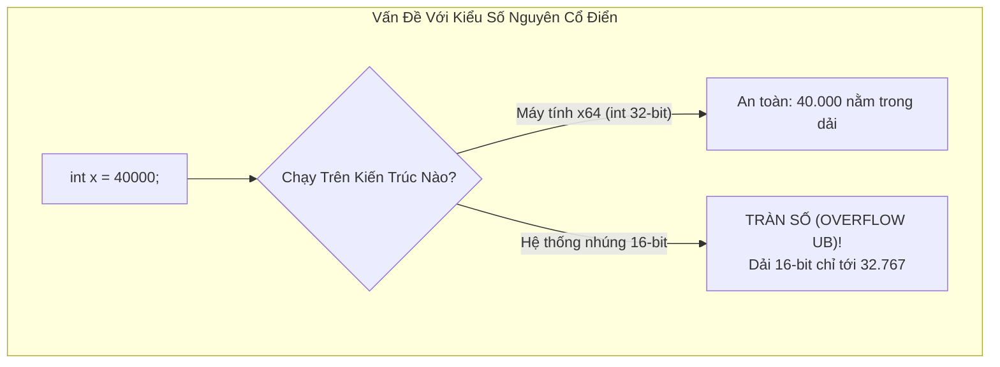
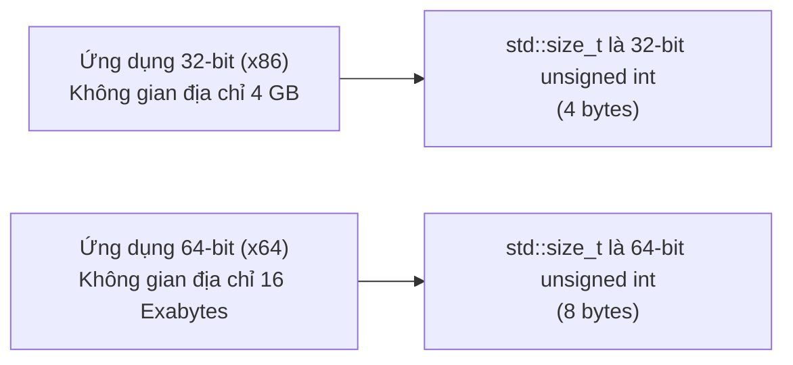

# 4.6 — Số Nguyên Độ Rộng Cố Định (Fixed-Width Integers) & `std::size_t`

---

## 🎯 Mục Tiêu Bài Học
- Hiểu rõ vì sao các kiểu số nguyên cổ điển (`int`, `long`) có kích thước không cố định và cách chuẩn C++11 giải quyết bằng **Số nguyên độ rộng cố định (Fixed-Width Integers)** trong `<cstdint>`.
- Nằm lòng bảng kiểu: `std::int8_t`, `std::int16_t`, `std::int32_t`, `std::int64_t` và các biến thể không dấu `std::uint#_t`.
- Nhận diện cạm bẫy đặc thù: **`std::int8_t` và `std::uint8_t` bị đối xử như ký tự `char`** thay vì số nguyên khi xuất bằng `std::cout`.
- Làm chủ kiểu số nguyên **`std::size_t`** trong `<cstddef>`: Kiểu biểu diễn kích thước bộ nhớ và độ dài đối tượng chuẩn mực nhất trong C++.
- Khám phá hàm cứu cánh trong **C++20**: **`std::ssize()`** giúp chuyển kích thước thành số có dấu (signed) để duyệt mảng an toàn.

---

## 1. Nguồn Gốc Lịch Sử: Vì Sao Kích Thước `int` Lại Không Cố Định?

Vào thập niên 1970 khi ngôn ngữ C ra đời, phần cứng máy tính rất phân mảnh (máy tính 8-bit, 16-bit, 36-bit, 64-bit). Để đạt hiệu năng tối thượng, cha đẻ của C quyết định không ép buộc kích thước cố định cho `int`, mà để người phát triển trình biên dịch tự chọn kích thước sao cho **phù hợp nhất với thanh ghi của CPU đích**.

Tuy nhiên, trong thế giới hiện đại đòi hỏi tính tương thích đa nền tảng (Cross-platform portability), sự mập mờ này là một hiểm họa:
- Một đoạn mã chạy đúng trên máy tính của bạn (nơi `int` là 32-bit) có thể bị **tràn số âm** khi biên dịch cho một vi điều khiển nhúng ô tô (nơi `int` chỉ có 16-bit!).



---

## 2. Số Nguyên Độ Rộng Cố Định (Fixed-Width Integers) Trong `<cstdint>`

Để xóa bỏ hoàn toàn sự không nhất quán này, chuẩn C++11 đưa vào thư viện **`<cstdint>`** bộ kiểu số nguyên có **độ rộng bit cố định 100% trên mọi nền tảng**:

| Kiểu có dấu (Signed) | Kiểu không dấu (Unsigned) | Số bit | Số byte | Dải giá trị an toàn |
| :--- | :--- | :--- | :--- | :--- |
| `std::int8_t` | `std::uint8_t` | 8 bits | 1 byte | Có dấu: $-128 \dots 127$`<br>`Không dấu: $0 \dots 255$ |
| `std::int16_t` | `std::uint16_t` | 16 bits | 2 bytes | Có dấu: $-32.768 \dots 32.767$`<br>`Không dấu: $0 \dots 65.535$ |
| **`std::int32_t`** | **`std::uint32_t`** | 32 bits | 4 bytes | Có dấu: $\approx \pm 2,14 \text{ tỷ}$`<br>`Không dấu: $0 \dots 4,29 \text{ tỷ}$ |
| **`std::int64_t`** | **`std::uint64_t`** | 64 bits | 8 bytes | Có dấu: $\approx \pm 9,22 \times 10^{18}$`<br>`Không dấu: $0 \dots 18,4 \times 10^{18}$ |

```cpp
#include <iostream>
#include <cstdint> // Bat buoc de su dung fixed-width integers

int main()
{
    std::int32_t myMoney { 1'000'000 }; // Đảm bảo 100% luôn luôn chiếm 4 bytes trên mọi CPU
    std::int64_t worldPopulation { 8'000'000'000LL }; // Đảm bảo 64-bit, lưu trọn vẹn 8 tỷ

    std::cout << "Money: " << myMoney << '\n';
    std::cout << "Population: " << worldPopulation << '\n';

    return 0;
}
```

---

## 3. ⚠️ Hộp Cạm Bẫy Thực Chiến: `std::int8_t` Bị Nhầm Thành Ký Tự!

::: danger Cạm bẫy khó chịu nhất của `std::int8_t`
Dưới góc độ kỹ thuật, các kiểu `std::int#_t` thực chất là các bí danh kiểu (`typedef` hoặc `using`) trỏ tới các kiểu cơ bản có sẵn của trình biên dịch.
Trên hầu hết mọi hệ điều hành (Windows, Linux, macOS), kiểu số nguyên 8-bit duy nhất tồn tại là **`signed char`**. Do đó:
```cpp
// Trình biên dịch định nghĩa ngầm:
using std::int8_t = signed char;
using std::uint8_t = unsigned char;
```

**Hậu quả**: Khi bạn đẩy một biến `std::int8_t` vào `std::cout`, luồng xuất sẽ **coi nó là một ký tự ASCII thay vì con số**!
```cpp
#include <iostream>
#include <cstdint>

int main()
{
    std::int8_t myNum { 65 };
    std::cout << "Gia tri: " << myNum << '\n'; // IN RA: 'A' (KÝ TỰ ASCII 65), KHÔNG PHẢI 65!

    return 0;
}
```
**Giải pháp**:
- Nếu muốn in thành số, bạn phải ép kiểu nó lên `int`:
  ```cpp
  std::cout << "Gia tri: " << static_cast<int>(myNum) << '\n'; // In ra 65 chuẩn xác
  ```
- Hoặc đơn giản là **tránh dùng `std::int8_t` cho số học**, hãy ưu tiên dùng **`std::int16_t`** hoặc `std::int32_t`.
:::

---

## 4. Kiểu `std::size_t`: Thước Đo Kích Thước Bộ Nhớ Chuẩn ISO

Khi bạn gọi toán tử `sizeof(int)`, toán tử này trả về một giá trị số nguyên. Vậy giá trị đó thuộc kiểu gì?
Câu trả lời là: **`std::size_t`** (định nghĩa trong header **`<cstddef>`**).

```cpp
#include <iostream>
#include <cstddef> // Header chuẩn chứa std::size_t

int main()
{
    int x { 42 };
    std::size_t sizeOfX { sizeof(x) }; // sizeof trả về kiểu std::size_t

    std::cout << "Kich thuoc bien x: " << sizeOfX << " bytes\n";
    std::cout << "Kich thuoc cua std::size_t: " << sizeof(std::size_t) << " bytes\n";

    return 0;
}
```



### Đặc tính cốt lõi của `std::size_t`:
1. Là kiểu **số nguyên không dấu (Unsigned)**.
2. Có kích thước phụ thuộc trực tiếp vào **độ rộng địa chỉ của kiến trúc máy tính**:
   - Trên hệ thống 32-bit: `sizeof(std::size_t) == 4 bytes`.
   - Trên hệ thống 64-bit: `sizeof(std::size_t) == 8 bytes`.
3. **Giới hạn kích thước vật lý**: Một đối tượng đơn lẻ trong C++ không bao giờ có thể có kích thước byte vượt quá giá trị cực đại mà `std::size_t` có thể biểu diễn.

---

## 5. 🚀 Đột Phá C++20: Duyệt Mảng An Toàn Với `std::ssize()`

Vì `std::size_t` là kiểu số nguyên không dấu, nó thừa hưởng toàn bộ rủi ro của lỗi tràn đáy (Underflow wrap-around) khi duyệt vòng lặp đếm lùi về 0 (như đã học ở bài 4.5):

```cpp
// VÒNG LẶP NGUY HIỂM VỚI std::size_t!
for (std::size_t i = length - 1; i >= 0; --i) // i >= 0 LUÔN ĐÚNG!
```

Để khắc phục nhược điểm này một cách triệt để, **C++20** bổ sung hàm **`std::ssize()`** (Signed Size) trong header `<iterator>`. Hàm này trả về kích thước của chuỗi hoặc mảng dưới dạng một **số nguyên có dấu (Signed)**:

```cpp
#include <iostream>
#include <vector>
#include <iterator> // Chứa std::ssize từ C++20

int main()
{
    std::vector<int> numbers { 10, 20, 30, 40, 50 };

    // std::ssize trả về kiểu ptrdiff_t (có dấu) -> Đếm lùi an toàn 100%!
    for (auto i { std::ssize(numbers) - 1 }; i >= 0; --i)
    {
        std::cout << numbers[static_cast<std::size_t>(i)] << ' ';
    }

    return 0;
}
```

---

## 6. 💡 Bảng Hướng Dẫn Thực Hành Chọn Kiểu Số Nguyên Chuẩn Mực

::: tip Lược đồ chọn kiểu số nguyên của kỹ sư C++ chuyên nghiệp
1. **Mặc định chọn `int`**: Áp dụng cho 90% biến số thông thường (biến đếm, tuổi tác, điểm số) nơi dữ liệu chắc chắn nằm trong khoảng $\pm 2$ tỷ.
2. **Chọn `std::int64_t`**: Khi cần lưu trữ các con số lớn hơn 2 tỷ (ID tài khoản ngân hàng, dân số, kích thước file theo byte, mốc thời gian Unix timestamp tính bằng mili-giây).
3. **Chọn `std::int32_t` / `std::int16_t`**: Khi thiết kế cấu trúc dữ liệu mạng (Network packets), định dạng tệp tin nhị phân (Binary file formats) hoặc mảng đồ họa lớn nơi kích thước byte phải chuẩn xác tuyệt đối trên mọi hệ điều hành.
4. **Chọn `std::size_t`**: Cho các biến lưu độ dài mảng, chỉ số phần tử container STL, hoặc kết quả đo lường bộ nhớ của `sizeof`.
5. **Tránh xa các kiểu Fast / Least**: Các kiểu `std::int_fast#_t` và `std::int_least#_t` có kích thước không nhất quán giữa các trình biên dịch, dễ gây lỗi khó đoán.
:::

---

## 7. 📝 Hệ Thống Quiz & Bài Tập Tự Luyện

::: details Câu hỏi 1: Sự khác biệt cơ bản giữa `int` và `std::int32_t` là gì?
**Lời giải chi tiết**:
- **`int`**: Là kiểu dữ liệu cơ bản nguyên thủy của C++. Chuẩn ISO chỉ đảm bảo nó có kích thước tối thiểu là 16-bit. Kích thước thực tế do trình biên dịch quy định (thường là 32-bit trên PC hiện đại, nhưng hoàn toàn có thể là 16-bit trên các vi điều khiển nhúng).
- **`std::int32_t`**: Là kiểu số nguyên độ rộng cố định được định nghĩa trong `<cstdint>`. Chuẩn ISO C++ đảm bảo trên mọi kiến trúc hỗ trợ nó, `std::int32_t` **luôn luôn có kích thước chính xác là 32-bit (4 bytes)** và sử dụng biểu diễn mã bù 2, không bao giờ thay đổi dù chạy trên bất kỳ hệ điều hành nào.
:::

::: details Câu hỏi 2: Đoạn mã sau in ra gì trên màn hình console? Hãy giải thích nguyên nhân.
```cpp
#include <iostream>
#include <cstdint>

int main()
{
    std::uint8_t code { 66 };
    std::cout << code << '\n';
    return 0;
}
```
**Lời giải chi tiết**:
- Đoạn mã sẽ in ra ký tự: **`B`** (chứ không in số `66`).
- **Nguyên nhân**: Trên hầu hết các trình biên dịch hiện nay, `std::uint8_t` được định nghĩa là bí danh của kiểu `unsigned char`. Khi toán tử `<<` của `std::cout` tiếp nhận một giá trị kiểu `char` hoặc `unsigned char`, nó diễn giải giá trị đó là mã ký tự ASCII và xuất ra hình dạng ký tự tương ứng (mã ASCII `66` đại diện cho chữ cái viết hoa `'B'`).
- Nếu muốn in ra con số `66`, ta phải ép kiểu nó lên số nguyên: `std::cout << static_cast<int>(code) << '\n';`.
:::
