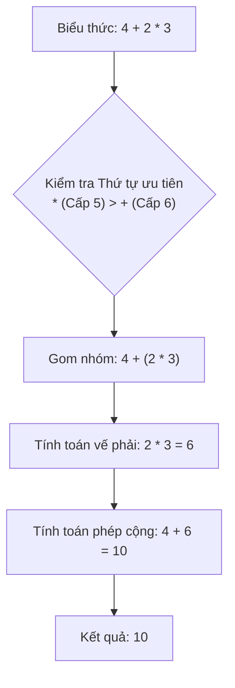

# 6.1 — Thứ Tự Ưu Tiên và Tính Kết Hợp của Toán Tử (Operator Precedence and Associativity)

---

## 🎯 Mục Tiêu Bài Học
- Hiểu cách trình biên dịch C++ phân tích các biểu thức phức hợp (Compound Expressions).
- Phân biệt rõ ràng giữa **Thứ tự ưu tiên** (Precedence) và **Tính kết hợp** (Associativity).
- Nắm vững bảng 17 cấp độ ưu tiên toán tử trong chuẩn ISO C++.
- Nhận thức sâu sắc về **Thứ tự đánh giá toán hạng (Order of Evaluation)** và sự khác biệt với độ ưu tiên.

---

## 1. Biểu Thức Phức Hợp và Vấn Đề Gom Nhóm

Một **biểu thức** (expression) là sự kết hợp giữa các giá trị thực (literals), biến số và toán tử để tạo ra một giá trị kết quả. Khi một biểu thức chứa nhiều hơn một toán tử, ví dụ:

```cpp
int x { 4 + 2 * 3 };
```

Kết quả của `x` sẽ là `18` hay `10`? 
- Nếu thực hiện `(4 + 2) * 3` thì kết quả là `18`.
- Nếu thực hiện `4 + (2 * 3)` thì kết quả là `10`.

Từ trường học, chúng ta đều biết quy tắc "nhân chia trước, cộng trừ sau". Trình biên dịch C++ cũng áp dụng nguyên tắc tương tự thông qua hai cơ chế chuẩn hóa: **Thứ tự ưu tiên (Precedence)** và **Tính kết hợp (Associativity)**.



---

## 2. Thứ Tự Ưu Tiên Của Toán Tử (Operator Precedence)

Để phân tích biểu thức, mọi toán tử trong C++ được gán một cấp độ ưu tiên (Precedence Level) từ **1 đến 17**:
- **Cấp độ 1** là cấp độ ưu tiên **cao nhất** (ví dụ: toán tử phân giải phạm vi `::`).
- **Cấp độ 17** là cấp độ ưu tiên **thấp nhất** (toán tử dấu phẩy `,`).
- Các toán tử có cấp độ ưu tiên cao hơn sẽ được gom nhóm với các toán hạng trước các toán tử có cấp độ ưu tiên thấp hơn.

Vì phép nhân `*` nằm ở Cấp 5 và phép cộng `+` nằm ở Cấp 6, trình biên dịch sẽ tự động gom nhóm `2 * 3` trước, biến biểu thức thành `4 + (2 * 3)`.

---

## 3. Tính Kết Hợp Của Toán Tử (Operator Associativity)

Điều gì xảy ra khi hai toán tử liền kề có **cùng cấp độ ưu tiên**? Hãy xem xét:

```cpp
int y { 7 - 4 - 1 };
```

Phép trừ `-` và phép trừ `-` có cùng cấp độ ưu tiên (Cấp 6). Trình biên dịch sẽ chọn cách gom nhóm nào?
- `(7 - 4) - 1 = 2`?
- Hay `7 - (4 - 1) = 4`?

Lúc này, **Tính kết hợp (Associativity)** sẽ can thiệp:
1. **Từ Trái sang Phải (Left-to-Right - L->R)**: Phổ biến ở hầu hết toán tử 2 ngôi số học, so sánh, logic. Biểu thức được gom nhóm từ trái qua phải: `(7 - 4) - 1 = 2`.
2. **Từ Phải sang Trái (Right-to-Left - R->L)**: Áp dụng cho các toán tử 1 ngôi (Unary operators như `++`, `--`, `!`), toán tử điều kiện `?:`, và các toán tử gán (`=`, `+=`, v.v.).

Ví dụ về tính kết hợp từ phải sang trái của toán tử gán:
```cpp
int a, b, c;
a = b = c = 5; // Gom nhóm thành: a = (b = (c = 5))
```

---

## 4. Bảng Tra Cứu Toàn Diện 17 Cấp Độ Ưu Tiên Trong C++

| Cấp | Toán tử | Tên toán tử | Tính kết hợp |
| :---: | :--- | :--- | :---: |
| **1** | `::` | Phân giải phạm vi toàn cục / namespace / class | L->R |
| **2** | `()`<br>`[]`<br>`.`<br>`->`<br>`++`<br>`--`<br>`typeid`<br>`cast` | Gọi hàm<br>Chỉ mục mảng<br>Truy cập thành viên trực tiếp<br>Truy cập thành viên qua con trỏ<br>Hậu tố tăng / giảm<br>Định danh kiểu runtime<br>`static_cast`, `const_cast`, `dynamic_cast`, `reinterpret_cast` | L->R |
| **3** | `+`<br>`-`<br>`++`<br>`--`<br>`!`<br>`~`<br>`(type)`<br>`*`<br>`&`<br>`sizeof`<br>`co_await` | Dấu dương / âm 1 ngôi<br>Tiền tố tăng / giảm<br>Phủ định logic (NOT)<br>Đảo bit (Bitwise NOT)<br>Ép kiểu kiểu C<br>Giải tham chiếu con trỏ (Dereference)<br>Lấy địa chỉ bộ nhớ (Address-of)<br>Đo kích thước kiểu/biến<br>Coroutine await (C++20) | R->L |
| **4** | `.*`<br>`->*` | Con trỏ tới thành viên | L->R |
| **5** | `*`<br>`/`<br>`%` | Phép nhân số học<br>Phép chia số học<br>Phép chia lấy phần dư | L->R |
| **6** | `+`<br>`-` | Phép cộng số học<br>Phép trừ số học | L->R |
| **7** | `<<`<br>`>>` | Dịch bit trái (hoặc xuất stream)<br>Dịch bit phải (hoặc nhập stream) | L->R |
| **8** | `<=>` | Toán tử so sánh ba chiều (Spaceship operator - C++20) | L->R |
| **9** | `<`<br>`<=`<br>`>`<br>`>=` | Nhỏ hơn<br>Nhỏ hơn hoặc bằng<br>Lớn hơn<br>Lớn hơn hoặc bằng | L->R |
| **10** | `==`<br>`!=` | So sánh bằng<br>So sánh khác | L->R |
| **11** | `&` | Phép toán Bitwise AND | L->R |
| **12** | `^` | Phép toán Bitwise XOR | L->R |
| **13** | `\|` | Phép toán Bitwise OR | L->R |
| **14** | `&&` | Phép toán Logical AND | L->R |
| **15** | `\|\|` | Phép toán Logical OR | L->R |
| **16** | `?:`<br>`=`<br>`+=`, `-=`, v.v.<br>`throw`<br>`co_yield` | Toán tử điều kiện ba ngôi<br>Toán tử gán giá trị<br>Các toán tử gán phức hợp<br>Ném ngoại lệ<br>Coroutine yield (C++20) | R->L |
| **17** | `,` | Toán tử dấu phẩy (Comma operator) | L->R |

---

## 5. Cạm Bẫy Lớn: Phân Biệt Precedence vs Order of Evaluation

::: warning ⚠️ Cạm Bẫy Tối Thượng: Thứ Tự Ưu Tiên KHÔNG Phải Thứ Tự Tính Toán!
Rất nhiều lập trình viên hiểu lầm rằng: Toán tử có độ ưu tiên cao hơn thì các toán hạng của nó sẽ được tính toán trước. **ĐÂY LÀ QUAN ĐIỂM SAI HOÀN TOÀN TRONG C++!**

- **Precedence & Associativity** chỉ xác định cách **gom nhóm toán tử với toán hạng** (Ai là toán hạng của ai).
- **Order of Evaluation**: Xác định thứ tự các hàm hoặc biểu thức con được thực thi tại runtime.

Xét ví dụ kinh điển:
```cpp
int a() { std::cout << "a"; return 1; }
int b() { std::cout << "b"; return 2; }
int c() { std::cout << "c"; return 3; }

int main()
{
    // Phép nhân có độ ưu tiên cao hơn phép cộng!
    // Gom nhóm: a() + (b() * c())
    int result = a() + b() * c();
}
```
Mặc dù `b() * c()` được gom nhóm trước, chuẩn C++ **KHÔNG HỀ QUY ĐỊNH** `b()` hay `c()` phải được gọi trước `a()`. Trình biên dịch hoàn toàn có quyền gọi `a()` trước, hoặc `c()` trước, hoặc `b()` trước (đây là **Unspecified Behavior**). Thứ tự in ra màn hình có thể là `abc`, `cba`, hoặc `bac` tùy compiler!
:::

::: tip 💡 Cập Nhật Chuẩn C++17
Từ C++17, chuẩn đã siết chặt thứ tự đánh giá cho một số trường hợp:
1. Trong `a.b`, `a->b`, `a[b]`: Biểu thức `a` được tính trước `b`.
2. Trong phép gán `a = b` hoặc `a += b`: Vế phải `b` được tính toán xong trước vế trái `a`.
3. Trong toán tử dịch bit `std::cout << a << b`: `a` được tính trước `b`.
Tuy nhiên, với các phép toán 2 ngôi như `+`, `-`, `*`, thứ tự đánh giá giữa 2 toán hạng **vẫn là unspecified**.
:::

::: tip 💡 Thực Hành Tốt Nhất (Best Practice)
1. **Luôn sử dụng dấu ngoặc đơn `()`**: Đừng ép bản thân hay đồng đội phải thuộc lòng 17 cấp độ ưu tiên. Hãy dùng `()` để tường minh hóa ý đồ logic: `(a & b) == 0` thay vì `a & b == 0`.
2. **Tránh phụ thuộc vào thứ tự gọi hàm trong cùng 1 biểu thức**: Tuyệt đối không viết `func(get_x(), get_x_next())` nếu hai hàm có hiệu ứng phụ (side effects) làm thay đổi trạng thái của nhau.
:::

---

## 📝 Hệ Thống Quiz & Bài Tập Tự Luyện

### Câu hỏi 1:
Biểu thức sau được gom nhóm như thế nào theo chuẩn C++? Giá trị trả về là bao nhiêu?
```cpp
int val = 12 / 2 * 3;
```
::: details [Xem lời giải]
- Phép chia `/` và phép nhân `*` đều có độ ưu tiên Cấp 5, tính kết hợp từ Trái sang Phải (L->R).
- Do đó, biểu thức được gom nhóm: `(12 / 2) * 3`.
- Tính `12 / 2 = 6`, sau đó `6 * 3 = 18`.
- Kết quả là `18` (nếu gom nhóm sai thành `12 / (2 * 3)` sẽ ra 2).
:::

### Câu hỏi 2:
Đoạn code sau có lỗi logic gì cực kỳ nguy hiểm?
```cpp
int flags = 0b0000'0101;
int mask  = 0b0000'0001;

if (flags & mask == 1) // Kiểm tra cờ có bật không?
{
    std::cout << "Flag is set!
";
}
```
::: details [Xem lời giải]
- Theo bảng ưu tiên: Toán tử so sánh `==` (Cấp 10) có độ ưu tiên cao hơn toán tử bitwise AND `&` (Cấp 11).
- Trình biên dịch sẽ gom nhóm thành: `flags & (mask == 1)`.
- `mask == 1` trả về `true` (tương đương 1).
- Sau đó `flags & 1` = `0b0101 & 0b0001 = 1` (chuyển sang bool là `true`).
- Trường hợp này vô tình ra đúng, nhưng nếu kiểm tra bit khác: `flags & mask == 4` sẽ bị biến thành `flags & (mask == 4)` -> `flags & 0 = 0` (luôn `false`)!
- **Cách sửa đúng**: Bắt buộc dùng dấu ngoặc: `if ((flags & mask) == 1)`.
:::
