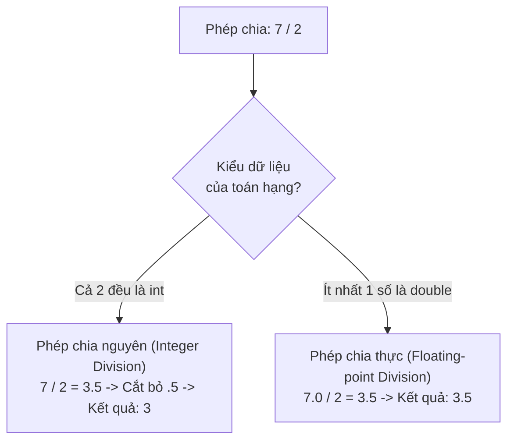

# 6.2 — Các Toán Tử Số Học (Arithmetic Operators)

---

## 🎯 Mục Tiêu Bài Học
- Nắm vững 5 toán tử số học cơ bản: Cộng (`+`), Trừ (`-`), Nhân (`*`), Chia (`/`), Chia lấy dư (`%`).
- Hiểu sâu bản chất phép chia số nguyên (Integer Division) và cách ép kiểu sang số thực.
- Phân biệt toán tử dấu 1 ngôi (Unary plus/minus) và toán tử 2 ngôi (Binary plus/minus).
- Nhận thức nguy cơ Undefined Behavior (UB) khi chia cho 0 và tràn số nguyên có dấu (Signed Integer Overflow).

---

## 1. Tổng Quan Về Các Toán Tử Số Học

C++ cung cấp 5 toán tử số học nhị phân (Binary arithmetic operators):

| Toán tử | Ý nghĩa toán học | Ví dụ | Kết quả |
| :---: | :--- | :--- | :--- |
| `+` | Phép cộng | `7 + 2` | `9` |
| `-` | Phép trừ | `7 - 2` | `5` |
| `*` | Phép nhân | `7 * 2` | `14` |
| `/` | Phép chia | `7 / 2` | `3` (với số nguyên) |
| `%` | Phép chia lấy dư | `7 % 2` | `1` |

Ngoài ra, C++ có 2 toán tử một ngôi (Unary arithmetic operators):
- **Unary minus (`-`)**: Đổi dấu toán hạng (ví dụ: `-x`).
- **Unary plus (`+`)**: Giữ nguyên dấu, nhưng thực hiện **Integer Promotion** (ví dụ: chuyển `char` thành `int`).

---

## 2. Phép Chia Số Nguyên (Integer Division) và Cắt Bỏ Phần Thập Phân

Khi thực hiện phép chia giữa hai số nguyên, C++ **không sinh ra số thực**. Thay vào đó, nó thực hiện phép chia số nguyên: phần thập phân bị **cắt bỏ hoàn toàn (truncated/dropped)**, không làm tròn.



```cpp
#include <iostream>

int main()
{
    std::cout << 7 / 2 << '
';     // In ra 3
    std::cout << -7 / 2 << '
';    // In ra -3 (cắt về hướng số 0)
    
    // Để có kết quả số thực, ít nhất 1 toán hạng phải có kiểu dấu phẩy động
    std::cout << 7.0 / 2 << '
';   // In ra 3.5
    std::cout << 7 / 2.0 << '
';   // In ra 3.5
    std::cout << static_cast<double>(7) / 2 << '
'; // In ra 3.5
    
    return 0;
}
```

---

## 3. Cạm Bẫy Thực Chiến: Chia Cho 0 và Tràn Số

::: warning ⚠️ Cạm Bẫy 1: Chia Cho 0 (Division by Zero)
Trong C++, việc chia một số nguyên cho `0` (hoặc lấy dư cho `0`) là **Undefined Behavior (UB)**!
Trên thực tế, CPU sẽ phát tín hiệu ngắt phần cứng (Hardware Interrupt / SIGFPE), khiến chương trình sập ngay lập tức (Crash).

```cpp
int x { 10 };
int y { 0 };
std::cout << x / y; // 💥 CRASH: Integer division by zero!
```

Đối với số thực (floating point), chia cho `0.0` theo chuẩn IEEE 754 sẽ không sập mà trả về giá trị đặc biệt `inf` (vô cực) hoặc `-inf`:
```cpp
std::cout << 5.0 / 0.0;  // In ra inf
std::cout << -5.0 / 0.0; // In ra -inf
std::cout << 0.0 / 0.0;  // In ra nan (Not a Number)
```
:::

::: warning ⚠️ Cạm Bẫy 2: Tràn Số Nguyên Có Dấu (Signed Overflow) Là UB!
Trong chuẩn ISO C++:
- **Tràn số có dấu (Signed Integer Overflow)**: Là **Undefined Behavior (UB)**. Trình biên dịch có quyền giả định hiện tượng này không bao giờ xảy ra và tối ưu hóa loại bỏ mã kiểm tra!
- **Tràn số không dấu (Unsigned Integer Overflow)**: Được định nghĩa rõ là quay vòng modulo $2^n$ (Wrap around).

```cpp
#include <limits>
#include <iostream>

int main()
{
    int maxInt { std::numeric_limits<int>::max() };
    int overflowed { maxInt + 1 }; // ⚠️ UNDEFINED BEHAVIOR!
    std::cout << overflowed << '
';
}
```
:::

---

## 4. Thực Hành Tốt Nhất (Best Practices)

::: tip 💡 Lời Khuyên Chuyên Gia
1. **Luôn kiểm tra mẫu số trước khi chia**:
   ```cpp
   if (b == 0) {
       // Xử lý lỗi hoặc thông báo không hợp lệ
   } else {
       int result = a / b;
   }
   ```
2. **Dùng `static_cast` khi cần kết quả số thực**: Không dùng ép kiểu kiểu C cổ điển `(double)a / b`. Hãy dùng `static_cast<double>(a) / b`.
3. **Cẩn thận khi lưu kết quả phép nhân**: Tích của hai số nguyên kiểu `int` 32-bit có thể vượt quá $2 	imes 10^9$. Hãy ép kiểu sang `std::int64_t` trước khi nhân:
   ```cpp
   int a = 1'000'000;
   int b = 1'000'000;
   long long c = static_cast<long long>(a) * b; // An toàn!
   ```
:::

---

## 📝 Hệ Thống Quiz & Bài Tập Tự Luyện

### Câu hỏi 1:
Đoạn mã sau in ra giá trị gì?
```cpp
double avg = 5 / 2;
std::cout << avg;
```
A) `2.5`  
B) `2`  
C) `2.0`  
D) Lỗi biên dịch  

::: details [Xem lời giải]
**Đáp án: C (`2.0` hoặc `2` tùy định dạng cout).**  
Giải thích: Biểu thức `5 / 2` thực hiện phép chia số nguyên trước, cho kết quả là `int` có giá trị `2`. Sau đó, giá trị `2` mới được ngầm định chuyển đổi (implicit conversion) thành `double` và gán vào `avg` thành `2.0`. Để nhận `2.5`, phải viết `5.0 / 2` hoặc `5 / 2.0`.
:::

### Bài tập code 2:
Viết chương trình nhập vào một số nguyên giây (ví dụ: 3665 giây) và chuyển đổi thành định dạng Giờ : Phút : Giây (ví dụ: `1 giờ 1 phút 5 giây`) sử dụng các toán tử `/` và `%`.

::: details [Xem lời giải]
```cpp
#include <iostream>

int main()
{
    std::cout << "Nhập số giây: ";
    int totalSeconds {};
    if (!(std::cin >> totalSeconds) || totalSeconds < 0)
    {
        std::cout << "Dữ liệu không hợp lệ!
";
        return 1;
    }

    int hours   { totalSeconds / 3600 };
    int minutes { (totalSeconds % 3600) / 60 };
    int seconds { totalSeconds % 60 };

    std::cout << totalSeconds << " giây = " 
              << hours << " giờ, " 
              << minutes << " phút, " 
              << seconds << " giây.
";

    return 0;
}
```
:::
