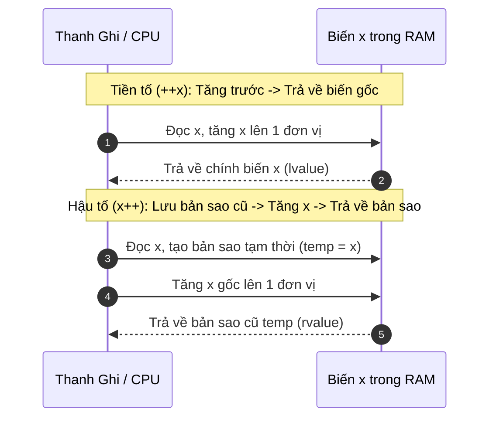

# 6.4 — Toán Tử Tăng / Giảm và Hiệu Ứng Phụ (Increment / Decrement Operators and Side Effects)

---

## 🎯 Mục Tiêu Bài Học
- Phân biệt triệt để giữa toán tử Tiền tố (Prefix `++x`) và Hậu tố (Postfix `x++`).
- Nắm rõ giá trị trả về: Tiền tố trả về lvalue reference, Hậu tố trả về rvalue copy.
- Hiểu khái niệm Hiệu ứng phụ (**Side Effect**) và Điểm trình tự (**Sequence Point**).
- Nhận diện các biểu thức gây **Undefined Behavior** kinh điển liên quan đến tăng/giảm biến.

---

## 1. Tiền Tố vs Hậu Tố: Bản Chất Ở Cấp Độ Bộ Nhớ

Toán tử tăng (`++`) và giảm (`--`) dùng để tăng hoặc giảm giá trị của biến đi 1 đơn vị. Tuy nhiên, thời điểm áp dụng phép tăng và giá trị trả về hoàn toàn khác nhau:



| Đặc điểm | Tiền tố (`++x`, `--x`) | Hậu tố (`x++`, `x--`) |
| :--- | :--- | :--- |
| **Cơ chế thực hiện** | Tăng biến lên 1, sau đó trả về chính biến đó | Lưu bản sao giá trị cũ, tăng biến lên 1, trả về giá trị cũ |
| **Giá trị trả về** | **lvalue** (có thể gán tiếp: `++x = 5`) | **rvalue** (giá trị tạm, không thể gán: `x++ = 5` báo lỗi) |
| **Hiệu năng (Performance)** | Tối ưu tuyệt đối (không tạo đối tượng tạm) | Tốn chi phí tạo bản sao tạm (rất rõ rệt với Iterator phức tạp) |

Xem ví dụ minh họa:
```cpp
#include <iostream>

int main()
{
    int x { 5 };
    int y = ++x; // x tăng lên 6, y nhận giá trị 6
    std::cout << "x: " << x << ", y: " << y << '
'; // 6, 6

    int a { 5 };
    int b = a++; // b nhận giá trị cũ là 5, sau đó a tăng lên 6
    std::cout << "a: " << a << ", b: " << b << '
'; // 6, 5

    return 0;
}
```

---

## 2. Hiệu Ứng Phụ (Side Effects) Là Gì?

Một hàm hoặc một biểu thức được coi là có **hiệu ứng phụ (side effect)** nếu nó làm thay đổi bất kỳ trạng thái nào bên ngoài phạm vi cục bộ trực tiếp của nó:
- Thay đổi giá trị của một biến trong bộ nhớ (`x = 5`, `++x`).
- Ghi dữ liệu ra màn hình console (`std::cout << ...`) hoặc ghi vào tệp tin.
- Gửi gói tin qua mạng.

Cả `++x` và `x++` đều có side effect là biến đổi giá trị của `x`.

---

## 3. Cạm Bẫy Chết Người: Thay Đổi Biến Nhiều Lần Trong Cùng Biểu Thức

::: danger 🚨 CỰC KỲ NGUY HIỂM: Undefined Behavior
Xem xét đoạn mã sau:
```cpp
int x { 1 };
int val = x + ++x; // 💥 UNDEFINED BEHAVIOR!
```
Hoặc:
```cpp
void print(int a, int b);
print(x, ++x);     // 💥 UNDEFINED BEHAVIOR / UNSPECIFIED!
```
Hoặc:
```cpp
x = x++;           // 💥 UNDEFINED BEHAVIOR!
```

**Tại sao lại như vậy?**
Chuẩn C++ không đảm bảo thứ tự thời gian chính xác khi nào side effect của `++x` được ghi lại vào RAM so với việc đọc giá trị của `x`. 
- Một trình biên dịch có thể đọc `x` (1) trước, rồi tính `++x` (2), kết quả $1 + 2 = 3$.
- Một trình biên dịch khác có thể tính `++x` (2) trước, rồi đọc cả hai vế là 2, kết quả $2 + 2 = 4$!
- Tệ hơn nữa, trình tối ưu hóa (optimizer) có thể sinh ra mã máy gây lỗi logic hoàn toàn.
:::

---

## 4. Thực Hành Tốt Nhất (Best Practices)

::: tip 💡 Quy Tắc Vàng Khi Dùng `++` và `--`
1. **Luôn ưu tiên toán tử Tiền tố (`++x`)**:
   Khi bạn chỉ muốn tăng giá trị mà không quan tâm giá trị trả về (như trong vòng lặp `for (int i=0; i<n; ++i)`), **hãy luôn dùng `++i` thay vì `i++`**. Đối với các kiểu phức tạp như iterator trong STL, tiền tố giúp tránh việc sao chép đối tượng tạm thời thừa thãi.
2. **Một biến chỉ được xuất hiện một lần nếu có side effect**:
   Tuyệt đối không đọc và ghi vào cùng một biến nhiều lần trong cùng một câu lệnh. Nếu cần tăng biến và sử dụng, hãy tách thành các câu lệnh độc lập:
   ```cpp
   // ❌ KHÔNG VIẾT:
   int result = x + ++x;

   // ✅ HÃY VIẾT:
   ++x;
   int result = x + x;
   ```
:::

---

## 📝 Hệ Thống Quiz & Bài Tập Tự Luyện

### Câu hỏi 1:
Đoạn mã sau in ra kết quả gì?
```cpp
int x { 10 };
int y { 20 };
std::cout << ++x << ' ' << y-- << '
';
std::cout << x << ' ' << y << '
';
```
::: details [Xem lời giải]
- Dòng 1: `++x` tăng `x` lên 11 và trả về 11. `y--` trả về giá trị cũ là 20 rồi mới giảm `y` xuống 19.
  -> In ra: `11 20`.
- Dòng 2: In ra giá trị hiện tại của `x` và `y`.
  -> In ra: `11 19`.
:::

### Câu hỏi 2:
Giải thích tại sao biểu thức `++x = 10;` là hợp lệ trong C++, nhưng `x++ = 10;` lại gây lỗi biên dịch?
::: details [Xem lời giải]
- `++x` (tiền tố) trả về **lvalue reference** (chính là biến `x` trong bộ nhớ). Một lvalue có thể nằm ở vế trái của phép gán, nên `++x = 10;` hợp lệ (gán 10 vào `x`).
- `x++` (hậu tố) trả về một **rvalue** (giá trị tạm thời lưu giá trị cũ của `x`). Giá trị tạm thời không có địa chỉ định danh cố định để gán giá trị vào, do đó trình biên dịch sẽ báo lỗi: `lvalue required as left operand of assignment`.
:::
