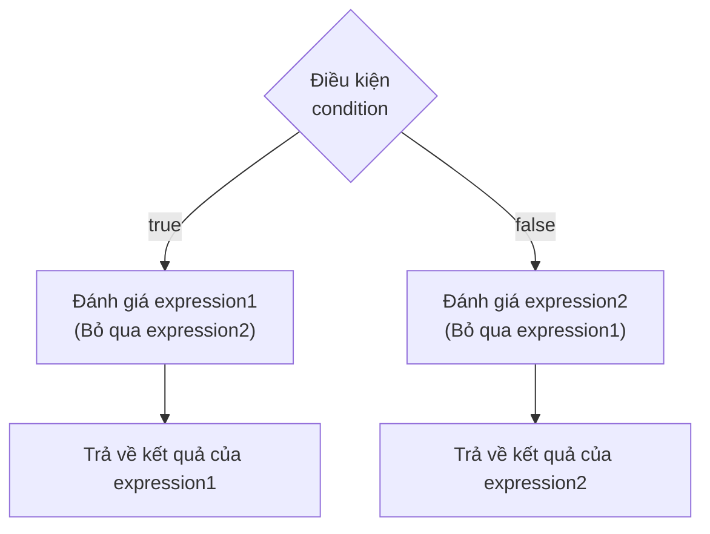

# 6.6 — Toán Tử Điều Kiện Ba Ngôi (The Conditional Operator)

---

## 🎯 Mục Tiêu Bài Học
- Hiểu cú pháp và cơ chế của toán tử duy nhất nhận 3 toán hạng trong C++: `condition ? expr1 : expr2`.
- Phân biệt sự khác nhau cốt lõi giữa **Câu lệnh `if-else` (Statement)** và **Toán tử điều kiện (Expression)**.
- Khởi tạo biến `const` tiện lợi thông qua toán tử điều kiện.
- Nắm vững quy tắc chuyển đổi kiểu chung (Common Type Conversion) giữa hai nhánh `expr1` và `expr2`.

---

## 1. Cú Pháp và Cơ Chế Hoạt Động

Toán tử điều kiện (Conditional Operator, thường gọi là **Ternary Operator**) có cú pháp:

```cpp
condition ? expression1 : expression2;
```



Quy tắc thực thi:
1. `condition` được đánh giá thành kiểu `bool`.
2. Nếu `condition` là `true`, chỉ có `expression1` được tính toán, và kết quả của `expression1` là giá trị trả về của cả biểu thức. `expression2` hoàn toàn bị bỏ qua.
3. Nếu `condition` là `false`, chỉ có `expression2` được tính toán, và kết quả của `expression2` là giá trị trả về. `expression1` hoàn toàn bị bỏ qua.

---

## 2. Vì Sao Chúng Ta Cần Toán Tử Điều Kiện Thay Vì `if-else`?

Khác biệt bản chất:
- `if-else` là một **câu lệnh (Statement)**: Nó không trả về giá trị, chỉ điều khiển luồng thực thi.
- `?:` là một **biểu thức (Expression)**: Nó sinh ra một giá trị cụ thể, có thể gán vào biến hoặc truyền vào hàm.

### Ứng dụng đỉnh cao 1: Khởi tạo biến hằng `const`
Nếu dùng `if-else`, bạn không thể khởi tạo biến `const` dựa trên điều kiện:
```cpp
// ❌ LỖI VỚI IF-ELSE:
const int maxVal; // Lỗi biên dịch: Biến const bắt buộc phải khởi tạo ngay!
if (a > b)
    maxVal = a;   // Lỗi: Không thể gán lại biến const!
else
    maxVal = b;

// ✅ GIẢI QUYẾT BẰNG TOÁN TỬ ĐIỀU KIỆN:
const int maxVal { (a > b) ? a : b }; // Hoàn hảo! Khởi tạo trực tiếp biến const.
```

### Ứng dụng đỉnh cao 2: Nhúng trực tiếp vào luồng xuất Stream
```cpp
std::cout << "Bạn có " << count << " " << ((count == 1) ? "tin nhắn" : "các tin nhắn") << '
';
```

---

## 3. Cạm Bẫy 1: Độ Ưu Tiên Thấp So Với Toán Tử Xuất Stream `<<`

Toán tử điều kiện nằm ở Cấp độ 16, có độ ưu tiên thấp hơn hầu hết các toán tử khác, bao gồm cả toán tử xuất dòng `<<` (Cấp 7) và phép toán số học:

::: warning ⚠️ Cạm bẫy khi in trực tiếp với `std::cout`
```cpp
int x { 5 };
std::cout << (x > 0) ? "Duong" : "Am"; // 💥 LỖI LOGIC NGHIÊM TRỌNG!
```
Do `<<` có độ ưu tiên cao hơn `?:`, trình biên dịch sẽ gom nhóm thành:
```cpp
(std::cout << (x > 0)) ? "Duong" : "Am";
```
Nó sẽ in ra màn hình số `1` (kết quả của `x > 0`), sau đó kiểm tra stream có hợp lệ không và bỏ qua chuỗi `"Duong"`!

**Cách viết đúng**: Bắt buộc phải bọc toàn bộ biểu thức ba ngôi trong dấu ngoặc đơn:
```cpp
std::cout << ((x > 0) ? "Duong" : "Am"); // ✅ In ra "Duong"
```
:::

---

## 4. Cạm Bẫy 2: Ép Kiểu Chung Giữa Hai Nhánh (Common Type Conversion)

Trong C++, hai nhánh `expression1` và `expression2` **phải có kiểu dữ liệu có thể chuyển đổi tương thích với nhau**. Trình biên dịch phải xác định một **kiểu dữ liệu chung (Common type)** ngay tại thời điểm biên dịch, bất kể điều kiện runtime là đúng hay sai!

```cpp
#include <iostream>

int main()
{
    constexpr bool flag { true };
    
    // Nhánh 1 là int (1), nhánh 2 là double (2.0)
    // Kiểu chung giữa int và double là double!
    auto result = flag ? 1 : 2.0;

    std::cout << result << '
'; // In ra 1 (kiểu double, tức 1.0)
    std::cout << sizeof(result) << '
'; // In ra 8 bytes (sizeof(double))!
    return 0;
}
```

Nếu hai nhánh có kiểu hoàn toàn không thể chuyển đổi qua lại (ví dụ một bên là `int`, một bên là `std::string`), trình biên dịch sẽ báo lỗi cú pháp ngay lập tức:
```cpp
auto x = flag ? 5 : "Hello"; // ❌ Lỗi biên dịch: Không tìm thấy kiểu chung!
```

---

## 5. Thực Hành Tốt Nhất (Best Practices)

::: tip 💡 Lời Khuyên Thiết Kế Code
1. **Luôn đặt biểu thức điều kiện trong dấu ngoặc đơn**: Viết `(x > 0) ? a : b` thay vì `x > 0 ? a : b` để tăng độ rõ ràng.
2. **Không lồng ghép toán tử ba ngôi (Nested Ternary)**:
   ```cpp
   // ❌ KHÔNG NÊN: Cực kỳ hại não, dễ sinh bug
   int res = a > b ? (c > d ? 1 : 2) : (e > f ? 3 : 4);

   // ✅ HÃY DÙNG IF-ELSE TƯỜNG MINH!
   ```
3. **Chỉ dùng cho các biểu thức đơn giản, ngắn gọn**.
:::

---

## 📝 Hệ Thống Quiz & Bài Tập Tự Luyện

### Câu hỏi 1:
Đoạn code sau in ra màn hình những gì?
```cpp
int count { 1 };
(count == 1) ? std::cout << "Mot" : std::cout << "Nhieu";
```
::: details [Xem lời giải]
Mã in ra: `Mot`.  
Mặc dù hợp lệ vì cả hai nhánh đều trả về kiểu `std::ostream&`, nhưng phong cách này không được khuyến khích vì dùng toán tử điều kiện như một câu lệnh thực thi side-effect. Nên viết:
`std::cout << ((count == 1) ? "Mot" : "Nhieu");`
:::
