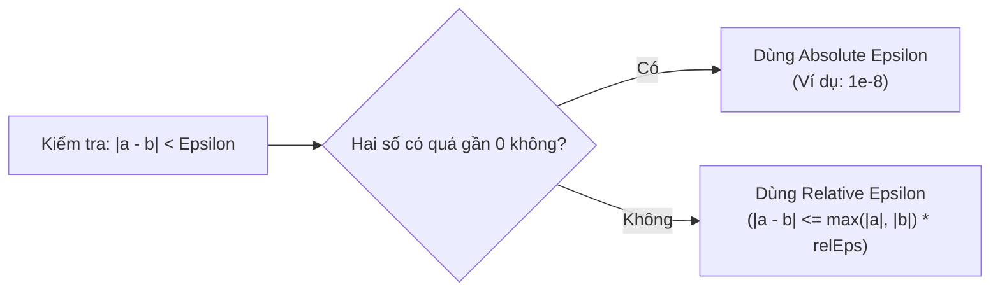

# 6.7 — Toán Tử Quan Hệ và So Sánh Số Thực (Relational Operators and Floating Point Comparisons)

---

## 🎯 Mục Tiêu Bài Học
- Nắm vững 6 toán tử quan hệ chuẩn: `<`, `<=`, `>`, `>=`, `==`, `!=`.
- Hiểu cặn kẽ bản chất sai số làm tròn của số thực dấu phẩy động (IEEE 754 Rounding Errors).
- Hiểu vì sao **tuyệt đối không bao giờ dùng `==` hoặc `!=`** trực tiếp với kiểu `float` và `double`.
- Cài đặt thuật toán so sánh số thực xấp xỉ dùng Epsilon (Absolute vs Relative Epsilon).
- Giới thiệu toán tử phi thuyền (Spaceship Operator `<=>`) từ C++20.

---

## 1. Các Toán Tử Quan Hệ Cơ Bản

Toán tử quan hệ dùng để so sánh hai giá trị và luôn trả về kết quả kiểu `bool` (`true` hoặc `false`):

| Toán tử | Ý nghĩa | Ví dụ (`x = 5`, `y = 7`) | Kết quả |
| :---: | :--- | :---: | :---: |
| `<` | Nhỏ hơn | `x < y` | `true` |
| `<=` | Nhỏ hơn hoặc bằng | `x <= 5` | `true` |
| `>` | Lớn hơn | `x > y` | `false` |
| `>=` | Lớn hơn hoặc bằng | `x >= 10` | `false` |
| `==` | So sánh bằng | `x == y` | `false` |
| `!=` | So sánh khác | `x != y` | `true` |

::: warning ⚠️ Cạm bẫy chuỗi so sánh kiểu toán học
Trong toán học, chúng ta có thể viết $1 &lt; x &lt; 10$ để kiểm tra $x$ có nằm giữa 1 và 10 hay không. Trong C++:
```cpp
if (1 < x < 10) // 💥 LỖI LOGIC NGUY HIỂM!
```
Biểu thức này được gom nhóm từ trái qua phải: `(1 < x) < 10`.
- Biểu thức `1 < x` trả về `bool` (`true` tương đương 1, `false` tương đương 0).
- Sau đó so sánh tiếp: `1 < 10` hoặc `0 < 10`. Cả hai đều **LUÔN LUÔN ĐÚNG (`true`)** bất kể giá trị của `x` là bao nhiêu!
- **Cách viết chuẩn**: `if (1 < x && x < 10)`.
:::

---

## 2. Vì Sao Không Được Dùng `==` Với Số Thực (Floating-point Numbers)?

Máy tính biểu diễn số thực dưới dạng nhị phân theo chuẩn IEEE 754. Nhiều phân số thập phân quen thuộc (như $0.1$ hay $0.2$) là các số thập phân vô hạn tuần hoàn trong hệ nhị phân:
$$0.1_{10} = 0.0001100110011..._2$$

Do bộ nhớ có hạn (32 bit cho float, 64 bit cho double), số thực bị **cắt ngắn và làm tròn**, dẫn đến sai số siêu nhỏ (rounding error).

```cpp
#include <iostream>
#include <iomanip>

int main()
{
    double d1 { 0.1 + 0.2 };
    double d2 { 0.3 };

    std::cout << std::setprecision(17);
    std::cout << "d1 = " << d1 << '
'; // 0.30000000000000004
    std::cout << "d2 = " << d2 << '
'; // 0.29999999999999999

    if (d1 == d2)
        std::cout << "d1 == d2
";
    else
        std::cout << "d1 != d2
"; // 💥 In ra d1 != d2!
}
```

---

## 3. Kỹ Thuật So Sánh Số Thực Bằng Epsilon

Thay vì so sánh bằng tuyệt đối, ta kiểm tra xem khoảng cách giữa hai số có nhỏ hơn một ngưỡng sai số cho phép $\epsilon$ (Epsilon) hay không:
$$|a - b| &lt; \epsilon$$



### 3.1. Epsilon Tuyệt Đối (Absolute Epsilon)
Dùng cho các số gần số 0:
```cpp
#include <cmath>

bool approximatelyEqualAbs(double a, double b, double absEpsilon)
{
    return std::abs(a - b) <= absEpsilon;
}
```

### 3.2. Epsilon Tương Đối (Relative Epsilon - Thuật toán của Donald Knuth)
Khi các số rất lớn (như $1,000,000$ và $1,000,000.0001$), một sai số cố định $0.00001$ không còn phù hợp. Ta cần tính sai số theo tỷ lệ phần trăm:

```cpp
#include <cmath>
#include <algorithm>

// Hàm so sánh xấp xỉ chuẩn mực kết hợp cả Absolute và Relative Epsilon
bool approximatelyEqualRel(double a, double b, double relEpsilon = 1e-8, double absEpsilon = 1e-12)
{
    // Kiểm tra sai số tuyệt đối trước (áp dụng khi số rất gần 0)
    if (std::abs(a - b) <= absEpsilon)
        return true;

    // Sử dụng thuật toán Knuth cho sai số tương đối
    return std::abs(a - b) <= (std::max(std::abs(a), std::abs(b)) * relEpsilon);
}
```

---

## 4. 🚀 Cập Nhật C++20: Toán Tử Phi Thuyền (`<=>` - Three-Way Comparison)

Từ C++20, C++ bổ sung **Toán tử so sánh 3 chiều (Spaceship Operator `<=>`)**:

```cpp
#include <compare>
#include <iostream>

int main()
{
    int a { 5 };
    int b { 10 };

    auto res = (a <=> b);

    if (res < 0)
        std::cout << "a nho hon b
";
    else if (res == 0)
        std::cout << "a bang b
";
    else
        std::cout << "a lon hon b
";

    return 0;
}
```

Toán tử `<=>` trả về các đối tượng thứ tự mạnh hoặc yếu:
- `std::strong_ordering`: Dành cho số nguyên (chỉ có thể nhỏ hơn, bằng nhau tuyệt đối, hoặc lớn hơn).
- `std::partial_ordering`: Dành cho số thực (vì có giá trị `NaN` - Not a Number, không thể so sánh được với bất kỳ số nào, kể cả chính nó!).

---

## 📝 Hệ Thống Quiz & Bài Tập Tự Luyện

### Câu hỏi 1:
Biểu thức `0.0 / 0.0 == 0.0 / 0.0` trả về giá trị gì?
::: details [Xem lời giải]
Trả về `false`!  
Giải thích: `0.0 / 0.0` sinh ra giá trị `NaN` (Not a Number). Theo chuẩn IEEE 754, `NaN` không bằng bất kỳ giá trị nào, bao gồm cả chính nó (`NaN == NaN` luôn trả về `false`). Để kiểm tra một số có phải là `NaN` hay không, bạn phải dùng hàm `std::isnan(x)`.
:::
