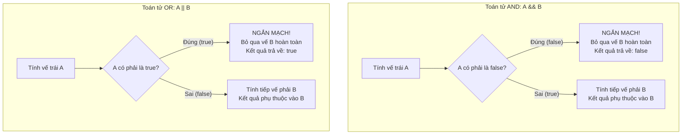

# 6.8 — Toán Tử Logic (Logical Operators)

---

## 🎯 Mục Tiêu Bài Học
- Nắm vững 3 toán tử logic nền tảng: NOT (`!`), AND (`&&`), OR (`||`).
- Hiểu sâu bản chất cơ chế **Đánh giá ngắn mạch (Short-circuit evaluation)** ở cấp độ phần cứng.
- Áp dụng Định luật De Morgan để tối ưu hóa và đơn giản hóa các biểu thức điều kiện phức tạp.
- Nhận diện các cạm bẫy khi đặt biểu thức có side effect vào các toán tử logic.

---

## 1. Tổng Quan Về Các Toán Tử Logic

Toán tử logic nhận các toán hạng kiểu `bool` (hoặc các giá trị có thể chuyển đổi sang `bool`) và trả về kết quả kiểu `bool`.

| Toán tử | Tên gọi | Ký hiệu | Bảng chân trị tóm tắt |
| :---: | :--- | :---: | :--- |
| Logical NOT | Phủ định | `!` | Đảo ngược: `!true` thành `false`, `!false` thành `true` |
| Logical AND | Phép VÀ | `&&` | Trả về `true` **khi và chỉ khi** cả hai toán hạng đều là `true` |
| Logical OR | Phép HOẶC | `\|\|` | Trả về `true` nếu **ít nhất một trong hai** toán hạng là `true` |

---

## 2. Cơ Chế Đánh Giá Ngắn Mạch (Short-Circuit Evaluation)

Đây là một trong những cơ chế quan trọng và quyền năng nhất của C++:



### Ứng dụng sống còn của Ngắn Mạch: Tránh lỗi truy cập bộ nhớ & Crash
Nhờ có short-circuit evaluation, bạn có thể kiểm tra an toàn trước khi thực hiện các thao tác nguy hiểm trong cùng một câu lệnh:

```cpp
// 1. Kiểm tra con trỏ Null trước khi dereference
if (ptr != nullptr && ptr->isValid()) 
{
    // Nếu ptr == nullptr, vế phải ptr->isValid() SẼ KHÔNG BAO GIỜ ĐƯỢC GỌI!
    // Tránh được lỗi Segmentation Fault / Crash chương trình.
}

// 2. Kiểm tra chỉ mục mảng trước khi truy cập
if (index >= 0 && index < arr.size() && arr[index] == target)
{
    // Tránh lỗi truy cập vượt quá biên giới mảng (Out of bounds)
}

// 3. Tránh lỗi chia cho 0
if (divisor != 0 && (num / divisor) > 5)
{
    // An toàn 100%!
}
```

---

## 3. Cạm Bẫy: Biểu Thức Có Side Effects Trong Toán Tử Logic

::: danger ⚠️ Cạm bẫy chết người với Side Effects khi bị ngắn mạch
Xem đoạn mã sau:
```cpp
int x { 1 };
if (x == 1 || ++x == 2)
{
    // ...
}
std::cout << "x = " << x << '
'; // x in ra là 1 hay 2?
```
Vì `x == 1` là `true`, cơ chế ngắn mạch của `||` kích hoạt ngay lập tức. Toàn bộ vế sau `++x == 2` **BỊ BỎ QUA VÀ KHÔNG ĐƯỢC THỰC THI**!
Kết quả: `x` vẫn giữ nguyên giá trị là `1`.

**Quy tắc bất biến**: Tuyệt đối không đưa các biểu thức làm thay đổi giá trị của biến (như `++`, `--`, lời gọi hàm có side effect) vào vế phải của toán tử `&&` và `||`!
:::

---

## 4. Định Luật De Morgan (De Morgan's Laws)

Trong đại số logic, định luật De Morgan cho phép bạn chuyển đổi giữa AND và OR khi có phủ định:
1. `!(A && B)` tương đương với `!A || !B`
2. `!(A || B)` tương đương với `!A && !B`

### Ví dụ áp dụng thực tế:
Giả sử bạn muốn kiểm tra xem người dùng có phải là đối tượng hợp lệ không:
```cpp
// Cách viết phủ định khó đọc:
if (!(age >= 18 && hasTicket == true))
{
    std::cout << "Khong du dieu kien vao cua!
";
}

// Áp dụng De Morgan: !(A && B) => !A || !B
if (age < 18 || !hasTicket)
{
    std::cout << "Khong du dieu kien vao cua!
"; // Trong sáng và dễ đọc hơn rất nhiều!
}
```

---

## 5. C++ Có Toán Tử Logic XOR Không?

Trong C++, không có toán tử `^^` (Logical XOR). Tuy nhiên, bạn có thể mô phỏng toán tử này cực kỳ dễ dàng bằng toán tử so sánh khác `!=`:

```cpp
bool a { true };
bool b { false };

// Logical XOR: Trả về true nếu một trong hai đúng, nhưng không phải cả hai
bool xorResult = (a != b); // ✅ Đúng chuẩn Logical XOR!
```

---

## 📝 Hệ Thống Quiz & Bài Tập Tự Luyện

### Câu hỏi 1:
Đoạn mã sau in ra giá trị gì?
```cpp
int a = 0;
int b = 5;

if (a != 0 && ++b > 5)
{
    std::cout << "Branch 1
";
}
else
{
    std::cout << "Branch 2, b = " << b << '
';
}
```
::: details [Xem lời giải]
- `a != 0` là `false`.
- Cơ chế ngắn mạch của `&&` kích hoạt ngay lập tức: vế `++b > 5` không chạy!
- Điều kiện `if` sai, nhảy vào khối `else`. Giá trị của `b` vẫn là 5.
- In ra: `Branch 2, b = 5`.
:::
