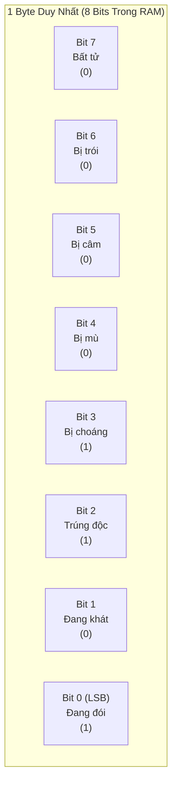

# O.1 — Cờ Bit (Bit Flags) và Thao Tác Bit Với std::bitset

---

## 🎯 Mục Tiêu Bài Học
- Hiểu khái niệm Cờ Bit (**Bit Flags**) và lợi ích tối ưu hóa dung lượng bộ nhớ RAM trong hệ thống nhúng / game engine.
- Làm quen với lớp `std::bitset` trong thư viện chuẩn `<bitset>`.
- Sử dụng thành thạo các phương thức thao tác bit: `test()`, `set()`, `reset()`, `flip()`, `count()`, `any()`, `all()`, `none()`.
- Nắm vững quy ước đánh số bit: từ phải sang trái, bắt đầu từ bit 0 (Least Significant Bit - LSB).

---

## 1. Bài Toán Tối Ưu Hóa Bộ Nhớ: Tại Sao Cần Cờ Bit?

Trong C++, kiểu dữ liệu `bool` chỉ cần 1 bit để biểu diễn giá trị `true` (1) hoặc `false` (0). Tuy nhiên, vì kiến trúc phần cứng của máy tính chỉ có thể gán địa chỉ bộ nhớ cho từng **Byte (8 bits)**, nên biến `bool` thực tế phải chiếm trọn **1 byte (8 bits)** trong RAM!

Giả sử trong một trò chơi nhập vai (RPG), một nhân vật có 8 trạng thái khác nhau:
1. Đang đói (`isHungry`)
2. Đang khát (`isThirsty`)
3. Bị trúng độc (`isPoisoned`)
4. Bị choáng (`isStunned`)
5. Bị mù (`isBlinded`)
6. Bị câm lặng (`isSilenced`)
7. Bị trói chân (`isRooted`)
8. Bất tử (`isInvulnerable`)

Nếu dùng 8 biến `bool` riêng lẻ, bạn sẽ tiêu tốn $8 \times 1 = 8 \text{ bytes}$ bộ nhớ. Nếu trò chơi có 100,000 thực thể quái vật và NPC, bạn lãng phí tới 700 KB bộ nhớ chỉ cho các trạng thái boolean!

Thay vì vậy, chúng ta có thể nén toàn bộ 8 trạng thái này vào đúng **1 byte duy nhất**, trong đó mỗi bit đại diện cho một trạng thái độc lập. Kỹ thuật này gọi là **Cờ Bit (Bit Flags)**.



---

## 2. Quản Lý Cờ Bit Với `std::bitset`

Để làm việc với cờ bit một cách an toàn và trực quan, C++ cung cấp lớp `std::bitset<N>` nằm trong header `<bitset>`. Trong đó `N` là số lượng bit cố định tại thời điểm biên dịch.

```cpp
#include <bitset>
#include <iostream>

int main()
{
    // Khởi tạo một bitset gồm 8 bit, tất cả bit ban đầu là 0
    std::bitset<8> me {}; 

    // Các bit được đánh số từ PHẢI sang TRÁI (Bit 0 ở ngoài cùng bên phải)
    // Thiết lập bit 0, 2, 3 thành 1
    me.set(0); // Đang đói
    me.set(2); // Bị trúng độc
    me.set(3); // Bị choáng

    std::cout << "Trang thai bitset: " << me << '\n'; // In ra: 00001101

    return 0;
}
```

---

## 3. Các Phương Thức Cốt Lõi Của `std::bitset`

| Phương thức | Chức năng | Ví dụ minh họa |
| :--- | :--- | :--- |
| `test(n)` | Kiểm tra bit tại vị trí `n` có bật (1) hay không | `if (me.test(2)) ...` |
| `set(n)` | Bật bit tại vị trí `n` thành `1` | `me.set(4);` |
| `set()` | Bật **tất cả** các bit thành `1` | `me.set();` |
| `reset(n)` | Tắt bit tại vị trí `n` về `0` | `me.reset(2);` |
| `reset()` | Tắt **tất cả** các bit về `0` | `me.reset();` |
| `flip(n)` | Đảo bit tại vị trí `n` ($0 \to 1$ hoặc $1 \to 0$) | `me.flip(0);` |
| `flip()` | Đảo ngược **toàn bộ** các bit | `me.flip();` |
| `count()` | Đếm tổng số bit đang bật giá trị `1` | `std::cout << me.count();` |
| `size()` | Trả về tổng số bit của bitset (`N`) | `me.size();` |
| `all()` | Trả về `true` nếu TẤT CẢ các bit đều là `1` | `if (me.all()) ...` |
| `any()` | Trả về `true` nếu CÓ ÍT NHẤT một bit là `1` | `if (me.any()) ...` |
| `none()` | Trả về `true` nếu TẤT CẢ các bit đều là `0` | `if (me.none()) ...` |

---

## 4. Thực Hành Tốt Nhất: Đặt Tên Cho Vị Trí Bit Bằng Enum

::: tip 💡 Thực Hành Tốt Nhất (Best Practice)
Tránh dùng các con số ma thuật (magic numbers) như `me.set(3)`. Không ai nhớ nổi bit 3 là trạng thái gì! Hãy dùng một `enum` hoặc hằng số `constexpr` có tên gọi rõ ràng:

```cpp
#include <bitset>
#include <iostream>

namespace CharacterState
{
    enum State
    {
        isHungry,       // 0
        isThirsty,      // 1
        isPoisoned,     // 2
        isStunned,      // 3
        isBlinded,      // 4
        isSilenced,     // 5
        isRooted,       // 6
        isInvulnerable, // 7
        totalStates     // 8
    };
}

int main()
{
    std::bitset<CharacterState::totalStates> hero {};
    hero.set(CharacterState::isPoisoned);
    hero.set(CharacterState::isInvulnerable);

    if (hero.test(CharacterState::isPoisoned))
    {
        std::cout << "Anh hung dang bi trung doc!\n";
    }

    return 0;
}
```
:::

---

## 📝 Hệ Thống Quiz & Bài Tập Tự Luyện

### Câu hỏi 1:
Cho bitset `std::bitset<8> b { 0b0000'0101 };`. Sau khi gọi `b.flip(1);` và `b.reset(0);`, chuỗi nhị phân của `b` sẽ là bao nhiêu?
::: details [Xem lời giải]
- Ban đầu: `b = 00000101` (bit 0 = 1, bit 1 = 0, bit 2 = 1).
- `b.flip(1)`: Đảo bit 1 từ 0 thành 1 -&gt; `00000111`.
- `b.reset(0)`: Tắt bit 0 về 0 -&gt; `00000110`.
- Kết quả: `00000110`.
:::
