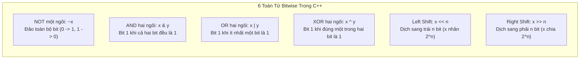

# O.2 — Các Toán Tử Trên Bit (Bitwise Operators)

---

## 🎯 Mục Tiêu Bài Học
- Nắm vững 6 toán tử thao tác trực tiếp trên từng bit:
  - Bitwise NOT (`~`)
  - Bitwise AND (`&`)
  - Bitwise OR (`|`)
  - Bitwise XOR (`^`)
  - Dịch trái (`<<`) và Dịch phải (`>>`)
- Phân biệt triệt để toán tử Bitwise (`&`, `|`) và toán tử Logic (`&&`, `||`).
- Hiểu cơ chế dịch bit số học (Arithmetic shift) vs dịch bit logic (Logical shift).
- Nhận thức nguy cơ Undefined Behavior khi dịch bit số nguyên có dấu âm hoặc vượt quá độ rộng bit.

---

## 1. Bản Chất Các Toán Tử Bitwise

Toán tử bitwise thao tác trực tiếp trên từng bit nhị phân trong bộ nhớ máy tính. Chúng chỉ áp dụng cho **các kiểu dữ liệu số nguyên** (`int`, `char`, `unsigned`, v.v.).



---

## 2. Chi Tiết Từng Toán Tử Bitwise

### 2.1. Toán tử Đảo Bit (Bitwise NOT `~`)
Đảo ngược từng bit của toán hạng: `0` thành `1`, `1` thành `0`.

Ví dụ với số nguyên không dấu 8-bit (`uint8_t`):
```
  ~ 0000 1100 (12)
  = 1111 0011 (243)
```

### 2.2. Toán tử Bitwise AND (`&`)
So sánh từng cặp bit tương ứng. Kết quả là `1` nếu và chỉ nếu **cả hai bit đều là 1**:
```
    0 1 0 1 (5)
  & 0 0 1 1 (3)
  ---------
  = 0 0 0 1 (1)
```

### 2.3. Toán tử Bitwise OR (`|`)
So sánh từng cặp bit. Kết quả là `1` nếu **ít nhất một trong hai bit là 1**:
```
    0 1 0 1 (5)
  | 0 0 1 1 (3)
  ---------
  = 0 1 1 1 (7)
```

### 2.4. Toán tử Bitwise XOR (`^` - Exclusive OR)
So sánh từng cặp bit. Kết quả là `1` nếu **hai bit khác nhau**:
```
    0 1 0 1 (5)
  ^ 0 0 1 1 (3)
  ---------
  = 0 1 1 0 (6)
```

::: tip 💡 Đặc tính siêu việt của phép XOR: Tự đảo ngược chính nó
$$A \oplus B \oplus B = A$$
Phép toán XOR thường được dùng để mã hóa đối xứng đơn giản, tìm phần tử xuất hiện lẻ trong mảng, hoặc hoán đổi giá trị hai biến mà không cần biến phụ:
```cpp
x = x ^ y;
y = x ^ y;
x = x ^ y;
```
:::

---

## 3. Toán Tử Dịch Bit: Dịch Trái (`<<`) và Dịch Phải (`>>`)

### 3.1. Dịch Trái (`<<`)
Khi thực hiện `x << n`:
- Toàn bộ các bit của `x` được dịch sang bên trái `n` vị trí.
- Các bit ngoài cùng bên trái bị rơi ra ngoài và biến mất.
- Các vị trí trống mới sinh ra ở ngoài cùng bên phải luôn được **lấp đầy bằng số 0**.
- **Ý nghĩa toán học**: Dịch trái $n$ bit tương đương với phép nhân số nguyên với $2^n$: $x \times 2^n$.

```
  0000 0101 (5) << 1
= 0000 1010 (10)
```

### 3.2. Dịch Phải (`>>`)
Khi thực hiện `x >> n`:
- Toàn bộ các bit dịch sang phải `n` vị trí. Các bit ngoài cùng bên phải bị rơi ra.
- Với số nguyên không dấu (**Unsigned** - Logical shift): Các vị trí trống bên trái luôn được điền số `0`.
- **Ý nghĩa toán học**: Dịch phải $n$ bit tương đương với phép chia nguyên cho $2^n$: $\lfloor x / 2^n \rfloor$.

---

## 4. Cạm Bẫy Thực Chiến & Undefined Behavior (UB)

::: danger ⚠️ Cạm Bẫy 1: Dịch Bit Với Số Âm và Dịch Quá Số Lượng Bit
1. Dịch số bit âm: `x << -2` hoặc `x >> -1` là **Undefined Behavior (UB)**!
2. Dịch số lượng bit lớn hơn hoặc bằng kích thước kiểu dữ liệu: Nếu `x` là `int` 32-bit, thì `x << 32` hoặc `x << 35` là **Undefined Behavior (UB)**!
3. Dịch trái một số nguyên có dấu làm tràn bit dấu (Signed Overflow) là **UB** trước C++20.
:::

::: warning ⚠️ Cạm Bẫy 2: Nhầm Lẫn Giữa Bitwise (`&`, `|`) và Logic (`&&`, `||`)
- `5 && 2`: Cả 5 và 2 đều khác 0 (là `true`), nên `true && true` cho ra `true` (`1`).
- `5 & 2`: Biểu diễn nhị phân $0101_2 \ \& \ 0010_2 = 0000_2 = 0$.
Hai kết quả hoàn toàn trái ngược nhau!
:::

---

## 5. 🚀 Cập Nhật C++20: Thư Viện `<bit>` Siêu Tối Ưu

C++20 bổ sung thư viện `<bit>` tận dụng trực tiếp các chỉ thị CPU tốc độ cao (như lệnh `POPCNT`, `BSF` trên x86):
```cpp
#include <bit>
#include <iostream>

int main()
{
    unsigned int x = 0b0000'1000'0000'0000;

    // Đếm số bit 1 (Population Count)
    std::cout << "So bit 1: " << std::popcount(x) << '\n'; // 1

    // Đếm số bit 0 liên tiếp từ bên trái (Leading Zeros)
    std::cout << "Leading zeros: " << std::countl_zero(x) << '\n';

    // Xoay bit vòng tròn (Bit rotation)
    unsigned char val = 0b1000'0001;
    std::cout << "Rotate left: " << (int)std::rotl(val, 1) << '\n'; // 00000011

    return 0;
}
```

---

## 📝 Hệ Thống Quiz & Bài Tập Tự Luyện

### Câu hỏi 1:
Giá trị của biểu thức `1u << 3` là bao nhiêu?
::: details [Xem lời giải]
`1u` là số 1 kiểu unsigned ($00000001_2$). Dịch trái 3 bit: $00001000_2 = 2^3 = 8$.
:::

### Câu hỏi 2:
Không dùng phép nhân `*`, hãy viết hàm nhân một số nguyên dương `x` với 10 bằng cách kết hợp dịch bit `<<` và phép cộng `+`.
::: details [Xem lời giải]
Ta có: $x \times 10 = x \times (8 + 2) = (x \times 8) + (x \times 2) = (x \ll 3) + (x \ll 1)$.
```cpp
constexpr unsigned int multiplyBy10(unsigned int x)
{
    return (x << 3) + (x << 1);
}
```
:::
